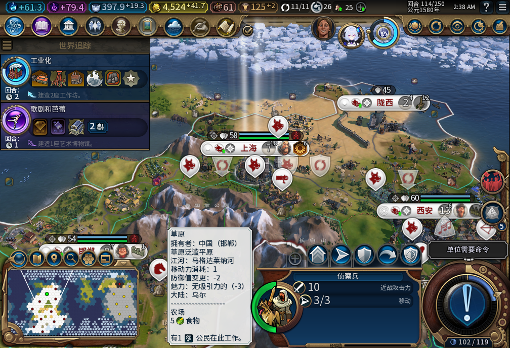
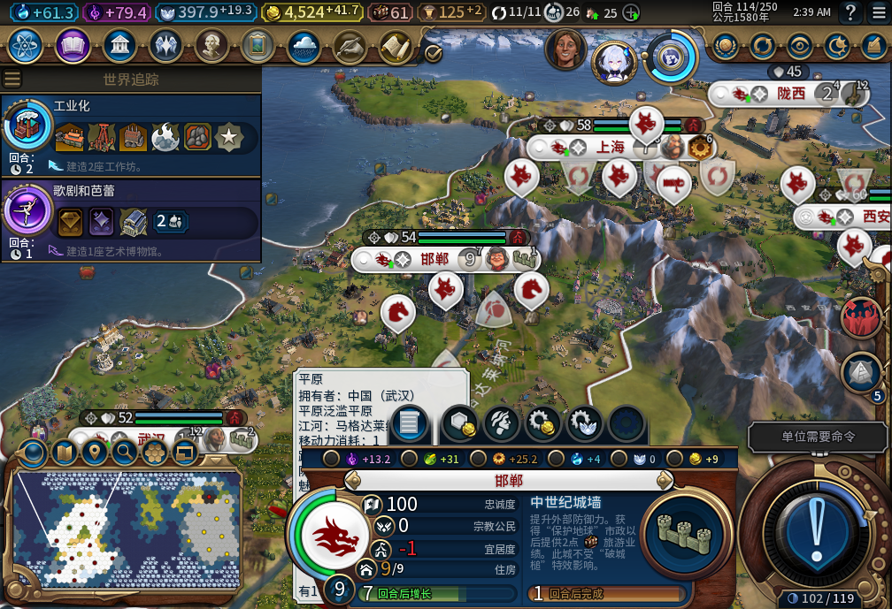
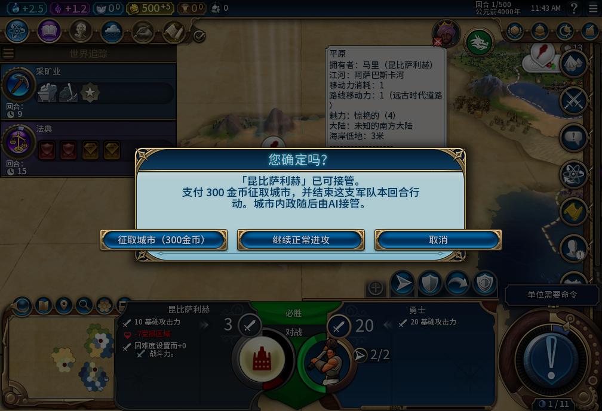

# civ6_dev

[111正式冷验／运动会开关重开三图](docs/testing/baiqi-worldcrisis111-cold210.md)：113文件匹配、新鲜后台离线后冷启；原入口自动适配，2次物理确认／2次实际关闭、真正重开尺寸保持。十城food／vitals保持，邢州8人净0，210已存未载，0END／Steam上线；工坊82未更。

[111模块原入口预验／两图](docs/testing/baiqi-worldcrisis111-hook210.md)：真实竞赛数据触发三次刷新，模块自动适配，动画中段原图保留、1.2秒后稳定全框可见；两轮15控件／函数／配置精确还原。Native列表key0被owner误作dense1的前置检查已纠正、0回调前失败。正式111冷装／真正关闭重开待验，0END／Steam上线，工坊82保持。

[111世界危机适配／软件](docs/testing/baiqi-worldcrisis-viewport-111.md)：保留原竞赛数据／外交选择／动画，六控件高度适配，完整预检与失败回滚；8新方法、相关17、完整1653（1SDK skip）通过，91Lua51／113包。运行110／210，模块入口预验和冷装待做，Steam离线、工坊82保持。

[210运动会小窗口预验／三图](docs/testing/baiqi-worldcrisis210-preview.md)：实际689视口中六处高度调整，确定630..671／关闭0..34完整；原版滚动条0→1→0、奖励末尾可读。合成滚轮无效不授验。15控件及滚动值已精确还原，原popup仍开，正式适配待做；0END／Steam上线，工坊82保持。

[110正式冷验／208—210实机](docs/testing/baiqi-food110-cold208-210.md)：新鲜后台离线后冷启，原缺粮208只载一次，正式后台1交换救粮；两普通回合后仍8人口／净0，30城帧food与忠诚保持。210运动会真实弹窗继续裁切，待修；已正式存档未载。Steam0上线，工坊82未更。

[110救粮后台预验／三图](docs/testing/baiqi-food110-preview208.md)：现有109／208下1次后台交换，地块实际归属、专家2→1、新粮格1人，邢州15→16粮食／净−1→0／饥饿2→−1；西安净16、十城队列Hash保持。原版面板先缓存，切城后实图刷新。73次Admin、0END，预验已精确撤并存档；正式110冷读／跨回合／重载仍待验。Steam离线、工坊82未更。

[110救粮分配／软件检查](docs/testing/baiqi-food-tile-rescue-110.md)：新增托管取用邻城工作范围外闲地，9方法及89Lua51通过、111文件包；首跑全量18版本门错误已修，相关复查通过，未称全量重跑。运行仍109／208，实际救粮与跨读档待验。Steam离线、工坊82保持。

[109新FAIL／208实机图](docs/testing/baiqi-food208-starvation.md)：邢州已粮食优先但净粮食−1，两回合后掉人口，停END208并正式存档。相邻闲置地块仅作未执行候选，救粮待修；605观察器已精确撤掉，三条全是显式只读检查，0自然目标样本。Steam离线，工坊82未更。

[109告警审阅与被动队列工具](docs/testing/baiqi-move-warning-audit-109.md)：3处新改良效果保留、演员归因未知；9MOVE中3条有后续同演员到原目标证据，不判引擎已拒绝。连接表两处按实际行序纠正，605原模块语法及6隔离反例整拒；负责人工具8方法通过，尚未接实机。游戏206／十城，0新END／Steam上线，旧FAIL／全矩阵保持。

[109实机186—206／九张原图](docs/testing/baiqi-continuous-window-109-186-206.md)：20实际回合、196城帧，9→10城上海，23建筑／7普通区域／3配对改良；受损娱乐中心及竞技场已修，动物园仍修复。33普通END／79玩家待命／0人工内政。12条未观察到请求告警、旧恢复FAIL、水坝施工／性能／全矩阵仍开；观察器已撤，206已存未载。Steam离线，工坊82未更。

[109正式冷读与伟人页／七图](docs/testing/baiqi-cold109-great-people186.md)：新鲜后台离线后启动，5组自有状态与9food／vitals保持，2建造者新MOVE有配对回执。原版开／切页／重开尺寸保持，末段API可看；物理滚轮横移仍未通过，单布尔可还原实验无效且已清理，负责人过早输入归因撤回。0END186／Steam上线，继续正常水坝验收，工坊82保持。

[109本地冷验准备：186正式保存1709262字节／0da97d…并保留旧186备份；自有106正常退出后残留超180秒，核0窗口／0监听／2秒CPU不变后仅清理PID25384。109已安装、109文件字节一致，游戏未重启；新后台只读Steam模式unavailable，暂停冷启动和上传，Steam与其他游戏未关闭。](docs/research/baiqi-p6-source109-cold-ready-evidence-2026-11-10.json)

[109水坝必需地貌修正](docs/testing/baiqi-dam-required-features-109.md)：仅水坝允许原版三类洪泛平原，双边界重检；新增9方法通过，旧108有13子场景断言失败。首跑1628有2构建版本错误，负责人修后相关8方法全过，87Lua51／109包。现有106只读函数预验18格、水坝交集0→1；未装109／未开工，Steam禁上线，工坊82保持。

[186城市边界与选址／两图](docs/testing/baiqi-city-amenity186-diagnosis.md)：两城文字当前在视口内，原版背景底边越5px；北京18自有可见格，保护通过6／娱乐中心原生合法4／交集0。水坝洪泛平原必需条件被通用地貌门排除，新缺口继续修；当前移民队列保持，0END186／Steam上线，工坊82未更。

[108可还原预验／六图](docs/testing/baiqi-gp108-preview186.md)：现有106／186实例，7次Applytrue，原版历史／当前／重开回调3次均过；传记滚动0→1与返回可见。75项及回调全还原，原版另重开9卡768／670，前后六组自有状态、9food／9vitals及186存档一致。仅预验通过，安装冷验／宽视口／CityPanel与旧恢复FAIL继续，0新进程／0Steam上线，工坊82不变。

[108句柄缓存修正／软件](docs/testing/baiqi-great-people-handle-cache-108.md)：改记成功高度，原XML／上次合法尺寸重验；Native别名和原池重置两回归在107各触发Lua断言，108八方法／相关38通过，全1618pass1SDKskip、87Lua51／109包。安装实机仍106／186，108预验与冷安装待做，Steam禁上线不新启；旧恢复FAIL／CityPanel／全矩阵继续。

[107可还原预验／重复应用FAIL](docs/testing/baiqi-gp107-preview186-reapply-fail.md)：106现有实例9卡首次适配689，原传记／历史可见；同控件GetChildren句柄==true但表键查不到，重复Applyfalse，缓存待修。75项已还原并原版关闭，0END186／0新进程／0Steam上线。Timeline原版字段勘误，592仍因局部表当全局等拒绝；源码107未改，软件绿不覆盖NativeFAIL。

[107伟人页布局／软件](docs/testing/baiqi-great-people-viewport-107.md)：689高适配并保留招募152区与费用行，原768恢复／实例池／失败整页预检／wrapper接线6新方法，相关36通过；全1616pass／1SDKskip，87Lua51／109包。安装实机仍106／186；新只读Steam模式查询不可用，0新进程／0上线，先做可还原预验。CityPanel／旧恢复FAIL与全矩阵继续，工坊82不变。

[106实机166—186／六张原图](docs/testing/baiqi-continuous-window-106-166-186.md)：20实际回合／174城帧，8→9城武汉，19建筑／6普通区域／7处配对改良；TC-037本GS场景通过。33普通END／63玩家军队待命／0人工内政。广州183竞技场完工但仍缺1；GP689对768裁切实测FAIL，负责人草稿5检查未入产品。186已存未载；旧恢复FAIL／全矩阵继续，Steam禁上线，工坊82保持。

[106完成态172正式重载／原图](docs/testing/baiqi-completed-reload-172-106.md)：竞技场与8／8宜居度、大学队列保持；世界／8城／52建筑／31区域／130地块、8food与120宜居分项相同。33单位身份同，1建造者继续移动，不称全世界不变。两时效拒绝0输入后复拍比对、唯一继续；旧未知恢复未闭，Steam禁上线工坊82。

[106实机166—172／七张原图](docs/testing/baiqi-amenity-native-106-166-172.md)：三城后台开娱乐中心，西安170完工接竞技场、172竞技场完成达8／8后排大学；娱乐来源+3与奢侈品+1分账。冷读六组相同，6实际回合／11普通END／16军队待命／0人工内政；观察1471零错丢已撤，172已存未载。其余缺口／旧恢复FAIL继续，Steam禁上线工坊82保持。

[106宜居度排序／软件](docs/testing/baiqi-amenity-production-106.md)：持续缺口≥2时合法娱乐设施至少94，保留基础生产、原版费用资格及已有队列；9新检查，完整1611中1610pass／1SDKskip，86Lua51／108包。首次18对照构建版本错误已修，ZIP前缀辅助错误另核。尚未安装实测，运行105／166；Steam禁上线工坊82保持。

[105使徒QA166—167／三张原图](docs/testing/baiqi-apostle-actions-qa-105.md)：两名调试授予使徒经原版按钮回调分别完成传道信仰与发起宗教审讯，后台补第三信条，167两侧审讯开启。已正式返回原166主线／8城31单位／两信条，QA结果未带入。不是正常采购或物理按钮通过；旧恢复FAIL／完整矩阵继续，Steam禁上线工坊82保持。

[105完成态165正式重载／新原图](docs/testing/baiqi-completed-reload-165-105.md)：8城／45建筑／28区域／124地块与7商路、8food、完成账本保持；30完整单位身份相同，1建造者继续移动，不称六组全同。发现原生FindID可返回复用槽位新演员，诊断按完整ID修正；未知MOVE持久化仍待审，旧ARMED恢复FAIL未闭。Steam禁上线工坊82未更。以下历史切点。

[105连续20回合145—165／5张原图／逐城表](docs/testing/baiqi-continuous-window-105-145-165.md)：本场景TC-037通过，21帧157城市行、18新建筑／5普通区域／7配对改良、7→8城；0人工内政／UserForced。160国内8城佛教多数，161无目标不续购；165已存未载。旧ARMED恢复FAIL、宜居度／小视口／其余矩阵继续，Steam禁上线工坊82未更新。以下历史切点。

[105北京最后一次传播144／实机原图](docs/testing/baiqi-missionary-beijing-final-105.md)：第二名传教士转往北京并耗尽，Core与UI回执完成；北京仍佛教4/11、未转教，不冒充信徒增加。144已存未载；后台观察809零错丢仍挂，宜居度／小视口／旧移民FAIL及完整40项继续。Steam他机占用禁上线，工坊82未更新。以下历史切点。

[105读档后续传教／首都转教141原图](docs/testing/baiqi-capital-religion-postreload-105.md)：新3670037后台三MOVE加一传播，3→2／新OBSERVED；首都佛教5→6、原生多数-1→1，宗教页列4城。不按6/12推多数，不量化压力贡献。141已存未load、7food／忠诚保持，观察140零错丢仍挂；旧移民FAIL／40项继续，Steam禁上线工坊82。以下历史切点。

[SDK离线单项补验](docs/testing/baiqi-official-sdk-offline-reference-check.md)：完整1598原运行1597通过1引用环境跳过；现有SDK单项另跑1方法／20辅助函数断言通过，0上传器Main／SteamAPI.Init，未重跑全套。以下开发进度。

[105正常续购／140正式重载／两原图](docs/testing/baiqi-missionary-normal-purchase-reload-105.md)：仅1次新购买80信仰，394.4297→314.4297，新3670037／3次／0行动／OBSERVED，旧70记录保持。完成140正式存读后六组自有行、7food／followers及原日志全同，无额外所测单位／扣款。续购与完成态读档窄过，全部观察器已撤，新传播／旧移民FAIL／40项继续，Steam禁上线工坊82。以下历史切点。

[105冷实机最后一次收尾／两原图](docs/testing/baiqi-missionary-final-charge-native-105.md)：同138前置普通139仅一次SPREAD，宗教记录自动OBSERVED、UI唯一core_final_charge_receipt确认，余额383.425与104失败六组自有样本保持。收尾窄过，完成139已存未重载，正常新购买／旧移民FAIL／完整40继续，观察器仍挂。Steam禁上线工坊82。以下历史切点。

[105最后一次传播回执修复／软件](docs/testing/baiqi-missionary-final-charge-105.md)：基于104真实Core/UI事件，精确SPREAD开始+次数1→0配对并复核原记录／演员，缺事件旧ARMED保持未知；UI缺失演员只接匹配Core完成态。新增13项、完整1598项1597pass1SDKskip，86Lua51／108包，尚未安装实机。104139FAIL及138前置已保留，Steam禁上线工坊82。以下历史切点。

[104实机国内传播／三原图／139新FAIL](docs/testing/baiqi-domestic-spread-and-final-charge-104.md)：137、138实际传播3→2→1及两OBSERVED，139最后一次发令后删除对象0次数／-9999坐标但ARMED。已停END139保存、两观察器撤除，收尾修复继续；首都佛教1→3→4→5仍非多数，压力贡献不冒领。28food／28忠诚保持，Steam禁上线，工坊82。以下历史切点。

[104冷实机回执恢复／新原图](docs/testing/baiqi-missionary-cold-recovery-104.md)：同136失败档ARMED自动变OBSERVED，原单位3407893／信仰351.414保持、无重复付款，7城与自有状态逐行核对；恢复窄过，正常104新采购及国内传播待验，136恢复点已另存。Steam他机占用禁止上线，工坊仍82。以下历史切点。

[104传教士回执修复／103实机FAIL两原图](docs/testing/baiqi-missionary-birth-receipt-104.md)：神社136完工，一次70信仰购买实际出生传教士，但圣地出生54,37与市中心56,38不符使日志ARMED。已存136／0END，未授采购回执或传播。104严格本城区域／地块匹配与新鲜复核，8新＋原23项检查，完整1577项1576通过1SDK跳过、86Lua／108包，尚未安装冷验。观察器全部撤除，Steam禁上线，工坊仍82。以下历史切点。

[103神社实机开工133／新原图](docs/testing/baiqi-shrine-start-and-followers-133.md)：原移民正常完工后后台一次排入神社0/35／3回合，开工窄过；已保存未重载，采购／传播继续。131／133七城信徒基线、无宗教-1修正与7项工具检查上库，零传教士时邢州自然转教不能算后台传教成功。观察787零错丢仍挂，Steam禁上线，工坊仍82。以下历史切点。

[103冷读128／新原图](docs/testing/baiqi-shrine-cold-readback-103.md)：7队列／20建筑／19区域／94地块／17单位、世界宗教经济及7城粮食逐行保持，邯郸移民33/130，佛教两信仰与先知完成日志保持；仅完成态冷读窄过，神社／采购／传播继续。Steam新鲜后台离线后启动，0上线或上传，工坊仍82。以下历史切点。

[103神社排产优先级／软件](docs/testing/baiqi-shrine-production-103.md)：合法神社40→91，原队列与必要生产保持、祷告同分仍先；4新检查，完整1562项1561通过1SDK条件跳过，86Lua51／108包。103尚未安装或实测，102的128回合已保存，7城、神社缺失／无传教士，后续冷验继续。观察器4096条／13丢弃如实记录且已撤。Steam禁上线，工坊仍82。以下历史切点。

[102正常创教实机／两张新原图](docs/testing/baiqi-normal-religion-founded-122.md)：111祷告开工→116完工，本样本多出32先知点→120正常点数招募→121到圣地→122自动创立佛教并选职业道德／什一税。正常链窄过；神社未建、传教士0，采购／国内传播继续验收，保存已校验但未重载。72food非负无饿，0Steam上线上传，工坊仍82。以下历史切点。

[102实机祷告开工111／原图](docs/testing/baiqi-normal-prayer-start-111.md)：邯郸106→111完成圣地，后台正常排入圣地祷告者0/68，自身44/+4、先知122未领取；开工窄过，完工奖励／招募创教未过，111已保存0END111。6城food与忠诚保持；570只读观察器12软件检查通过、尚未实机订阅，0上线上传，工坊仍82。以下历史切点。

[102冷实机伟人数字／两张原图](docs/testing/baiqi-great-people-native-numbers-102.md)：103中国先知12/60、每回合4，原版查看及白绮只读窄通过；小视口布局未通过。一次游戏显示切换报错后，从同一103保存点恢复窗口模式；自有六组状态保持，故障如实留证。真实早期99→103四回合／25食粮／22文职调用，尚未招募或创教。Steam禁上线，工坊仍82。以下历史切点。

[102伟人招募进度修复／软件](docs/testing/baiqi-great-people-standings-102.md)：仅白绮原版明确空列表补读公开点数，保留已有数据；12新回归及完整1546项1545通过1SDK条件跳过，86Lua／108文件。尚未安装实机，数字显示／小视口布局／宗教整链未通过；运行101早期分支，Steam禁上线，工坊仍82。以下历史切点。

[101实机原图／部分通过与显示FAIL](docs/testing/baiqi-great-people-native-partial-101.md)：伟人页可打开关闭且白绮只读，但进度X/Y、底部截断，整页未通过；公开枚举为空的替代读取正在修复。187负例另存，真实早期99分支已载入，先知122未领取、自身0/+0，祷告／招募／创教仍未通过。568只读诊断23项通过。Steam禁上线，工坊仍82。以下历史切点。

[101伟人页加载修复／软件验证](docs/testing/baiqi-great-people-view-101.md)：恢复主体及扩展加载，保留白绮禁写和普通领袖行为；8项回归、完整1531项1530通过1SDK条件跳过，85Lua／107文件。冷实机仍待验，100的187负例已保存；祷告奖励／先知招募未通过。Steam禁上线，工坊仍82。以下为历史切点。

[100冷实机187负例／原图](docs/testing/baiqi-empty-prophet-and-gp-ui-fail-100.md)：186保留自有状态，187当前先知类无个体；公开历史122已被玩家1在186领取，自己42点/+1无先知，祷告奖励／招募未通过。另确认伟人页主体缺失、查看事件ACK未打开，UI查看FAIL修复中。18food18loyalty／269观察已撤，187保存0END187；Steam禁上线，工坊仍82。以下历史切点。

[100正常祷告项目排产软件](docs/testing/baiqi-prayer-project-production-100.md)：未创教／未有先知且公开机会已知、圣地完整时项目排序1→91；原队列及建造者／粮仓等优先级保持，全帝国承诺及最终复核，未知请求不重发。26新回归通过，旧99二十／原稿十九失败事件；完整1503项1502pass1SDKskip、85Lua51／107包。100未安装或实机，运行99主186；实际项目奖励／先知创教／旧恢复FAIL／完整40继续，Steam禁上线、公开Alpha2仍82。以下历史切点。

[99圣地实机／七普通回合／两张原图](docs/testing/baiqi-first-holy-site-native-99.md)：太原182开建、185完工接灯塔，186先知点40→41／+1，正式存读保持；冷读179与186完成态均核对自有状态。7普通END／45玩家待命、72food／72loyalty，1846观察185已撤；0手补宗教。首座建设与产点窄通过，创教／传教／旧恢复FAIL／完整40保持。源码安装实机99，Steam外机占用0上线或上传，公开Alpha2仍82。以下为历史切点。

[99首座圣地生产修订](docs/testing/baiqi-first-holy-site-production-99.md)：自有未创教且先知机会已知、全帝国无已建／放置／排队／未决圣地时，首座排序35→92；现有队列与粮仓／移民／建造者优先级保留。23新回归旧98十四失败、新全过，完整1457项／1SDK条件跳过，85Lua51／107文件。99尚未安装或实机，运行98主179；宗教整链／旧恢复FAIL／完整40仍开放，Steam外机占用禁上线，公开Alpha2仍82。以下为历史切点。

[98正常建城实机／独立173→176](docs/testing/baiqi-source98-natural-founding-176.md)：1次后台FOUND实际8→9城，陇西1人口／粮仓0→3/32／忠诚100+17，原移民176在UI与Core均消失、OBSERVED新请求0:175:18。34food/34loyalty保留，655观察已撤；3实际回合/5普通END/15玩家待命，独立176已另存并返回179主线。正常路径窄通过，暂时资格拒绝路径仍仅软件证据，旧恢复FAIL／宗教／完整40保持。Steam持续0上线或上传，公开Alpha2仍82。以下为历史切点。

[561更正：秀容原图是4回合](docs/testing/baiqi-cityui561-image-reading-correction.md)：负责人误读小字造成错误缺陷判断；原图放大、三次CityPanel只读和控件／数据／队列均4，原PNG未修改，已修正文档与BBCode，不作产品补丁。真实旧恢复／宗教／完整40缺口保持。

[98冷读176→179／四张原图](docs/testing/baiqi-source98-cold-followup-179.md)：冷读自有记录与97末176逐项保持，实际3普通回合／4END／15玩家军队待命，九城36食粮与忠诚样本保留；陇西粮仓3→14/32、长沙8人口，177洪水总损1与首都16→15→16另记，广州净粮食0。秀容原图实际4回合，初次误读1已撤回，原生／控件均4。观察784条／12单位调用全自有建造者，179撤除并保存；旧恢复、宗教、完整40仍开放。Steam新鲜后台离线证明后启动，0模式切换或上线上传，公开Alpha2仍82。以下为历史切点。

[98同回合尚未发出的建城请求修复](docs/testing/baiqi-live-unissued-found-98.md)：新鲜确认的内存闭包可同回合重验后首次发令；旧ARMED／读档／跨回合不授重发。23新回归旧97有14失败，新全过；完整1412项／1411pass／1SDKskip，107文件85Lua51。98尚未安装实机，运行97主线176已另存；旧恢复FAIL、宗教、完整40仍开放，Steam外机占用禁止上线或上传，公开Alpha2仍82。以下为历史切点。

[97陇西176正式存读档／新原图](docs/testing/baiqi-longxi-completed-reload-97.md)：9城粮食18行前后一致，陇西1人口／粮仓3/32／忠诚100+17与OBSERVED条目保持，世界经济/9队列/56建筑/33区域/139地块相同；两名建造者继续移动，不称全世界不变或引导0发令。完成态窄通过，旧未决恢复／宗教／完整40仍开放。Steam外机占用，0私自上线或上传，工坊仍82。以下均为历史切点。

[97自然建陇西／实际建城前警告](docs/testing/baiqi-natural-longxi-and-prefound-warning-97.md)：自然训练4063259于175建第9城陇西，176粮仓0→3/32、忠诚100／+17。一次实际发令前采样UNKNOWN/nil保留，既有记录OBSERVED对应589832，目标0／演员消耗另核；不关闭旧负例或未决恢复。12新诊断方法＋10相关检查、5只读回调场景通过，工具不入mod包，176已存未load。前轮5内嵌图已公开GET200/hash一致；完整40仍开放，Steam占用禁上线、工坊仍82。以下均为历史切点。

[97续验20回合／5张新原图](docs/testing/baiqi-food-focus-long-window-97.md)：实际153→173，中途154正式存读档一次；长沙4→7人口，160行全城食粮样本无饥饿倒计时，168行忠诚样本均100正变化。17建筑／7区域完成，8处新改良；新移民仍在途，广州末样本净粮食0。29普通END／92玩家待命，议会实际结果与投票分账；观察器4629条0错0丢、全部撤除，173已保存未load。宗教／旧恢复／完整40仍开放，Steam外机占用禁私自上线，公开Alpha2仍82／12图。以下均为历史切点。

[97粮食冷实机／三张原图](docs/testing/baiqi-food-focus-native-97.md)：同153饥饿档自动粮食侧重，净粮食−1→+5，154保住人口4（96同档掉3），产能11.70→8.10；154保存重载八城粮食状态保持。一名建造者继续排队移动，不声称全世界不变。154起后续窗口继续，旧FAIL／完整40未闭；Steam占用禁上线，公开Alpha2仍82／12图，GitHub已补饥饿风险及两图。以下历史切点。

[97粮食侧重软件修复／96两图负例](docs/testing/baiqi-food-focus-97.md)：独立同档153粮食−1/饥饿1，普通154人口4→3，已保存饥饿前153；未工作3粮农场存在。97后台两阶段合法粮食侧重，16新方法旧96八失败／新全过，完整1375pass1SDKskip、107文件85Lua51。尚未安装／实测97，冷验继续，完整40未通过。Steam占用禁止私自上线，Alpha2仍82／12图。以下历史切点。

[96冷实机／三张原图](docs/testing/baiqi-early-governor-native-96.md)：同152失败档自动提前派总督，秀容−2.6875→+5.3125、胶东保持+18；四普通回合后秀容人口2且八城忠诚100正变化。长沙人口4→3→4原因未定，已停END156、撤钩保存并继续复现；完整40未通过。Steam占用禁止上线，公开Alpha2仍82／12图。以下均历史切点。

[96提前总督救援的软件修复](docs/testing/baiqi-early-governor-96.md)：负忠诚自有城市不再等降至75，调出城安全及目标严格扭正仍必需。新8方法旧95四失败／修订全过，完整1359pass1SDKskip、105文件83Lua51。尚未安装／实测96；95秀容FAIL及完整40保留。Steam占用禁止私自上线，Alpha2仍82／12图。以下均历史切点。

[95续验／6张实机图](docs/testing/baiqi-warning95-followup152.md)：农场学院147完工；新建秀容152忠诚100但每回合−2.6875，扩张稳定仍FAIL，已停END并保存。138—152的106行队列／106行城市状态已入库；提前总督干预继续修复，完整40未通过。Steam他机占用，禁止私自上线；公开Alpha2仍82／12图。以下均历史切点。

[95冷实机：139拒绝旧坏城址、保留移民并改道](docs/testing/baiqi-native-negative-warning-live-95.md)。同138存档、七城保持，观察窗口移民2移动0建城、既有生产继续。新目标与长期稳定继续验收，旧FAIL／完整40未闭。Steam保持离线且他机占用禁上传，Alpha2仍82／12图。以下为历史切点。

[95负忠诚警告守卫的软件修复](docs/testing/baiqi-native-negative-warning-95.md)：94独立复现138在建城前实际读到目标−6；新13项对旧版8失败、95全过，完整1351通过／1SDK跳过、105文件。尚未安装／实测95，上海139FAIL保留；Steam他机占用禁上线，Alpha2仍82／12图。以下为历史切点。

[94实机新FAIL：139上海每回合忠诚−9.5625，五张原图](docs/testing/baiqi-shanghai-negative-loyalty-native-94.md)。已停止结束并保存现场，正在修复诊断。太原100／+17与130完成态读档窄通过不能覆盖此风险；完整40项未通过。Steam他机占用，禁止上线上传，Alpha2仍82／12图。以下保留历史切点。

[94太原130完成态读档已核对](docs/testing/baiqi-rainforest-completed-reload-94.md)：七城十八单位及所采集生产／建筑／区域／己方地块保持，太原忠诚100／+17。旧未决恢复和长期保城仍未通过；宗教130先知点40／每回合0、七城无圣地。Steam他机占用，持续禁止上线与上传。下文各“当前”保留历史切点。

当前源码／安装／实机94。[雨林建太原与黑暗时代130，4张原图](docs/testing/baiqi-rainforest-dark-age-native-94.md)：太原粮仓3/32、忠诚100／+17；广州粮仓与纪念碑完工、人口2、100／+18。130已保存，长期、旧恢复和完整40项仍开放。Steam他机占用，禁止上线／上传；公开Alpha2仍82／12图。

[Alpha 2已在GitHub预发布](https://github.com/XenoAmess/civ6_dev/releases/tag/v0.1.0-alpha.2)，[安装与风险](docs/releases/v0.1.0-alpha.2/README.zh-CN.md)，含[12张实机的逐图解读](docs/workshop/v0.1.0-alpha.2/screenshot-commentary.md)、BBCode、独立宣传封面与明确风险。**Steam已同步Alpha2内部82／12图**，93个文件实际下载核对一致，客户端已恢复并只读确认离线。下列开发条目保留各历史切点，旧“尚未开始／当前”不能覆盖最新记录。

- [82全新开局首都与两张实机图](docs/testing/baiqi-newgame-first-capital-82.md)：false新局标志、自动建西安、纪念碑0→4/60及第2回合正式重载窄通过。中途保存续建与旧档扩张缺口仍在，工坊Alpha74未更新。

- [82自然建城与中途保存失败窗口（3张实机图）](docs/testing/baiqi-settlement-lifecycle-recovery-82.md)：156建成太原、157粮仓7/32；非空ARMED确实入档，但重载后的存活移民经过两个普通回合仍未续建，完整恢复未通过。

- [82冷启动、空日志与两张实机图](docs/testing/baiqi-settlement-native-init-82.md)：UI／Core完整读回及普通保存／重载后世界核对；空日志可能重建，尚不能授持久意图或未决建城恢复通过。

- [82建城持久授权软件](docs/testing/baiqi-settlement-persistent-82.md)：Core一次授权、读档恢复枚举、前端授权后复核已接线；完整1153项软件通过，93文件包。82冷实机尚未通过；未知移民继续等待。

- [81日志与Core存储组件](docs/testing/baiqi-settlement-storage-81.md)：45个合同子场景、完整1132项软件通过、89文件包；尚未接实际发令／恢复入口，实机仍80，不能称中途恢复通过。

- [建城中途恢复的Core／UI接口核对](docs/testing/baiqi-settlement-recovery-boundaries-80.md)：Core可读已知城址与可见性，但没有IsSavedGame；两份候选已拒，持久协议仍未实现，不将完成后读档升级为中途恢复通过。

- [80同一名新移民完整窄链：长沙、初期生产与148正式重载](docs/testing/baiqi-natural-settler-founded-80.md)：147一次建城，148粮仓3/32与忠诚100／+20保持，三张新原图；未决动作持久恢复、长期质量及完整40项仍未闭，工坊仍Alpha74。

- [80正常训练与实际人口成本，三张原图](docs/testing/baiqi-natural-settler-training-80.md)：益阳自动训练190产能，142新移民7929900出生、人口14→13并接续下水道；安全路线与建城继续验，工坊仍Alpha74。

- [80双场景实机与三张原图](docs/testing/baiqi-known-border-native-80.md)：坏城址保留移民等待，有己方支撑处自动建九江，138粮仓3/32与正式重载保持；保守筛选及短窗口不等于长期保城，工坊仍Alpha74。

- [80保守边境筛选的软件修复](docs/testing/baiqi-known-border-screen-80.md)：22新增回归、完整1130通过；原坏目标与有支撑目标冷实机待做，不能据此关闭忠诚失城FAIL，工坊仍Alpha74。

- [79同档建城回执、生产与175正式重载](docs/testing/baiqi-found-city-receipt-native-79.md)：实际1次建城正确observed，附2张新实机图；忠诚54／每回合−23及选址缺口仍在，工坊仍Alpha74。

- [79建城回执软件修复](docs/testing/baiqi-found-city-receipt-79.md)：24新增回归、完整1108项通过；冷启动实机待做，忠诚选址缺口仍开放，工坊仍Alpha74。

- [78临淄178实际叛离，两张实机图](docs/testing/baiqi-new-city-loyalty-loss-78.md)：173建城、175忠诚54、177为8、178实际变为自由城市。扩张选址质量记FAIL，继续修复；工坊仍Alpha74。

- [78同档绕行建城、六张实机图与忠诚风险](docs/testing/baiqi-settler-detour-native-78.md)：173建第16城、粮仓自然产能和175正式重载保持；成都港口／九江工业区已完成。新城每回合忠诚−23及建城回执缺口仍未关闭，工坊仍Alpha74。

《文明 VI》新领袖【白绮】，能力【为我前驱】：内政、生产、建造与和平扩张强制由 AI 执行，玩家查看城市、指挥军队、处理全部外交并结束回合。外交来访、世界议会、城邦使者及宣战议和均由玩家决定。没有托管开关、手动接管或地块保留入口。已完成风云变幻五城二十回合的少操作实机窗口；开发原型仍在验证，尚未完成全功能验收。

征城改为选中军队后直接右键与敌城互动，满足条件时确认金币代价；可继续普通进攻或取消。粮仓经营权已按用户要求删除，旧版效果须清理。

**公开Alpha：** [v0.1.0-alpha.1下载](https://github.com/XenoAmess/civ6_dev/releases/tag/v0.1.0-alpha.1)，内部构建74。先读[安装与真实实机图](docs/releases/v0.1.0-alpha.1/README.zh-CN.md)和[已知问题／未验收风险](docs/releases/v0.1.0-alpha.1/KNOWN_ISSUES.zh-CN.md)。这是预发布版，建议独立新局，不承诺长期主档可靠性。

**Steam工坊：** [白绮 Alpha 2](https://steamcommunity.com/sharedfiles/filedetails/?id=3833805495)已公开，12张真实实机图已内嵌正文，新封面与恢复风险明确标注。[图文／BBCode／上传源码](docs/workshop/v0.1.0-alpha.2/README.md)及[发布回执](docs/workshop/v0.1.0-alpha.2/publication-status.json)已入库；实际工坊下载的93个文件与82版pin一致。上传前检查账号占用，禁止顶号。

白绮接管研究、政策、排产、建设和移民扩张。你用手头的军队和国库处理前线，决定外交，并结束回合；城市可以查看，但没有临时接管。







征城图为27版QA敌城场景，人口1、报价300金币；不是74版重拍。[完整玩法介绍与7张实机图](docs/workshop/v0.1.0-alpha.1/README.md)逐图注明版本与场景。

- [最新开发与验收交接（2026-11-08）](docs/handoff/2026-11-08.md)：当前构建、游戏／存档现场、已验范围、剩余任务及本地模型续接。
- [全部功能状态快照](docs/testing/baiqi-feature-status-2026-11-01.md)、[安装与当前实现](docs/implementation/baiqi-prototype.md)、[持续验收](docs/testing/results/2026-11-01-p6-acceptance.md)、[P5 历史记录](docs/testing/results/2026-11-01-p5-acceptance.md)。
- [74版建筑财政重验](docs/testing/baiqi-building-budget-74.md)：修复规划后收入／承诺变化仍提交建筑，8项回归及完整1029项通过；74已离线冷启并恢复114，[财政压力实机待验](docs/testing/baiqi-cold-start-74.md)。
- [74版财政观察与副本](docs/testing/baiqi-financial-observer-74.md)：独立诊断工具10测及实机接入；测试后已清理观察器并恢复正常114存档。
- [74版财政储备实机对照](docs/testing/baiqi-finance-native-pair-74.md)：相同准备档低库存拒绝、高库存追加1名建造者后在数量上限停止，24支军队对照保持。
- [74版负收入及恢复](docs/testing/baiqi-finance-pressure-recovery-74.md)：合成维护负担下有需求仍拒绝招募，119移除负担后恢复资格与生产；原有移民自然建第12城。完整资源／外部冲击矩阵仍待验。
- [73版排队移动核对](docs/testing/baiqi-queued-move-observation-73.md)：1017项软件通过；旧排队跨回合保持、实际抵达及114自动农场／次数扣除窄实机通过。
- [72版建造者失败目标记忆](docs/testing/baiqi-builder-rejected-goals-72.md)：1013项软件通过；离线推进至112仍未改良，继续修复跨回合排队移动。
- [71版文职占格修复](docs/testing/baiqi-civilian-stack-71.md)：1005项软件通过；离线实机已避开原占格，后续往返耗行动失败正在修复。
- [70版先知与待验范围](docs/testing/baiqi-prophet-bootstrap-recovery-70.md)：999项软件及真实故障冷恢复、Debug新人物执行、完成记录重载和旧未知记录保留的窄样本通过。
- [自由城市QA征城与随城资产](docs/testing/baiqi-minor-city-capture-73.md)：地图右键确认后恰扣1100、转城一次，8栋建筑与文物保留，已恢复正常存档；完整特殊矩阵待验。[资产读取工具](docs/testing/baiqi-special-city-assets-73.md)。
- [74版埃特曼安吉城征取](docs/testing/baiqi-etemenanki-capture-74.md)：1300金币、1次转城；未完工校园及87点进度撤去，后台建成纪念碑。正常114→118后城成自由城市，奇观／巨作随城转走，未重复收费或退款；含确认与叛离实机图。
- [74版既有驻军城市征取](docs/testing/baiqi-garrison-city-74.md)：实际右键／确认300，转城及结束行动各1次；原守军完整ID／敌方归属／37伤害保持，被移到相邻水格并登船。含两张74版原图，完整驻军矩阵未闭。
- [74版扣费后、结束行动前恢复](docs/testing/baiqi-finish-interruption-recovery-74.md)：实际FINISHING中断保存／加载后自动完成，未再扣300；完成后两次Recover均0转城／0Finish，其他恢复窗口待验。
- [74版扣款凭证缺失冻结](docs/testing/baiqi-debit-unknown-recovery-74.md)：实际扣300后停CHARGING，清理钩子、存读档及四次Recover仍冻结，未再收费／退款；费用与行动未假装结清。
- [74版第三方归属与未知态](docs/testing/baiqi-third-party-unknown-74.md)：受控转给第三方后不误认成功、不扣款／退款，正式存读档保持冻结；真实第三方作战及完整中断矩阵仍待验。
- [73版队列第二项右键](docs/testing/baiqi-queue-right-click-73.md)：普通领袖实际删除、白绮拦截，完整队列／费用核验并恢复114正常现场。
- [70版两项生产队列换序](docs/testing/baiqi-two-item-queue-70.md)：普通领袖生效、白绮拦截的真实点击对照，完整队列／费用核验及原档恢复。
- [需求](docs/requirements/baiqi-requirements.md)、[验收方案](docs/testing/baiqi-acceptance-plan.md)、[40 项用例](docs/testing/baiqi-test-cases.md)。
- [能力设计](docs/design/baiqi-delegate-execution.md)、[征城设计](docs/design/baiqi-requisition.md)。
- [协作规则](AGENTS.md)、[Steam 离线流程](docs/steam-offline-workflow.md)：每个完整改动提交推送，普通开发与实测保持 Steam 离线。
- [本地模型指南](docs/local-model-worker-guide.md)、[接入清单](docs/local-model-executor-config.json)、[采用经验](docs/local-model-experience.md)。开发必须使用 [local-model-operations](https://github.com/XenoAmess/local-model-operations) 的共享规范、配置、调用器和每日维护；玩家运行不需要模型服务。

在仓库根目录通过 CMD 执行：

```bat
python -m pip install -r requirements-dev.txt
python -m unittest discover -s tests -v
python tools\build_mod.py --install
```

生成的 `dist/Baiqi.zip` 与本机安装内容不入库。游戏、私人存档、账号资料和模型原件均不公开。协作资料参考 [ck3_eternal_recurrence](https://github.com/XenoAmess/ck3_eternal_recurrence)，遵循 [GPL v3](LICENSE)。[P1](docs/testing/results/2026-10-31-p1-smoke.md)／[P2](docs/testing/results/2026-10-31-p2-requisition.md)报告是历史证据，其中旧面板、接管与经营权已撤销。

- [74版冷进程恢复补证](docs/testing/baiqi-cold-recovery-74.md)：完整退出后，正凭证FINISHING自动完成，缺肯定扣款回执的CHARGING继续冻结；两组完成后探针均0额外转城／Finish，TC-029／030仍部分。

- [74版未知扣款正常114→115](docs/testing/baiqi-debit-unknown-normal-turn-74.md)：仍UNKNOWN、冲突冻结，新回合骑手4行动；跨回合及两次Recover原生转城／Finish计数0，资金差值限制明说。

- [74版建造者最后一次改良](docs/testing/baiqi-builder-final-charge-74.md)：独立114／115存档证明538新增农场、1次劳动建造者消失，日志确认缺口保留；原正常114已恢复。

- [74版移民资格拒绝与恢复](docs/testing/baiqi-settler-qualification-recovery-74.md)：115原地一次待命，其他内政继续；撤故障后116自动三步移动，尚未建城，不授完整压力矩阵。

- [74版恢复移民实际建城](docs/testing/baiqi-settler-recovery-founded-74.md)：119胶东新城、原移民延迟移除、自动粮仓及119重载均有独立证据；测试玩家处理一次外交来访，原正常114已恢复。

- [74版地图外军队恢复的软件反例](docs/testing/baiqi-capture-removed-actor-software-74.md)：CHARGED／FINISHING对同ID、延迟销毁形状仍调用动作并完成；实机军队情景未验，守卫修复中。

- [75版征城军队可用性检查](docs/testing/baiqi-capture-actor-guard-75.md)：已修复74的软件反例，新增回归及完整软件检查通过；75安装和实机复测继续进行，工坊仍74。

- [75版征城恢复实机复测](docs/testing/baiqi-capture-native-recovery-75.md)：旧FINISHING恢复、未知扣款冻结、实际军队移除及重载已有窄样本和3张原图；同ID延迟销毁的军队实机窗口仍未验，正常114已恢复。

- [75版过期FINISHING正常跨回合](docs/testing/baiqi-expired-finishing-75.md)：114正扣款中断到115，撤故障及存读档后骑手仍4行动，两组Recover均0转城／Finish；正常114已恢复。

- [75版转城后、扣款前恢复](docs/testing/baiqi-transferred-before-debit-75.md)：真实TRANSFERRED保存点同进程／新进程恢复完成；附前后实机图。新进程前出现一次退出收尾残留，已如实记录，不授干净关机通过。

- [75版已扣款、未写军队冷却恢复](docs/testing/baiqi-charged-before-cooldown-75.md)：真实CHARGED保存点重载后金币保持、军队行动结清，附前后两张原图；正常114已恢复。

- [75版动作已生效后的异常恢复](docs/testing/baiqi-finish-applied-recovery-75.md)：实际Finish1后异常，撤故障两次LiveRecover连续观察仍Finish1；保存点重载及前后两图另列，正常114已恢复。

- [73样本身份更正](docs/testing/baiqi-free-city-classification-audit-75.md)：原“城邦62”实际为自由城市；保留已发生的1100扣费及资产数据，撤回该样本的城邦验收结论。

- [75版真正城邦征取](docs/testing/baiqi-vilnius-city-state-capture-75.md)：维尔纽斯最后一城300金币，实际右键／确认、一次转城与结束行动、存读档及三张实机图。宫殿移除、灭亡敌军Core延迟对象与未验范围均单列；Alpha74未更新。

- [75城邦征取后的正常生产](docs/testing/baiqi-vilnius-production-turn3-75.md)：后台自动排纪念碑，正常2→3后进度0→1／60；忠诚100、金币按净收入增加、军队恢复待命。单回合证据与实机图入库，未授建筑完工或长期稳定。

- [75执行军队升级后的中断恢复](docs/testing/baiqi-upgraded-actor-recovery-75.md)：实际Core保留离图旧骑手完整ID，撤故障与存读档均冻结、无误补Finish；三张图入库。另确认驻军旗帜可绕过城市征取弹窗，记FAIL并继续修复。

- [76驻军旗帜确认修复](docs/testing/baiqi-garrison-flag-confirmation-76.md)：复用已有征取弹窗，新增10回归及完整1058项软件检查通过；安装／冷启实机复测待做，原75旗帜FAIL尚未关闭。

- [76驻军旗帜冷启实机三选](docs/testing/baiqi-garrison-flag-native-76.md)：取消不扣费／不战斗，确认300只结算一次，继续进攻才发生原版战斗；四张原始实机图和存读档证据入库，关闭同一75入口的窄FAIL，Alpha74未更新。

- [76正常训练新移民与人口成本](docs/testing/baiqi-natural-settler-training-76.md)：后台选生产、0→153／175进度、125回合新单位与人口10→9→10的有序事件，三张原始实机图已内嵌；新移民的完整建城链仍在继续。

- [77移民占格后切换城址](docs/testing/baiqi-settler-occupied-route-77.md)：76实机暴露有安全替代却直接待命，77补规划检查；新增6回归、完整1064软件通过，同一正常移民保存点冷验继续。

- [77实机：新移民绕路建成九江，读档后新城继续生产](docs/testing/baiqi-natural-settler-founded-77.md)：5张内嵌原始实机图；同一正常训练演员闭合76→77窄链，明确区分版本、未完成建筑和完整矩阵。

- [77军队训练实机跟踪](docs/testing/baiqi-military-production-77.md)：武汉炮兵109/165、北京步兵77/180，两张内嵌实机图；24现有加2在训符合13城需求26，出生／军费及上限持续观察继续。

- [77新兵实际完成、玩家指挥与军费对账](docs/testing/baiqi-military-born-control-77.md)：炮兵146、步兵147出生，玩家移动炮兵实效与148正式读档通过；解释征兵政策淘汰带来的全军费用变化，新增3张内嵌实机图。低财政／缺资源分支继续。

- [77低金币独立实机分支](docs/testing/baiqi-military-low-reserve-77.md)：69.754低于100储备、有缺兵且炮兵原生合法时，后台0单位请求、两座城继续合法建筑；受控夹具和主148恢复明确记录，资源不足分支继续。

- [77资源短缺独立实机分支](docs/testing/baiqi-military-resource-shortage-77.md)：硝石9不足步兵费用10时改排胸甲骑兵；142自然恢复12后保留原队列51/165。3张实机图、派发前库存和主148恢复证据齐全，完整验收仍部分。

- [77区域容量盘点](docs/testing/baiqi-district-capacity-inventory-77.md)：14城、18普通区域、252条Native记录，找出容量满／缺科技／缺地块的独立样本；只是夹具条件，后台行为和恢复建设继续验。

- [77自然增长与两个新港口完整实机链](docs/testing/baiqi-district-growth-harbors-77.md)：容量恢复、真实坐标派发、正常进度、157／160建成和正式存读档保持，新增7张内嵌实机图；其他区域与完整矩阵继续。

- [77低净收入时暂停扩军](docs/testing/baiqi-military-low-net-income-77.md)：余额6517、军队有缺额且原版炮兵合法，实际净收入0.777时后台继续项目；新增3张内嵌实机图，测试后已恢复主线160。

- [77水上乐园完工、成都增长后新放港口](docs/testing/baiqi-water-entertainment-growth-77.md)：正常165完成并正式重载，4张内嵌实机图；成都港口和九江工业区仍在建。

- [77新发现：移民同一城址绕行缺口](docs/testing/baiqi-settler-occupied-detour-gap-77.md)：77正常训练及出生已核，167因己方先知挡住原生首步而等待；完整绕行／建城未授通过，已保存复现现场并继续修复。

- [78版移民同城址绕行的软件修复](docs/testing/baiqi-settler-detour-78.md)：20新增回归、完整1084项通过，87文件包已生成；安装／冷启动实机仍待核，不授建城通过。

- [83已选城址连续性修复](docs/testing/baiqi-settler-target-continuity-83.md)：原生推荐变化后继续重检旧目标，9项新增回归／全量1172通过、1环境跳过／93文件包；83尚未安装实测，不含冷读目标持久化。Steam与GitHub Alpha2仍82。

- [83离线实机第二城与存读档](docs/testing/baiqi-settler-continuity-native-83.md)：61出城、64到址、65自主建立北京、66粮仓5/65，正式重载保持；3张原图。人口成本、行军计划持久化及未决恢复仍未闭，公开Alpha2仍82。

- [84独立行军计划持久化](docs/testing/baiqi-settler-goals-persistence-84.md)：读档后恢复提案再重检，30新增软件方法，全量1202通过／1环境跳过、96文件包，尚未安装冷验。旧未决建城与旧档等待FAIL仍保留。

- [84真实在途计划／85原生队列守卫](docs/testing/baiqi-settler-queued-goal-85.md)：61真实写入目标1983并正式保存原队列2132，1111447B／1张原图；85软件1210通过／1环境跳过，待冷读同档，不授未决恢复或完整40项。

- [85读档后自动行军、建城与计划清理](docs/testing/baiqi-settler-goals-native-85.md)：84排队61档升级冷读，65建立北京、66粮仓5/65，完成态正式重载保持；3张原始实机图。恢复FAIL、人口成本和完整40项仍开放，公开Alpha2仍82。

- [85移民训练扣人口的事件实证](docs/testing/baiqi-settler-population-cost-native-85.md)：实际4→3→4、粮食33→2，解释两帧4→4；自动接续建造者，51正式重载保持，3张原图。只授该成本样本，恢复FAIL／完整40项仍开放。

- [85读取旧ARMED失败档及接口资格](docs/testing/baiqi-armed-upgrade-and-native-api-85.md)：旧日志保留，恢复仍FAIL；宗教四类实际演员为0，权限待验。缺失属性实际0返回，撤回function误读；1张原始实机图。

- [86先知资格修复](docs/testing/baiqi-prophet-ownership-86.md)：原版“拥有先知”含义纠正，17项Lua5.1对照由旧版11失败到修订全过；完整1213通过／1环境跳过，待冷实机。旧LEGACY保护不清除，公开Alpha2仍82。

- [86古典新局实机与4张内嵌图](docs/testing/baiqi-classical-native-86.md)：26普通回合、自动生产／五处改良／寡头四卡及66正式重载已核；先知点0、激活仍未验收，被俘提示与斥候受伤如实记录。公开Alpha2仍82。

- [87区域经济改良修复与86后续3图](docs/testing/baiqi-district-improvements-87.md)：74实机发现合法农场地块被旧筛选排除；修订9项Lua5.1对照通过，完整1222通过／1环境跳过、96文件包待冷实机。玩家近战及议会提交／恢复已补，文职损失与无新先知如实记录。

- [87冷加载与玩家城防实机3图](docs/testing/baiqi-cold-city-range-87.md)：74→78普通推进、商业中心后转移民、玩家两次城防伤害读回；区域农场消耗与新先知仍未触发。78已撤钩备份，接续正式无野蛮人对照，围城风险保留。

- [87无蛮族对照：三城、加载保持与5张实机图](docs/testing/baiqi-nobarb-three-cities-87.md)：40→85普通推进，71/78自行移民建城，原版保存加载后3城7单位保持；区域观察首都限定已纠正，农场替换／新先知仍待正案。

- [87五城二十回合与5张实机图](docs/testing/baiqi-five-city-twenty-turns-87.md)：99→119零人工内政，5→7城、6栋建筑、4个特色区、19处改良；矿山替代工业区实际完工。战略资源逐回合库存漏采，TC-037仍未整项通过；验收工具已上库。

- [87五城资源补测通过及5张实机图](docs/testing/baiqi-five-city-resource-complete-87.md)：从正式99档独立重测20回合，21份资源／147行齐全、6建筑4特色区19改良，零人工内政；TC-037仅该GS无蛮族夹具通过。Steam有其他设备占用，继续暂停上线与上传。

- [88传教士报价／日志组件](docs/testing/baiqi-missionary-purchase-components-88.md)：新增17软件方法与7清单检查通过、76Lua5.1编译、98文件包一致；采购需求、Core许可与发令尚未接通。安装／实机仍87，不授88实机通过，Steam占用期间保持不上线。

- [89传教士Core采购许可](docs/testing/baiqi-missionary-purchase-storage-89.md)：补持久许可、传播日志初始化与共用信仰检查；完整1268通过／1SDK环境跳过、79Lua5.1、101包一致。需求和发令未接，未安装，实机仍87；Steam占用期间继续不上线。

- [90传教士自动采购软件链](docs/testing/baiqi-missionary-purchase-flow-90.md)：安全国内需求、一次信仰购买及回执后传播交接已接通；1287软件通过／1SDK跳过、81Lua5.1／103文件一致。未安装／实测90，安装及实机仍87，Steam占用期间不上线。
