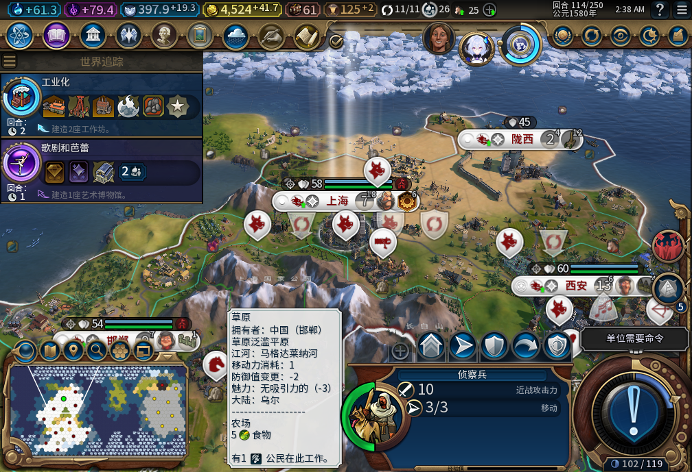
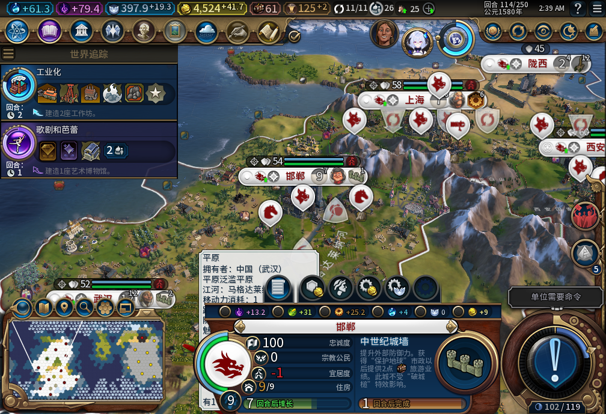
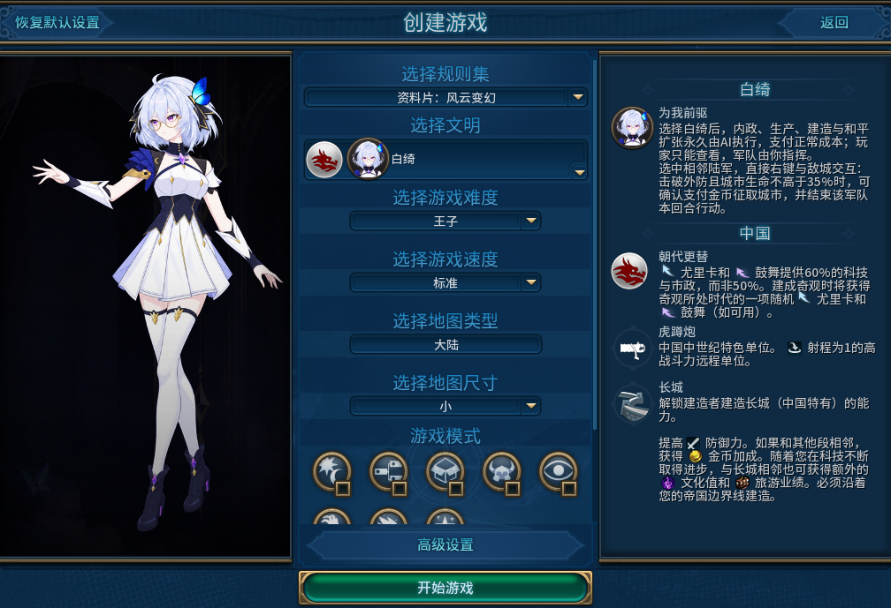
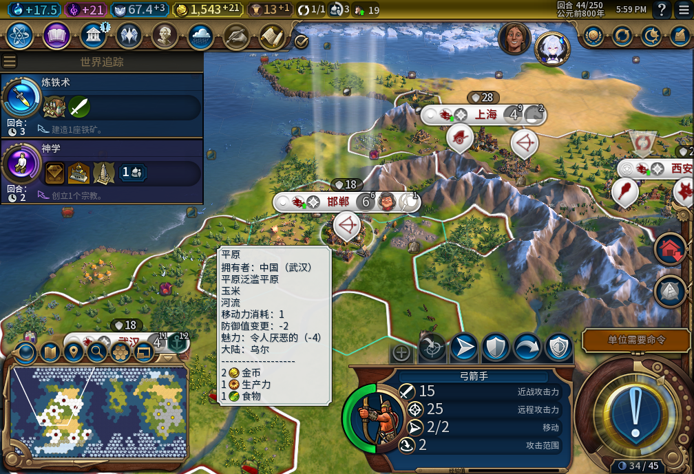
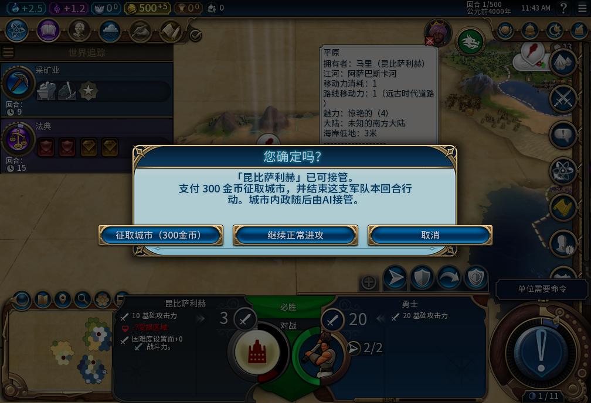
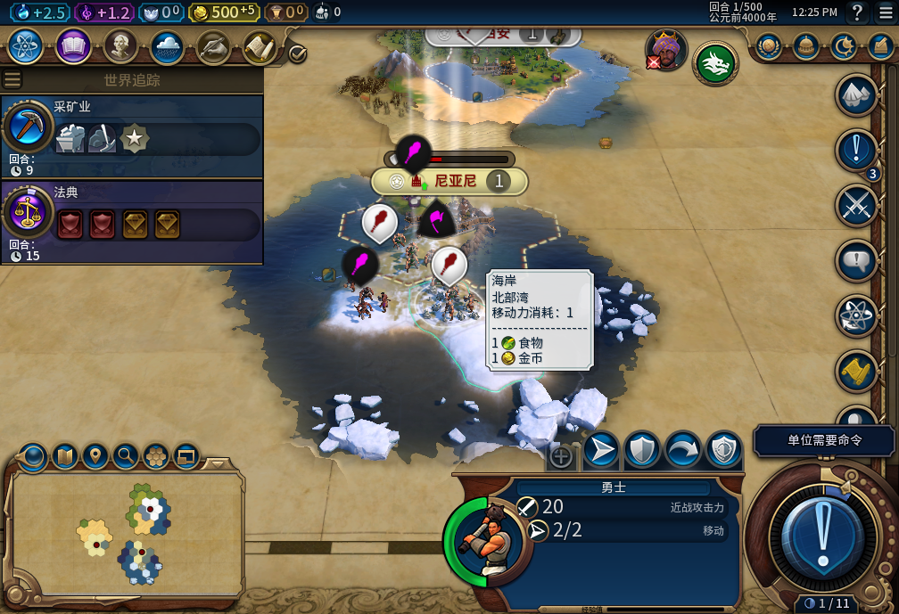
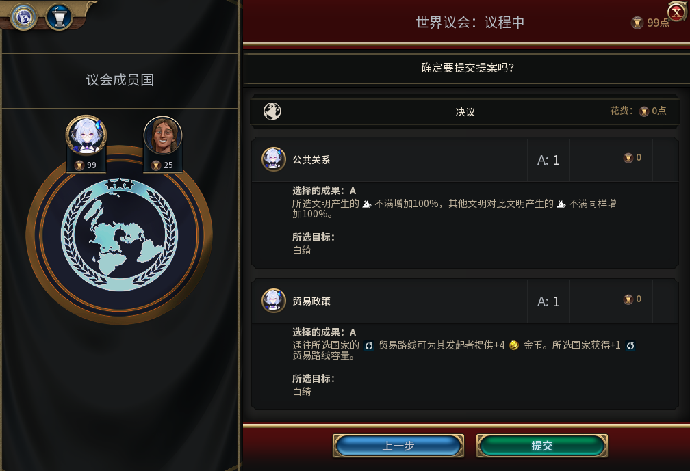

# 白绮【为我前驱】Alpha 1

发布版本：`v0.1.0-alpha.1`；内部构建：74。面向愿意反馈问题的测试玩家，尚未完成全部40项游戏验收，不是稳定正式版。

选择白绮后，内政、生产、建设和和平扩张永久交给游戏内的自动逻辑。玩家查看城市，指挥军队、处理全部外交并结束回合。**没有暂停托管、手动接管或逐城开关；如果自动化停滞，玩家无法通过这些入口自行补操作。**

一个回合里，你看城市进度，用现有军队和国库决定前线怎么打，处理外交，再结束回合。城市按自己的节奏发展，排产不合心意时也不能临时接回来改。[完整玩法介绍](../../workshop/v0.1.0-alpha.1/README.md)和下方7张实机图展示这套分工。

军队、将军、海军统帅以及使徒／审判官／上师由玩家指挥；传教士的安全国内传播由自动逻辑处理。后台不会为扩张发动战争或派军队侦察、护送。生产军队后由玩家下令。

有偿征城从地图操作：选择合格陆军，直接右键与敌城交互，符合当前规则时确认金币代价，也可以选择普通进攻或取消。当前规则要求交战、相邻、可行动且无护送，城防已破、城市生命不高于35%；报价为200＋100×人口金币，成功后结束该单位本回合行动。普通敌城、原始首都及城邦非最后城市已有样本，其他特殊资产与异常恢复仍未验完。没有独立征取侧栏；粮仓经营权及“解放地块”入口已删除，旧收益标记只清理、不退款、不补发收益。

## 安装

1. 下载Release中的 `Baiqi-v0.1.0-alpha.1.zip`，不要把GitHub自动生成的Source code压缩包当安装包。
2. 退出《文明 VI》，将压缩包内的整个 `Baiqi` 文件夹放到实际使用的 `Documents/My Games/Sid Meier's Civilization VI/Mods` 目录；如果文档目录被重定向，请使用游戏实际读取的位置。最终应有 `Mods/Baiqi/Baiqi.modinfo`，避免套两层Baiqi文件夹。
3. 在“额外内容”中启用“白绮：为我前驱”，创建单人《风云变幻》游戏，选择中国文明的白绮。替换旧版本文件后重新启动游戏。
4. 建议先使用独立新局，保留升级前存档和原模组副本。旧档迁移未完整验收；不要把长期主档作为首次测试对象。

本Alpha的验收环境为Windows、Steam版DX12、单人《风云变幻》。其他平台、规则集、多人、热座及其他UI模组组合未承诺兼容。发布包不含游戏本体、DLC、私人存档、测试注入器或本地模型工具；正常游玩不要求安装Python、OpenCode、FireTuner或提供模型密钥。

运行逻辑位于游戏模组内，不需要玩家连接在线模型。开发使用本地模型，Steam离线环境已有实测；“专门阻断模型服务后继续运行”的独立隔离用例仍未完成，不能当作该项实测已通过。

## 已有实机依据

- 五城起点连续20回合自动建设与扩张已有历史32版样本，固定十城性能预算已有67版样本；它们不是74版全功能回归通过。
- 74版已离线冷启动。相同准备档低库存拒绝招募、高库存追加一名建造者后在数量上限停止；原队列正常完成，商业区及银行自然修复。
- 74版合成维护压力下，库存充足但净收入为负时拒绝有需求的招募；移除QA维护负担后资格恢复，AI继续排产。合成负担不算真实敌方掠夺或正常军队训练证据。
- 建造者实际抵达、建农场并扣次数，以及正常训练考古学家、作品入藏、地图征城和部分读档防重都有具名实机样本；不能扩大成所有条件通过。

本次发布前全套1039项软件检查通过（208.698秒），不是1039项游戏实机验收，也不代表全部40项游戏用例已通过。游戏代码保持内部74，未为Alpha临时加入测试权限或手动接管入口。

请先阅读随包的 [KNOWN_ISSUES.zh-CN.md](KNOWN_ISSUES.zh-CN.md)。报告问题时提供版本、规则集、其他模组、复现步骤及期望／实际结果；截图请避开账号和聊天，私人存档不必公开上传。

## 实机图

以下共7张真实游戏截图。前两张为2026-11-05的74版正常恢复档114回合，其余5张补充对应版本的历史开发场景；部分含QA准备。城市／资源数量不代表全程纯自然取得，图片只展示所示界面，前后成本与实效以具名验收记录为准。

30版选人实机：选择领袖时就确定这套分工。

32版五城准备档推进20回合，期间没有手动内政；不是74版重测。

27版QA敌城：右键地图上的敌城，选择征取、正常进攻或取消。人口1时的报价为300金币。

27版QA场景：正常进攻分支没有支付征城费用。

67版101回合：世界议会投票由玩家亲自决定，模组不代投。

逐图原始来源、裁切与范围见[实机解读](../../workshop/v0.1.0-alpha.1/screenshot-commentary.md)。原始Alpha压缩包仍附带2张74版图，本次在线说明补图不改写原始安装附件。

图片捕获时未修改游戏像素，已排除桌面、任务栏和Steam窗口。当前截图布局约为1024×728窗口；其他分辨率／缩放未完整验收。

源码采用仓库GPL v3许可，见随包LICENSE。人物美术使用本项目已指定素材的派生纹理，来源与背景制作记录见仓库 `docs/implementation/baiqi-art-sources.md`；不含原始素材包或游戏安装资产。
