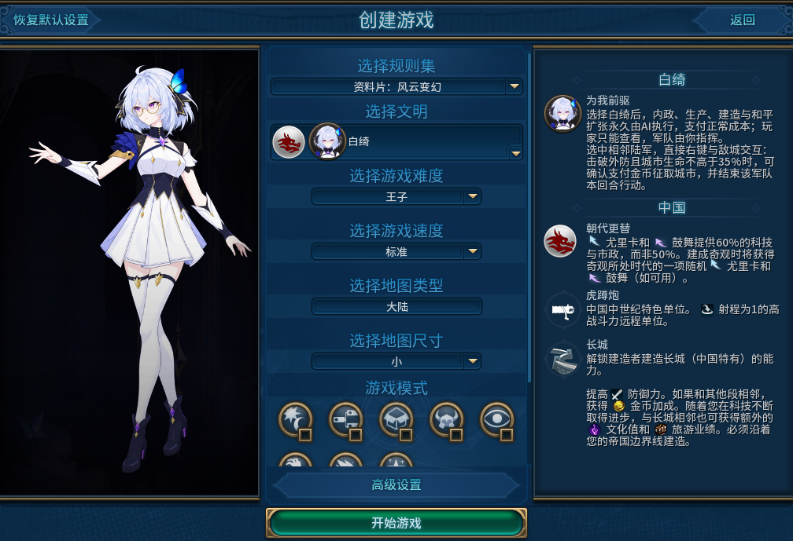
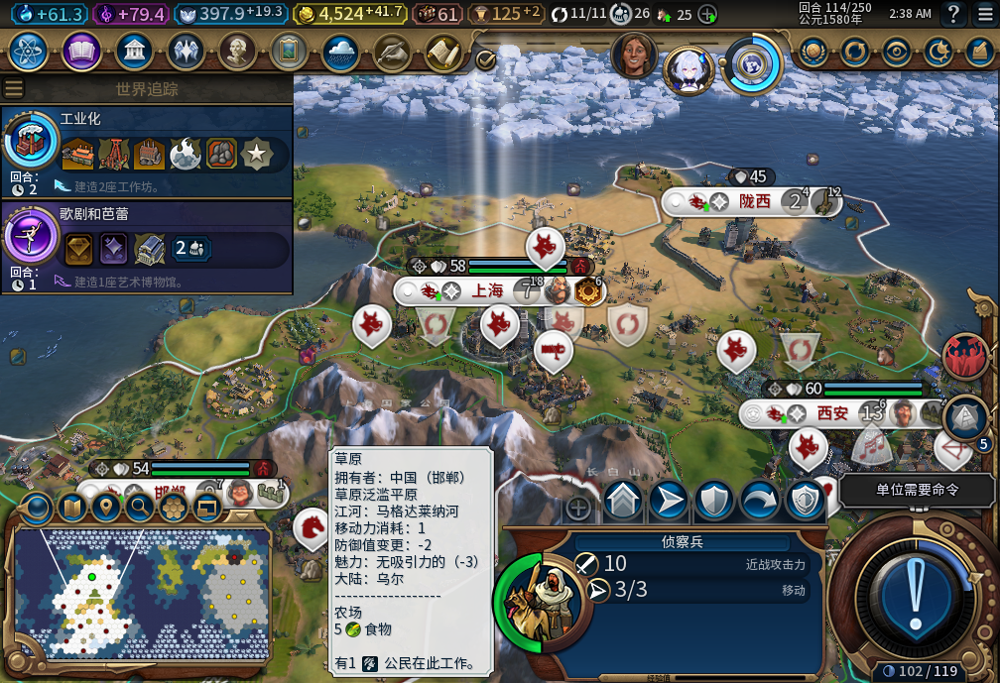
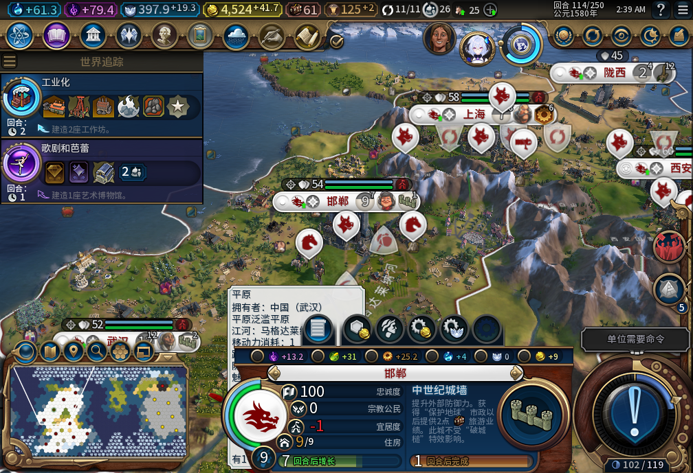
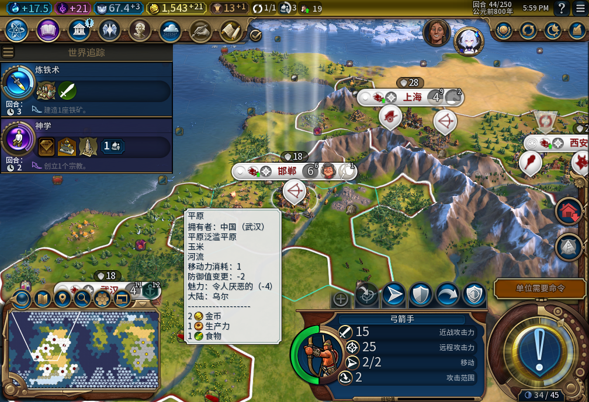
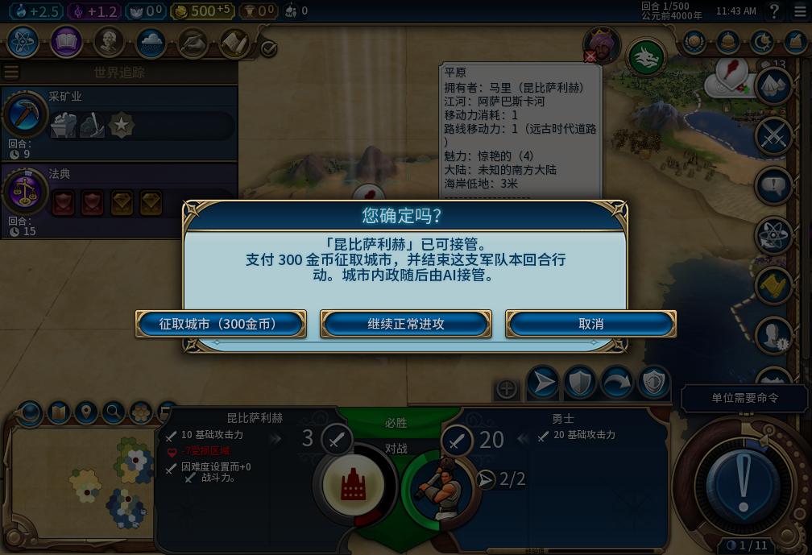
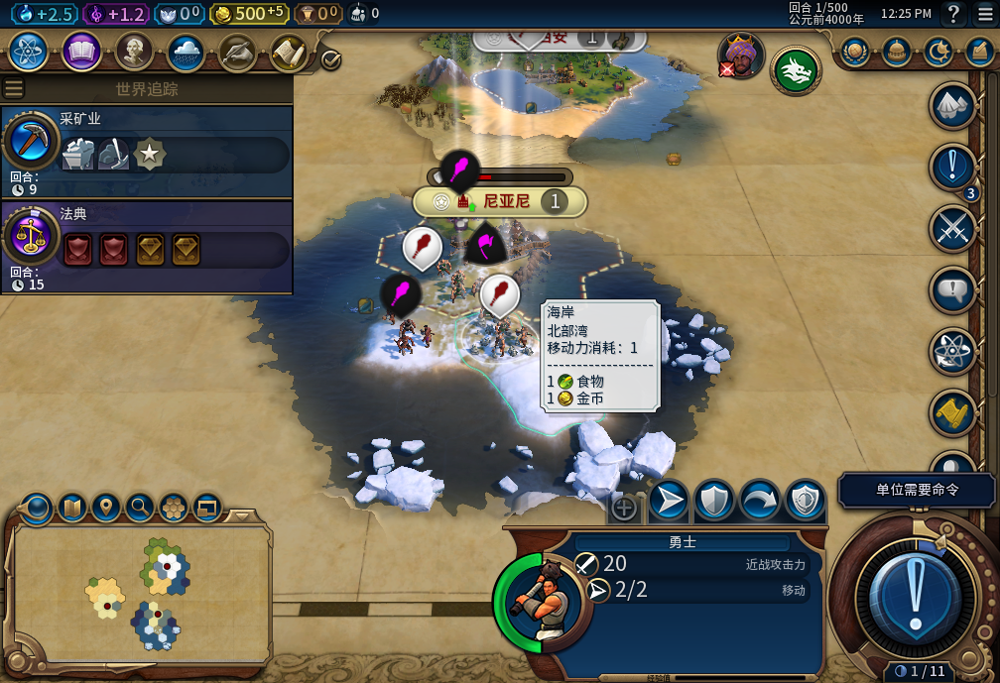
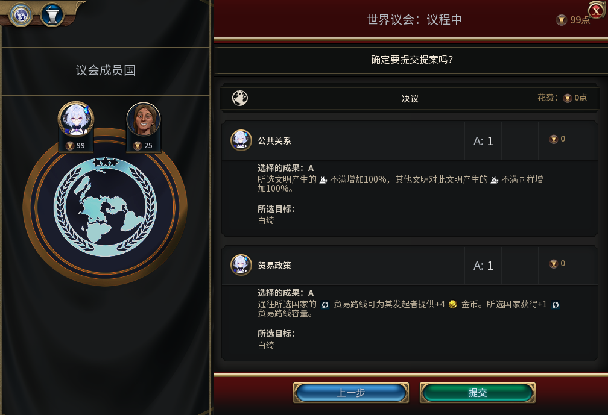

# 白绮【为我前驱】v0.1.0-alpha.1

选择白绮，城市交给她，军队和外交留给你。

研究什么、城里造什么、哪里修改良、移民去哪里建城，由模组安排。你可以查看城市进度，但不能改排产，也没有暂停或临时接管。

30版选人实机：选择领袖时就确定了这套分工。

## 一个回合，你做什么

看地图和城市进度，决定军队往哪里走、打谁、何时停手；处理外交，再结束回合。新训练出来的军队等你的命令，模组不会替你调兵、宣战，或借护送文职把军队带走。

74版114回合的地图。开发存档含历史QA准备，城市和资源数量不代表全程自然取得。

城市不再逐项按你的手法优化。你得用手头的兵力和国库作决定，让内政按它的节奏推进；发现排产不合心意，也不能临时接回来改。

74版城市查看界面：可以看，不能手动改生产。

32版历史开发样本：五城准备档连续推进20回合，期间没有手动内政。此图不是74版重测。

## 破城之后，多一个选择

合格陆军贴近已经破防、生命不高于35%的敌城后，直接在地图上右键点城。可以继续正常进攻，也可以确认报价，用金币接管整座城，或取消。

27版QA敌城：人口1，报价300金币。征取、正常进攻和取消都在地图确认框里。

报价为200＋100×人口金币。还须交战、相邻、部队可行动且没有护送编队；成功接管会结束该部队本回合行动。是否值得动用国库，由你决定。

27版QA场景：玩家选择正常进攻，勇士实际参战，该分支没有付征城费。

## 外交仍由你拍板

宣战、议和、交易、城邦使者和世界议会都由玩家决定。和平扩张走移民建城；国内传教士由托管处理，使徒、审判官和上师仍由你指挥。

67版101回合：测试玩家选择并提交世界议会投票，模组不代投。

## Alpha 1 试用与安装

内部构建74，全功能实机验收尚未完成。可能出现托管停滞；征城结果未知时会冻结后续冲突操作。特殊城市资产、长期忠诚度与经济、护送和兼容边界仍有未验范围，没有手动接管兜底。建议独立新局并保留原档。

验收环境为Windows、Steam版DX12、单人《风云变幻》。下载下方`Baiqi-v0.1.0-alpha.1.zip`，退出游戏，将其中的`Baiqi`文件夹放入游戏实际使用的`Documents/My Games/Sid Meier's Civilization VI/Mods`，启用模组后创建新局。正常游玩不需要Python或在线模型服务。

以上7张均为真实游戏截图，27／30／32／67版为已注明的历史开发场景，部分含QA准备。宣传封面另为AI辅助插画。原始安装包附带2张74版图；本次补图更新的是公开正文和仓库说明。

[详细安装与7图说明](https://github.com/XenoAmess/civ6_dev/blob/main/docs/releases/v0.1.0-alpha.1/README.zh-CN.md) · [逐项已知风险](https://github.com/XenoAmess/civ6_dev/blob/main/docs/releases/v0.1.0-alpha.1/KNOWN_ISSUES.zh-CN.md) · [逐图来源与解读](https://github.com/XenoAmess/civ6_dev/blob/main/docs/workshop/v0.1.0-alpha.1/screenshot-commentary.md) · [Steam工坊](https://steamcommunity.com/sharedfiles/filedetails/?id=3833805495)
