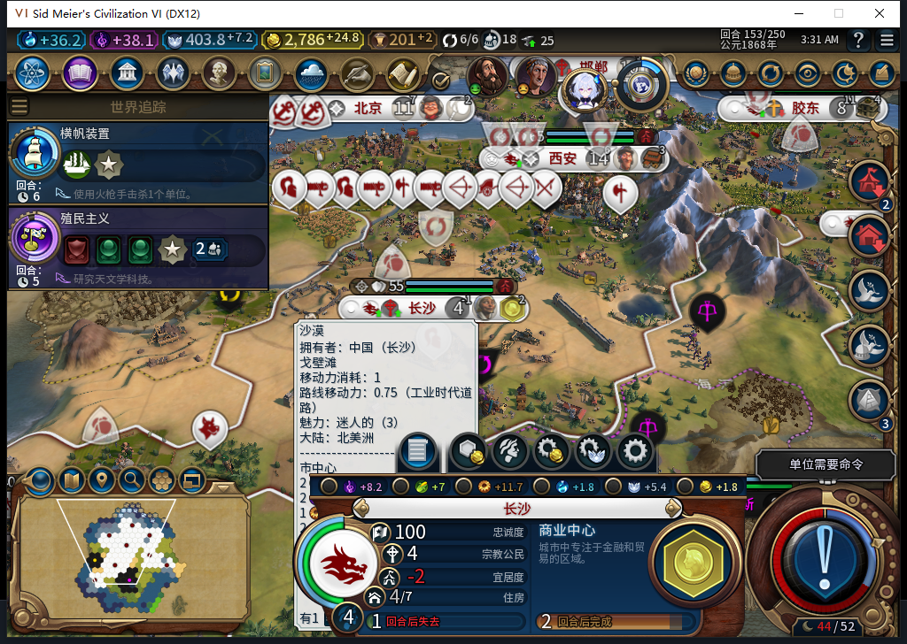
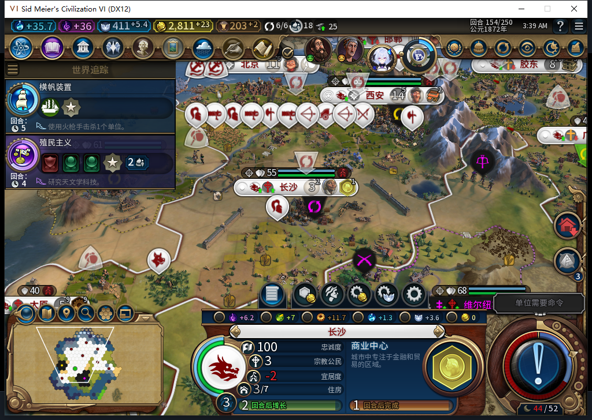

# Alpha 2 新增风险：增长后可能饥饿掉人口

2026-11-09 后续验收中，96 版长沙从人口 3 长到 4 后，净粮食变成 −1、库存不足 1，原版显示一回合后饥饿；下一次普通结束后确实掉回人口 3。当时还有未工作的 3 粮农场，玩家无法手动接管市民来解围。

开发版 97 新增后台粮食侧重，软件检查通过；它还没有进入 Alpha 2。**GitHub 下载包与工坊内容仍是内部 82，未用同一存档复测 82，不能把上面的 96 负例标成 82 实测。** 长局人口与粮食管理的风险仍未排除，完整验收尚未通过。

[逐回合粮食、市民地块与修复边界](../../testing/baiqi-food-focus-97.md)。先前的[先知资格、建城恢复和忠诚风险](post-release-findings-2026-11-09.md)继续适用。未修改现有压缩包或 12 张工坊图库。

Steam 账号正由其他设备使用，本次仅准备仓库文件及更新 GitHub 说明；[工坊 BBCode 补记](../../workshop/v0.1.0-alpha.2/pending-food-risk-2026-11-09.bbcode.txt)尚未发布。禁止因此私自上线或初始化上传器。
