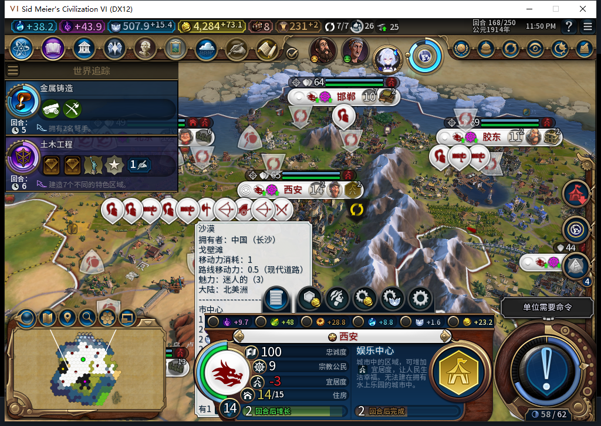
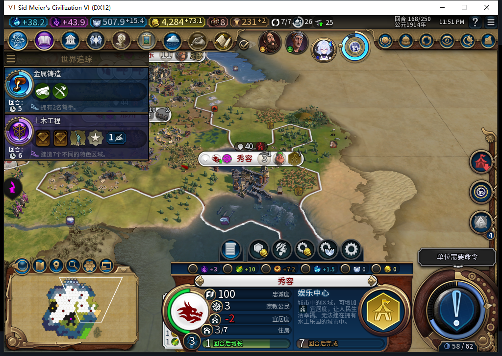
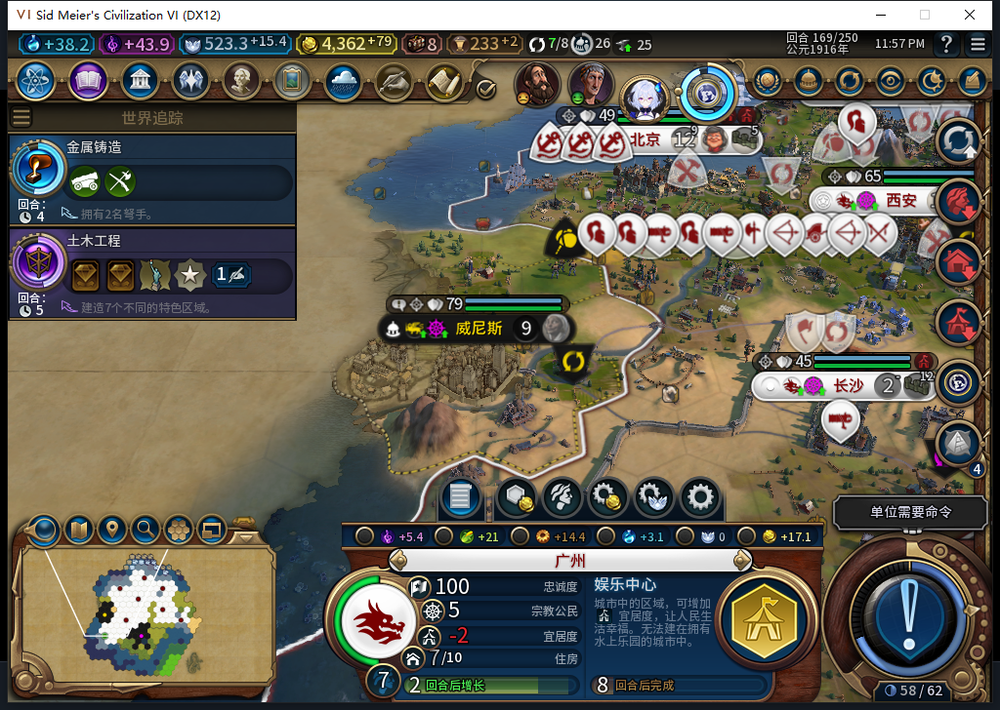
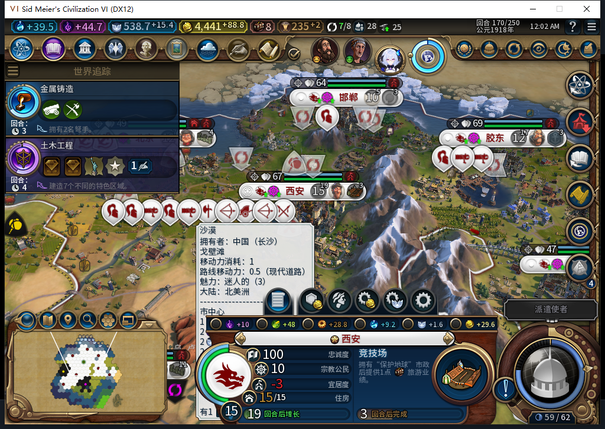
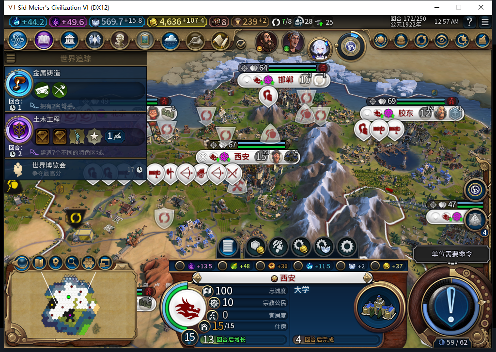
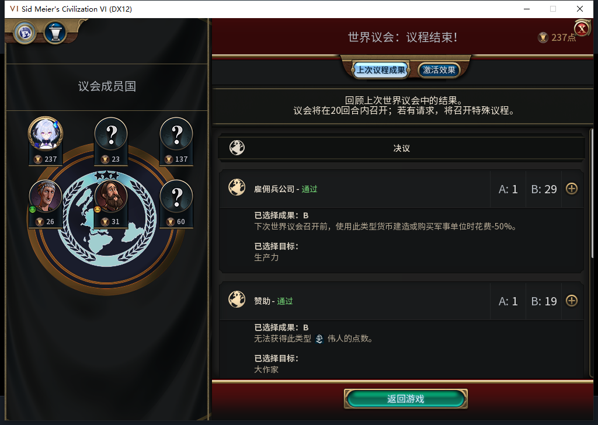
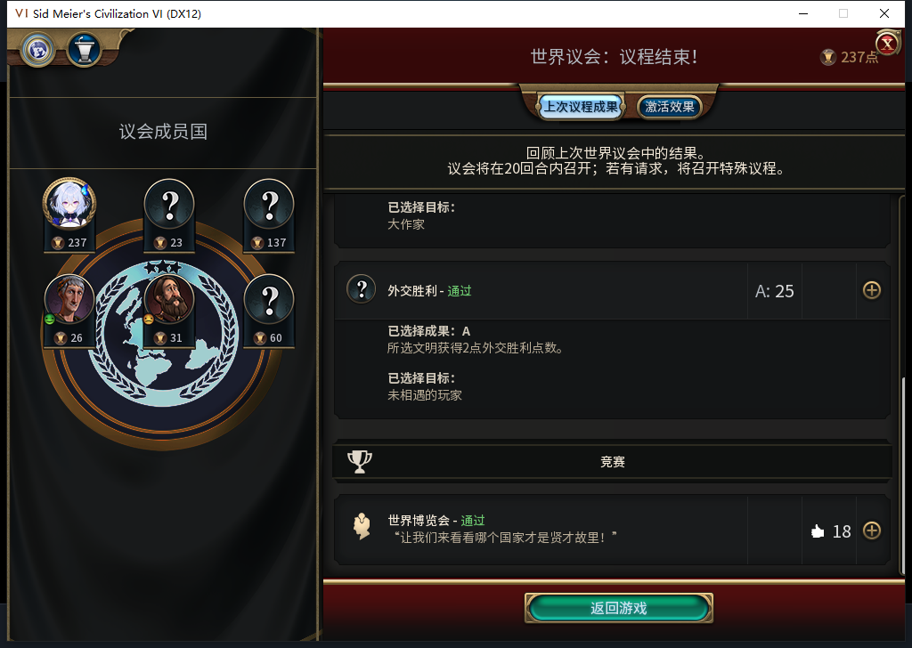

# 106离线实机166—172：娱乐中心接竞技场，西安缺口清零

这次验证的是“玩家不能代选内政时，托管能否自己补宜居度”。自然主线没有授予单位、生产、资源或点数。168西安和秀容先开娱乐中心，169广州灯塔完工后也开建；170西安娱乐中心建成并接竞技场，172竞技场正常完工，宜居度达到8／8，随后自行排大学。只授这条单城补救链通过，其他城市和完整验收仍未完成。**Steam他机占用，持续禁止上线／上传；订阅版仍Alpha2内部82／12图，本页为开发106。**

| 西安实际状态 | 人口 | 宜居度／所需 | 来自娱乐设施 | 来自奢侈品 | 生产 |
| --- | --- | --- | --- | --- | --- |
| 168 | 14 | 4／7 | 2 | 1 | 娱乐中心0／66 |
| 170 | 15 | 5／8 | 3 | 1 | 娱乐中心已建，竞技场0／75 |
| 171 | 15 | 6／8 | 3 | 2 | 竞技场49／75 |
| 172 | 15 | 8／8 | 5 | 2 | 竞技场已建，大学0／125 |

娱乐设施来源实际2→3→5，分别对应娱乐中心与竞技场完成。171奢侈品来源另增1，四城都有这项变化，未做单个资源归因；不能把它算给竞技场。170人口增长使需求也增加，所以当时总量4→5并没有让净缺口缩小。所有数字来自原版增长对象，五次八城共600个分项均读到VALUE；不把缺失当0，也不以日志替代实际收益。

图1：西安原建造者正常训练结束后，后台排娱乐中心0／66；原版面板预计2回合，宜居度仍−3。左侧遗留地块提示不用于证明城址，身份与生产由原生读取核对。

图2：秀容的纪念碑正常完成后，后台同回合开娱乐中心0／66，原版预计7回合。此时仍−2，不能将开工算完工。

图3：广州先完成已有灯塔，再开娱乐中心0／112，原版预计8回合。没有强行换掉原生产，也不把不同城市的区域成本都写成66。

图4：西安已进入竞技场0／75；面板预计3回合只是当时估计，实际172已完工。人口15、宜居度−3与表格相符。

图5：原版面板显示宜居度0、大学4回合；增长对象是8／8，竞技场已存在。世界博览会信息窗曾遮住统计，原版“确定”关闭后重拍此未修改原图；小视口底部截断仍未修复。没有为了好看改存档或涂改图片。

冷启动前的后台模式查询先unavailable、UIA头部0匹配未Invoke；只通过正式菜单头部导航一次，该步骤有激活，不冒充只读。之后独立后台实际读到当前客户端“上线…”菜单，启动前再次确认离线，证明距spawn0.003247秒。全程0模式切换／上线／登录／下载／上传初始化或上传。此前105保存后原版退出一次，进程超过180秒仍残留，但无窗口／端口且两项CPU计数不变，才仅清理该自有残留；Steam与其他设备进程未动。

106安装108文件逐字节等于源码，原版LoadGame一次、继续一次后实际读到166。与105退出前逐行相比：世界摘要1、城市8、建筑46、区域28、自有地块127、单位31六组相同。冷读后八城食粮另采安全样本，不补造缺少的105退出前食粮对照；引导期间具体Native发令数未知，不能称0发令或全世界不变。

166→172实际6回合，用了11次普通结束、16次测试玩家军队待命，0UserForced、0手动内政。167两次只推进文职排队，待新鲜回读后第三次普通结束才进入168；168遇Core忙碌，脚本停在后续输入之前，重新取得空闲／已知军队状态后才作第二次普通结束。170停在议会，由测试玩家完成原版投票才进入171；171使者提示只打开／关闭，28名使者保留未分配。没有把动作ACK算实际换回合。

图6—7：测试玩家四张免费票选择金币军事折扣、工程师翻倍、白绮外交胜利点与支持世界博览会。真正通过的是**军事生产花费−50%、大作家不能获得点数、未相遇玩家获2外交胜利点、世界博览会通过**。不是AI后台外交，也不把所投目标冒充最终结果；预览花费0，外交支持截图235→下一回合237→239，原版显示每回合+2。

透明观察器只覆盖BaiqiExecutor：1471记录＝1398招募资格检查＋11城市请求＋62单位操作＋0单位命令，0错误／丢弃；单位均自有建造者、移民、商人和工程师，没有该范围军队发令。招募资格检查不是实际招募次数。三次娱乐中心与一次竞技场请求均对应实际队列／完成；观察器已撤除，未插入游戏动作。56城帧原始食粮盈余均非负、未见饥饿倒计时；172八城忠诚均100、变化率非负，但长沙食粮盈余仍0。

恢复测试前分支后，168正常训练的建造者与虎蹲炮恰好取得旧QA使徒用过的数字完整ID4915231／4980768。当前类型、分支和出生流程不同，不是QA演员复活；不能跨存档时间线只凭数字认演员。完整ID、所有者、类型和记录来路都要保留。

589候选完整stop／JSON，5176+678=5854tokens、5.083503秒；编造GameConfiguration.IsHuman与全局Cities接口、错误self并漏领袖／首都核验，整份未执行。负责人用实际API另写只读采样器，Lua5.1编译后取得40城帧／600分项。调用发生于本机11月9日并复用当日维护成功缓存；本页跨到11月10日整理证据，不追认11月10日模型维护或新调用。产品源码未再改，软件1610通过／1SDK环境跳过保留前次结果，未重跑全套。

172已正式保存1645552字节，SHA-256 `55ba3d3bbfdb114e58805313aa81a3ec554553f96a73bacf6c1d72559806c817`，保存前全部诊断已撤，尚未读回。广州仍47／112、秀容44／66，二者缺口仍2；旧已发令移民ARMED恢复FAIL、通用未知MOVE、小视口、规则集／军队全矩阵及完整40项仍未关闭。此前105的20回合通过不等于新增106也已完成20回合。

[56行逐城生产](baiqi-source106-166-172-production.csv) · [600行宜居度来源](baiqi-source106-168-172-amenity-components.csv) · [结构化证据／原图哈希](../research/baiqi-p6-amenities106-native172-evidence-2026-11-10.json) · [待同步BBCode](../workshop/v0.1.0-alpha.2/pending-source106-amenities172-2026-11-10.bbcode)

后到补证：[172竞技场完成态已正式读回](baiqi-completed-reload-172-106.md)。本页“未载”是前一冻结切点；竞技场8／8及五组自有状态保持，1建造者移动，不授全部未知恢复通过。

后到补证：[106已自然推进至186并补齐本场景20回合](baiqi-continuous-window-106-166-186.md)。秀容175／广州177娱乐中心完成、广州183竞技场完成；西安173奢侈品重新分配后7／8，不是永久8／8。其他缺口与旧恢复FAIL继续。
