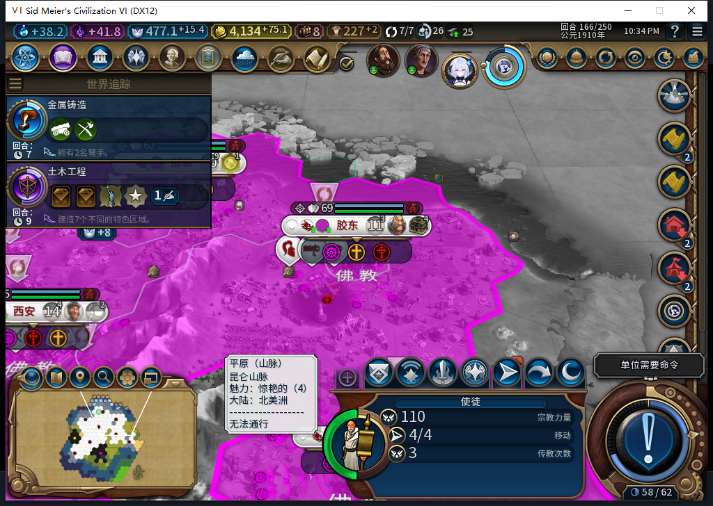
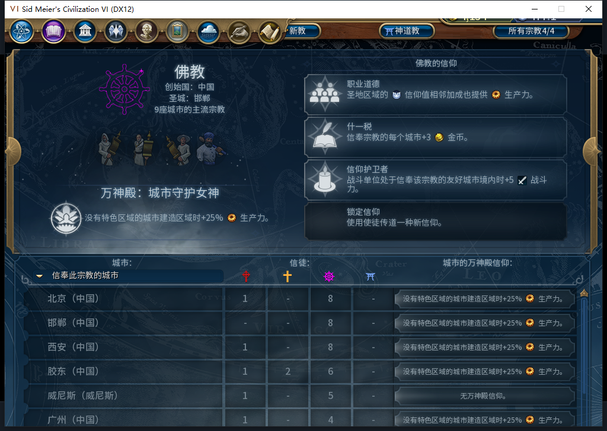
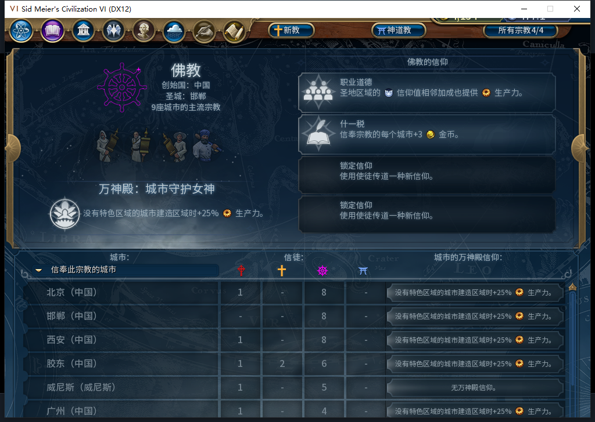

# 105使徒原版使用操作：QA166—167

“传道信仰”和“发起宗教审讯”两个窄样本通过。玩家分别调用一次原版UnitPanel按钮回调，使徒被实际消耗；托管后台补选新获得的信条，宗教审讯也确实开启。这次没有修改模组源码，没有手动请求ADD_BELIEF。

这是F04调试夹具，不能证明正常购买使徒：在原始166正式保存点之后，只创建两名测试使徒并指定其佛教归属。初始行动4、传播3，信仰余额477.16015625保持。测试完成后已正式读回原始166，测试结果留在单独QA167存档中，未混入自然扩张主线。产品与实机仍105，工坊仍Alpha2内部82；Steam他机使用，禁止上线及上传。

| 原版操作 | 实际输入与结果 | 验收范围 |
| --- | --- | --- |
| 传道信仰 | 4915231；原版回调一次；已获信条资格2→3，后台选择48“信仰护卫者”；原两条保留 | 玩家操作未拦截，获得资格后AI内政接续通过 |
| 发起宗教审讯 | 4980768；原版回调一次；Core未开启→开启，实际进入167后UI／Core均开启 | 玩家操作和实际开启窄通过 |

原版按钮数据实际均为Disabled=false，所选单位通过完整ID／类型／所有者检查。本次通过的是原版回调调用及实际效果，**不是物理点击单位按钮通过**，也没有安装请求计数钩子，不能推断精确Native请求数或这段窗口后台零军令。

两名使徒在166的UI先后消失；Core暂留延迟销毁对象，坐标−9999、传播次数仍3、行动仍4，不能写成“次数3→0”。167两侧都已查不到。宗教审讯在166先是Core=true／UI=false，普通结束实际166→167后两侧才同为true；未用动作ACK掩盖同步差异。该正常换回合用了2次普通结束、2次测试玩家军队待命，0UserForced。信仰自然增至492.56640625，没有重设资源或行动。

图1：明确授予的QA使徒，原版面板显示行动与传播次数。地图镜头并非其位置证明，完整身份／坐标另由原生读取核验；不把这张图当作正常采购证据。

图2：右侧第三条“信仰护卫者”已出现。已有“职业道德”“什一税”保持；第四条仍锁定。左侧9座多数宗教城市包含外城威尼斯，不能写成9座自有城市，也不证明后台对外传教。小视口底部截断风险仍保留。

后台日志有同166的religion:belief:48请求及admin_observed／beliefs=3，且UI与Core实际信条表均含48；不是只见日志就授通过。UI.RequestPlayerOperation中的ADD_BELIEF仍作为手动内政被拦，未放开手选；使徒原生使用操作通过另一个单位入口，能正常取得新资格。本样本无需据此补丁。当前原版ReligionScreen内IsReadOnly实际为nil，不能误称包装器已将它强制置true。

图3：这是回到测试前存档后的主线，重新只有原两条信条；不是新增信条意外丢失。正式LoadGame一次、原版继续一次后，8城／31单位、477.16015625信仰、宗教审讯未开启、两名QA演员均不存在；夹具属性／全局与全部诊断观察器为空。原建造者4456469仍54,32／4次／pending=true，UI行动0.25、Core0，保持各自读数；没有核对全世界全部字段，不授未知MOVE恢复通过。

QA167保存1627647字节，SHA-256 `b433da9b56cb9dcd63663ff177f79211e946695fcd15fa96dc87f8f83a20b435`，未读回；返回主线使用此前166原档，SHA-256 `f68d3615670e73c95da888e3e19e19b5585dd9141db73468c4d0b119334c737f`，原档未覆盖。加载中的一次只读LSQ超时未发送CMD，等待原版继续后重新资格化成功，没有重放游戏动作。

585本地模型候选完整stop／合法JSON，5283+1205=6488 tokens、8.477650秒，整份代码拒绝且未入游戏：局部函数与托管全局同名导致入口立即返回，领袖比较写成字面量BaiqiConfig.leader，并漏人类／城市完整身份检查。负责人重新准备夹具，经Lua5.1编译和17项隔离断言后才执行。负责人第一次只读预检误用Core缺失的GetNumBeliefsEarned；另两次面板查询有数字与and粘连语法错误，均在动作前失败，随后编译并修正。未修改产品或重跑完整1598套件；旧运行1597通过／1SDK环境跳过及其离线补验保持各自记录。

仅补TC-019的两项原生使用与信条接续，不关闭完整宗教／军事矩阵、正常使徒采购、审判官实际清外教、旧已发令移民ARMED恢复FAIL、未知MOVE、宜居度和小视口问题。

[结构化证据与原图哈希](../research/baiqi-p6-apostle-actions-qa105-evidence-2026-11-09.json) · [既有宗教战斗／治疗证据](../research/baiqi-p6-religious-actions-native46-evidence-2026-11-02.json) · [待同步工坊BBCode](../workshop/v0.1.0-alpha.2/pending-source105-apostle-qa166-2026-11-09.bbcode)
