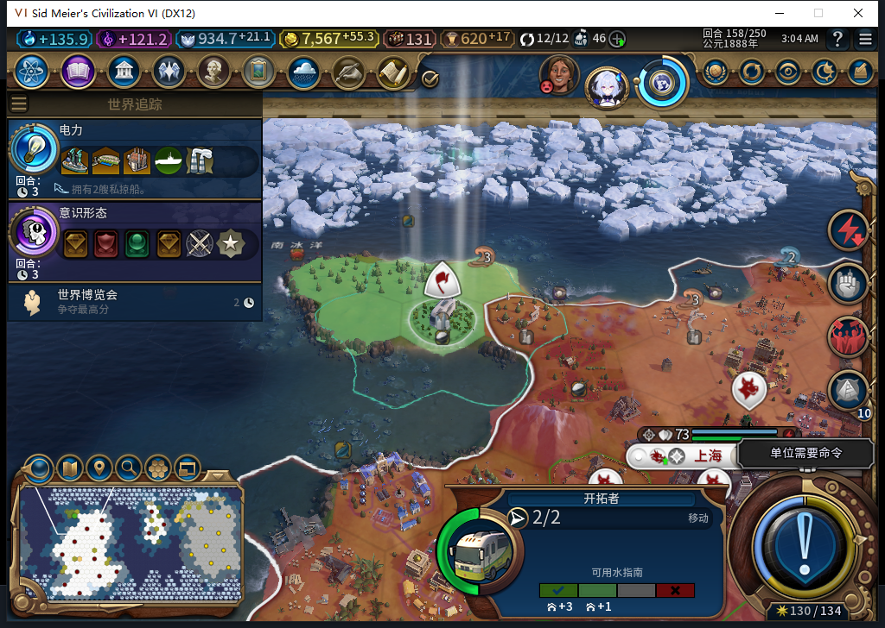

# 85读取旧ARMED失败档：日志保留，恢复仍未通过

原82第158回合失败存档正式交给85读取。UI／Core一致：14城、58个自有单位、余额7567.28515625；移民8650807仍在10,19，有2行动力，未编队、无伤害，目标846没有城市。原日志ARMED／settle:0:1／request0:156:173保持，没有因升级改写为成功或新请求。

本轮没有再结束两个回合来重复旧失败证据，没有重发FOUND、清日志／队列、注入ARMED、调用私有Inspect／Prepare／Commit。只授升级读取保留记录，前进恢复仍FAIL。另存85现场629900字节，SHA256`53a08d9f9eff2fb65a5bc93a11b938b78c5f18a09b50c75dddb6b58a73d9c579`；新文件稳定且保存ACK为true，本轮没有再加载这份85文件，私人存档不上库。

实际接口分布如下；函数缺失与返回空值分别记录。

| 读取 | 界面UI | 游戏Core |
| --- | --- | --- |
| 单位HasPendingOperations | false | false |
| 单位GetOperationType | 函数不存在 | −1 |
| UnitManager.GetQueuedDestination | 函数存在，目的为nil | 函数不存在 |
| 操作Added／Started／Deactivated／Cleared事件 | Add／Remove存在 | Add／Remove存在 |

本机原版WorldInput把排队目的用于显示移动路径；UnitPanel及WorldTracker的操作事件主要刷新界面。没有由此获得模组请求ID对应的提交回执或全派发队列空保证，不能据表中false／−1／nil重放未决建城。

还核对了宗教验收条件：严格读取58个自有单位，四种目标MISSIONARY／APOSTLE／INQUISITOR／GURU共0个，结果是KNOWN空集合，不是读取失败。没有生成单位、购买或花信仰补条件，也没有授宗教单位原版操作权限通过。

最初直接把缺失属性调用作为type的末尾参数，误读为“function”。完整返回计数在UI／Core均为0；赋给局部变量再type均为nil，旧建城日志则为1个正常table。撤回存档属性损坏推断，未重置任何属性。负责人首个形状工具还用了本机原版Lua没有的rawget，导致自己的日志表读取失败；改为已资格的next，15项隔离检查在rawget缺失环境重跑后，实际两上下文均正常。产品未使用rawget，没有产品改动。[完整范围、指纹和原件摘要](../research/baiqi-p6-recovery505-religion506-property507-evidence-2026-11-08.json)。

模型505把单位读数误当全部队列证明，给出未支持的静态API及注入ARMED实验；506没有导出模块，把Members迭代器当数组，并以局部type遮蔽内置函数；507错误解包pcall，合法输入即对nil求长度。三稿均拒绝、0原稿实机。负责人宗教元数据工具15检查、属性工具及修订各15检查；它们是忽略目录的只读QA工具，不是恢复修复。累计507任务／472完整stop／32length／3最终transport，537HTTP／额外重试30；OpenCode新原生生成0，未知成本null。

源码／安装／运行仍85，公开GitHub／Steam Alpha2仍82／12图，本轮持续离线。完整40项、未决恢复、旧档等待、宗教实际演员与长期矩阵继续开放。
