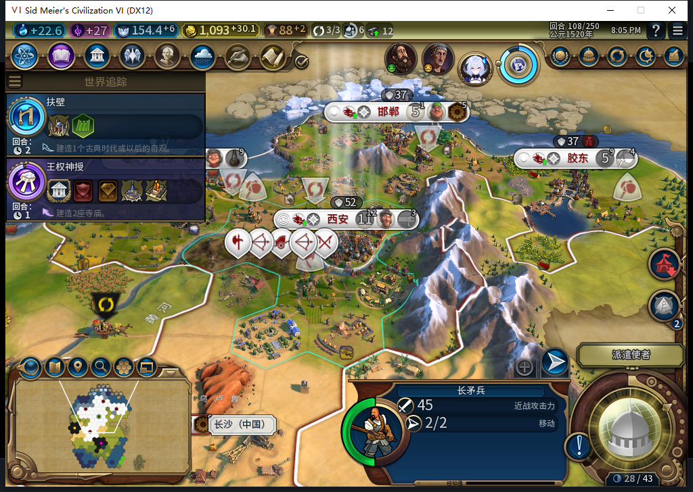
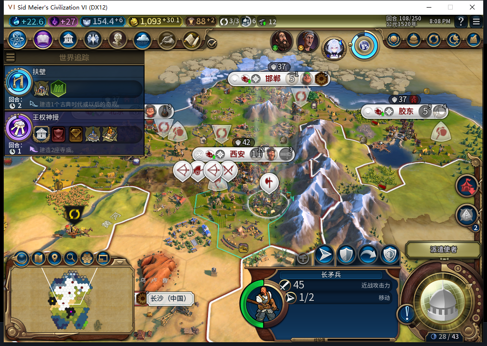

# 93实机102→109：新军队等待玩家，移民筛选发现缺口

五城继续自动生产，首都102排长矛兵0/90，103为28、104为51、105为74，106自然完成新单位1703946。106、107、108玩家指挥前，它一直在首都55,34，2行动力；108由测试玩家通过原版移动到55,33，行动力2→1，109仍在该处。这个窄样本支持“AI训练、军队交给玩家”，不授全军事／编队矩阵通过。[40行队列](army-wait93-102-109-queues.csv)、[40行城市状态](army-wait93-102-109-vitals.csv)、[完整证据](../research/baiqi-p6-army-wait93-native109-model544-evidence-2026-11-08.json)。

界面名称是长矛兵，完整ID1703946。旧建造者1638410和它复用了编号低位，核对必须用完整ID与类型；不能把单位槽复用误写成转化。观察器覆盖期间未看到该军队的后台发令。

这是TEST_PLAYER军令，实际坐标和行动力已单独读回。两张都是查看过的游戏原图，无裁剪、合成或改数字。玩家另在103至108每回合普通移动斥候一次，从54,34到51,28，只走当前可见、相邻、空的己方／无主非城市陆格。没有护送、揭图接口、宣战或文职命令，不能算后台自动侦察。

移民1572869仍未扩张，102至109在54,33、2行动力、无原生目的地、保存目标0。101撤观察器至102安装之间的位置变化没有发令调用点证据；源码的文职重叠让位与之相符，但不能认作扩张移动。第二窗口只覆盖BaiqiExecutor绑定，102→109计1021招募检查、8城市请求、32单位操作、0单位命令，1061样本，0错误／丢弃。移民103至109各一次待命，观察范围内0移动／建城。观察器109已完整撤下。

继续侦察后，109七条原生推荐中四条当前可见，49,27最近己方城5格、5格内无可见外国城；另三条存在外国城距离不大于最近己方城，仍应保守拒绝。发现93的新候选和旧目标筛选都要求没有任何地貌，连普通雨林也排除。当前49,27为雨林；原版数据库Features.Settlement=true，NaturalWonder=false、Impassable=false。原版schema的Settlement默认true，绿洲及自然奇观显式false；NoCity字段不存在，最初只读探查该名称得到nil后已据schema纠正。**源码误排除已证，是否唯一等待原因、修复后是否可行军建城仍待实机。** 不放宽边境或忠诚规则。

所有采样五城忠诚100、变化非负；这不是新城长期保城测试。107还是寡头四槽，109已由后台换成君主六槽，无玩家补选。101至108共8次普通结束，实际推进8回合，8次玩家军队待命；另6次斥候移动和1次新长矛兵移动。107罗马来交易，测试玩家拒绝一次，等新的告别按钮后告别一次，才到108，没有重放结束回合或自动外交。无Shift+Enter／UserForced或手补内政。

109正式保存ACKtrue、1305498字节、SHA256 a66859203fcd08027a9411ab15b375ac5e20f84a9b533b3a07f9d5d1bc421002，连续读取稳定，尚未加载，私人存档不入库。源码／安装／运行仍93，软件基线1330运行／1329通过／1SDK跳过未重复。模型544适配候选因length整份丢弃，未读正文或解析候选，负责人独立改用既有普通军队工具，复用27选择场景，0新增软件case、0原稿入实机。冻结至544累计544任务／507完整JSON／34截断／3最终传输失败／574HTTP含30额外尝试；未知成本null，OpenCode原生生成0。

下一包修复地貌筛选并重验。93新城及长期保城未通过，92长期130FAIL、旧ARMED／LEGACY恢复、宗教、兼容、性能及完整40项保持开放。Steam已被其他设备占用，本轮0模式切换／上线／登录／下载／上传器初始化／上传，公开Alpha2仍82／12图。
