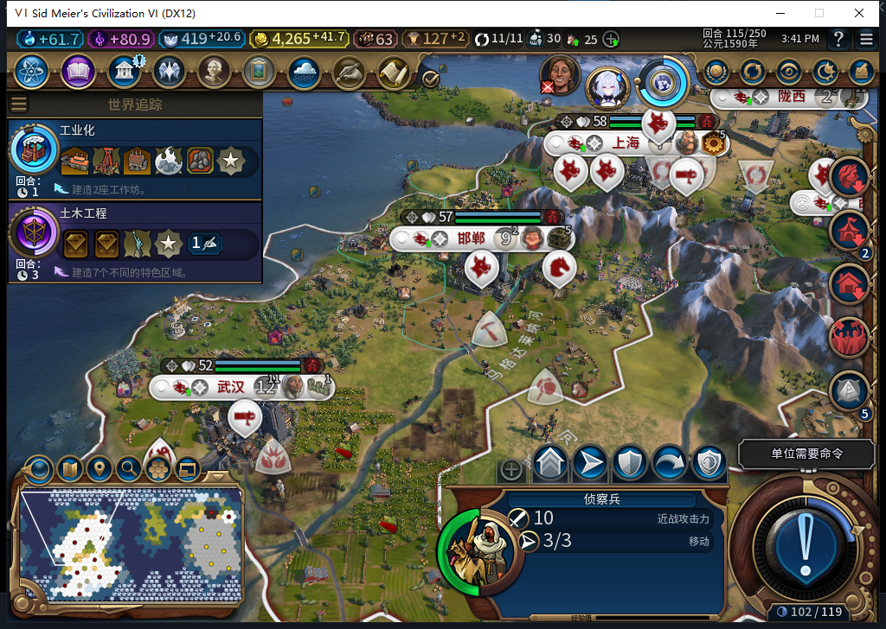

# 74版：最后一次建造后的地块与单位

后续[末次使用归因审阅](baiqi-builder-final-charge-attribution-review.md)确认本页农场效果通过保持，通用日志缺口与效果分账；未把“单位消失＋农场出现”提升为肯定消耗回执。

2026-11-05，BF-202609141645，Steam离线／owned12052／产品74。正常114→115时，建造者5832733移到538并提交改良后消失，Controller记unit_request_not_observed／unit_unavailable。独立保存、载入原准备114前态及115后态核对，确认538从无改良变为未受损农场，原539农场保持，单位消失与最后一次建造消耗一致。本例改良实效通过；自动日志没有最终确认的缺口保留，不把单位缺失一律当成功。[结构化证据、模型409审阅与存档指纹](../research/baiqi-p6-builder409-final-charge-evidence-2026-11-05.json)。

| 项目 | 原准备114正式加载 | 保存115正式重载 |
| --- | --- | --- |
| 建造者5832733 | 白绮／UNIT_BUILDER，11,12／539，1次数、0移动 | FindID缺失，538／539／582单位列表也无此完整ID |
| 地块538（10,12） | 自有、改良-1、可见 | 自有、IMPROVEMENT_FARM／Index1，未受损、可见 |
| 地块539（11,12） | 自有、未受损农场 | 同一农场保持 |
| 地块582（10,13） | 自有、无改良；原斥候786438 | 保持 |

真实后台日志依次为0:115:7移动539→582且observed、8移动582→538且observed、9在538提交BUILD_IMPROVEMENT，随后unit_unavailable。两个移动和建造由后台自行发出，测试玩家只跳过军队及结束回合，没有补移动、造农场、改建造次数或重投建造。准备114与保存115分别核SHA，照片仅用于解读；实际地块类型由独立Native字段确认。

没有直接捕获UnitRemoved的原生原因或建造调用计数，因此这里以精确请求链、原1次劳动、新农场与单位缺失限定样本；不推广为任何消失都成功。Controller先按完整ID归一化，缺失分支会清pending，本例没有“永久卡死”。其普通pending只记kind／plot／from／moves，缺少目标改良及前态次数；日志读回无法在单位消耗后确认效果。没有为改善报表重写历史日志、伪造持久回执或重复动作，产品未改。

409候选63行能编译，但GetCharges、unit:GetIndex不是所给已验证入口，改良Name不是类型，returntable也不能通过实际NativeCMD打印证据；负责人只参考独立前后地块检查方向，原稿0游戏执行，改用GetBuildCharges／XY定位／ImprovementType及可见原地单位列表，完整核ID和owner。源码摘录缺少ReadBack的完整ID归一化两行，负责人随后直接读取，候选关于该部分的推测未采用；模型分析不代替原生效果证据。

本项结束后已正式恢复原正常Farm114，并独立Core／UI／Input核验11城、金币4524.2734375／信仰397.94140625、建造者1次／0移动、原农场539／538无改良、骑手10,12／4行动、原敌城和守军、征城账本nil与故障／观察命名空间清除。原文件SHA保持。保存115仍留忽略目录供后续复测。完整40项、全部改良／地形／失败及修复矩阵仍未完成；没有把旧1039软件通过当新Native覆盖。
