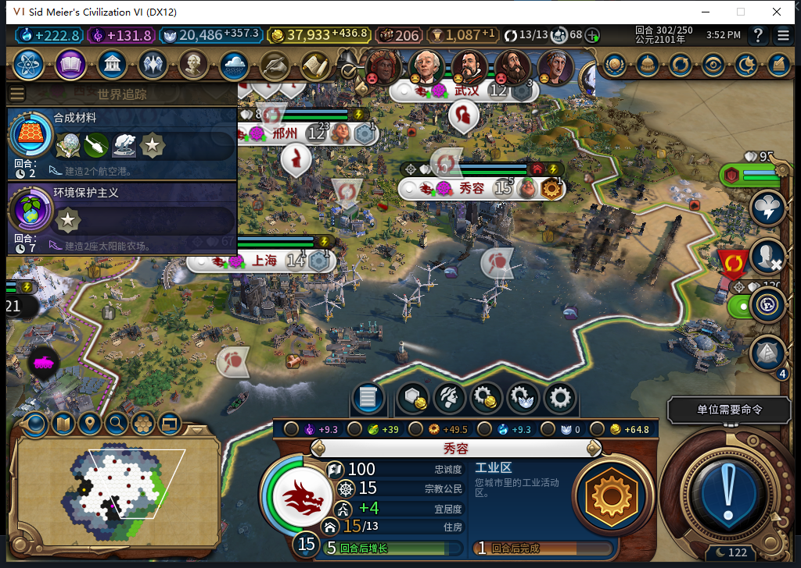

# 131实机：保留工坊修复投入，303新人口损失

2026-11-12，BF-202609141645。[逐项证据](../research/baiqi-p6-native131-repair-poploss303-2026-11-12.json)，[131软件与部分674采用](baiqi-blocked-building-repair-131.md)。正式119文件匹配55a4907，新鲜后台Steam离线证明后0.006333秒启动；一次正式加载原130／302档、一次原版继续，实际读回302。确认本身0输入／焦点／移动／截图，原版菜单导航另记。

后台唯一0:302:1工业区修复请求并OBSERVED，Native裁掉不可生产的旧工坊修复条目，但工坊仍已拥有且pillaged、72/97投入保持；旧项目143/157也保持。世界经济、176建筑、64区域、219自有可见格、50单位和其他10城队列相同；11城人口及库存／净粮相同。广州重载后忠诚度每回合24→27、生产49→53.8984375、宜居度11→13、增长预测12→11，原因未知。vitals生产者读取GetLoyaltyPerTurn，负责人先前评论误称住房已撤回；该工具没有读取住房。

图为原始自有游戏窗口，仅原版选城及镜头查看、0内政输入；Native另核第四座在沈阳1901，未把图中三座称作全部四座。当前UI住房显示也不能用vitals中的忠诚度增量替代。

1次普通END302／7军SKIP／0UserForced后实际303 READY。工业区已完好，后台接回工坊修复72/97，旧项目仍143/157，关闭“已拥有修复项因前置区损坏卡死”的窄恢复失败；工坊修复完成及旧项目再续仍待后续普通回合。

同303人口守卫单独检出秀容15→14、0END303，已建131停止标记。当前净粮+9不抵消真实损失。风电新增沈阳1754／上海1983，但旧2133变为NONE，现5座且其余完好，未将损失隐藏为净增1；保存日志未见新的2133后台请求，不能因此直接判定灾害因果。

UI及Core均读到可见302事件14：Start302／End305、2209→2207、整事件PopLost1／TilesDamaged14；303另一事件18整场PopLost0。当前受影响自有城市清单明确包含秀容524295，但自有城中心GetCurrentTurnEventAtPlot为nil。全事件损失、城市清单和人口帧仍不是逐城原子因果回执，继续诊断，不把14／18历史与别次损失混算。

131修复起步302正式存2326676字节、SHA-256 7316923980c66eff54c9c6636c67d8bf74f002fd57307d4b4331ac510332d918；新损失303正式存2326693字节、SHA-256 af68853ab423afd3e18e7f9e297595578f0485c1a9f6eaa513286d240746afc3。两个均未重载，旧129／130停止标记及旧人口归因保持。0新HTTP、不重计674/675；0BAIQI错误不等于整个数据库无错误，Steam未上线／未上传、工坊82保持。下一步保全303并从同302独立复现，核城市人口与地块损失的事件证据，再继续修复完成／供电验收。
