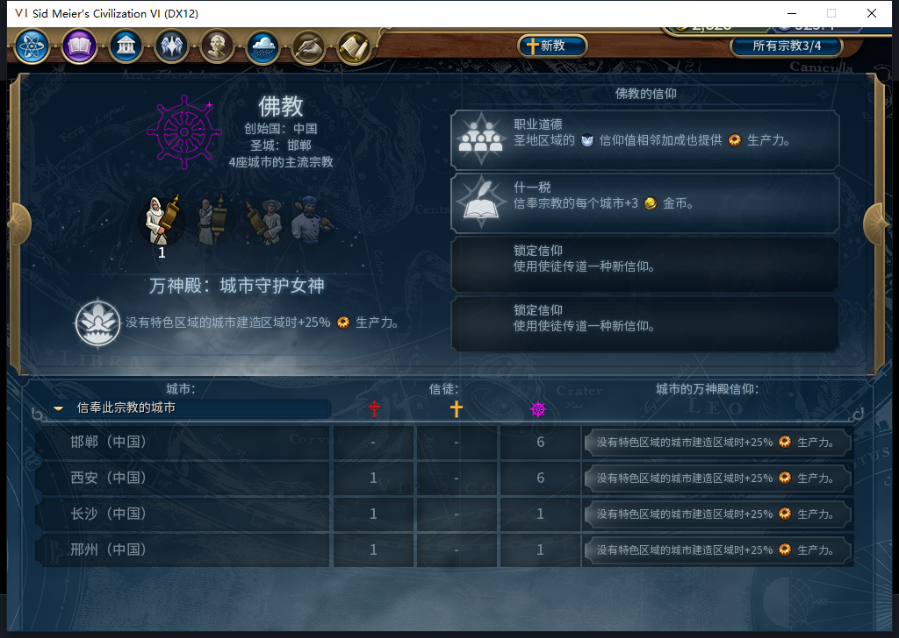

# 105实机141：读档后继续传教，首都已属佛教多数

140完成态正式重载后，新传教士仍在邯郸圣地、3次传播。只由测试玩家让军队待命2次并普通结束140，141白绮自行移动三步到首都西安55,34，再发出一次原版传播。实际次数3→2，新记录religion:0:4为OBSERVED，旧单位最后一次的religion:0:3继续保持。

140首都12人口、佛教信徒5、原生多数宗教-1；141为12人口、佛教6、原生多数宗教1，原版宗教页同时显示4座佛教主流城市，列出邯郸、西安、长沙、邢州。按原生多数标记和原版界面确认转教，没有用6/12自行推断多数规则。这个回合包含普通宗教压力，不量化其对总信徒变化的贡献；传播自身另有原生请求、实际次数消耗与持久化完成记录。

读档后新观察器捕获140条（128招募读取／1城市／11单位操作／0单位命令），0错0丢；4次属于本传教士（三MOVE_TO加一SPREAD_RELIGION），其余建造者／移民，没有后台军令或宗教战斗。城市命令0，未重复购买。只覆盖白绮执行环境，引导期间原生命令次数未知。7城食粮样本非负无饥饿倒计时、7城忠诚100且正变化，广州人口5→6；没有测试玩家手补内政。

141已正式另存1466428字节、摘要核验，尚未重载；观察器仍挂以继续验证其余国内城市目标与后续次数。授予本次读档后传播和原版首都多数转变窄通过，不关闭旧已发令移民ARMED恢复FAIL、40项完整验收、基础版／迭起兴衰、小视口与性能缺口。

本次0新模型请求，579累计不增；此前1598软件完整运行及SDK离线单项补证各按原范围保持。Steam他机占用限制持续有效，0上线／登录／下载／上传初始化或上传，工坊Alpha2仍内部82。本原图、逐城数据及BBCode仅入库。

[逐城信徒CSV](baiqi-source105-postreload-followers140-141.csv) · [结构化请求、次数、原生多数证据](../research/baiqi-p6-source105-postreload-capital-buddhist-majority141-evidence-2026-11-09.json) · [140续购及完成态读档](baiqi-missionary-normal-purchase-reload-105.md)
