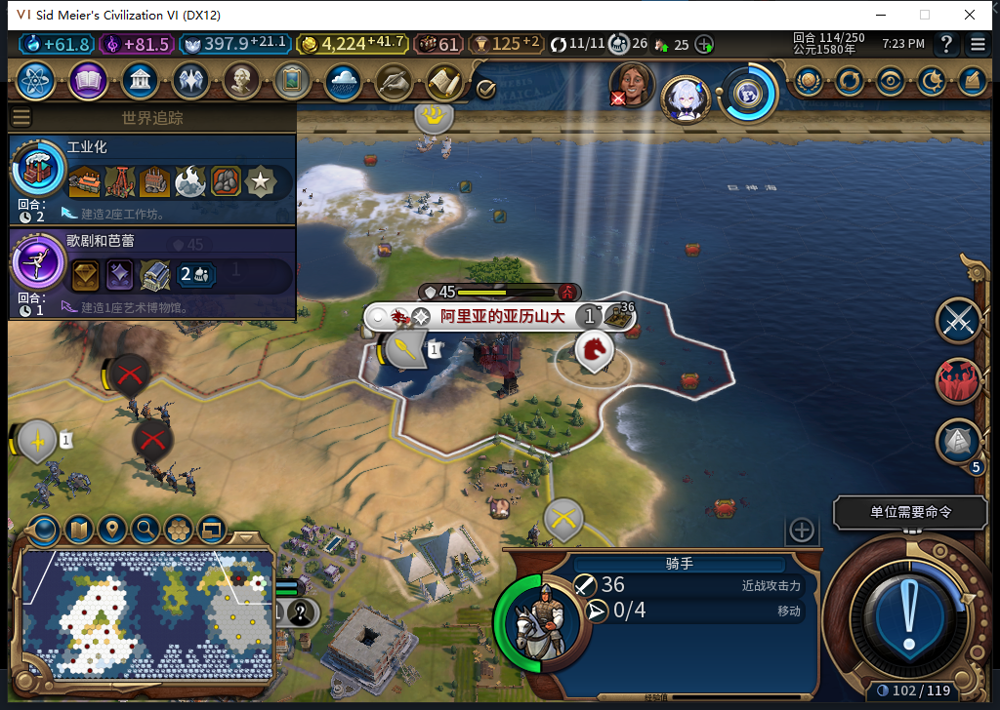
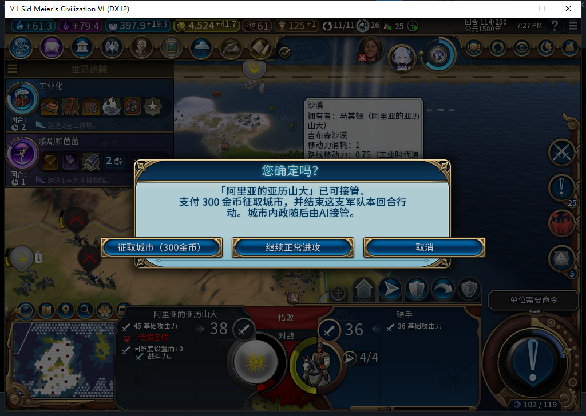
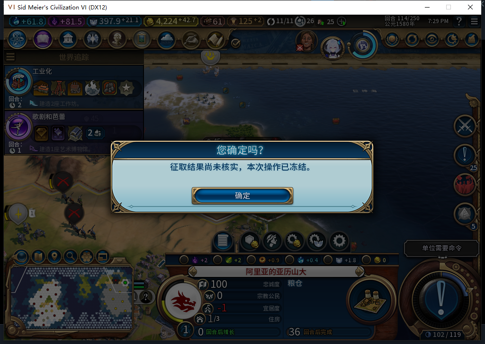

# 75版：正常恢复、未知扣款与军队移除实机复测

2026-11-05，BF-202609141645。75版87文件与源码一致，正式退出旧自有进程后冷启；只读Steam离线确认距启动0.004秒。软件修复见[军队可用性守卫](baiqi-capture-actor-guard-75.md)，完整1048项软件检查仍是该源码提交的结果，本轮未改产品、未重跑全套。[实际状态、次数及原件指纹](../research/baiqi-p6-capture415-native75-recovery-removal-evidence-2026-11-05.json)。

| 独立场景 | 实际结果 | 次数范围 |
| --- | --- | --- |
| 旧74正凭证FINISHING，75冷进程首载 | 自动COMMITTED／DONE；金币4224.2734375、骑手0行动、冷却114 | 完成后两次Recover，0转城／0Finish；启动自动恢复调用数未知 |
| 旧74缺肯定扣款凭证CHARGING，75同进程载入 | 仍UNKNOWN；骑手4行动、无冷却，军队与城址冲突冻结 | 载入后两次Recover，0转城／0Finish |
| 新75真实右键及确认300，结束行动前受控中断，再移除己方军队 | 确实转城、扣款；移除后UI／Core新查询均缺失，仍UNKNOWN／FINISHING | 整个征取／移除窗口转城1、Finish0；移除后两次Recover |
| 军队已移除的未知态正式存读档 | 唯一记录、肯定扣款回执、城市及冲突冻结均保留，余额仍4224.2734375 | 重载后两次Recover，0转城／0Finish |

下图为75实机正常恢复后的骑手，右下显示0／4行动。它证明当前界面状态，扣款回执和恢复阶段由独立Core读取补证。

移除情景来自独立QA驻军存档，宣战、敌城受损和己方骑手位置已有明确准备；不是自然战争形成。测试玩家实际右键敌城并点一次“征取城市（300金币）”，没有后台主动征城。

真实转城、扣款后，测试故障阻止了两次原生Finish调用，记录停在UNKNOWN／FINISHING。随后只对这支QA己方军队调用一次原生移除，立即恢复故障绑定；不再读取旧对象引用。新查询均返回缺失，原生观察器保持Finish0，记录没有冒认完成。下图是该次未核实结果提示，不是成功提示。

正式存档568786字节，重载后同样冻结。没有直接拦截国库扣款／退款函数；这里只报告余额保持和原生转城／Finish计数，不能把余额差值当完整财政调用计数。该次移除产生的是“单位缺失”，旧74本来也有缺失身份检查；尚未形成实机军队“同ID保留、延迟销毁”的窗口，新增守卫在该形状的证据仍为软件回归。自然战斗、过期FINISHING及全部中断点继续待验。

全部故障／观察／输入绑定已恢复，随后独立恢复正常Farm114：11城、4524.2734375金币、397.94140625信仰、原骑手4行动、建造者1次，征取journal为空。公开Alpha及工坊仍固定74，75未上传。
