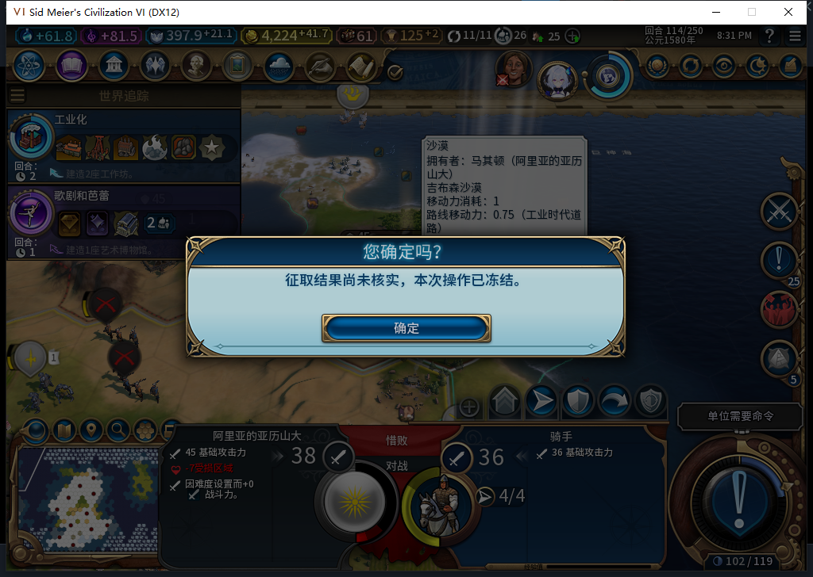
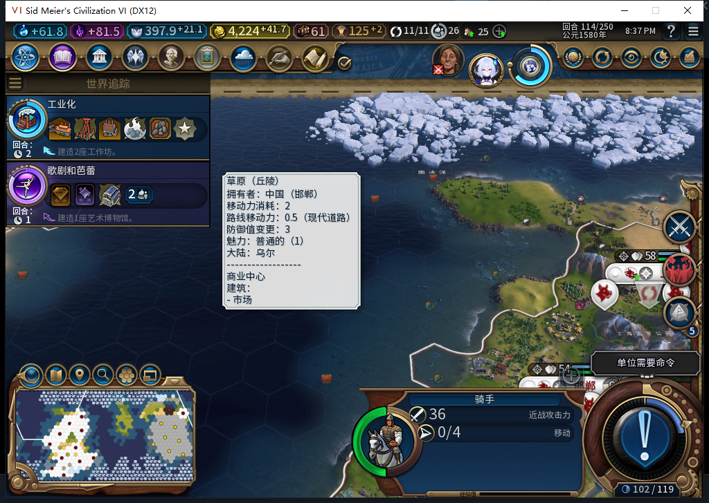

# 75版：已扣款、未写军队冷却的恢复

2026-11-05，BF-202609141645，75源码／安装／运行，当前自有进程15788。本轮未改产品，沿用代码1961f911完整1048项软件通过。[实际阶段、回执与次数](../research/baiqi-p6-capture418-positive-charged75-evidence-2026-11-05.json)。

独立QA驻军114存档中，测试玩家真实右键及确认一次300金币。临时故障只在真实CHARGED回执之后、军队身份结算检查处抛错，形成UNKNOWN／CHARGED；自动恢复资格检查再次命中后保守冻结。原生转城1、Finish0，故障命中2、透传4、匹配错误0。未写journal、余额、冷却或军令来制造阶段。

保存时实际before4524.2734375／after4224.2734375及chargeObserved=true齐全，金币4224.2734375，军队4行动、冷却为空。输入与原生观察绑定已清，临时故障仍占位以保持真实待恢复阶段；正式存档568843字节、SHA256为a4b0db4ab59ff2d85acf3ca94d1b12010033b61bf09144d13131a5e29d09a21f。故障不写游戏属性，加载前精确恢复原绑定并重验旧阶段。

| 项目 | 保存时 | 同进程正式重载后 |
| --- | --- | --- |
| 记录 | UNKNOWN／CHARGED | COMMITTED／DONE |
| 金币 | 4224.2734375 | 4224.2734375 |
| 肯定扣款回执 | 齐全 | 原数值保持 |
| 骑手行动／冷却 | 4／空 | 0／114 |
| 完成后两次Recover | — | 转城0、Finish0、观察错误0 |

余额、肯定回执及完成后的原生观察窗口分开记录；没有直接国库调用计数，加载自动恢复的转城／Finish总数未知。本例覆盖同进程、一个已确认扣款而未写冷却的保存点，未授新冷进程CHARGED或全部阶段通过。

完成后所有诊断绑定清理，原Farm114三上下文恢复：11城、4524.2734375金币、397.94140625信仰、原军队／建造者和空征取journal。75没有上传工坊；417已记录的退出收尾残留原因仍未定位，本轮未再退出进程。
