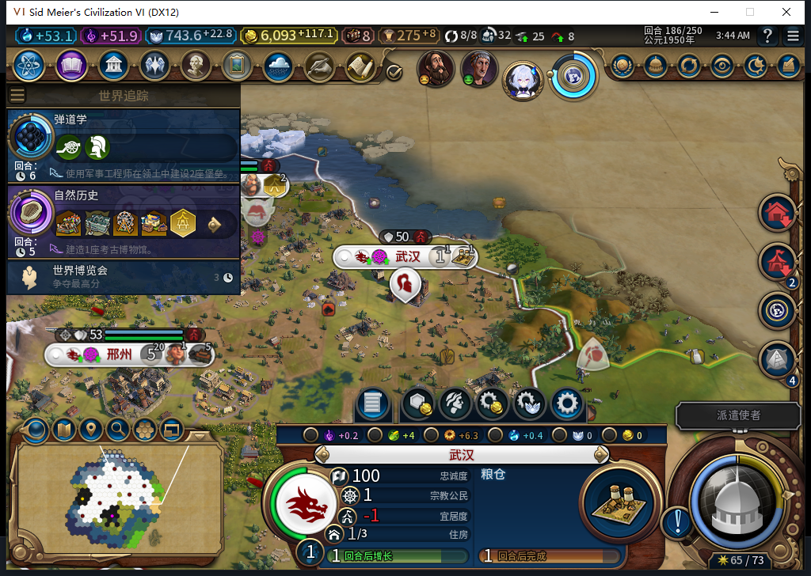
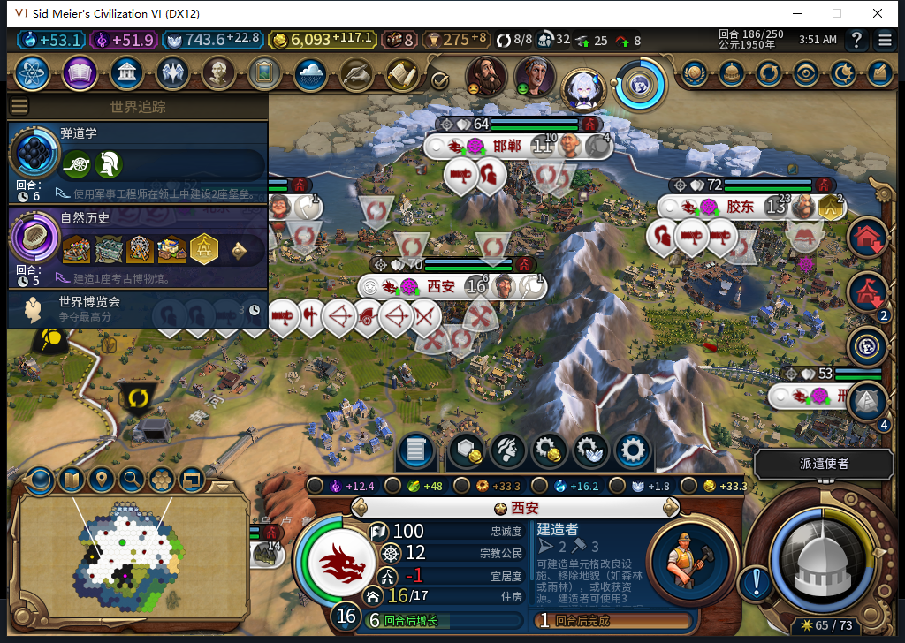

# 186回合：城市面板边界与北京宜居度选址诊断

现有离线106实例只读复核后，两个问题可以分清：武汉与西安当前城市面板的文字和按钮没有发现裁切；北京娱乐中心的生产资格为真，但模组允许的地块与原生合法地块没有交集。继续查替代设施时发现真正的水坝选址缺口：原版要求洪泛平原，通用规则却拒绝所有地貌。**本包只交诊断，水坝修复继续；没有改队列、结束186回合、安装新版本或上线Steam。工坊仍内部82／12图。**

武汉：186回合、1人口、粮仓还需1回合、成长1回合，宜居度差额−1。玩家仅选择自有城市查看，没有代做内政。

西安：16人口、建造者还需1回合、成长6回合、宜居度差额−1。两图原PNG完整嵌入，未裁切或修图。

窗口外框1024×728，UI客户区实际1008×689；不能用外框高度判断控件是否越界。两城关键控件测量如下：

| 控件 | 客户区Y | 高度 | 底边 |
| --- | ---: | ---: | ---: |
| MainPanel背景 | 532 | 162 | 694 |
| GrowthTurns／ProductionTurns文字 | 661 | 21 | 682 |
| LabelButtonRows | 540 | 138 | 678 |
| PortraitFrame／ProductionFrame | 540 | 118 | 658 |
| ProductionDataScroll | 555 | 101 | 656 |

背景底边确实超出5像素；原版CityPanel.xml的MainPanel就是右下锚定、Offset 0,−5，白绮包装没有改布局。当前两帧文字、成长／生产倒计时与查看内容在视口内，不能继续把它笼统描述成“功能内容被裁掉”。也不能据此宣布所有城市、规则集和子页通过，或断言原版作者意图。FoodCheck、ProductionCheck和ChangeProductionCheck仍为禁用，只读边界没有放开。

北京与胶东当前均13人口、宜居度5／所需7。实际原生资格读回：

| 城市 | 当前队列 | 娱乐中心两种CanProduce | 已放置娱乐中心 | 竞技场两种CanProduce |
| --- | --- | --- | --- | --- |
| 北京 | 移民150／160，1回合 | true／true | false | false／false |
| 胶东 | 娱乐中心60／117，2回合 | true／true | true，尚未完工 | false／false |

有效false保留为VALUEfalse，不当作查询失败。这里只证明186现状，不解释174的历史造船厂选择。当前队列非空，ProcessCity在候选生成前就返回，不应为了测试抢掉原生产。

北京18格购买地块全部为自有且当前可见／已探明，0跳过。[逐格CSV](baiqi-beijing186-owned-plot-gates.csv)包含原保护规则、原生娱乐中心、水坝和水上乐园选址结果，只输出资源是否可见，不公开隐藏资源身份。保护规则通过6格、原生娱乐中心合法4格、交集0格。四个原生娱乐中心合法但被保护的地块为：

| 地块 | 坐标 | 原因 |
| --- | --- | --- |
| 2715 | 51,36 | 牧场上的可见资源 |
| 2640 | 50,35 | 森林／伐木场 |
| 2568 | 52,34 | 洪泛平原／农场 |
| 2567 | 51,34 | 农场上的可见资源 |

普通经济改良本身允许合法区域替换；可见资源、地貌、奇观、公园和特殊改良仍分别受保护。没有娱乐中心候选不等于所有建筑、单位和项目都无合法候选，也不能直接推断Choose返回nil。

替代设施检查发现：水上乐园当前两种生产资格false，自然历史尚未完成；虽有6格原生地形合法，不能提前算能建或保证将来一定选中。水坝两种生产资格true，18格中1格原生合法，恰为2568的洪泛平原农场、无可见资源。原版Expansion2_Districts.xml明确列水坝所需三种洪泛平原。现有ClearPlot统一要求FeatureType=−1，令这类必需地貌永远进不了新建候选，属于应修复的范围缺口。下一步只针对水坝所需地貌配对处理，同时保留资源、资产、正常费用和最终原生资格复核；此处没有声称水坝实际开工或完成。

模型594—596均完整stop／DONE／合法外层JSON、各1次HTTP；594／595真实并行峰2、重叠11.652919秒，596另行执行。594关于偏移方向和所有界面通过的推断已纠正；595原代码只定义未调用函数、集合与表混用、将有效false误判等，整体拒绝；596反转可见资源保护、把单类候选空等同全部候选空及误读非空队列，均拒绝。原模型代码0次Native执行，负责人独立有界只读采样，不把模型完整传输当作诊断正确。595负责人探针在缺少区域定义时存在可能回落到建筑行的表达式，本次真实定义完整且索引7正确，未授缺定义分支通过。

冻结到596累计596逻辑／556完整／37截断整弃／3最终传输失败、626HTTP／30额外重试／0OpenCode原生生成；后续597修复候选另计。同机BF-202609141645的Nov10成功1.19.5每日维护缓存由canonical CLI复用。缓存tokens、人工成本和净节时未知为null。本包不改产品，不为文档复跑已通过全套；旧已发令移民ARMED恢复FAIL、未知MOVE、108正式冷安装、十城性能和完整40项继续开放。Steam他机占用，联网／登录／下载／上传初始化／上传均0；新启动离线证明不可用时不新启。

[结构化证据与原图哈希](../research/baiqi-p6-city-amenity186-evidence-2026-11-10.json) · [待同步BBCode](../workshop/v0.1.0-alpha.2/pending-city-amenity186-2026-11-10.bbcode)

后续：[109修正水坝必需洪泛平原规则](baiqi-dam-required-features-109.md)，软件回归与现有106中纯函数只读预验通过，正式安装开工／建成仍待验。
