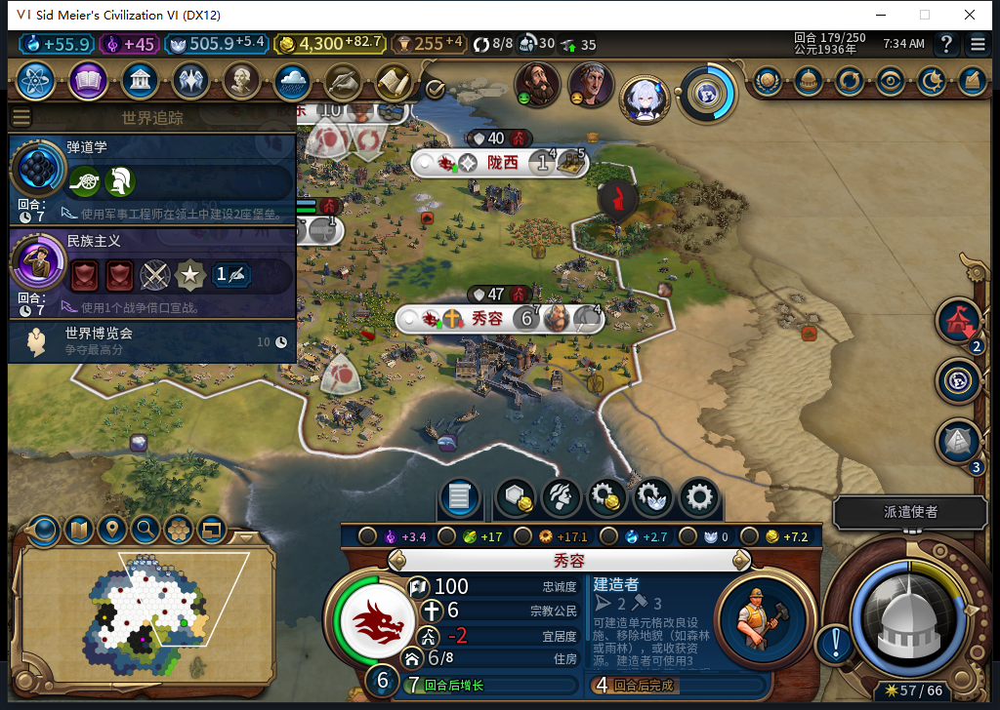
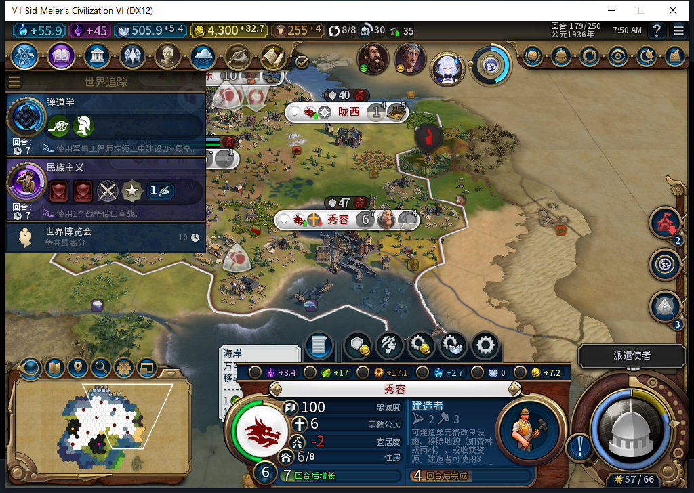

# 561更正：秀容截图显示4回合，负责人曾误读为1

上一轮把秀容建造者截图的小字读成1，错误地报告了“原生4、界面1”的新缺陷。复核原图的私有放大视图，数字清楚是4。原生队列、现有CityPanel控件及原版GetCityData也都是4。**这个缺陷判断已撤回；没有因此改产品代码。**

负责人在同一179回合重新选择自有秀容一次，只做查看；随后三次独立只读核对：完整ID524295／62,30／人口6、队列29/83、标准编队modifier0。GetTurnsLeft不带modifier与带0均返回number4；原版ProductionNum文本4、ProductionNowLabel建造者、GetCityData.CurrentTurnsLeft为4，CityPanel未隐藏。截图前后读数保持，没有调用刷新器、生产／文职命令或写控件。

检查也确认ProductionLabel本身只是“回合后完成”，数字来自独立ProductionNum；不能把本例归因于本地化参数或GetTurnsLeft可选参数。只授当前样本三者一致，不升级为完整界面、全用例通过。

561模型收到的是负责人已经误判的文字事实，没有图片。它对原版控件和取数路径的建议窄采用，但把Expansion2说成覆写ViewMain不准确：实际这里是Expansion1→Base，当前模组只是调用原版后禁用写入口。缓存、回调竞态、可选参数差异均未成为本例根因证据。不能把未见图片的模型没能否定输入错误，算成模型视觉失败。

原四张实机PNG保持字节不变，已经修正README、179解读、结构化证据、用例与待发布BBCode中的错误缺陷描述。两份裁切放大图仅供私人识字检查，未作为实机截图提交。561完整stop／DONE／JSON，1HTTP，27329+1144=28473 tokens、11.281081秒；累计561任务／523完整／35截断／3最终传输失败，591HTTP／30额外重试，新OpenCode原生生成0，未知成本null。

产品仍98，软件1412项／1411pass／1SDK环境skip未因这次更正重跑。179正例存档保持，旧中断存读恢复FAIL、自然宗教和完整40用例仍开放。Steam其他设备占用，0模式切换／上线／登录／下载／上传初始化／上传。

[完整更正与原生读数](../research/baiqi-p6-cityui561-owner-image-reading-correction-evidence-2026-11-09.json)、[已更正的98实机记录](baiqi-source98-cold-followup-179.md)。
