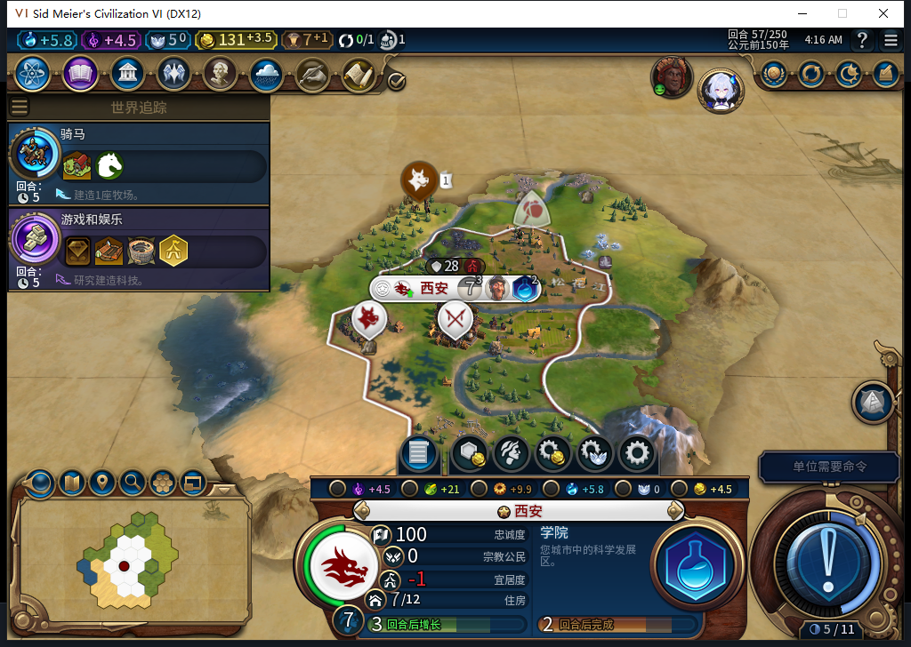
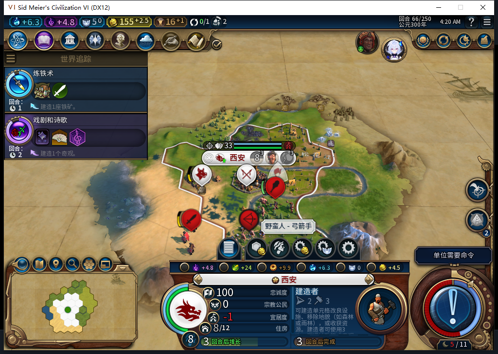
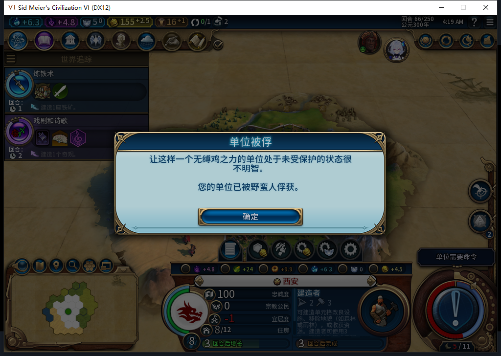

# 86古典新局实机：内政持续推进，先知激活仍未验收

96文件的源码86已安装并逐字节核对，冷启动后新开单人局，实际从第40回合开始。条件为风云变幻、王子、大陆小图、古典时代、联机速度；“联机”是速度名称，Steam保持离线。此场景用于尽早寻找全新先知，不能代替默认远古／标准速度条件。[结构化证据](../research/baiqi-p6-source86-native510-512-evidence-2026-11-08.json)。

原版设置参数的实际ID是GameSpeeds与GameStartEra，分别对应GAME_SPEED_TYPE、GAME_START_ERA。负责人在原版合法域内选择完整值记录，经原始setter与配置广播各设置一次；游戏种子1855881338、地图种子1855881339，默认6个参与者。没有通过私人函数补建城市、单位、科技或内政。初始西安由模组建于15,32，4人口、54金，先排粮仓；首都日志为OBSERVED，先知日志serial0／0操作。

40→66共26次普通结束、52次测试玩家军队待命；没有UserForced、军队移动、主动攻击或文职／内政输入。48的首次接触及50的使团来访需要测试玩家普通外交回复，第一次等待新回合未成功的原件保留；外交结束后分别读到49和51，没有重发结束回合。军队待命不等于没有战斗发生，后续野蛮人确实造成了伤害与俘获提示。

后台未来请求记录显示，城市依次安排纪念碑、水磨坊、建造者、学院、城墙、移民、建造者。第57回合7人口，学院正在施工；生产与市民管理按钮实际读回为禁用。50回合起自动采用寡头政体及纪律、斯巴达教育、城市规划、殖民四卡，66保存重载后仍在。

第66回合五个可见自有地块读回为一处采石场、四处农场，重载后逐项保持。城市8人口、155.5金；新移民393217留在首都，后台明确等待已探明的安全城址或路线，下一项生产是建造者。此处尚未建第二城，不能补授扩张成功。

本轮也出现了“单位被野蛮人俘获”提示，斥候伤害为52。提示未给出单位ID；第二名建造者327681在58、59的后台待命记录中存在，60的自有单位清单里已不在，但本轮没有注册UnitCaptured事件，不能把提示直接当成该ID的确切回执。军队一直原地待命、没有清剿，城市周围的野蛮人压力也未被消除。这是实际风险，不能写作安全性全部通过。

宗教方面，40—66的27份逐回合快照均为未创教、已获信条0、万神殿-1、没有先知、信仰5。51、54、57、60、63、66读取的先知点总量及每回合产出都是0，也没有已完成圣地；Core先知日志仍serial0／0操作。没有新先知，86修正的激活资格尚未触发，不能用这轮城市建设通过代替先知移动、激活或创教通过。

未来观察器的914条样本逐项读回一次：892次招募评估、7次城市请求、15次文职单位操作；单位为14次建造者操作和1次移民待命，0错误／丢样本。原请求返回0值，pcalltrue不是原生布尔ACK。27份先知快照也全读一次，0错误／未知／丢样本／参数截断；没有出生或激活事件。范围仅覆盖安装后的Executor，不能推为所有上下文零军令，也不包含安装前首都生产或Admin的玩家操作。

两套钩子已撤，随后用原版保存和加载各一次，实际UI／Core均读回66／1城／3单位／155.5金／8人口／建造者队列，五处改良、政体四卡、首都OBSERVED、空先知日志保持。备份1122654字节，SHA256`fb62e6062dc2786c51e92a48df32c273ac7ca7c460664a376915ead440a918a3`。第一次Continue探测仍在加载画面，0输入；真正出现继续按钮后只执行一次。私人存档不上库，以上四张原始实机图已内嵌。

本地模型510、511、512均完成HTTP200／完整SSE／stop／合法JSON，但原稿分别是占位调用、文件路径和错误的SafeCall／API／丢弃返回值，整稿全部拒绝、0Native执行。负责人选择器15项、事件观察器16项、只读进度模块14项Lua5.1检查后才使用。累计512任务／477完整stop／32length／3最终transport，542HTTP／额外重试30，OpenCode新增原生生成0，未知缓存与成本保持null。

源码和产品文件本轮未改，前包1213通过／1SDK环境跳过不重复冒充新运行。公开GitHub／Steam Alpha2仍内部82／12图，本轮0上线／上传。建城ARMED恢复、旧档等待、宗教完整链路、长期经营及全部40项继续开放。接续从已核验66备份继续，优先观察真实宗教前提与城外威胁，不赠送先知、不代做内政、不自动操纵军队。
