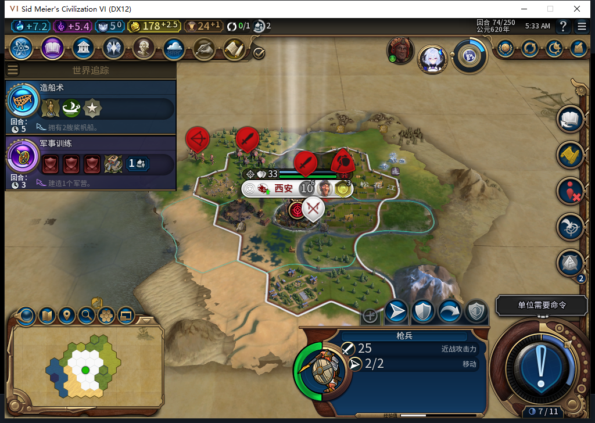
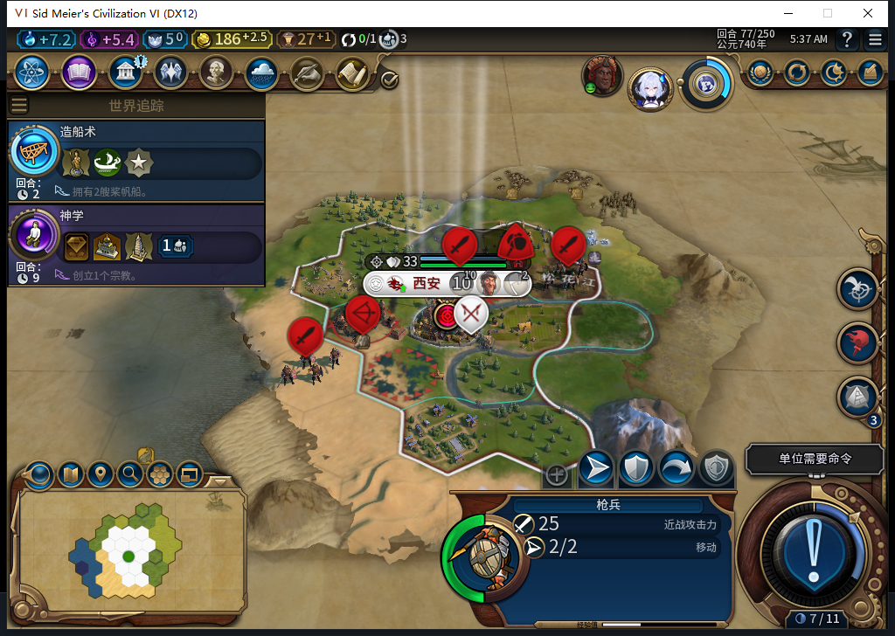
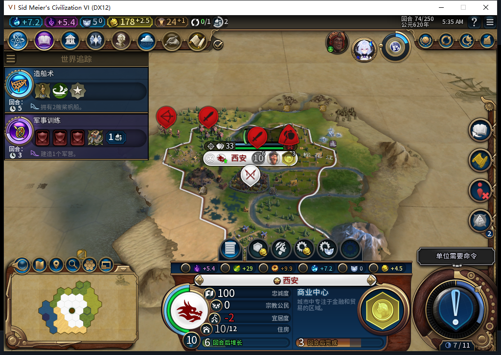

# 87冷加载保持，玩家城防攻击实际生效

87已安装96文件并逐字节匹配，独立后台只读确认Steam离线后才冷启动。原版正式加载86的第74回合备份、继续一次，实际UI／Core读回10人口、178.5金、城内一名枪兵和商业中心队列，首都OBSERVED日志保持。[全部读回和范围](../research/baiqi-p6-source87-native-city516-evidence-2026-11-08.json)。此前86正式退出后仍留无窗口、无监听残留，超过180秒并复核私人存档／2秒CPU不变后只退役该自有tuple一次；不称正常退出。未操作Steam或其他游戏进程。

74→78完成4次普通END、4次玩家军队待命，0UserForced、0文职／生产输入。商业中心自然完成后，75的后台请求选择了移民，77和78实际队列仍为移民，金币增至188.5。当前没有新区域放置请求；87修复已加载，但“允许消耗农场的区域实际建造”仍未触发，不能把冷加载或软件通过代替该效果。

TEST_PLAYER另通过原版城防接口发出两次攻击：74攻击邻格剑客，伤害0→10；77攻击邻格弓箭手，伤害0→16。命令都返回0值，首次即时读回伤害仍为旧值、城防资格已消耗，均未重发；稍后读取同一可见敌人完整ID才确认伤害。军队没有被模组后台调动；这只是玩家城防两次操作的窄通过，不是全部战斗单位或围城安全性通过。

本轮未来观察器129条样本逐项读回一次：128次招募评估、1次城市请求、0文职操作，0错误／丢样本。5份宗教快照也全部读取，仍未创教、已获信条0、万神殿-1、无先知、信仰5，0出生／激活事件。Executor观察器不捕获WorldInput中的城防命令，不能以0单位请求冒充所有上下文零命令。两套钩子已经撤除，随后原版保存78一次，SaveACKtrue／稳定字节；1175013字节、SHA256`5955400004f54a5230bce33e8b436e493c4f47a48442762accda9db67d46fd16`，该新文件尚未加载，私人存档不上库。

模型516原稿可编译，但使用全局对象和多处未给出API、缺少精确身份／回合门、实际没有声称的32个边界与pcall保护，整稿拒绝，0Native执行。负责人提示还错误指定CityCommandTypes.PARAM_X/Y；所附原版WorldInput第2550—2556行实际使用UnitOperationTypes.PARAM_X/Y发CityManager命令，已先纠正再查询／发令。负责人只读资格与单独动作意图均Lua5.1编译、严格核当前自有城市、可见邻格敌人、已有战争和原生资格。累计516任务／481完整stop／32length／3最终transport、546HTTP／额外重试30；OpenCode新增原生生成0，未知缓存／成本null。

围城局继续缺少新先知，区域生产正案也还没出现。接续保留此78备份，使用正式新局“无野蛮人”对照场景观察生产与宗教前提，实际参数／种子另记；这个对照不能关闭围城局文职生存风险。源码与产品文件本轮未改，前包1222通过／1SDK环境跳过不重复计为新运行。公开GitHub／Steam Alpha2仍内部82／12图，0上线／上传，建城恢复FAIL、旧档等待及完整40项继续开放。
