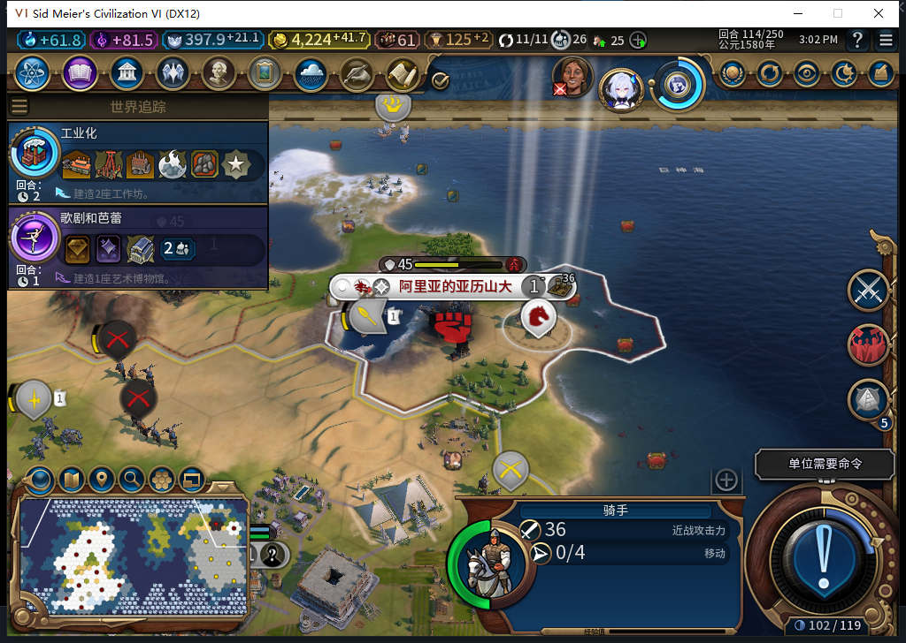
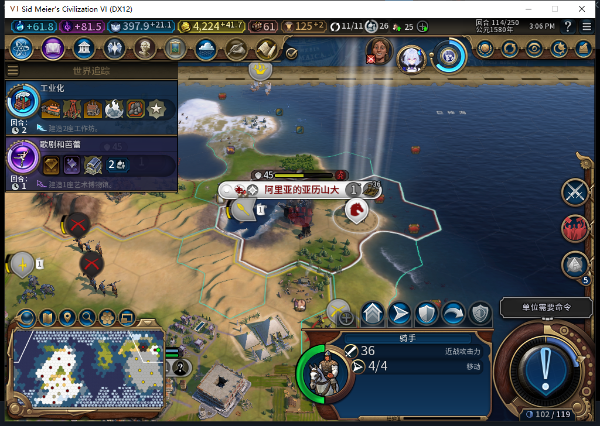

# 74版：完整退出后的两种中断存档

2026-11-05，BF-202609141645，Steam离线，产品74／Alpha的87个文件未改。原验收正常Farm114已独立恢复为11城、金币4524.2734375、账本nil、骑手原位4行动，故障和输入绑定清除；之后正式退出18760并独立确认进程消失，未terminate／kill。新进程12052启动前15.843194秒取得当前Steam实例后台只读正式“上线…”菜单证明，0联网切换。[结构化读回、存档与原件指纹](../research/baiqi-p6-cold407-recovery-evidence-2026-11-05.json)。

| 原18760保存的真实窗口 | 新12052首次Core／UI读回 | 后续两次Recover |
| --- | --- | --- |
| UNKNOWN／FINISHING：转城与扣300有肯定凭证，军队尚4行动 | COMMITTED／DONE／recovered；金币4224.2734375、骑手0行动、冷却114 | 同一笔记录；新计数器转城0／Finish0／错误0 |
| UNKNOWN／CHARGING：实际少300但肯定扣款回执缺失 | 仍UNKNOWN／CHARGING／execution_interrupted；金币4224.2734375、骑手4行动、无冷却 | 状态不变；新计数器转城0／Finish0／错误0 |

FINISHING先从新进程主菜单载入；CHARGING随后在同一新进程加载。两份文件都来自旧18760，分别通过文件字节数与SHA校验；这证明跨旧／新进程保存恢复，不冒称做过两次全新启动。首次读回在人工Recover及新观察器之前，故启动恢复的原生调用次数仍未知。原守军仍为玩家1／完整1179657，40,19水格、伤害37、行动0、登船，未变为己方单位。

未知分支对同军队、同坐标的真实Conflict谓词仍为true；没有重投付费Request，不把谓词读回写成新UI拒绝验收。两分支的观察器都核所有权恢复，未修改任何持久回执、金币或单位来达成结果。两份照片为原始截图，内部状态另有独立证据。

测试工具也保留失败：正常恢复检查一度把空tag3成功终帧错判错误，实际UI只读断言已过；修正ERR契约后用新标签读全。第二份加载期截图还是“加载中”，继续动作的ROI门拒绝、0输入；负责人未及时停止依赖查询，两个只读LSQ超时，均先收终态再取新端点和已查看的Continue图。失败探针未收到LSQ、未发NativeCMD，无付费操作重放；这些不归产品或模型故障。

407普通HTTP候选68行能编译，但遗漏最小化／client矩形及截图后复核，并把两份JSON附在同一文件；负责人只参考所有权与导航意图方向，原稿0执行，改为既有ctypes挂起查询、前后复核与独立只写一次凭据。模型成功不等于工具或游戏验收；产品未改、未重跑完整软件套件。

这里只覆盖同114回合的真实FINISHING与未知CHARGING两个保存窗口。TC-029／030整体仍部分，其他阶段、跨正常回合及第三方战斗矩阵仍需继续。当前保留未知分支以做下一项正常回合检查；原正常存档文件哈希未变，不能把本切点写成再次恢复完毕。

后续：[正常114→115的未知扣款](baiqi-debit-unknown-normal-turn-74.md)也维持冻结；原冷加载切点不改。
