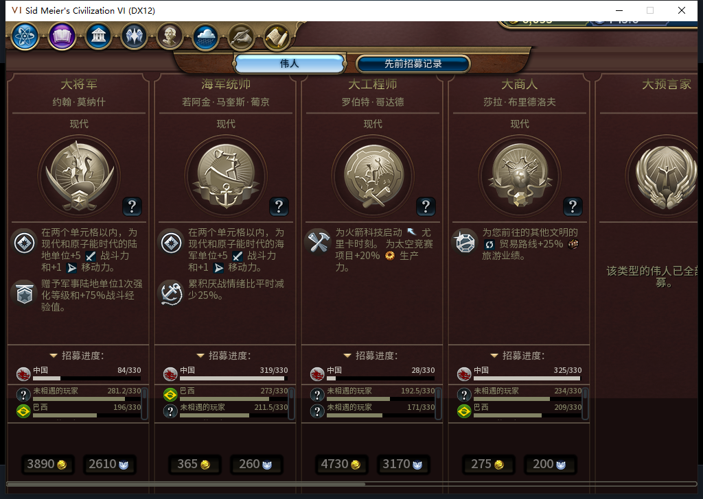
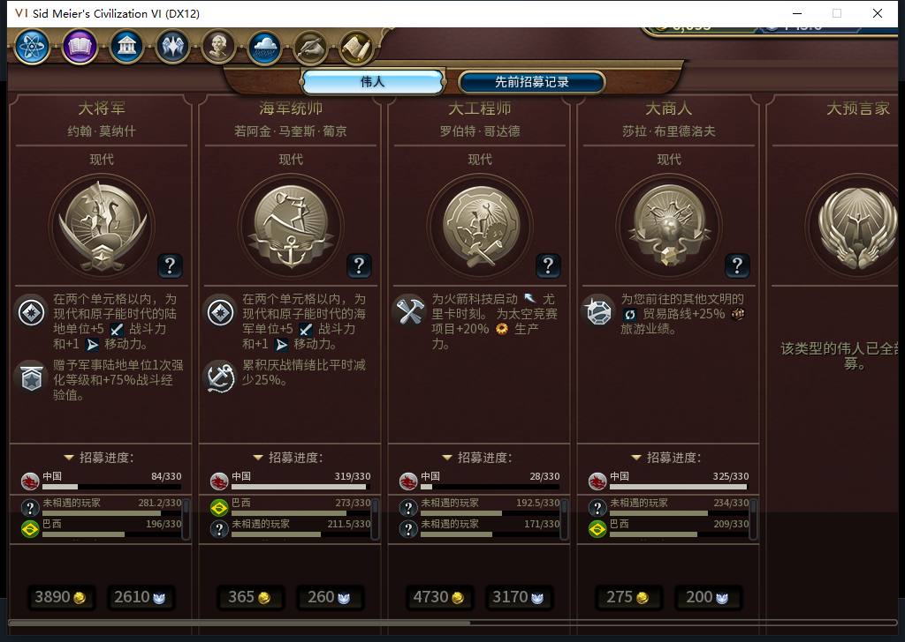
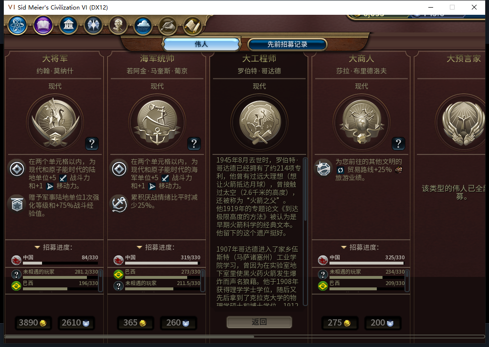
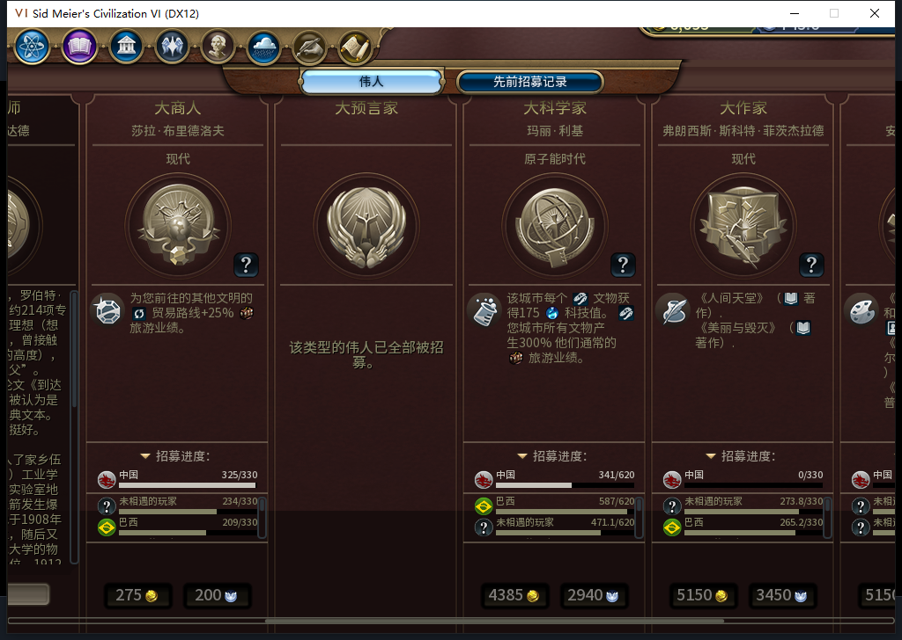

# 109正式冷验：伟人页尺寸与查看部分通过，滚轮待查

已通过官方菜单头部导航暴露模式项，再独立后台读到当前Steam实例提供“上线…”，以0.004954秒新鲜离线证明启动自己的109验收进程。头部导航有输入与激活，状态确认另一次只读查询0输入／激活／焦点变化／移动／截图；没有选择模式项或上线。109的109个安装文件与已提交源码一致，正式加载106的186存档一次并实际点击继续游戏，仍在186回合。**工坊仍内部82／12图，本包只入库，不上传。**

冷读前后，世界摘要1、9城队列、65建筑、34区域、144己方可见地块、9食粮和9城市状态相同。35个单位身份、类型、伤害、编队和所采次数保持；其中33整行相同，2建造者坐标／行动点变化。新日志分别有5111822从2207到2206、4718607从2432到2505的后台MOVE请求与OBSERVED，匹配新位置，不能称全世界不变或冷启0发令，也不授通用未知MOVE恢复通过。最初比较器排序字典报TypeError，修后严格六组相等断言又正确拒绝两单位变化；原失败结果保留，分类核对另存，未重放游戏动作。

图1：正式安装后的第一次原版打开，689高视口已经自动适配。没有在Tuner里调用Apply／Install、注入布局模块或替换渲染回调。九卡均591，主信息575、效果161、完整招募进度区152、传记／详情312，名字偏移−255；弹窗与横向滚动区689，历史滚动区507。费用行及公开招募进度可见，军队操作没有在本包测试。

图2—3：原版按钮切到历史页，当前卡片栈高度0是隐藏状态。原版历史ScrollPanel API从0滚到1后，最后一条葛饰北斋记录完整可见；这不是物理鼠标滚轮通过。返回当前页后九卡尺寸保持。

图4：原版关闭再开，九卡仍为相同尺寸，费用行保留；没有手工重新适配。当前、历史、回当前、重开、传记末段五次尺寸读回均核对九卡，不据此声称Apply调用了多少次，或全类目已横向逐一目视验收。

图5—6：原版按钮打开罗伯特·哥达德传记，正文区域312高；原版ScrollPanel API实际0→1，末段和返回按钮可见。最后完成原版返回按钮输入并关页。末段可由控件API查看，不代表物理滚轮交互已验收。

图7：首次20格向下物理滚轮后，传记仍0，整排卡片横向滚动0→0.604575157。第二次新测试在指针资格断言前中止，0次新滚轮。UIManager:GetMousePos在移动和正文点击后仍返回早先传记按钮坐标614,270，它在输入回调外的实时语义没有证实。**负责人先称“输入未被游戏接收”，依据不足，撤回这个归因；不能从该读数判根因。**

随后在OS点540,500及其所属自有游戏窗口均核验后，做一次可还原单变量实验：仅把可见传记滚动区的ConsumeMouseWheel从false临时设true，另20格滚轮仍使整排横移，传记不动。原属性false和父子滚动值0全部还原，临时命名空间nil；没有修改产品、原输入处理器或回调。该假设未解决问题，物理滚轮保留未通过，尚不能判109引入回归。后续输入路由诊断继续，不能为了报通过省略它。

整段查看前后，所采自有六组记录、9食粮和9城市状态逐行相同。共2次原版开／关、5次查看／聚焦按钮输入、2批实际滚轮、2项主要控件API查看，另有失败滚轮资格与恢复滚动操作如实留证；0END186、0人工内政。所有可还原实验都已清理，安装109的产品布局模块正常保留。

日志也没有写成全绿：初次冷读归档Lua日志未见错误，Database.log有70条重复键错误，35条序列化来源记录分别为CurrentClickouts21、HallOfFame14，每条对应两条错误；Modding.log另有官方DLC的XML与语言文件警告。白绮SQL加载与文本保存点释放记录已核，不将这些上下文等同白绮失败，也不宣布全部错误无害或根因已修。

598—600三个普通HTTP均stop／DONE／合法外JSON、各1次、真实峰1，原候选代码0Native。598混淆进程PID22612与玩家0、局部installed与冷加载时序，整份断言计划拒绝；599部分日志事实参考，其全局完整性推断缩窄，负责人读完整来源后分账；600部分可还原实验建议采用，拒绝以未资格化GetMousePos作为强制前置。598复用Nov10成功维护，599跨日首次完成Nov11检查、本机／registry1.19.5且无升级，600复用新缓存；0OpenCode原生生成。累计600逻辑／560完整／37截断整弃／3最终传输失败，630HTTP／30额外重试，未知缓存tokens／人工成本／净节时null。

本包只授所测109冷读状态与伟人页尺寸／查看范围通过，物理滚轮、宽视口、其他规则集、完整城市面板、军队／宗教全入口、旧已发令移民ARMED恢复FAIL、通用未知MOVE、十城性能和完整40项仍开放。下一步正常推进186以后回合，观察水坝合法选址是否实际排产、按正常产能推进并建成；不抢移民或其他已有队列。源码未改，不重复已通过软件全套。

[结构化原图、冷读、日志与候选审阅](../research/baiqi-p6-cold109-gp186-evidence-2026-11-11.json) · [待同步BBCode](../workshop/v0.1.0-alpha.2/pending-cold109-gp186-2026-11-11.bbcode)
