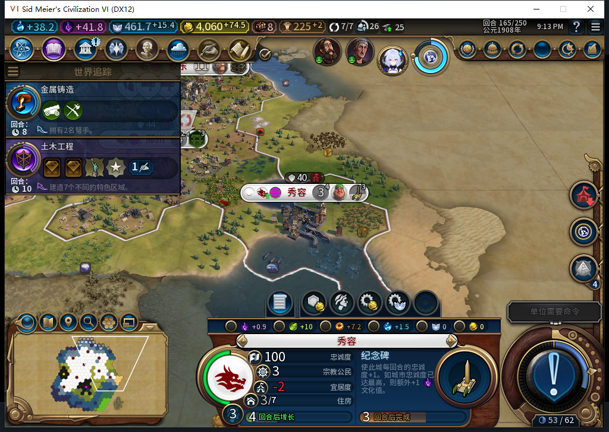

# 105完成态165正式读档：新城、宗教账本和七条商路保持

已实际加载[连续20回合终态](baiqi-continuous-window-105-145-165.md)的165存档一次，并在原版加载画面点击继续一次。同一进程回到165，未结束165或手补内政。8座城市、金币4060.16796875、信仰461.75390625、4笔传教士购买及7条实际国内商路保持，新城秀容仍3人口、佛教多数、正在建纪念碑。

| 读档前后比较 | 结果 |
| --- | --- |
| 世界／城市／建筑／区域／可见自有地块 | 1／8／45／28／124行完全相同 |
| 单位 | 30个完整ID及类型集合相同；1名建造者位置／行动改变，不能写六组全同 |
| 8城食粮及焦点 | 每行完全相同 |
| 持久化记录 | 建城、普通伟人、传教士购买、传播的全部已打印标量字段相同；先知打印记录也相同 |
| 国内商路 | 7条原城市／完整商人ID／目标所有者／目标城市记录完全相同，实际7/7 |

原165逐城帧是在新商人4784157出发前采样，随后原日志已有同165:270的MAKE_TRADE_ROUTE请求和完成，之后才是保存ACK。重载准备时，它已从59,32走到59,33、行动2→0，邢州渡槽预计4→3回合，Hash、进度0、成本74均未变。第一次严格比较因此在加载前停止；没有把这处正常时序当存档损坏，也没有覆盖原165存档。最终以更新后的真实前态及原生7条商路逐项比较，原165文件实际重载，商路保持。

另一个诊断守卫原先假设“旧ID的FindID必须返回nil”，实际不成立：UI和Core按3145745查到的是完整ID4653073的骑士，按4259861查到的是完整ID4456469的建造者。两个旧演员的完整ID都不在实际名册中。必须比较GetID和实际类型，不能把返回非空当旧移民／旧传教士仍活着，更不能由此操作新演员。该失败守卫0游戏命令，修正的是验收资格，不是清旧账本或接管骑士。

重载后建造者4456469实际从53,35到54,34、行动2→0、次数仍4；原日志对应新165:3的后台MOVE_TO。旧日志末条164:253指向另一地块且未见对应observed，本轮据此记录重规划差异，继续审查MOVE等待／持久化消费者；不将它宣传成未知移动恢复通过，也没有据此断言同一请求被重复执行。引导期全量命令次数未知。

原165文件1613032字节、SHA-256 `558acebef0362c1a4e0c665ce9b39a935e1cb6b7cda67194894d5b1ae21d5a94`，本次只加载一次，原文件保留。完整实际Lua日志另存忽略目录，公开证据保留摘要、相关行序和前后原生数据；没有以模型推断替代读回。0新HTTP，582累计不增，也没有新跑完整产品检查。

只授予新城及已完成账本／商路这次正式读档的窄通过。旧已发令移民ARMED恢复FAIL、未知移动审查、宜居度、小视口与兼容／性能矩阵继续。Steam其他设备用号限制持续，0上线、登录、下载、上传初始化或上传，工坊Alpha2仍内部82。图文与BBCode仅入库。

[结构化比较、完整ID别名与日志行序](../research/baiqi-p6-source105-reload165-and-exact-id-evidence-2026-11-09.json) · [原20回合逐城数据和5图](baiqi-continuous-window-105-145-165.md)
