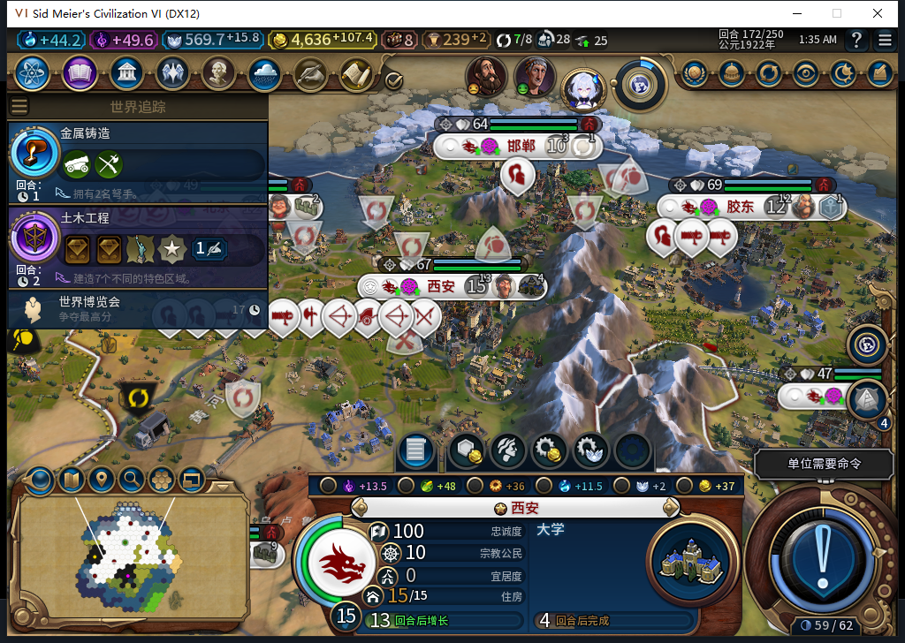

# 106完成态172正式读档：竞技场与8／8宜居度保持

172已保存的竞技场完成点，经原版LoadGame一次、原版继续一次后实际载入。西安竞技场仍在，宜居度8／8，娱乐来源5、奢侈品来源2，大学0／125；本次完成态同进程重载窄通过。当前仍172，0END172，Steam他机占用禁上线／上传，工坊82保持。

| 逐行比较范围 | 数量 | 结果 |
| --- | --- | --- |
| 世界摘要 | 1 | 相同 |
| 自有城市队列 | 8 | 相同 |
| 自有建筑 | 52 | 相同 |
| 自有区域 | 31 | 相同 |
| 采样自有地块 | 130 | 相同 |
| 单位完整身份／类型 | 33 | 集合相同，1名建造者状态变化 |
| 食粮／侧重 | 8城 | 全行相同 |
| 宜居度基础与来源 | 8城／120分项 | 全行相同 |

建造者4915231由56,36／行动2继续到57,37／行动0.5，次数仍3，其余32单位采样行相同。不能因此写六组全同、全世界不变或引导0发令；引导Native请求数量未知，也不从坐标变化推导旧请求的具体重放／恢复因果。

原图没有修改。面板宜居度0对应原生8／8，竞技场存在及收益另由原生读取核实；窗口底部仍有既有小视口限制。

最初两次继续输入都在发送前被60秒截图时效拒绝。只读核对显示同owner／PID／birth均匹配，截图年龄150.55秒；没有点击、没有重发LoadGame。随后复拍，将领袖名称及“继续游戏”文字区域与负责人已审阅原图逐字节比较，再沿用原来的60秒／前台／进程／矩形／文件哈希检查发送唯一一次继续。没有放宽守卫或把点击ACK当世界载入。

正式原档1645552字节、SHA-256 `55ba3d3bbfdb114e58805313aa81a3ec554553f96a73bacf6c1d72559806c817`，未覆盖。读档后诊断观察器与宗教QA属性均为空。仅新增原生读回证据，产品106未改、0新增模型请求／生成／全套重跑，不追认11月10日模型维护。

这只关闭该竞技场完成态同进程读档子项。其他城市娱乐设施、106新的20回合窗口、通用未知MOVE、旧已发令移民ARMED恢复FAIL、冷进程及完整40项仍保留。

[结构化比较与原图哈希](../research/baiqi-p6-source106-completed-reload172-evidence-2026-11-10.json) · [166—172实机链与七张原图](baiqi-amenity-native-106-166-172.md)
