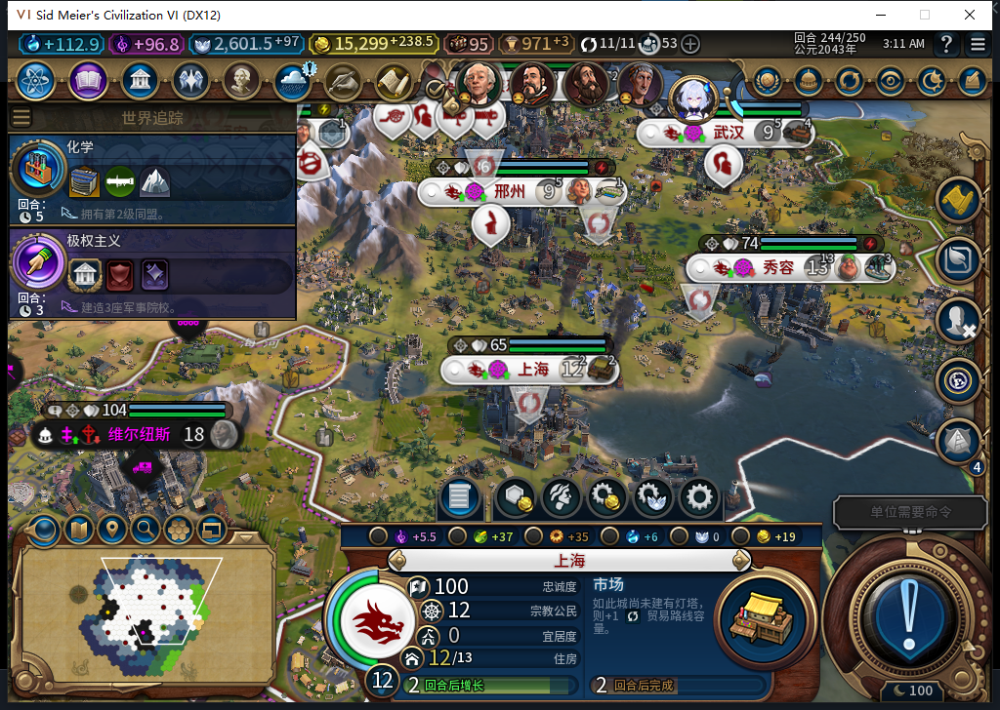
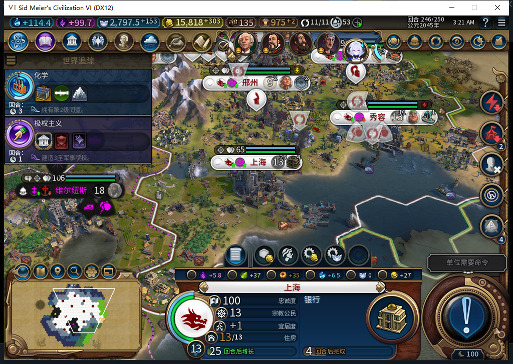
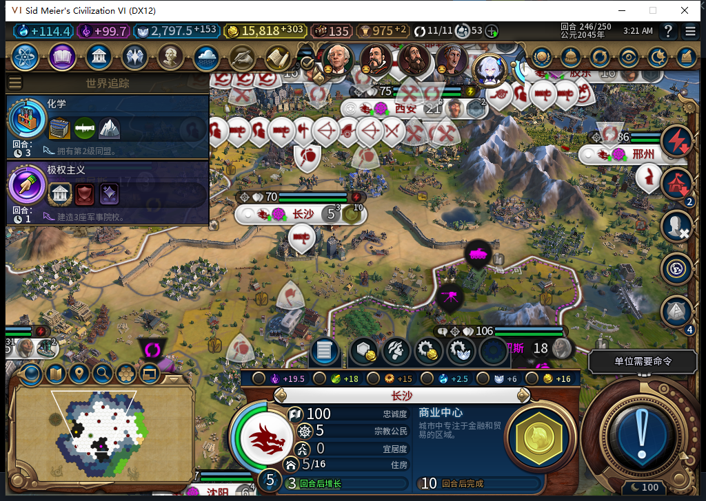

# 119：商业中心与市场完工，246 重载和电力缺口

2026-11-12，BF-202609141645。从已恢复的 243 完成态继续三个普通回合到 246。上海商业中心在 244 建成，后台开工市场，245 为 59/60，246 建成后接银行 0/145。上海人口自然增至 13，下水道仍完好，旧工厂仍未建且保留 73/165；工业区仍受损，不授其修复和工厂续建通过。

长沙下水道在 246 完成，人口由 4 增到 5，后台开始商业中心。当前总粮 18、净粮 8、库存 3.37109375，食品市场完好、实际产粮 4。邢州水力发电站在 245 建成，246 已自动施工工业区项目。

三个回合共 3 次普通 END、21 次玩家军队待命；巴西、加拿大原版交易拒绝／再见共 4 次物理输入。两次等待因原版外交对话超时，处理后只作新鲜等待，未重发 END。无人工内政、无 UserForced、无 Steam 上线或上传。11 城每回合人口不下降、粮食不为负。本段接在原 236→243 分支后，单独的武汉 221→222 取证不计入其中。

246 正式保存后请求一次原版重载、点击一次继续。世界行、11 城队列、151 建筑、64 区域、200 可见自有地块、51 单位及 11 城粮食／状态全部一致。存档 2091495 字节，SHA-256 `a9973422c4a559e54aaaa8070b821810c5610fdd03cabeed27313d24d1e8801c`。243、原主 237 和 118 失败档均保留。

首次额外核对错误地强求市场保持 243 的 6 粮，实际 4 触发断言，后续保存没有执行。负责人独立重读确认建筑完好、人口增长、净粮为正后，修正这项过严预期，再正式保存。它是负责人检查错误，不是新生产回执失败。

为查清当前 4 粮的条件，先读原版 `CityPanelPower.lua` 真实消费者，再让 632 提出尚未实现的只读探针候选。候选虽完整 stop/DONE/合法 JSON，但用 `ipairs` 拷贝字符串键来源行会变空表，首个电力接口异常会中止后续读取，两项隔离反例成立；另缺独立保护、11 城有界范围，并依赖未提供的 `json.encode`，原代码拒用。负责人实现 8 组隔离合同后的一次性工具，无订阅、函数替换或游戏动作。

实测 11 城共 129 项分阶段 API 记录，全部标签为 246，无缺失或错误。长沙 `GetFreePower=0`、`GetTemporaryPower=1`、`GetRequiredPower=3`，`IsFullyPowered=false`，市场实际为 4；邯郸与邢州市场实际为 6，原版标记完全供电。胶东、长沙、广州、秀容四城有正需求而未完全供电。西安和邢州同时记录到原版项目供电标记，不能只凭它或已拥有水电站推断长期稳定供电；此次也未重建 243→246 的逐时供电原因。

这关闭商业中心与市场正常完工、接续及完成态重载的窄项，并揭示自动生产尚需处理电力需求。没有把电力检查写成自动补电已实现；工厂恢复、213 缺粮与自然低粮商路、武汉一人损失归因、未知动作恢复及完整矩阵继续开放。

632 单 HTTP200，4537+748=5285 tokens、6081.4556ms，同机同用户 Nov12 OpenCode 1.19.5 成功维护缓存复用；OpenCode 原生生成 0，累计 632 逻辑／590 完整／39 length／3 transport／662 HTTP／30 extra，未知成本收益保持 null。

[结构化读数、输入计数、存档指纹与电力表](../research/baiqi-p6-source119-completed246-power632-evidence-2026-11-12.json) · [此前 243 完成态](baiqi-recovery-food-completed243-119.md) · [武汉新取证](baiqi-wuhan-damage-callback-119.md)。
