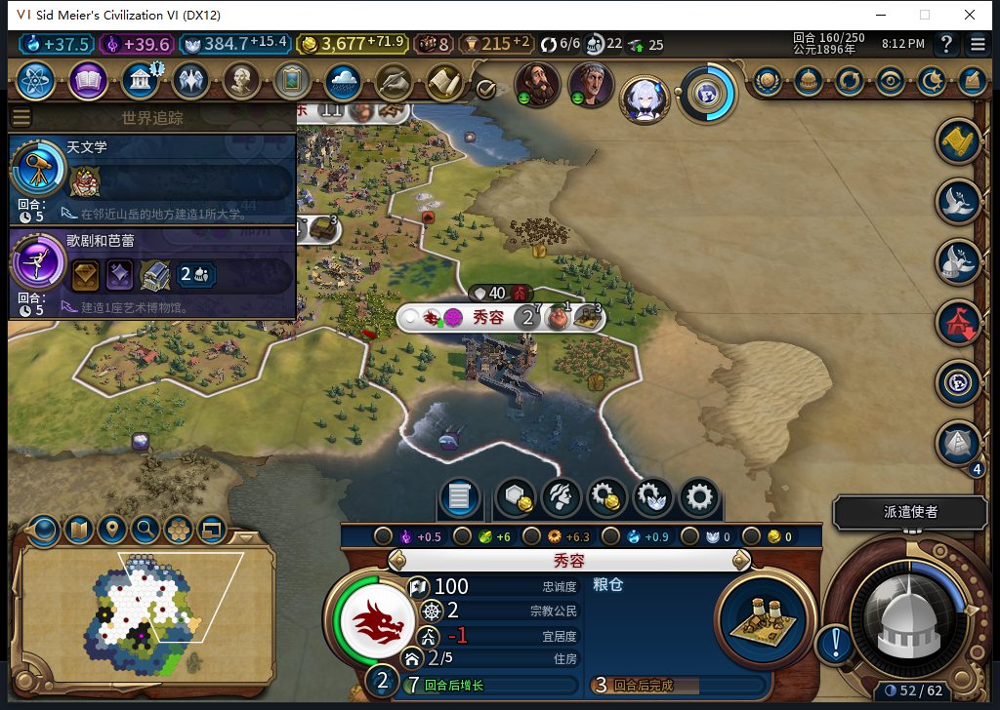
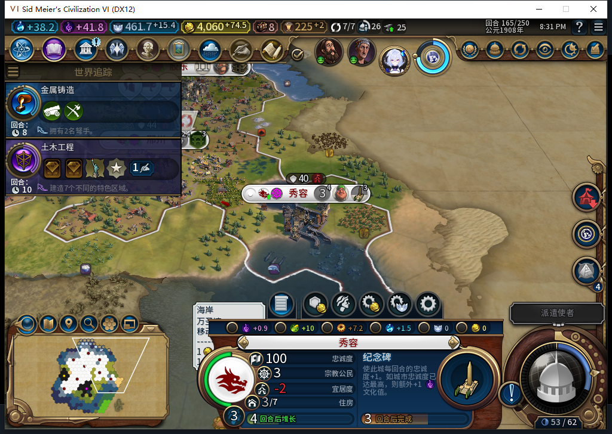
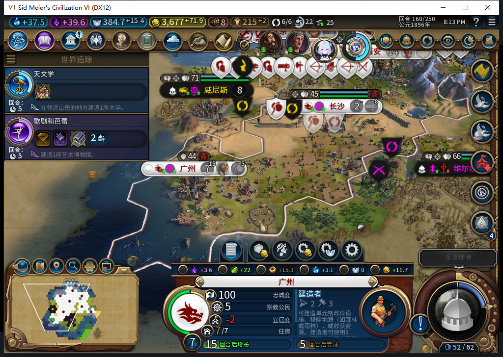
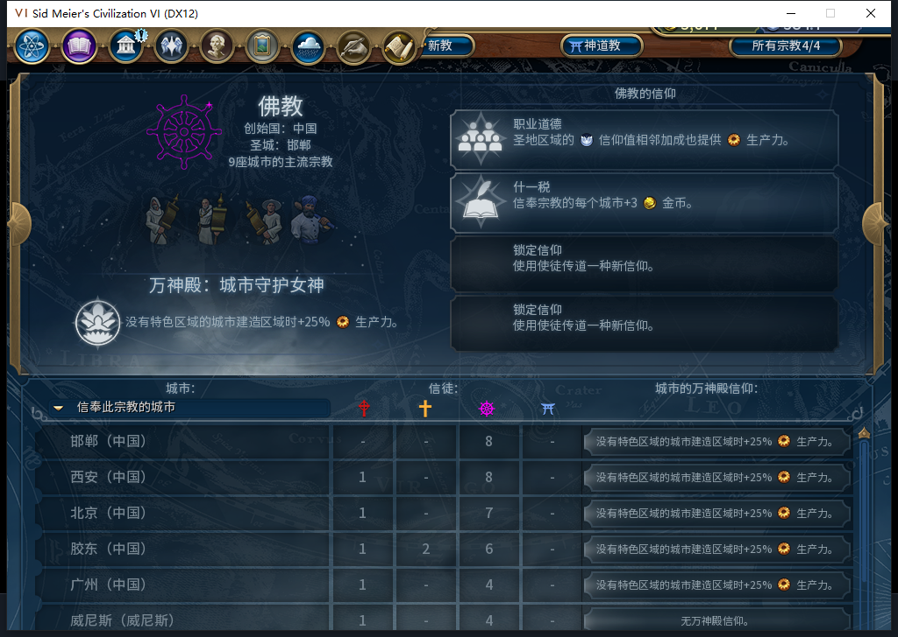
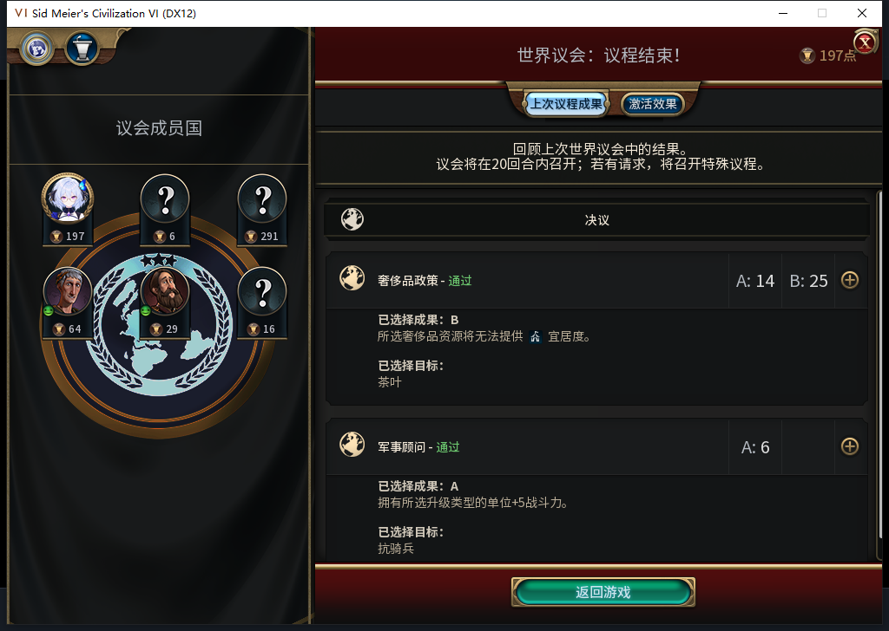

# 105实机145—165：连续二十回合，内政不用手补

同一105进程完成145→165的20次实际换回合。21个回合、157条逐城记录覆盖全部7→8座自有城市：人工生产／区域选址／文职命令为0，新增18座建筑、5个普通区域、7处同一可见自有地块从无到有的改良，均有后台BUILD请求对应。TC-037授予本次单人《风云变幻》场景通过；这不是历史固定五城档重播，也不代表全部40项或十城性能通过。

| 本窗实际结果 | 数量与边界 |
| --- | --- |
| 队列 | 21帧、157城市行，实际Hash非零且类型／进度／成本已知 |
| 建筑 | 27→45，新增18；逐项列在完成CSV |
| 普通区域 | 北京商业中心、胶东学院、广州港口、邢州商业中心、西安工业区，均实际完成且未损坏；不计新城市中心 |
| 改良 | 7处原已可见自有地块从NONE变成改良，7处均匹配后台BUILD；另4处后见改良不当作本窗新建 |
| 回合输入 | 24次普通结束请求，实际前进20回合；36次测试玩家军队待命，0 UserForced |
| 安全样本 | 所有食粮净值非负、无饥饿倒计时；忠诚最低100、变化非负。宜居度差额最低-3仍属风险 |

145首帧已记录所有城市的正常任务、成本和资产，前态另有正式144存档；本窗没有资源赠送、快完成或源码热补。140→160虽也前进20回合，但142／143缺完整队列表，不能用那一段单独授予此通过；保留该缺口，改用145—165连续完整21帧。正常结束有时先执行原版排队而仍留本回合，读回真实状态后才执行另一次普通结束；没有把ACK当换回合、没有重发未知动作。

133在邯郸正常完工的移民3145745继续自己的行军，于156在62,30建成秀容524295。Core记录settle:0:8为OBSERVED，原移民实际不存在，原位置有己方新城；160粮仓14/32、165已建好并接续纪念碑，新城人口2→3、忠诚100。该演员此前的正常排产见[128—133移民完工和神社接续](baiqi-shrine-start-and-followers-133.md)，本段续验新城落地，不把新建成功当成旧ARMED故障恢复已经修好。

第三名传教士145实际花85信仰，369.44921875→284.44921875；第四名151花90，350.2734375→260.2734375。两名分别150在胶东、160在广州耗尽，原生次数、Core完成账本和UI最后一次完成日志均对应。145—160没有手动传教；前三次末次回执139／144／150与160四个切点分别保留，不从单位消失单独推成功。

原版宗教页的9是总数，不能叫9座自有城市，也不能把外部城市的自然压力变化算成模组主动外传。实际自有8城在160、161、165均为原生佛教多数。161已无存活传教士，购买仍4笔、城市购买命令仍仅145／151两次，信仰384.72265625→400.12890625，没有新扣费；165余额461.75390625。只确认本次“无国内目标便不再买”的负例，不推定所有宗教／经济边界通过。

测试玩家在150议会投两张免费票，选择可可豆A与近战A；实际结果如图。罗马148来访告别、巴西156要求停止邻近建城的回应与告别均由测试玩家完成；后者选择不承诺、原版标示25不满，不把它当模组自动外交。3次使者提示查看再关闭共6次界面调用，未花使者。外交和原版议会的宜居度／战斗力变化单列，不冒领为AI内政收益。

140读档后财政观察器至160共3788条（3563招募读取／28城市操作／196单位操作／1单位命令），0错0丢。144接上的外层2979条与旧前缀809条精确衔接，160先撤外层再撤内层。唯一单位命令为154商人伟人4325405激活，原生名称UNITCOMMAND_ACTIVATE_GREAT_PERSON／374670040；不是军令。记录仅覆盖白绮执行环境，161—165财政钩子已撤，不能声称全20回合都有同样API计数。城市命令钩子161精确撤除，165三处namespace均nil。

582模型用于真实的只读采样诊断：完整stop／合法JSON，2795+1699 tokens、10.320730秒，但原补丁损坏、重试复用冻结子标签、缺白名单且不支持实际续读，原代码未采用。负责人独立使用七类只读工具白名单，未就绪／UNKNOWN最多3次采样，既有资格不放宽；69次实际调用全为首试，重试分支未触发，不记实机分支通过。旧守卫拒绝、UNKNOWN、范围限制及标记名错误均保留，成功读取不重复，游戏动作不进入重试。没有新跑完整1598套件；此前完整检查和SDK离线补证保持各自范围。

160已保存1580930字节，SHA-256 `8177f36338bc5ea70f9f814ece36e847b1f377d8bed68633d5af9cf3afa8f0e0`；165已保存1613032字节，SHA-256 `558acebef0362c1a4e0c665ce9b39a935e1cb6b7cda67194894d5b1ae21d5a94`。两份尚未重载。旧已发令移民ARMED恢复仍FAIL，宜居度不足、小视口裁切／残留提示、兼容规则集、特殊文职及性能矩阵继续。当前Steam他机占用，0上线／登录／下载／上传初始化或上传，工坊与发布附件仍内部82；本证据和BBCode仅入库。

[逐城队列／成本／食粮／忠诚CSV](baiqi-source105-window145-165-cities.csv) · [逐回合经济](baiqi-source105-window145-165-world.csv) · [逐回合单位](baiqi-source105-window145-165-units.csv) · [完成清单](baiqi-source105-window145-165-completions.csv) · [结构化证据](../research/baiqi-p6-source105-window145-165-and-no-demand-evidence-2026-11-09.json)
