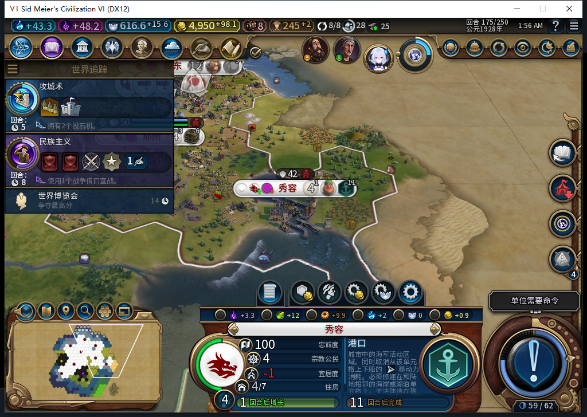
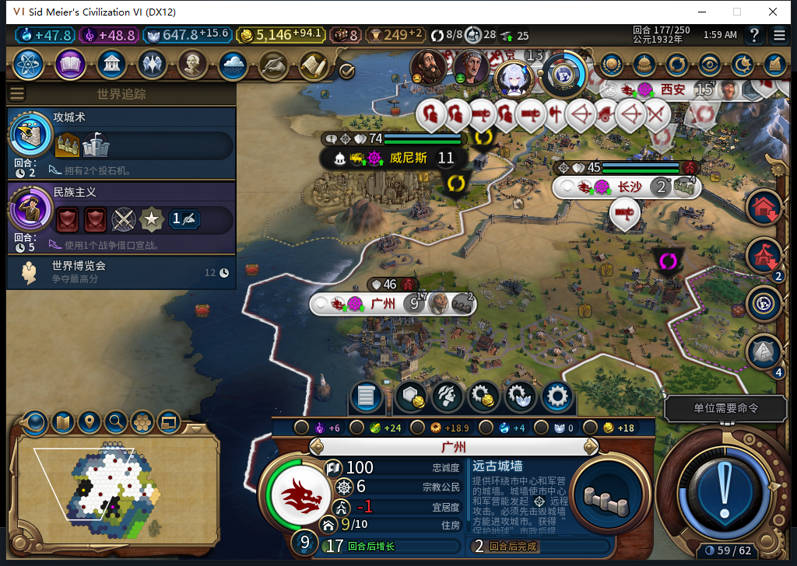
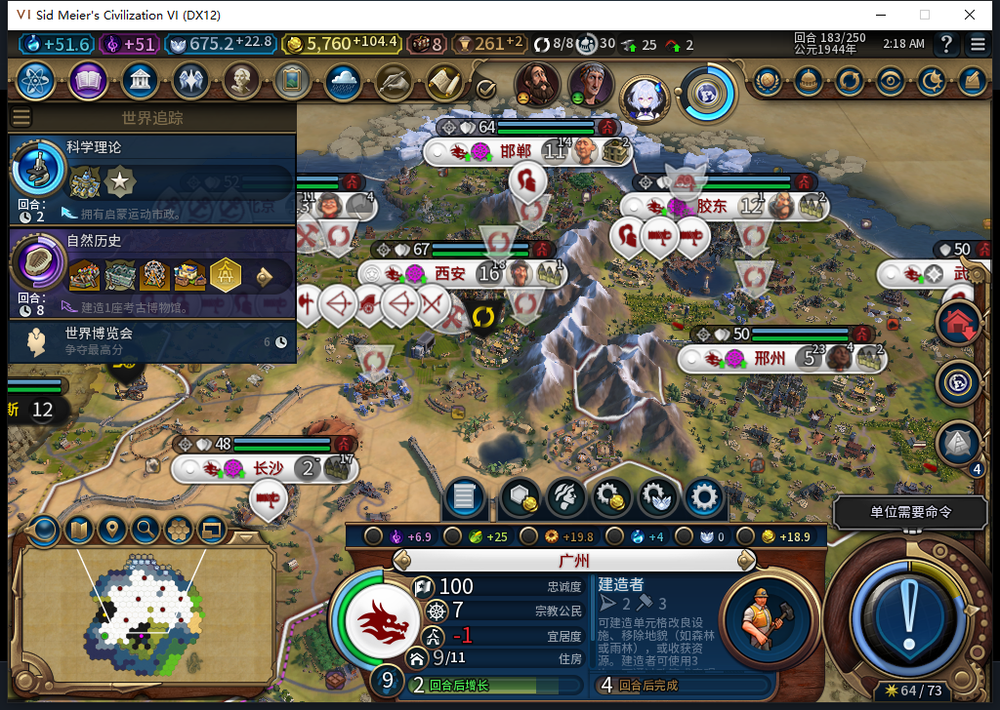
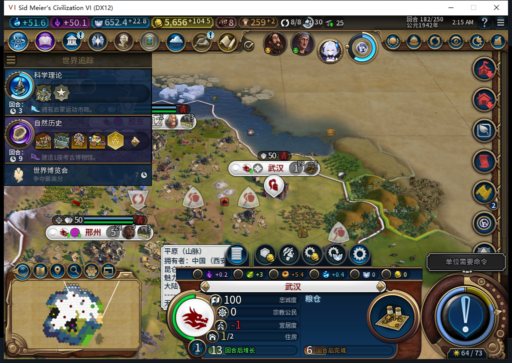
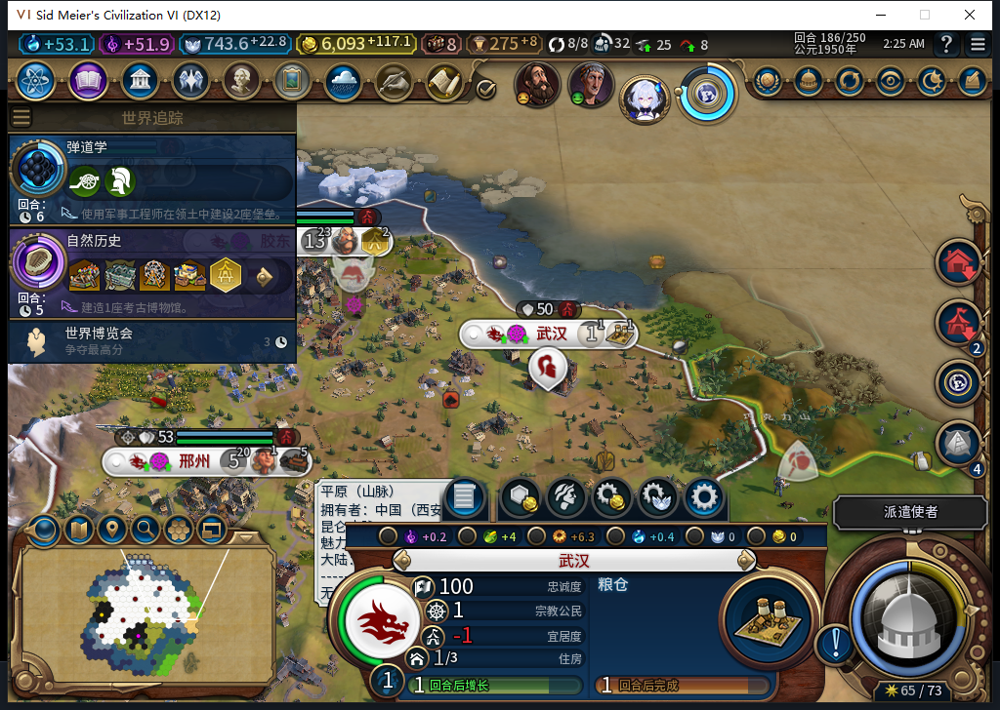
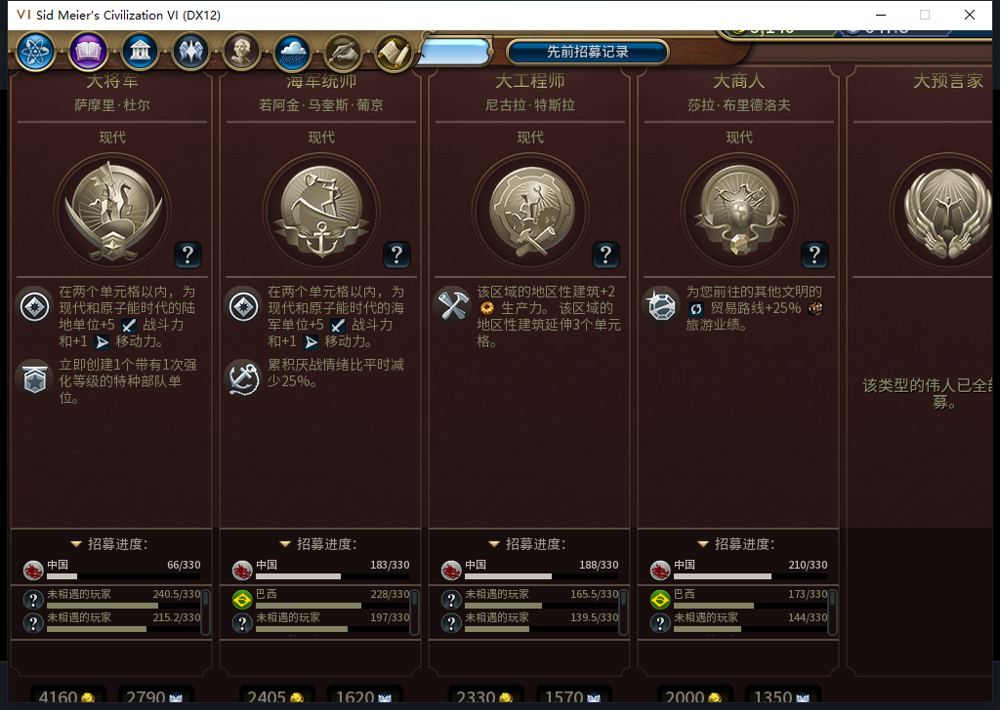

# 106实机166—186：二十回合，自己补娱乐设施并建出武汉

同一106版本实际走过20回合，21帧、174条逐城记录覆盖全部8→9座自有城市。测试玩家没有代选生产、区域或文职任务；新增19座建筑、6个普通区域、7处有后台BUILD请求对应的同一可见地块改良。TC-037授予这次《风云变幻》单人场景通过。172曾正式读回同一回合完成态，之后继续173，未倒回重放；不是全程不读档或全部40项通过。**Steam他机占用，继续禁止上线／上传。工坊仍Alpha2内部82／12图，本页是开发106。**

| 实际进展 | 结果与边界 |
| --- | --- |
| 西安娱乐链 | 170娱乐中心、172竞技场完成，随后大学176完成；172为8／8，173奢侈品重新分配后变7／8，娱乐贡献仍5 |
| 秀容娱乐链 | 175娱乐中心完成，娱乐贡献0→1；当时1／2，后台接港口，185港口完成接灯塔；后续人口增长与奢侈品再变，不能提前宣称缺口解决 |
| 广州娱乐链 | 177娱乐中心完成，179古城墙完成后接竞技场，183竞技场完成接建造者；娱乐贡献0→1→3，186仍4／5 |
| 自然扩张 | 181新建武汉62,34，粮仓自动排入；186粮仓28／32预计1回合，忠诚100／+20，尚不能把在建说成完工 |
| 操作与观察 | 33次普通结束、63次测试玩家军队待命，0UserForced、0手动内政；军队待命不算后台军令 |
| 经济和保城 | 174城帧食粮原始盈余非负、无饥饿倒计时，忠诚均100且变化率非负；长沙盈余0、其他宜居度缺口仍是风险 |

图1：娱乐中心已建，后台接港口0／116，原版预计11回合；宜居度仍−1。106对缺口至少2的合法娱乐候选加优先级，不抢占已有队列，也不等于不经原版资格就强建竞技场。秀容此刻缺1，不能凭下一项是港口判竞技场失败。

图2：娱乐中心完成后转古城墙0／40，人口已到9。娱乐贡献升1但需求也从4升5；另有奢侈品分配，不能只看总宜居度判断设施有没有生效。

图3：原版面板已是建造者，建筑读取确认竞技场存在，娱乐贡献3。面板仍显示−1，忠实保留；奢侈品贡献的变化单列在来源表，设施实效不等于全城长期幸福。

图4：移民4390938实际在181建城，完整城市ID589832。UI与Core原始记录同为OBSERVED、token `settle:0:9`、请求 `0:181:99`、地块2578、62,34，均对应武汉；182粮仓3／32，测试玩家只查看城市。

图5：粮仓28／32预计1回合，人口1、宜居度−1，宗教公民1；新城尚有建设与增长任务。182忠诚100／+17，186为100／+20，只授本窗口保城，不推断任意远方城址安全。截图遗留地块提示与小视口底部裁切均保留，城市身份以原生完整ID核对。

议会170的免费投票与实际171结果见[前一段证据](baiqi-amenity-native-106-166-172.md)。179图拉真提出铁10换每回合4金及开放边界，测试玩家拒绝并再见；181佩德罗要求停止附近定居，选择拒绝承诺，原版预览25不满，未另测外交API实际增量；182佩德罗提出鲸鱼换一次性4金及开放边界，同样拒绝并再见。共6次原版外交点击，没有后台谈判或宣战。171／179使者提示仅开关，未分配；186仍有32名使者。

两次178／184的只读就绪连接被重置，游戏进程存活，随后分别只读确认179／185，未重发结束动作。它们与独立诊断查询时间重叠，尚不能确定因果；后续游戏端查询串行。179Core忙碌与外交打断也分别记录，不以动作ACK冒充实际换回合。物理输入保留原60秒、进程出生时间、前台窗口和截图哈希检查；静态文字复拍匹配时排除动画金币，失败为0输入，不放宽时效。

新一段透明观察仅覆盖BaiqiExecutor：3210记录＝3054招募资格检查＋24城市请求＋132单位操作＋0单位命令，0错误／丢弃。单位操作仅建造者74、工程师31、移民12、商人6、传教士9；招募检查不是实际招募。与166—172的1471记录分账，读档引导段未安装，不能相加冒充无缝全局监控。186已撤除全部诊断，正式保存1709266字节，SHA-256 `ba39b408bc543e39cfa7644aa750db1835ee3404b89db5cbba70b4ff784b752b`，本切点尚未读回。

图6：公开进度数字已正常显示，页顶与底部仍截断。原生实测视口1008×689，PopupContainer与PeopleScroller高768，卡片670、MainInfo654。模型591指出固定高度假设，负责人独立只读测量确认尺寸；原候选探针缺范围保护且引用不可见私有变量，未执行。592实现把原版局部m_kGreatPeople当作全局访问，并把实例映射当控件、首卡即返回、累积缩小且无大视口恢复，整份拒绝；隔离反例实际重现。负责人另写绝对尺寸修正草稿，5项Lua5.1隔离检查通过，但未入产品、未安装、未授实机修复。城市面板底部裁切仍单独开放。

590—592均完整stop／SSE DONE／合法外层JSON，各1HTTP；590主文案的“hint”及未证实资格解释重写，591仅采用待核实源锚点，592代码／复制测试不采用。三次共72795tokens，HTTP真实峰值1，未为12—16目标制造并发或空任务。11月10日canonical CLI新维护检查通过，OpenCode本机与registry均1.19.5，后两次复用同机缓存；OpenCode原生生成0。累计592逻辑／552完整／37截断弃用／3最终传输失败，622HTTP／30额外重试；缓存tokens、负责人有效用时与净节时未知。产品源码106未动，不重复全套；此前1610通过／1SDK环境跳过保持独立。

旧已发令FOUND的ARMED读档恢复FAIL、旧档迁移、通用未知MOVE、十城性能、规则集／军队／宗教全矩阵继续开放。新武汉OBSERVED属于自然成功路径，不能覆盖旧失败。九城也不等于十城性能通过。

[174条城市表](baiqi-source106-window166-186-cities.csv) · [世界收支](baiqi-source106-window166-186-world.csv) · [单位与建造次数](baiqi-source106-window166-186-units.csv) · [完成清单](baiqi-source106-window166-186-completions.csv) · [2370条宜居度来源](baiqi-source106-window166-186-amenity-components.csv) · [结构化证据](../research/baiqi-p6-source106-window166-186-evidence-2026-11-10.json) · [待同步BBCode](../workshop/v0.1.0-alpha.2/pending-source106-window186-2026-11-10.bbcode)
