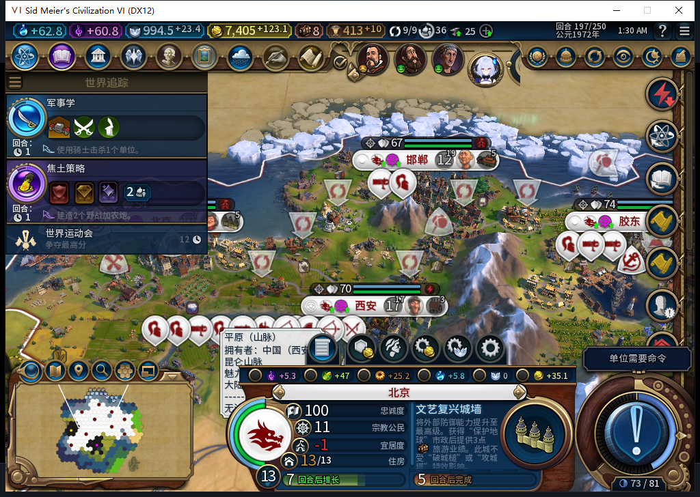
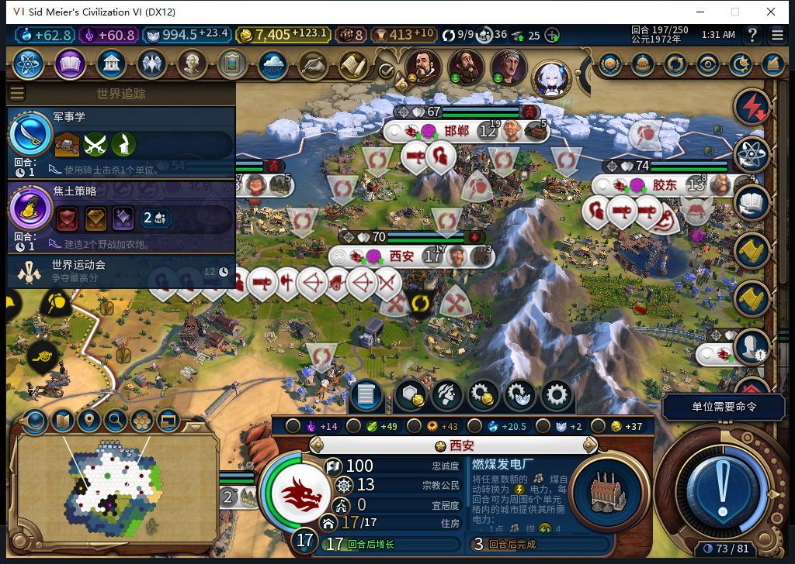
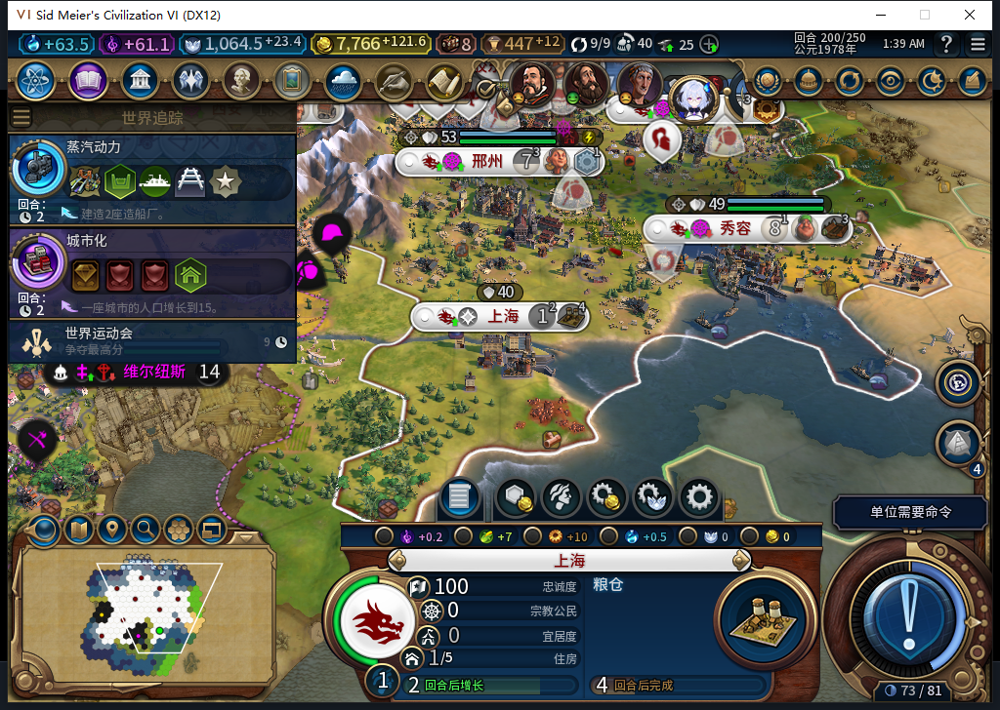
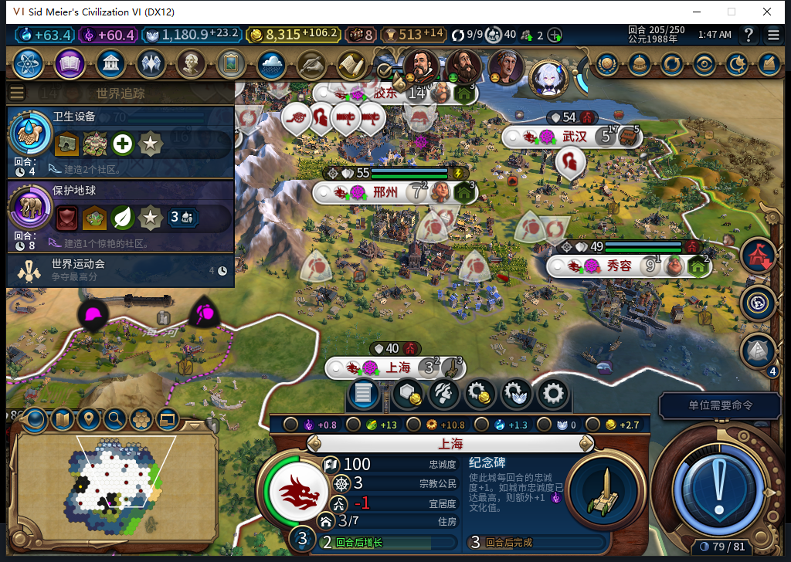
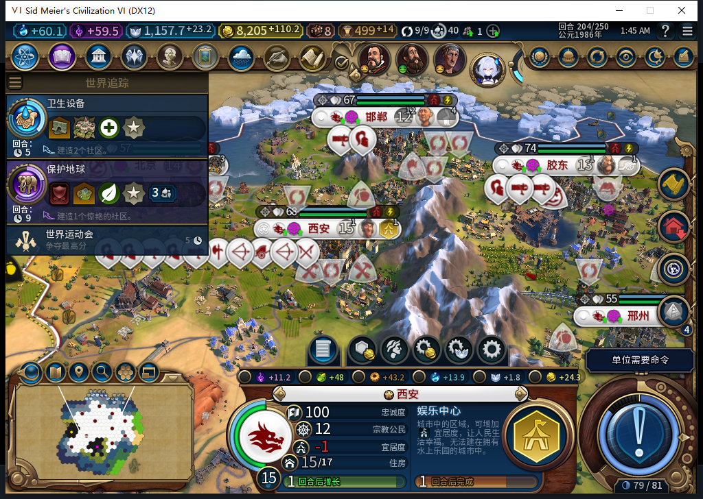
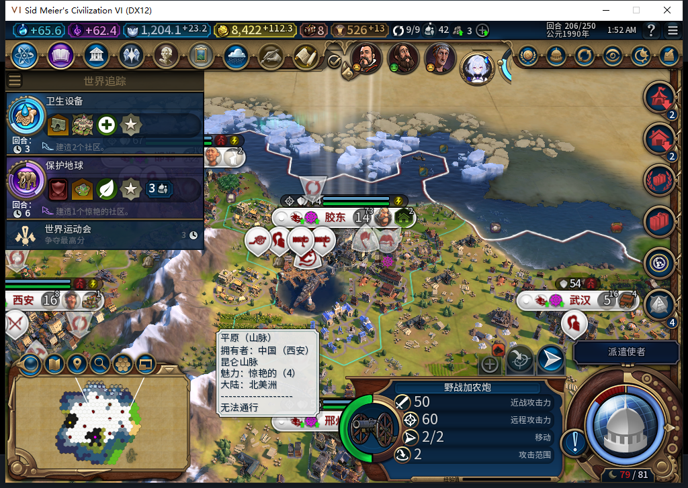
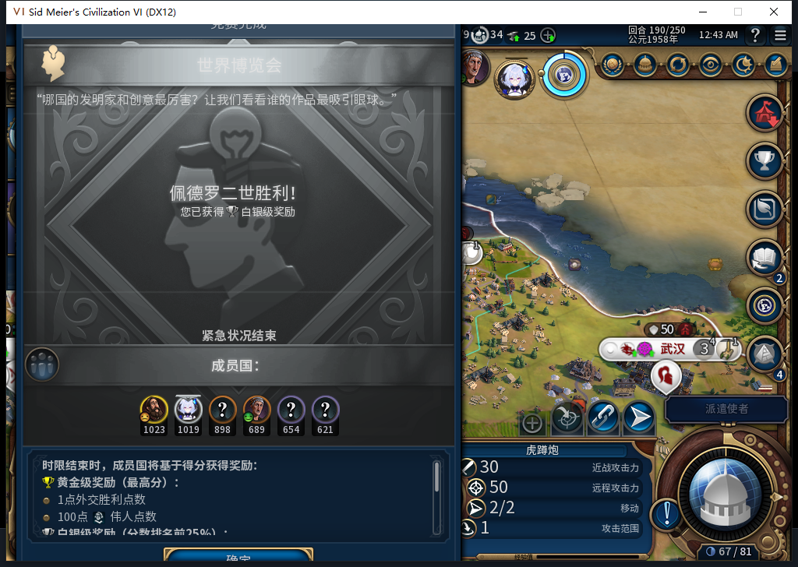
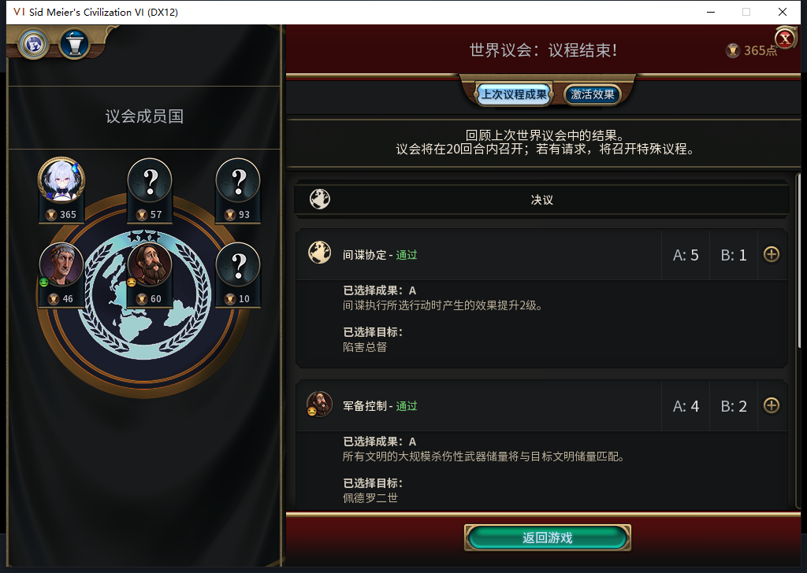
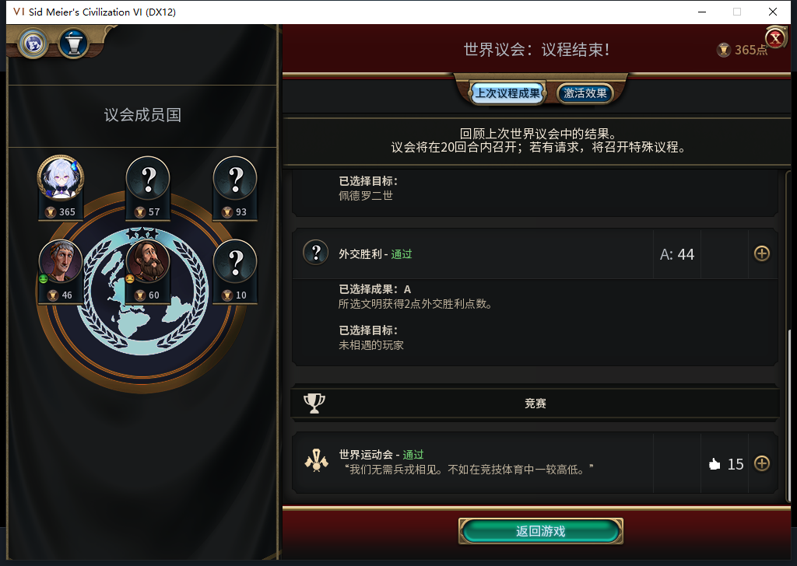

# 109实机186—206：十城、娱乐设施与受损后的修复

玩家在这二十回合里只处理军队、外交和结束回合。北京自行建成水上乐园，上海从移民建城发展到3人口，粮仓建好后接着造纪念碑；西安娱乐中心受损后，也由后台排产修复。本页是**开发109**的实际记录，Steam工坊仍为Alpha2内部82／12图，本次未上传。

| 本轮实际观察 | 结果 |
| --- | --- |
| 连续回合 | 186→206，21帧、196条逐城记录，9→10城 |
| 建设 | 新增23座建筑、7个普通区域；3处同一可见己方地块改良与后台建造请求配对 |
| 玩家操作 | 33次普通结束流程、79次军队待命；0手动内政、0UserForced |
| 采样状态 | 城市队列已知且非空；196城帧食粮盈余非负、无饥饿倒计时，忠诚均100且变化率非负 |
| 仍未通过 | 水坝施工、旧未决建城恢复、十城性能对照、部分界面，以及12条未观察到请求的告警 |

图1：银行193完工后，后台排入水上乐园，196建成；197已接续棱堡城墙，预计5回合，宜居度仍−1。地图中心不是北京，城市身份以底部北京面板与完整城市ID131073核对；本图不冒充水上乐园施工画面。

图2：工厂192完成后接动物园，197动物园完成、转造燃煤发电厂。此刻宜居度9／9，面板为0；后续设施受损仍会影响收益。

图3：北京187正常训练出的移民5505060在200建立上海59,28，粮仓0／32、预计4回合。前端与游戏核心读到同一完成记录，原移民已消耗。忠诚100、每回合+6.71875；没有人工建城、补生产或移军护送。

图4：上海已到3人口，粮仓完成，后台接续纪念碑0／30、预计3回合，面板宜居度仍−1。206纪念碑17／30，忠诚100、变化率+8.078125。本轮只观察到建城后六个实际回合。

图5：同一56,31娱乐中心在202变为受损，204修复49／66。205区域修好后，竞技场与动物园仍受损；206竞技场已修好，动物园仍在修复135／180。该区域不重复计入7个新增区域。西安人口202也下降，原因尚未隔离，不指定灾害类型。

图6：胶东205正常生产出野战加农炮6094889，206仍在出生地59,36，2行动力、无损伤，可供玩家选择。此处只选中查看；189—206的BaiqiExecutor观察器未记录对它的后台命令，玩家军队待命另记。

图7：佩德罗二世获胜，白绮获得白银奖励。窗口底部“确定”被裁切，测试玩家点击可见上缘后关闭。后续仅测隐藏控件尺寸，尚未修复；伟人页物理滚轮横移也继续开放。

图8：玩家投了禁止破坏生产B1，实际通过“陷害总督效果提升”A5；军备实际通过以佩德罗二世库存为目标的A4。不能把自己的投票写成已生效规则。

图9：玩家投给白绮的外交胜利点没有获选，实际目标为尚未相遇玩家A44；世界运动会获15赞成通过。四项各投免费首票，消耗外交支持0。

水坝109修正已装入本次游戏。190只读检查覆盖9城147个己方可见且已揭示的购买地块，得到西安3处、北京1处同时满足保护策略与原生地块资格的城址。但两城已有生产，后续也先选了娱乐、发电和移民；本轮没有水坝开工或完成，4个可用地块不能当作施工通过。

观察器只覆盖BaiqiExecutor的189—206段：5122记录＝4830次招募资格检查＋38次城市请求＋253次文职单位操作＋1次大商人激活命令，0观察器错误／丢弃；资格检查不是实际招募。日志另有12条“请求未观察到”告警：3次单位不可用、9次原生空闲且无路线，仍需逐条核对。206已撤除观察器，正式保存1854563字节，SHA-256为3cf8d772ecae29841a50807635d0c40dffb600e418a6a7e789c00060106d5523，ACK为true，尚未重载。

普通结束的返回与实际换回合分别核对。来访或忙碌时停止后续输入；200首次军队待命在忙碌守卫处中止、未发令，重新取得稳定状态后以新序号继续。204首次快照在只读守卫处中止，同回合重新采样成功。西班牙交易的两次像素比对、一次文件名前缀拒绝，以及佩德罗交易的一次截图过期，均为0点击；新画面重新查看后，各只执行一次拒绝。原60秒、进程出生时间、窗口与哈希检查未放宽。24次物理输入分为议会14、其他外交9、博览会确认1；190／193／199使者提示只开关、不分配，分别保留34／36／40枚。

本轮没有逐回合七种战略资源完整表，不另授TC-037全项通过；十城也还没有禁用模组的匹配性能对照。旧82已发令FOUND在ARMED窗口读档后不续建的FAIL保持，不能用新上海覆盖。规则集、宗教、军队和完整40项继续验收。源码109未改，本包不重复软件全套。

模型601原探针因集合迭代、队列API及可见性错误拒绝，原稿0实机；负责人补上实际消费者后独立查询。602仅采用待测尺寸清单，按钮显示条件和一次性标记建议拒绝；负责人自己的接口名也从错误GetScreenOffsetVal改为实际GetScreenOffset，失败原件保留。603文案整份拒绝：把已发布82说成未发布、颠倒北京开工／完工时间、输出英文压缩笔记；本文据原件重写。负责人给603的压缩描述及未核实忠诚率12.71875也已改为实际8.078125。三次均stop／DONE／合法外层JSON，累计603逻辑、563完整、37截断弃用、3最终传输失败、633HTTP／30额外重试。本轮实际峰1，复用11月11日同机1.19.5维护缓存，0OpenCode原生生成；未知缓存成本、人工耗时及节时为null。

[196条城市记录](baiqi-source109-window186-206-cities.csv) · [世界收支](baiqi-source109-window186-206-world.csv) · [单位记录](baiqi-source109-window186-206-units.csv) · [完成清单](baiqi-source109-window186-206-completions.csv) · [结构化证据](../research/baiqi-p6-source109-window186-206-evidence-2026-11-11.json) · [待同步BBCode](../workshop/v0.1.0-alpha.2/pending-source109-window206-2026-11-11.bbcode)
