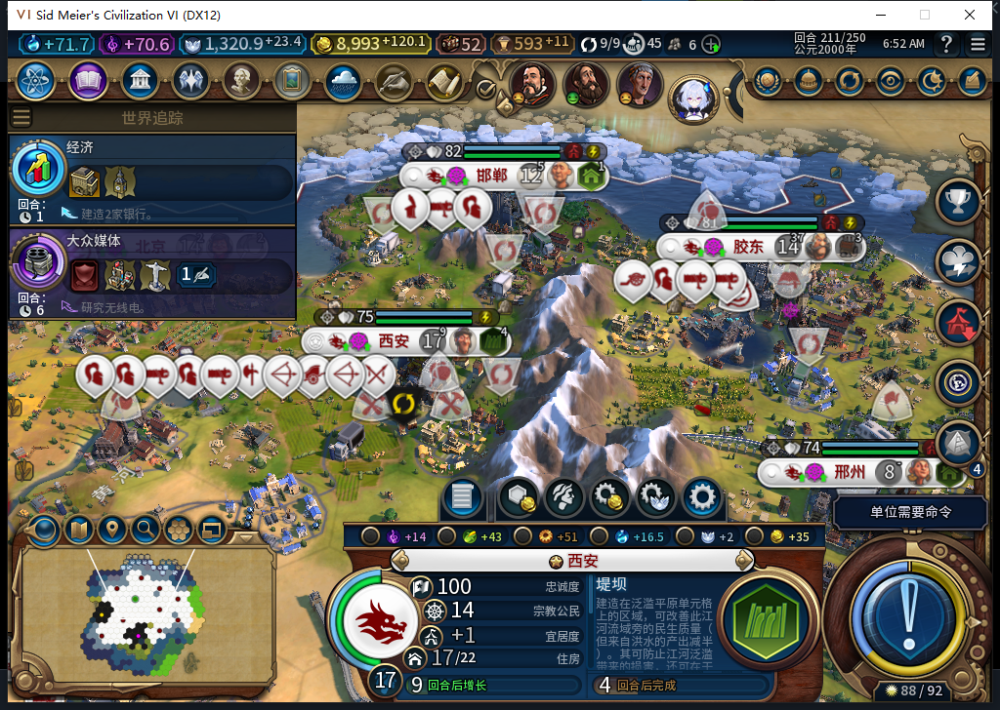
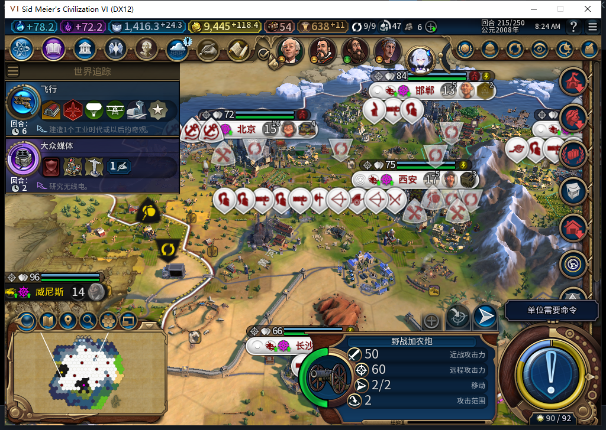
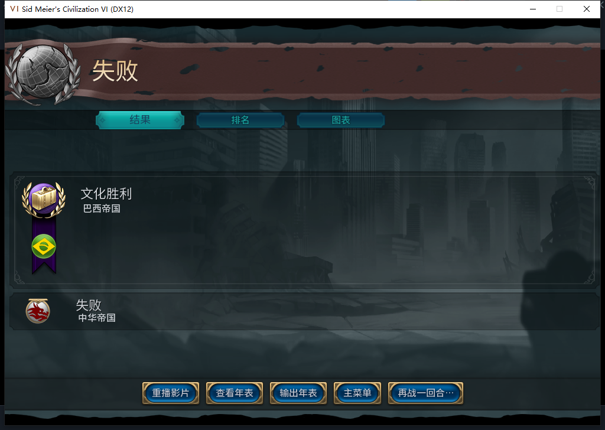

# 215 实机：西安堤坝从开工到完工

115 在 Steam 离线下读入 213 的原版检查点。西安原坝址 2569（53,34）仍在建，进度 111/197。两次普通结束回合后，214 到 163/197，215 原版区划读回已完工、未被掠夺。托管没有再建一座坝，而是继续排产证券交易所。

213 的结束回合先遇到加拿大交易，测试玩家拒绝并返回。随后原版世界议会特别议程出现，测试玩家对巴西的援助请求投一张免费反对票；议案以 28 赞成、1 反对通过。返回游戏才实际到 214。没有重发 213 的结束回合；214 的下一次普通结束进入 215。两回合共跳过 8 个原版军队动作，没有手动安排内政或提交援助。

三帧十城的当前粮食和忠诚变化率均非负，214、215 没有城市比上一帧人口更少。邢州自然从 7 人长回 8 人，已完成大学；214 的新社区实际放到了 2277，215 此格产粮 0、邢州净粮 +1，胶东商路仍活跃。此前人口损失已经发生，长回人口不算防住了断粮。商路优先粮食的新分支仍缺一次符合条件的新开路线实测。

215 完工时已正式保存。此次通过了同一坝址从真实开工到完成；尚未遇到可归因于这座坝的洪水，防洪效果未验。Steam 创意工坊未更新。

[原版完工、十城读数和存档指纹](../research/baiqi-p6-source115-dam-completed215-evidence-2026-11-11.json)。

完工另存后又普通推进到 216。坝体仍完好，证券交易所 74/165；十城无新增人口损失，邢州 8 人、净粮 +1、库存 3.79296875。长沙净粮 0、库存 0.68359375，但没有空闲商人，商路容量 9/9。该回合不是 115 新开商路排序的验收场景。[延续检查](../research/baiqi-p6-source115-dam-continued216-evidence-2026-11-11.json)。

216 检查点重载后，坝体和十城粮食、忠诚读数与保存前一致。再执行一次普通结束回合时，巴西取得文化胜利，原版停在 216 结算。没有进入可操作的 217，邢州社区完工没有在这局验到，也没有用“再战一回合”绕过结算。原 216 检查点保留。

[结算接口、截图和存档指纹](../research/baiqi-p6-source115-natural-result216-evidence-2026-11-11.json)。
