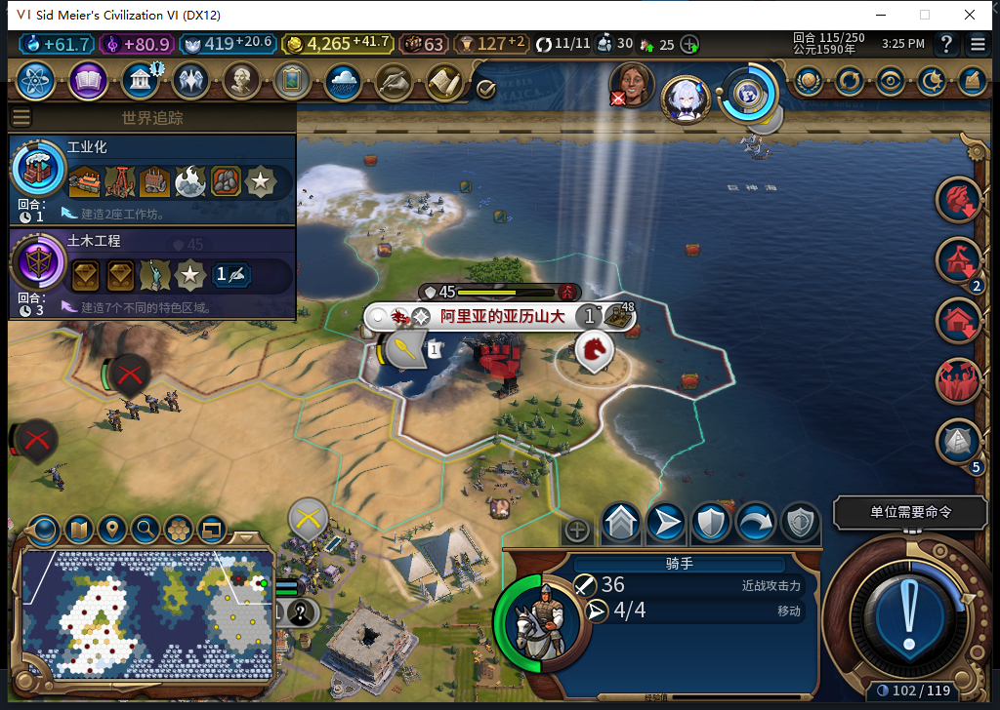

# 74版：未知扣款经过正常下一回合

2026-11-05，BF-202609141645，离线owned12052／产品74未改。从[冷进程UNKNOWN／CHARGING](baiqi-cold-recovery-74.md)实际114推进到115，原事务仍未知、军队和坐标的冲突守卫继续有效，新回合军队行动没有被结算耗尽。[结构化证据、模型408及原件指纹](../research/baiqi-p6-debit408-normal-turn-evidence-2026-11-05.json)。

| 项目 | 114 | 正常115及两次显式Recover后 |
| --- | --- | --- |
| 金币 | 4224.2734375 | 4265.984375 |
| 事务 | 1笔UNKNOWN／CHARGING | 同1笔，原turn仍114 |
| 凭证 | before4524.2734375、transferObserved真；after／chargeObserved空 | 完全保持 |
| 城市 | 玩家0／851979／41,19／人口1 | 保持 |
| 骑手2162700 | 42,19、4行动、伤害0、无冷却 | 仍4行动、伤害0、无冷却 |
| 同军队／同坐标Conflict | true／true | true／true |

测试玩家按已资格流程完成11个不同军队的SKIP和6次DoEndTurn选择，之后在新鲜CanEndTurn／active／idle门内发一次原版ACTION_ENDTURN，无第二参数、REASON或UserForced。先读回114已非active，再独立读到115已active；没有把ACK当换回合。未消费全部军队选择提醒，不授完整物理按钮矩阵。全程没有替AI移动文职、改生产、重投付费Request或补回执。

正常回合前安装的Core透传观察器跨自动回合读到转城0／FinishMoves0／错误0；115再Recover两次，计数仍全0，独立Core／UI字段吻合后恢复观察器。金币净增41.7109375，但收入／支出会随回合变化，也没有直接treasury原生调用计数，不能仅靠差值宣称没有任何资金动作。这里确认的是同笔未知回执未结清、没有观测到Lua原生转城／结束军队行动，不能伪称成功恢复或自动退款。

移除全部故障／观察器后正式另存115，572522字节，SHA-256 `9b7c5ead58823e810e5f55b1b3101992d200c91aba090ec4c3c4f367bb2e47f5`。原正常Farm114文件哈希未改。当前仍保留这个115分支：日志出现最后一次改良后建造者5832733缺失，已另交409检查实际地块；本例既不授该改良成功，也不虚构pending卡死。其余24条单位请求只算日志，不当原生计数或全部军事安全证明。

408候选50行Lua能编译，但排除当前事务而错误读出Conflict=false；真实产品Conflict包含当前未完成记录。负责人改用Core实际函数、完整ID／owner别名拒绝及完整回执行，7项隔离诊断检查通过，不是新增产品测试。第一次负责人调用发现Executor没有BaiqiRequisition，Core及此前UI字段已只读返回后失败；原件保留，随后明确UI守卫不可用、以Core为准，用新标签读回，无游戏动作重放。

TC-029／030整体仍部分；这里只增加一个UNKNOWN／CHARGING正常跨回合样本，过期FINISHING及其他阶段不能据此闭合。产品74和Alpha附件未改，完整软件套件未重复运行。
