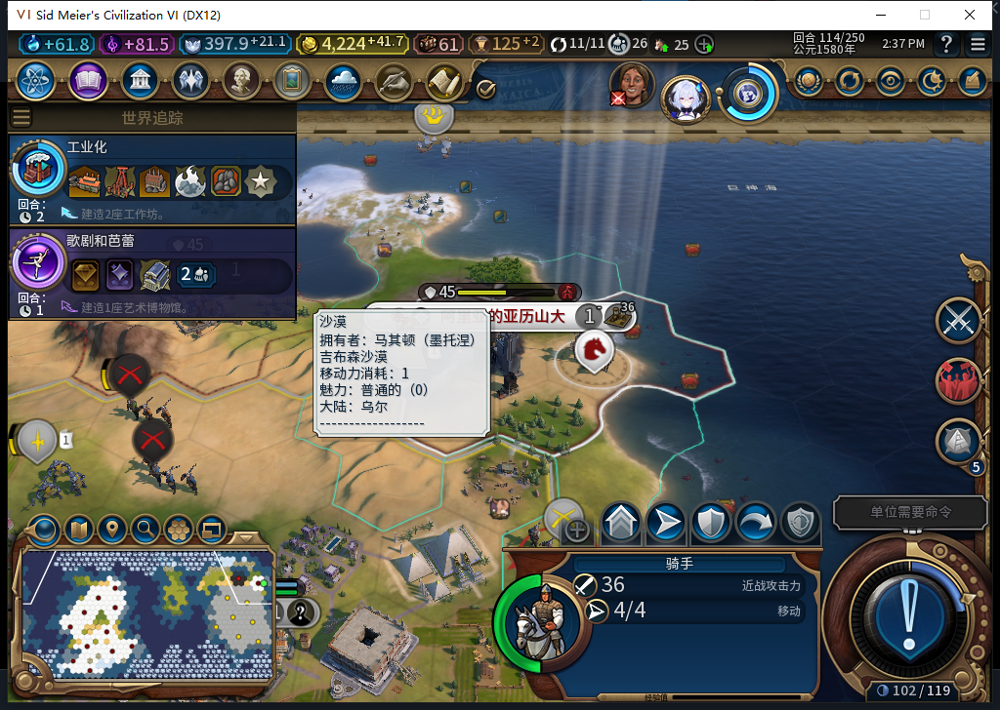

# 74版：扣款已发生、肯定回执未写完时的冻结

2026-11-05，BF-202609141645，Steam离线，单人风云变幻／构建74。独立QA分支实际地图确认300金币后，城市已转移、余额减少300，但肯定扣款回执尚未写完。移除全部故障及观察绑定后正式保存／加载，事务仍为UNKNOWN／CHARGING；没有第二次收费、退款或结束军队行动。这是TC-029／030的一个未知态安全样本，不是成功结算恢复，也不代表全部验收完成。[结构化证据与模型406审阅](../research/baiqi-p6-debit406-unknown-evidence-2026-11-05.json)。

| 项目 | 确认前 | 故障后、清理后及正式加载后 |
| --- | --- | --- |
| 城市 | 原主1／524295／41,19，人口1 | 新主0／851979，同位置人口 |
| 金币 | 4524.2734375 | 4224.2734375，未额外收费或退款 |
| 事务 | 账本nil | 同一requestID、仅1笔UNKNOWN／CHARGING／execution_interrupted |
| 转城凭证 | 无 | transferObserved=true，新城851979 |
| 扣款凭证 | 无 | balanceBefore=4524.2734375；balanceAfter、chargeObserved仍为空 |
| 骑手2162700 | 42,19，行动4，无冷却 | 仍4行动、无冷却；未假装完成结算 |
| 观测 | 0请求 | 物理右键／确认各1、UI请求1、Native转城1／FinishMoves0 |

故障只包BaiqiGameplay的Number校验函数：核对精确requestID、回合、玩家、军队、新城市、实际余额及CHARGING字段后，在原生扣款之后、肯定扣款回执写入之前抛错一次。它不写账本、金币或单位。balanceBefore在扣款前就已持久化，不能当作空；异常从Number调用向外抛出，由外层Execute捕获为execution_interrupted，而非假称treasury原生调用失败。

钩子移除后，显式Recover两次保持原状态；新装计数器下，读档后再Recover两次仍为0转城／0Finish、余额不变。实际Conflict谓词对同军队、同坐标分别为true；没有重投付费Request，不能将此读回写成新UI请求测试。恢复白名单不接受CHARGING，不会仅因余额恰好少300就推定成功。对玩家的实际风险是：已拿到城、有费用变化，但回执不完整时可能持续冻结；本例没有自动补款或解除入口。

独立存档568819字节，SHA-256 `00d7b6fbba1336c9c6519e5572419b06d4c589c906acb2826c1d8a32f39be90d`。保存前8项绑定已核所有权恢复，加载前后回执、费用、行动和冲突守卫对应。没有直接计数treasury原生调用或加载启动期间的调用，分别保留未知；实际余额变化和状态有独立证据。战争、我方邻接及150／200城防为既有QA，不授自然战斗；原守军没有人为改动。此分支与405从同一准备副本独立开始，requestID文字相同不表示同一账本执行两次。原正常Farm114文件哈希保持；已官方加载它、ACKtrue，本切点尚待独立恢复读回。

406完整stop／DONE／合法JSON且两段Lua53编译，但原install把balanceBefore误作空；实际Capture／Gameplay软件见证中根本不命中、直接正常完成。负责人修正字段、作用范围和透传，8项钩子检查通过；cleanup六行原样采用，来自输入中已资格405参考，不宣称新颖能力。第一次恢复探针的负责人脚本拼接成niland，被原生解析器拒绝、0执行；修正并加发送前Lua53检查后才用新标签执行，失败原件保留，不归模型或产品故障。上述检查不是新增产品测试，产品74未改、完整套件未重跑。

下一步仍是跨回合／冷进程、其他中断阶段、真实第三方战斗及完整特殊资产矩阵；本例冻结符合未知结果约束，不据此授稳定版通过。

后续： [新进程读回](baiqi-cold-recovery-74.md)仍UNKNOWN／CHARGING；原本切点事实不改。模型406通用经验已[单独提交共享仓库](https://github.com/XenoAmess/local-model-operations/blob/6febe5c66c1c89f6712319972a161903a11260c1/docs/evidence/2026-11-05-civ6-recovery406.json)。
