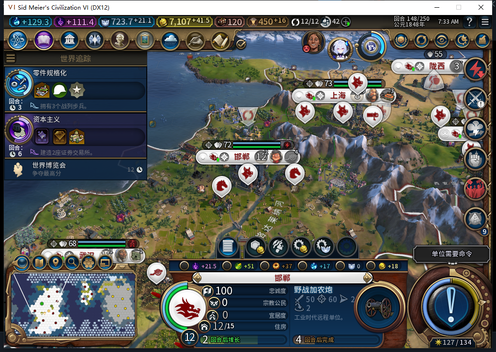

# 区域容量验收：先区分人口、科技与地块限制

77主线148回合完成了14座城的只读盘点，找到三种独立测试条件：容量满、缺科技、缺合法地块。这里只确认夹具条件，不把原版拒绝资格直接写成后台行为通过。下一步在正常回合中观察实际生产请求与人口增长后的资格变化。

| 样本 | 人口／占用容量／允许容量 | 其他条件 | 原版完整资格 |
| --- | --- | --- | --- |
| 邯郸圣地 | 12／4／4 | 科技已解锁，10个自有可见同城合法地块 | false |
| 西安宇航中心 | 16／3／7 | 火箭研究未解锁，4个合法地块；该区域不占人口容量 | false |
| 上海港口 | 8／2／3 | 科技已解锁，0个自有可见同城合法地块 | false |

三个false的条件不同，不能统一解释为“容量满”。邯郸不占人口容量的社区仍然完整资格true，不能在容量满时一律禁止所有区域。

容量使用本机原版Expansion2 CitySupport的实际查询方式，分别读已占用与允许的专业区域数，不套固定人口公式；例如西安实际允许7个，需要保留原版修正。已占用区域也不能直接当成全部建成，正在放置／建设的区域单独记录。

盘点遍历36个定义中的18种普通、非内部、无其他文明特有条件的区域，对14城形成252条记录。逐条读人口容量、科技／市政、现有／已放置状态、可见与完整生产资格，以及自有、可见且确属同城的合法地块数量；错误与截断均0。其他文明特有区域、隐藏地块和他人资产没有包含在本次覆盖里。

地块所属城市用原版WorldViewIconsManager实际使用的Cities.GetPlotPurchaseCity(plot)查询。两个猜测的地块实例接口在本机为nil，没有调用。城市、定义与每城地块分别设有限上限，不能在跨城累计计数后默默漏掉后几座城。

原版148预估邯郸与北京约2回合后增长。这只是当前估算，未当实际增长，更未把“恢复容量后后台建设完成”写成通过。后续继续正常回合，不加人口、造空队列、手选区域或代做内政。产品代码未改，既有1064项软件通过未重跑；Steam离线、工坊Alpha74未变。[结构化盘点、模型450审阅、来源与原件哈希](../research/baiqi-p6-capacity450-native77-district-inventory-evidence-2026-11-06.json)。[此前资源短缺实机分支](baiqi-military-resource-shortage-77.md)。
