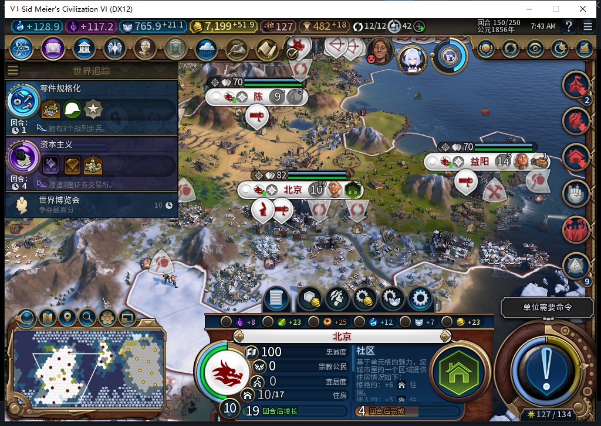
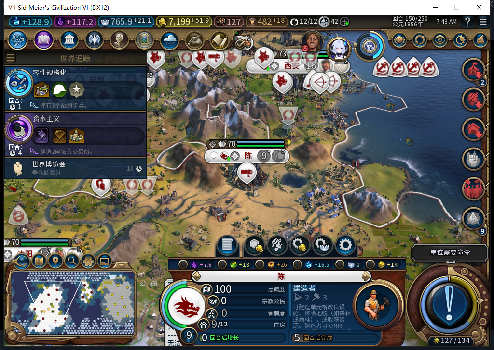
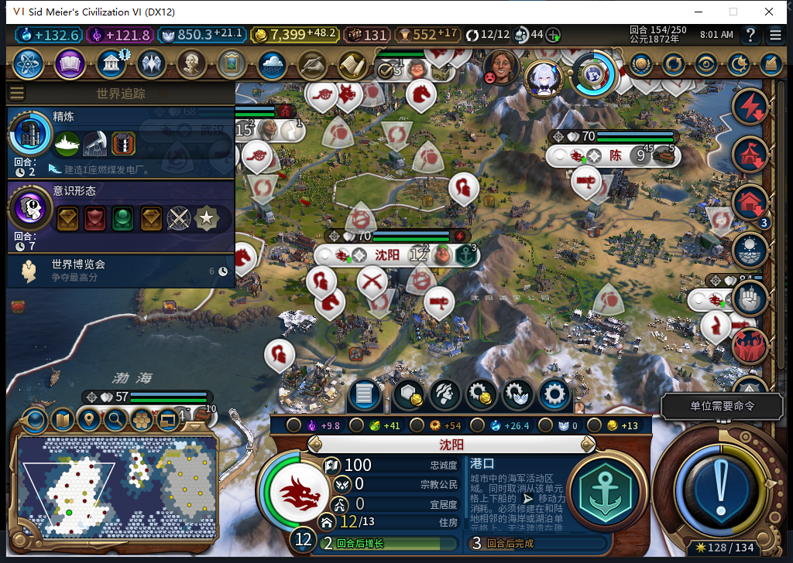
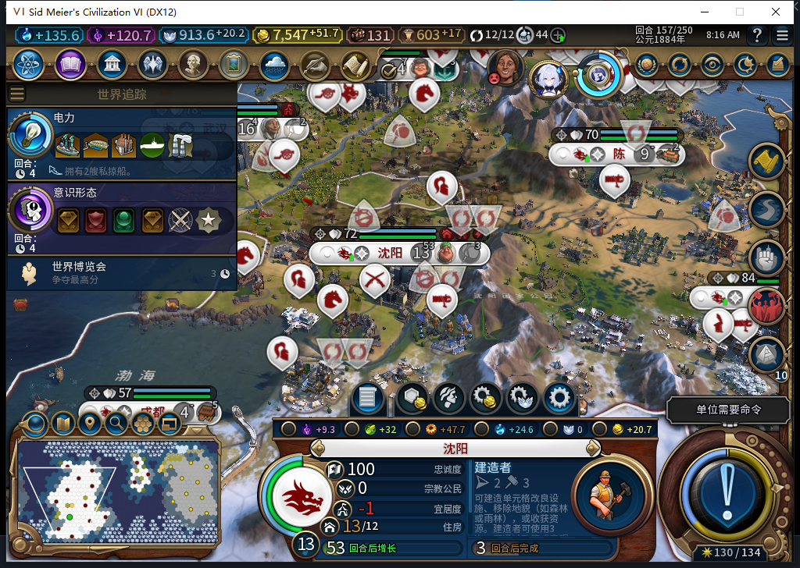
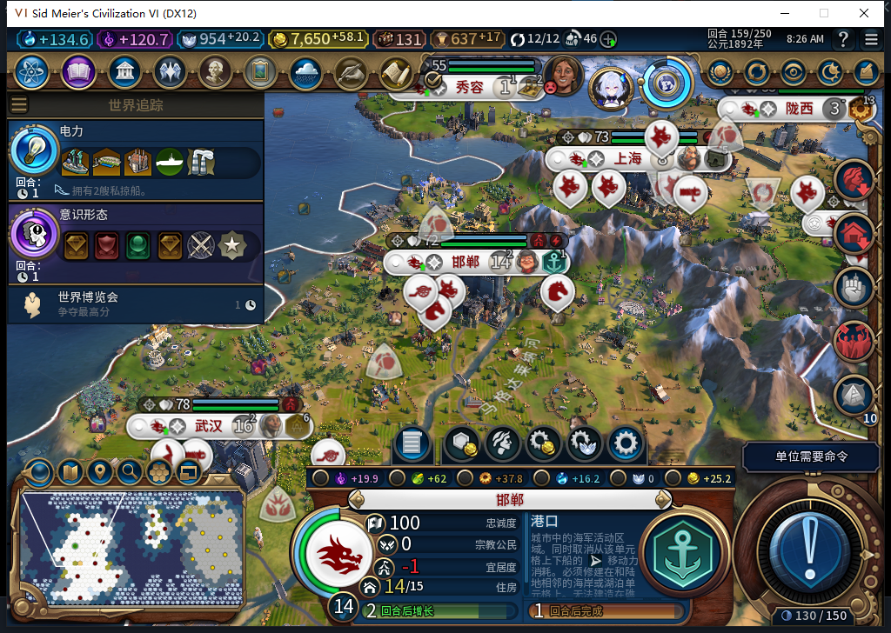
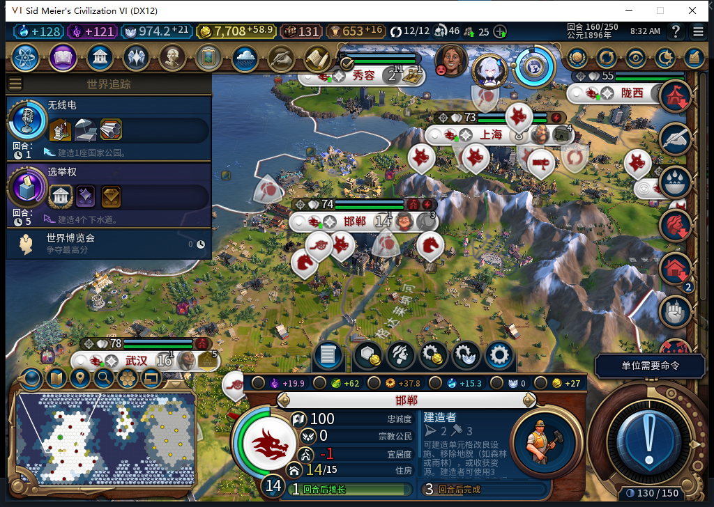
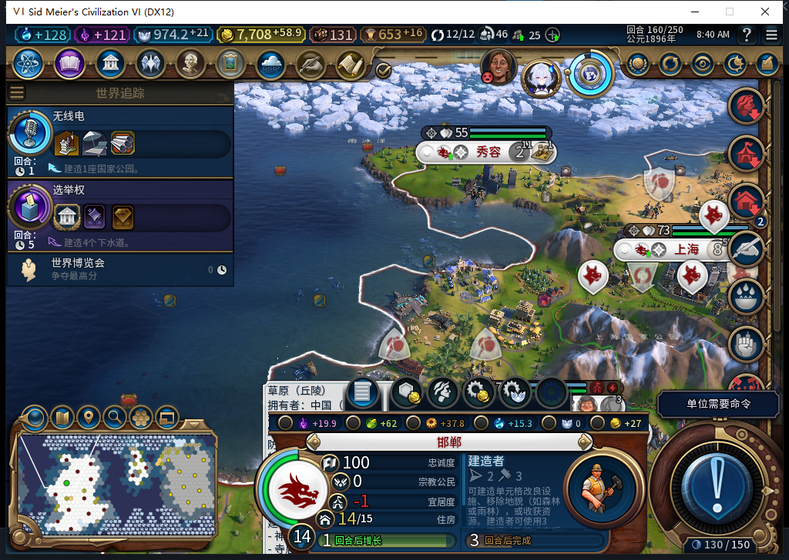

# 容量满时继续内政，增长后重新选址：两个港口真实建成

77开发版主线正常推进到160回合：北京与邯郸自然增长后恢复了区域容量；后台在沈阳和邯郸分别新放港口，按实际产能推进、建成后继续其他合法生产。两个港口和北京的新社区经过正式存读档仍保留。本页新增7张未编辑实机图。

这关闭了两个港口的选址、生产、完成、接续及本次重载子项。完整TC-009、全部40项和其余预算边界仍未全验；工坊现有Alpha74没有随本记录更新。

## 满容量没有停掉其他合法生产

北京148为9人口、3/3容量，150自然增长到10人口、3/4；原先被容量挡住的圣地等区域资格恢复。邯郸148为12人口、4/4，151自然到13人口、4/5。没有加人口、清队列、拆改良或手选区域。

陈城150仍为9人口、3/3，后台在原棱堡完成后排建造者；154接续工厂，159接续证券交易所。这里保留了其他合法工作，没有为了补区域越过人口容量。

资格恢复也不等于立即拆地建设。153对圣地、军营、社区三类候选分别核对发现，北京和邯郸的这些陆地候选被已有改良或树林保护；原版几何合法数不能直接当成AI策略可用数。水域区域另算，不能由此推断所有区域都无空地。

另找到了自然存在的成都样本：153人口3、容量1/1，地块53即(9,1)没有改良、地貌或资源，学院几何合法但完整生产资格false；154自然长到4、容量1/2，原工业区真完成后先排了工坊。该学院的后续选址与建成没有冒称通过。

## 沈阳：实际地块从0/177到建成

154后台请求前，沈阳12人口、容量3/4，港口可见与完整资格均true，科技、市政和坐标(9,5)合法。请求包含真实坐标；读回新实例3080237已放在该处、属于白绮，尚未完成。放置后的4/4也说明在建区域占用了容量，不能只数已建成区域。

| 回合 | 同一港口实例3080237 |
| --- | --- |
| 154 | 0/177，未完成 |
| 155 | 82/177，未完成 |
| 156 | 152/177，未完成 |
| 157 | IsComplete=true，城市接续建造者 |

148沈阳港口曾没有同城合法可见候选，154已有合法坐标并实际派发。地块取得的具体原因没有独立留证，不把它冒称为AI买地专项通过。产能数值包含原版修正与溢出，本页不把进度差直接写成固定基础产量。

## 邯郸：恢复容量后使用新名额

156后台实际提交港口(9,16)：请求前14人口、容量4/5，两种原版资格、科技、市政、地块均通过。新实例3145774入队0/177后，容量变成5/5；158推进117/177，159为166/177，160真实完成并接续建造者。

两个港口都收到了各两次原版完成通知，只计两个实际资产。相同城市、行号和通知次数不能代替完整ID与地块；这里联合实际派发坐标、逐回合进度、同一Native对象完成状态，以及未取消的完成事件判定。

## 其他共同观察与覆盖边界

北京另一个社区2818089位于(14,7)，151为104/165、152为133/165、153完成，区别于早已完成的旧社区2621478(14,3)。成都工业区1638424(8,1)从153的115/121未完成，到154完成。这两项是既有建设的续行与完成，不能反过来说是本轮新选址。

连续城市派发观察覆盖148安装至160精确清理：33次BUILD、10次单位、3次军事、4次区域。四个区域请求前均有容量空位、原版资格及坐标资格；外方、未知、元数据错误、容量读取错误与溢出均0。九江新工业区和武汉新水上乐园仍只授入队，不授建成。内部未确认承诺无法直接读出，保持未知。观察范围只含BaiqiExecutor城市派发，不扩成全游戏上下文或后续军队命令隔离通过。

Core区域集合不能沿用UI的枚举入口：一次只读尝试失败，未写游戏状态。随后使用已核的Core地块区域ID、类型和所有者，与UI原生对象完成状态及事件联合核对，没有假装Core完成读取通过。159早期Ready也曾先于稍后的收入、生产与内政变化；原件保留，结论使用晚段读回。

精确恢复城市派发函数、移除3个观察事件后，正式保存160：641388字节，SHA256 3495cc9c6cc618f01174b34a7d6f6b364853e20c61f6cecd9e4dd6d85b847bb2。校验后正式加载一次，实际读回15城、金币7708.4609375、两个港口和新社区完成状态保持，观察与测试输入临时绑定均不存在。私人存档不公开。

本轮没有产品代码修改。18项观察器透明性检查、12项保护条件与未知值检查通过；8项既有事件资格复用不重复计数，77既有1064项软件通过未重跑。Steam离线、0上传，工坊仍Alpha74。[结构化派发、事件、模型451—453审阅与原件哈希](../research/baiqi-p6-capacity451453-native77-growth-harbors-evidence-2026-11-06.json)。[前态14城盘点](baiqi-district-capacity-inventory-77.md)。
