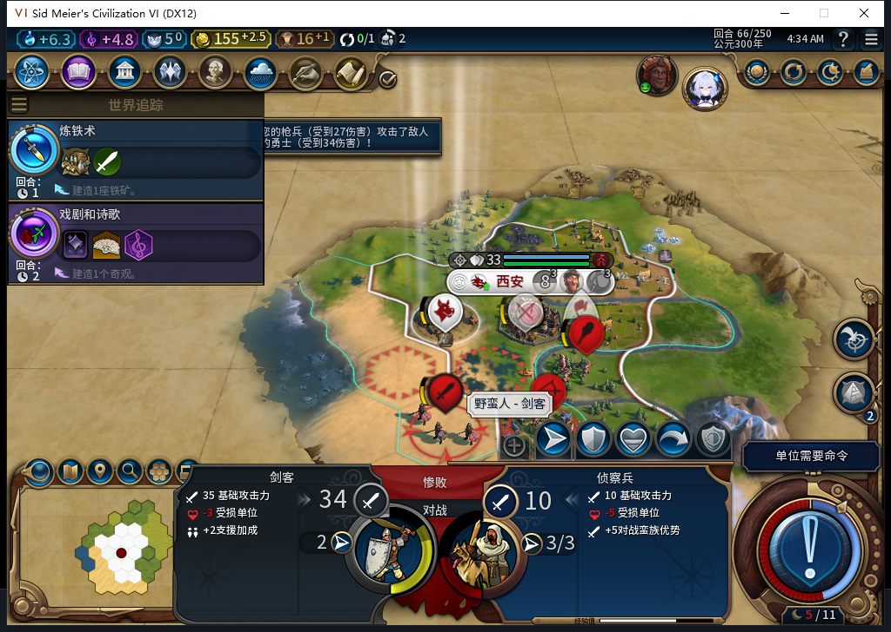
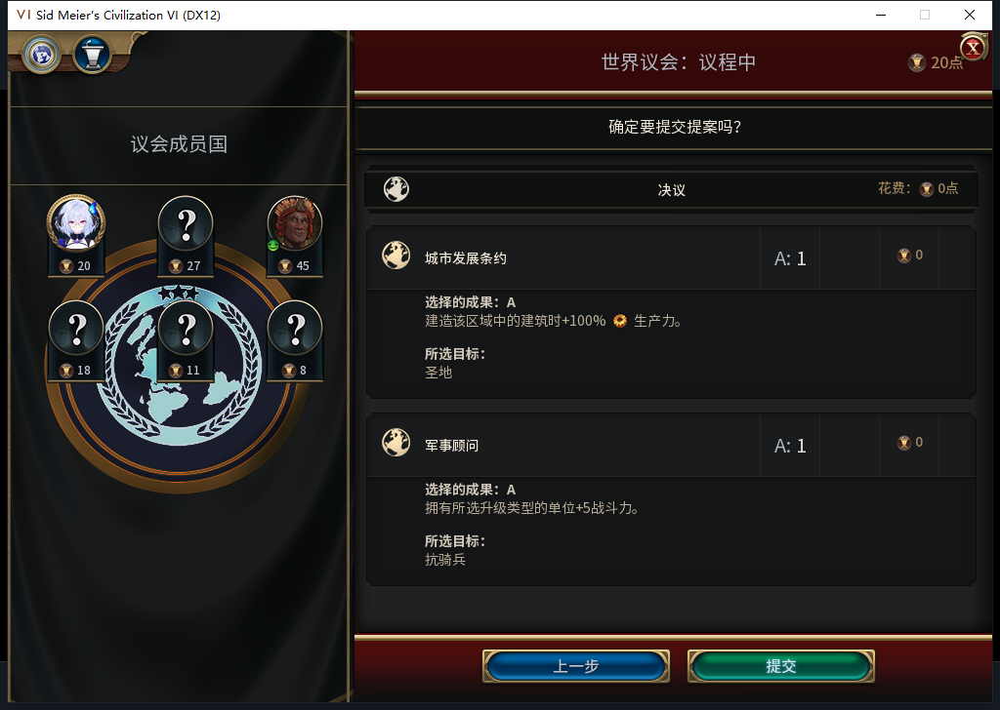
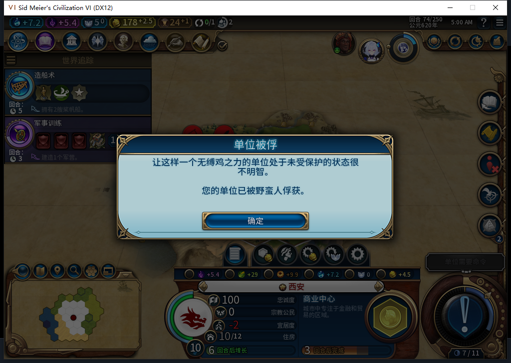

# 87允许区域替换普通经济改良，并在发令前复核

86实机第74回合找到一处确定的筛选缺口：西安有14个已探明可见的自有购地，旧规则筛出的合法圣地候选为0；16,34的农场同时通过原版CanHaveDistrict与城市BUILD资格，其他保护条件也通过，却仅因有改良而被排除。当自动建造者先填满裸地，区域规划会失去本可合法使用的地块。[原生读回、软件对照与范围](../research/baiqi-p6-district515-source87-evidence-2026-11-08.json)。

87允许区域替换农场、矿山、采石场、种植园、牧场、营地、伐木场，仍保护城市、自然奇观、公园、既有区域、地貌、可见资源，以及军用和未知改良。没有新增手动保留／解放地块入口。候选经过原版资格后，在真正发令前再次按坐标取得同一地块，核对所有权、区域定义、原版放置资格和保护条件；已有生产队列及区域评分不改。因此74仍在造的商业中心不会被圣地覆盖，也不能把候选资格当作已建成圣地。

9项Lua5.1实际Controller回归覆盖七类经济改良、未知／军用改良、受保护地貌、原版拒绝、已有队列、维修，以及最终原版查询时地块变成公园／资源／军用改良／他国所有、坐标别名或失去放置资格的情形。旧86与完整模型515候选都在3个方法中留下15条失败断言；87修订为0失败／0异常。完整1223项运行，1222通过，1项因缺少官方Steamworks测试程序集跳过；74份Lua通过5.1编译，96文件包逐字节匹配，SHA256`e3f06cb2fdaa38e968ec819cb8ce823cd4e5f8aba60fb18802cc1538ce88aa37`。87尚未安装实机，不能授区域实际建设通过。

本轮还补了86的玩家军队及世界议会窄验收。TEST_PLAYER通过原版MoveUnitToPlot发出一次近城枪兵攻击：首次即时读回尚为旧状态，未重发；稍后实际枪兵行动力0／伤害27，敌勇士伤害14→48，枪兵仍在城内，没有请求新战争。Executor新观察bank在攻击时记录0条请求，不能把玩家军令混写成模组后台行为，也不据此授全军事单位矩阵通过。

70的第一普通结束执行文职原有移动队列，仍在70；精确读回位置和队列后，第二个新鲜普通结束进入世界议会。TEST_PLAYER为城市发展条约的圣地、军事顾问的抗骑兵各投A一票，审阅总花费0后只提交一次。界面显示六方已提交，关闭等待页后实际恢复71、战略操作重新开放。最终哪项议案胜出和效果尚未独立读回，不能拿选票内容冒充决议效果。物理滚轮一次未改变滚动位置，随后原版展示控件滚到底；未完成选项时的一次“下一步”仍留在编辑页，不是第二次提交。

66→74为8个实际回合、9次普通END、8次玩家军队SKIP、1次玩家近战攻击，0UserForced／0文职或生产输入。新bank267条记录是254次招募评估、2次城市请求、11次文职操作；9份宗教快照仍无新先知、信仰5。两bank全部序号读回一次、0错误／丢样本并已撤除。当前圣地未放置，先知点仍0，完整宗教链路没有通过。

风险也扩大了：69的自有清单已无斥候，74清单也无移民及最近建造者，只剩城内枪兵，第二城未建。再次出现被俘提示，但本轮没有UnitCaptured精确事件，不能逐个捏造俘获演员或认定全部损失均由本次区域缺口造成。近城已有敌剑客和敌建造者的可见读回，文职离城后的安全与野蛮人压力仍须复核。

已撤钩后正式保存74：1154101字节，SHA256`7024d35ed777ff78a38bdb02f8fe8144a26717052df4b96be959c4545c940be5`，SaveACKtrue／稳定字节；此新文件尚未加载。10人口／178.5金／商业中心队列／一名枪兵。私人存档和机器日志不上库，上面三张原始实机图已内嵌；此前66的正式重载备份保留。

模型513仅保留可见近城、资格与结果分离等分析方向；其“非我方即敌对／BARBARIAN单位类型”及错误资格签名拒绝，负责人提示也有签名错误，已据原版Civ6Common纠正。514错把圣地任务答成学院，未采用其评分建议。515三个锚点都能依次唯一应用且Lua5.1可编译，但经济改良名漏IMPROVEMENT_前缀，两个重复FreshValid从未调用且依赖未定义名字及错误参数键，整稿拒绝、0Native。负责人曾两次未经测量推断锚点失败，对照在断言处停止；实际验证已撤回该判断，仅保留测得的语义失败。只读地块工具也曾因false／nil资源分支出错，0动作，修正后完整读取14地块。累计515任务／480完整stop／32length／3最终transport、545HTTP／额外重试30，OpenCode新增原生生成0，未知缓存／成本null。

接续按正式入口退出86并确认终态，在新鲜Steam离线证明后冷启动87、正式加载74，等待商业中心自然完成，再观察真正的区域候选选择与地块消耗。不能手动补圣地、清旧未知回执、赠送先知或替模组操纵军队。公开GitHub／Steam Alpha2仍内部82／12图，本轮0上线／上传；ARMED恢复、旧档等待、宗教完整链路和全部40项继续开放。
