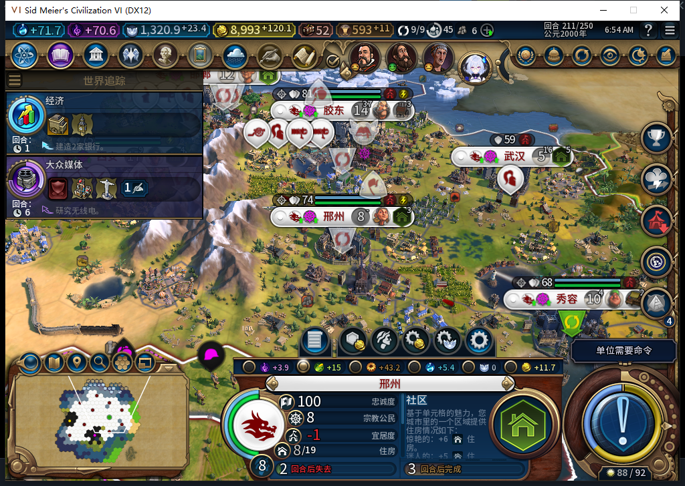
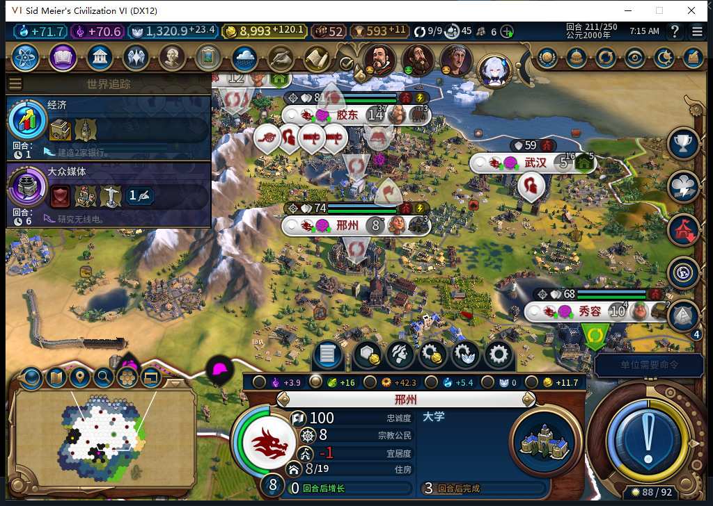

# 114 实机：邢州保住粮格，接着建大学

正式安装 114 后，在 Steam 离线下只载入一次原 210 健康存档。2277 当时仍有 1 人工作、产 1 粮，邢州净粮食为 0；只读检查确认新判据拒绝在该格放社区。之后按普通回合流程，测试玩家在世界议会投和 113 对照相同的三张免费票，实际进入 211，没有再次发送结束回合或代做内政。

114 的 211，2277 没有被放置区域，仍归邢州、1 人工作、产 1 粮。邢州仍为 8 人、总粮 16、净粮 0，掉人口提示没有再出现。生产没有停：原社区完工后，白绮托管开始建大学。没有新的救粮请求或账本许可；原完成记录仍在。

十座城市当前粮食盈余都非负，忠诚均为 100。西安仍在同一洪泛平原 2569 开工堤坝，进度 0/197；校验没有阻止这项有余粮的建造。211 现场已正式保存，旧失败档单独保留。此处通过的是这一条复发路线，堤坝完工和更长时间保持仍需单独验收。

[完整读回与存档指纹](../research/baiqi-p6-source114-district-food-native211-evidence-2026-11-11.json)。Steam 离线，工坊仍为内部 82。
