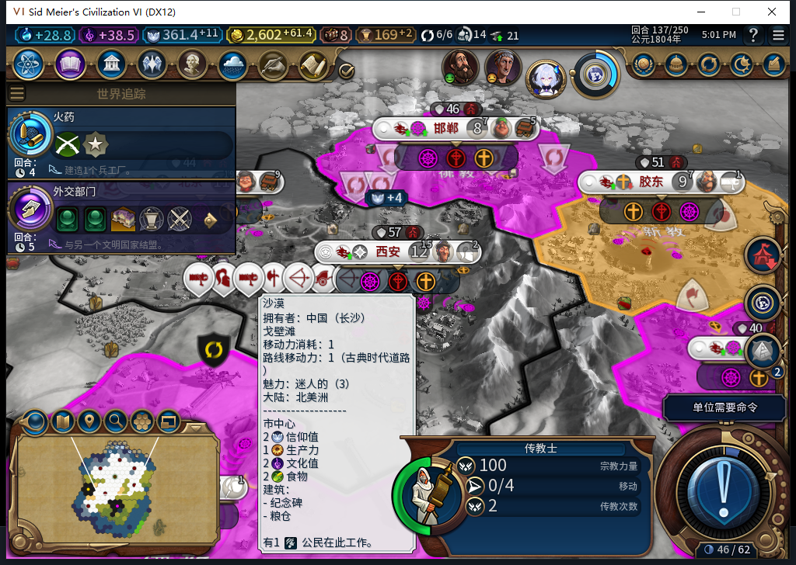
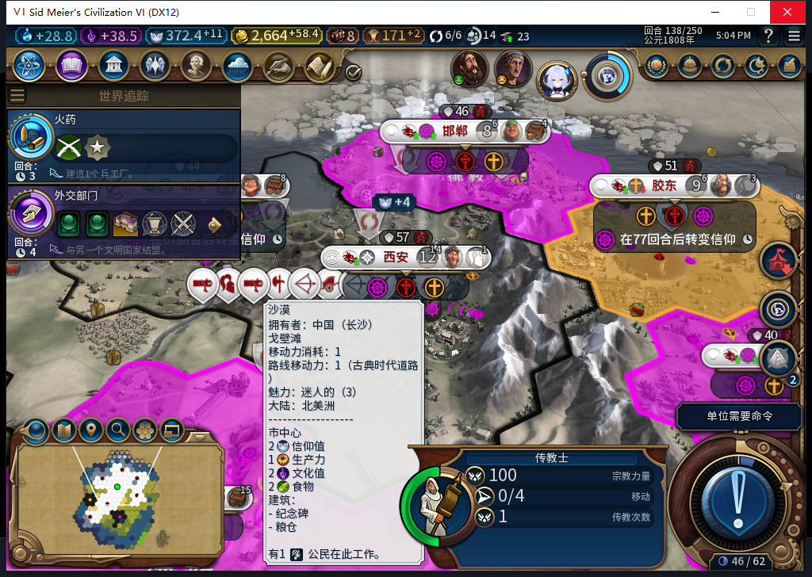
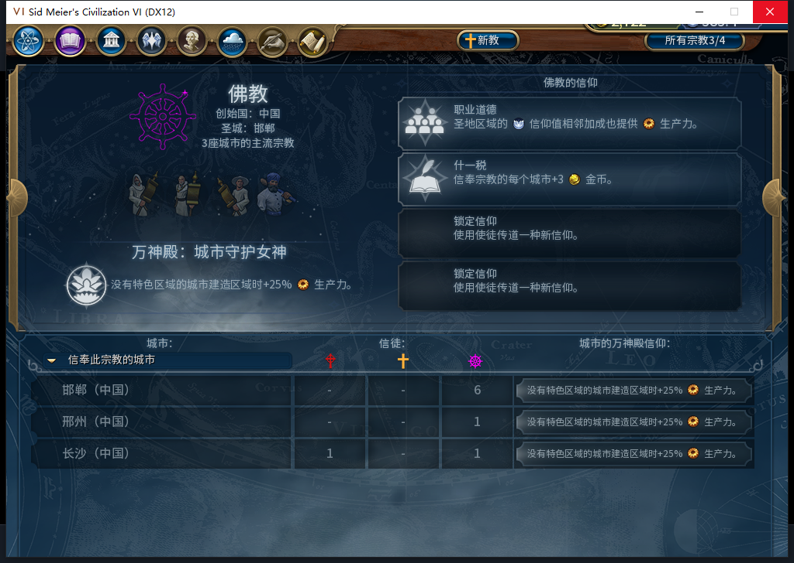

# 104实机：两次国内传播通过，最后一次回执仍失败

136的购买回执恢复后，只由测试玩家让军队待命并普通结束回合。137白绮把佛教传教士3407893从邯郸圣地54,37移动三步，到自有首都西安55,34，随后发出原版传播命令。138、139各再发一次传播，没有测试玩家移动或传播，也没有再购买。

| 回合 | 该单位剩余次数 | 持久化传播记录 | 首都佛教信徒／总人口 |
| --- | --- | --- | --- |
| 136 | 3 | 空 | 1／12 |
| 137 | 2 | religion:0:1，OBSERVED | 3／12 |
| 138 | 1 | religion:0:2，OBSERVED | 4／12 |
| 139 | UI存活名单已无；Core删除对象为0 | religion:0:3，ARMED | 5／12 |

这两张原图的地形悬浮信息仍显示长沙地块，不能拿它判断传播目标。目标65536／西安55,34由原生持久化记录及单位坐标独立核对。被动观察捕获三次MOVE_TO和三次SPREAD_RELIGION（137—139各一次），原生调用返回void本身不是成功证据；前两次同时有Core／UI的3→2→1实际次数下降与OBSERVED记录，因此给予这两次国内传播窄通过。

139最后一次发令后，UI已不列出存活传教士；Core仍枚举到同一ID／所有者／宗教，但次数0、IsDelayedDeath=true、坐标为-9999,-9999。现有读取拒绝负坐标，记录停在ARMED。最后一次的回执收尾FAIL保留，不把单位消失或删除后的对象读数单独作为传播成功证明，也不清记录、补单位或重发。真实139失败点已保存1463393字节，摘要核验；此前137、138检查点分别保存1454022、1458799字节，均尚未重载。

首都佛教信徒从1增加至5，同期自然压力可能参与；四次原生多数宗教仍为-1，不能宣布首都已转教，或把全部增加归给这三次传播。邢州与长沙已在没有本次传教士操作时受普通宗教压力影响。

137—139实际推进3个普通回合，3次普通END请求、4次测试玩家军队待命，0UserForced／手补内政。28行食粮样本净粮食非负、无饥饿倒计时，28行忠诚均100且正变化；北京人口10→11。观察器总413条（383招募读取／3城市／27单位操作／0单位命令），0错0丢；27次单位操作全部是建造者、移民或这名传教士，只覆盖白绮执行环境。城市命令计数0；两只观察器已在139撤除。

576诊断请求1HTTP、12043+201=12244 tokens、3.540883秒、stop／DONE／合法JSON。坐标拒绝与源码相符，但此前已由负责人识别；候选建议把-9999删除对象当作回执，或绕坐标直接读错误的Core扁平接口，不能采用。当前未改产品，下一步从138保存点独立观察原版次数／操作／删除事件，先取得可信时序证据。共享累计按576切点为576任务／537完整／36截断／3最终传输失败、606HTTP／30额外重试，OpenCode原生0，未知缓存／人工成本null。原完整1577软件检查不因这份实机报告增加。

用户告知其他设备占用Steam仍有效，整轮0上线、登录、下载、上传初始化或上传。三张图、说明和BBCode只入库，工坊Alpha2仍内部82。104正常新购买、最终一次传播收尾、旧移民已发令恢复FAIL、完整40、基础版／迭起兴衰及小视口仍开放。

[逐城信徒CSV](baiqi-source104-followers136-139.csv) · [结构化实机与失败证据](../research/baiqi-p6-religion576-domestic-spread137-139-last-charge-fail-evidence-2026-11-09.json) · [136冷读购买回执恢复](baiqi-missionary-cold-recovery-104.md)
