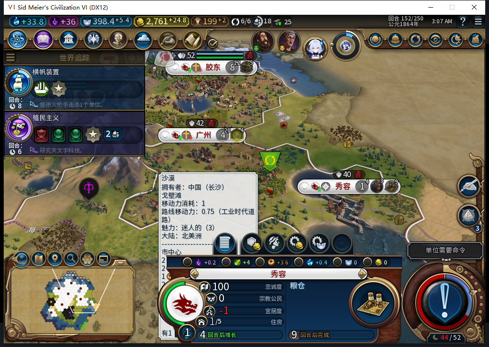
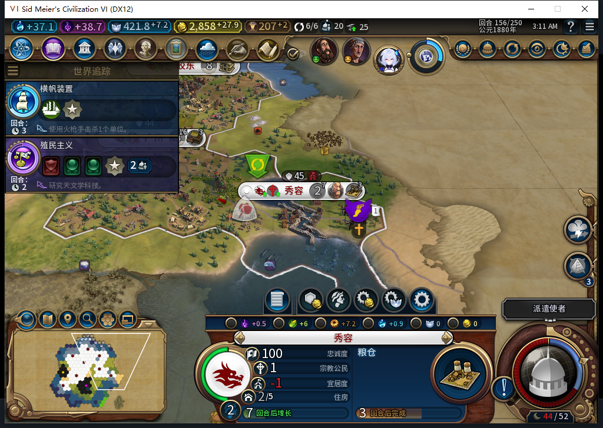
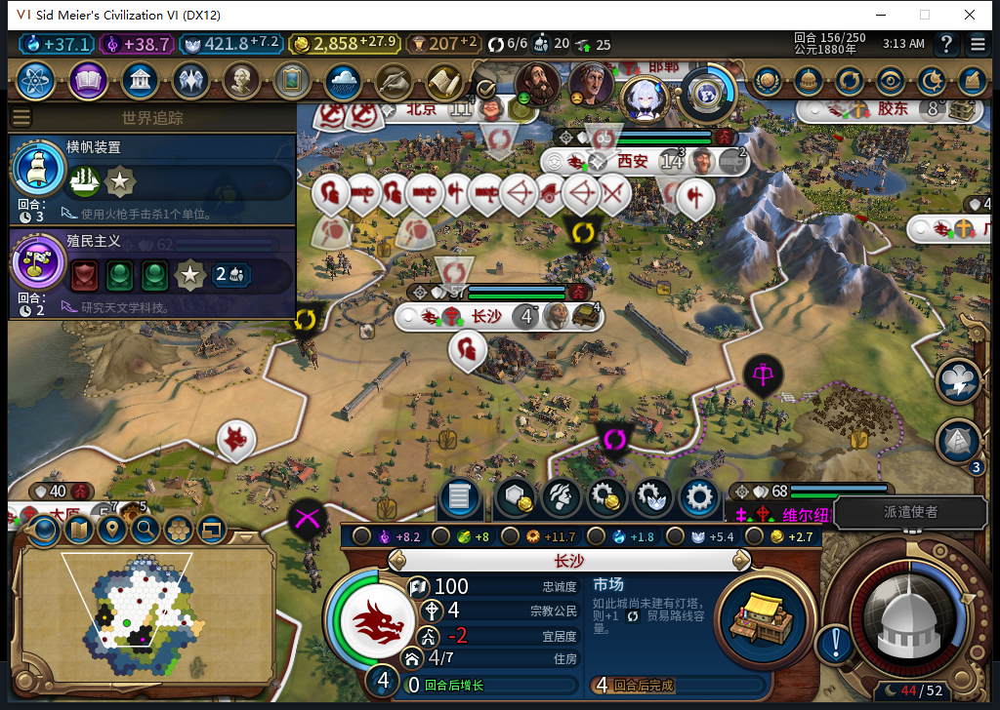

# 96 冷实机：秀容提前总督救援与四回合后续

2026-11-09，BF-202609141645。源码／安装／实机 96，产品 pin `4679b611562c8295ff46a9f4497930a1dd498376`。**同一 95 失败保存点的提前救援窄通过**：模组自行把 0 号总督从胶东调到秀容，秀容忠诚变化 −2.6875→+5.3125；胶东 +26→+18。测试玩家没有手动派总督、补粮、改忠诚或排产。

[机器证据](../research/baiqi-p6-governor96-native156-model552-evidence-2026-11-09.json)、[40 行生产队列](governor96-152-156-queues.csv)、[40 行城市状态](governor96-152-156-vitals.csv)、[原 95 FAIL 与六图](baiqi-warning95-followup152.md)、[96 软件修复](baiqi-early-governor-96.md)。

## 同档实际调任与效果

原版加载私人 95 的 152 档一次、ACK=true，完成加载后原版“继续游戏”一次。八城、25 单位、36 建筑、25 区域、115 可见己方地块及所采世界值与保存前逐项一致；不是全世界零变化证明。城市状态仅胶东／秀容的总督归属和变化不同。

| 152 状态 | 95 保存前 | 96 冷加载后 |
| --- | ---: | ---: |
| 秀容忠诚 | 100 | 100 |
| 秀容变化 | −2.6875 | +5.3125 |
| 秀容总督 | 无 | 0 |
| 胶东忠诚 | 100 | 100 |
| 胶东变化 | +26 | +18 |
| 胶东总督 | 0 | 无 |

实际拆分仍为人口压力 +0.3125、幸福度 −3、其他 0，新增总督 +8。冷加载启动期没有提前安装计数器，所以**原生调任请求次数未知**；不以回执或事后状态虚构“一次请求”。后续已直接核对总督归属和真实变化。

该图保留实际地图悬停提示，忠诚变化的精确值来自上述只读拆分；未修图移除界面。初始负忠诚建城的历史 FAIL 保留，这里通过的是已建城后的提前救援，不是所有新址初始稳定。

## 继续四个普通回合

152→156 实际推进 4 回合，直接原版 END 4 次、玩家军队待命 16 次，0 UserForced／手动内政。五份八城状态均忠诚 100、变化为正；0 号总督一直在秀容，没有把它反复召回胶东。秀容 156 长到人口 2，粮仓已有正常产能进度。

长沙商业中心在 155 完成并转市场。它的农场前态 145／区域放置 146 在 95 包已有证据，故这是 **95 放置／96 完工的混合版本存档链**。广州商业中心 156 完成；没有采到其地块农场前态，不归入农场替换。

这只有四回合，不是 20 回合或完整稳定性矩阵。旧上海 −9.5625、旧 ARMED／旧档等待等失败不因此关闭。

## 长沙人口变化仍在诊断

长沙 `327684@53,30` 采样人口为 152 的 3、153 的 4、154 的 3、155 的 3、156 的 4。当时在建商业中心，不能直接称作训练移民的人口成本；也没有足够的历史粮食数据把它归为饥饿。

156 的原版 Growth API 实际读回：粮食余额 0.8984375、阈值 22、盈余 0、总粮食产出 8、增长／饥饿倒计时均 −1。这仅说明该时点没有饥饿倒计时，不能追认 153→154 的原因。

按原版 ClimateScreen 的可见历史过滤，152—154 的事件未通过可见性筛选；155 可见 4 级飓风，公开 PopLost=0；156 无该接口记录。这些结果均不能解释或排除长沙的历史人口损失。下一步从已知 152 档独立复现，补采粮食和人口事件，不代做内政。

发现人口疑点时，批处理已有后续周期在途；本地停止门最终在 156 周期入口拒绝，**0 END156**，不是立刻停在 154。观察器最终 667 条：招募检查 637、城市请求 5、单位操作 25、单位命令 0，序号恰好各一次、0 errors／drops。只覆盖 Executor 绑定，不含总督 PlayerOperations 全部请求；已恢复原函数、namespace 为 nil。

原版保存 ACK=true 且字节稳定：私人 `Baiqi_P6_20261109_V96_GovernorRecovery156.Civ6Save`，1575467 B，SHA-256 `908048bbb579e535b93bae834f27a24819758490eb1b7d76c84a66f6d8d621d3`，未加载、不公开存档。

## 诊断候选与环境界限

552 是上述真实人口疑点的可见灾害历史只读任务，1 HTTP，完整 stop／DONE／合法外层 JSON；1365+363=1728 tokens，2.866 秒。原 Lua 5.1 可编译，但没有要求的逐回合 pcall，还把 nil 检查误称隐式 pcall，并读取未提供的 Game 全局；代码整拒、0 原稿 Native。负责人另写固定 player0、五回合有界、原版可见性过滤的纯读取器，经 4 项隔离资格后执行。空／过滤／未知不当作损失 0，也未确定根因。4 项只是诊断资格，不计成新产品方法。

累计至 552：552 逻辑／514 完整 stop 合法外层 JSON／35 length／3 最终传输失败，582 HTTP／30 额外尝试；0 新 OpenCode 原生生成，Nov9 每日成功缓存复用。缓存 tokens、人工成本、净节时保持 null。本包没有产品修改，原 96 的 1359 pass／1 SDK 环境 skip 未重跑。

95 自有游戏先原版退出；273 秒后仍有无窗口／端口且两次 CPU 相等的自有残留，只清理这一 tuple 一次，未结束 Steam 或其他游戏。96 冷启前 UTC `2026-11-08T19:00:32.104098+00:00` 后台实际读取当前 Steam“上线…”菜单，0 输入／激活／移动／截图，新鲜度 0.003335 秒；正式菜单头部导航和关闭前台菜单另记，不是模式切换。加载期间两次 4319 LSQ 超时均 0 CMD，实际 Continue 后 4318／126 上下文才资格通过。

Steam 他机占用禁令持续：0 模式切换／上线／登录／下载／上传器初始化／上传。Alpha 2 下载仍 82／12 图，本页三图尚未上工坊。自然宗教链、Base／RF、性能及完整 40 项仍开放。
