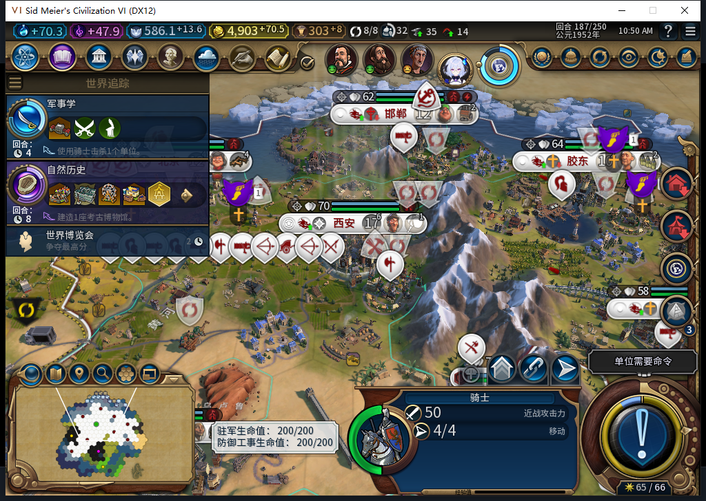

# 100冷实机负例：187当前无先知候选，伟人页未打开

100正式冷读186，自有经济／9队列／66建筑／34区域／145地块／36单位保持；一个普通回合后到187，白绮先知点42／每回合1，仍未创教或持有先知。当前PROPHET类记录存在，但Individual和Claimant均nil。原版GreatPeoplePopup351–356把此正常形态显示为noneAvailable，不能当成解析出错或空闲名额。

独立只读公开过去记录读到三位已领取先知：117由玩家4在54回合领取、112由玩家3在95领取、122由玩家1在186领取。186末看到的122未领取机会已关闭。这里不读取他方隐藏单位或信仰，也不推断领取方式；三份公开记录不能凑成地图上限4的完整归属账。

太原此时仍在完成既有灯塔，祷告项目尚未开工，供应就已消失。100的加权因此不生效；**本窗不授祷告完工／奖励／先知招募通过。** 99首座圣地及首次产点的窄通过保持，不能升级为创教成功。后续用保留的真实早期存档验证机会尚在时的整链，187另存为负例，不补点数、信仰或单位。

此图证明查看事件后仍留在地图，当前先知是否为空来自独立数据，不是图中字段。进一步只读确认：GreatPeoplePopup上下文的Open、OnOpenViaLaunchBar、LateInitialize均nil，只有IsReadOnly函数，未在弹窗队列中。直接原版处理器前置检查未发输入，后来原版LaunchBar事件返回ACK也没有打开页面，记**伟人页查看FAIL**。

源码中BaiqiUILoader把它当成普通父级包含链，只加载GreatPeoplePopup_Expansion2；实际扩展文件明确由Base末尾wildcard载入，本身仅覆盖IsReadOnly，主体及事件注册因此缺失。正在单独修复和冷验，不靠伪造页面补图，不泛改其他UI的继承路径。白绮禁写守卫仍保留。

186→187共1普通结束、8玩家军队待命；西班牙提出交易，测试玩家拒绝并关闭，未成交煤／象牙／金币或开放边界。结束遇外交后的等待失败没有重发结束。18行食粮非负且无饥饿倒计时，18行忠诚100且正变化；269条透明观察0错0丢，187全部撤除。187已正式保存校验，0END187。

旧555诊断器要求每条先知都有Individual，故本次返回UNKNOWN是工具边界，不能改写成供应事实。566负责人新只读工具区分明确NONE_AVAILABLE与缺类／无效UNKNOWN，读取公开Past并按原版过滤未领取条目；20项Lua5.1检查通过，不入模组。原稿重复把Game静态方法写冒号，20方法9失败事件；三处调用改点号的诊断对照仍11失败事件，漏元表、过去未领取过滤、负数和自身状态一致性等。原稿／对照均0实机，失败事件不等于独立方法数。

模型566完整stop／DONE／JSON，1HTTP、7197+1744=8941 tokens、11.434711秒；累计566任务／528完整／35截断／3最终传输失败、596HTTP／30额外重试，新OpenCode原生生成0，未知成本null。567界面修复另账，此页不将其候选或待验修订算作100实机通过。

100仍为107文件／85Lua的安装源码，源100完整1503切点没有重跑或重算为新完整回归。启动前独立后台离线证明0.005349秒新鲜，模式导航与确认分列；Steam外机占用，0模式切换／上线／登录／下载／上传初始化／上传，公开Alpha2仍内部82。旧ARMED恢复FAIL、宗教整链、伟人页查看及完整40保持开放。

[结构化证据](../research/baiqi-p6-religion566-empty-current-prophet-and-source100-ui-fail-evidence-2026-11-09.json)、[20项诊断](../../tests/test_diagnostic_prophet_supply.py)、[只读模块](../../tools/lua/diagnostic_prophet_supply.lua)、[18行食粮](source100-empty-prophet186-187-food.csv)、[18行队列](source100-empty-prophet186-187-queues.csv)、[100软件边界](baiqi-prayer-project-production-100.md)。
