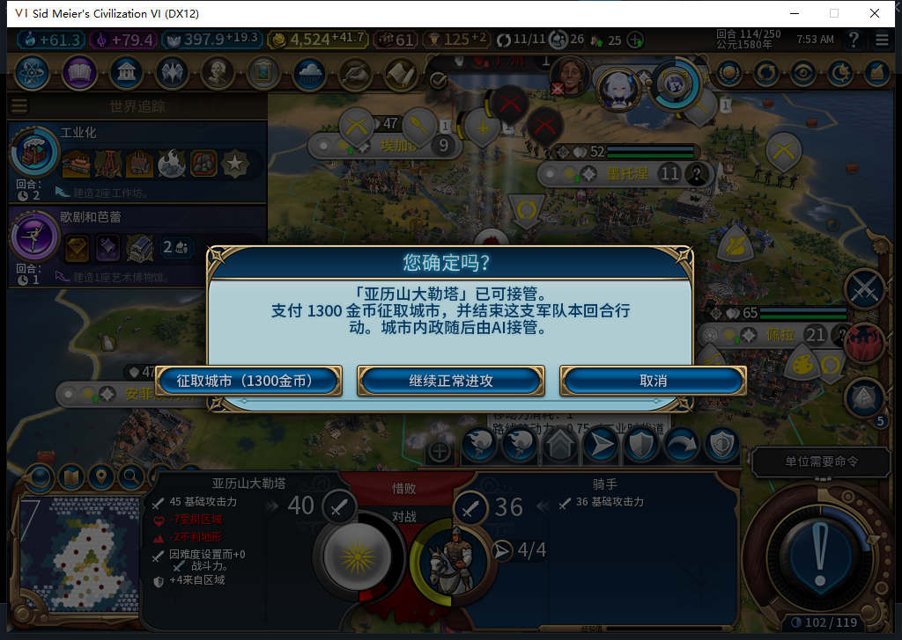
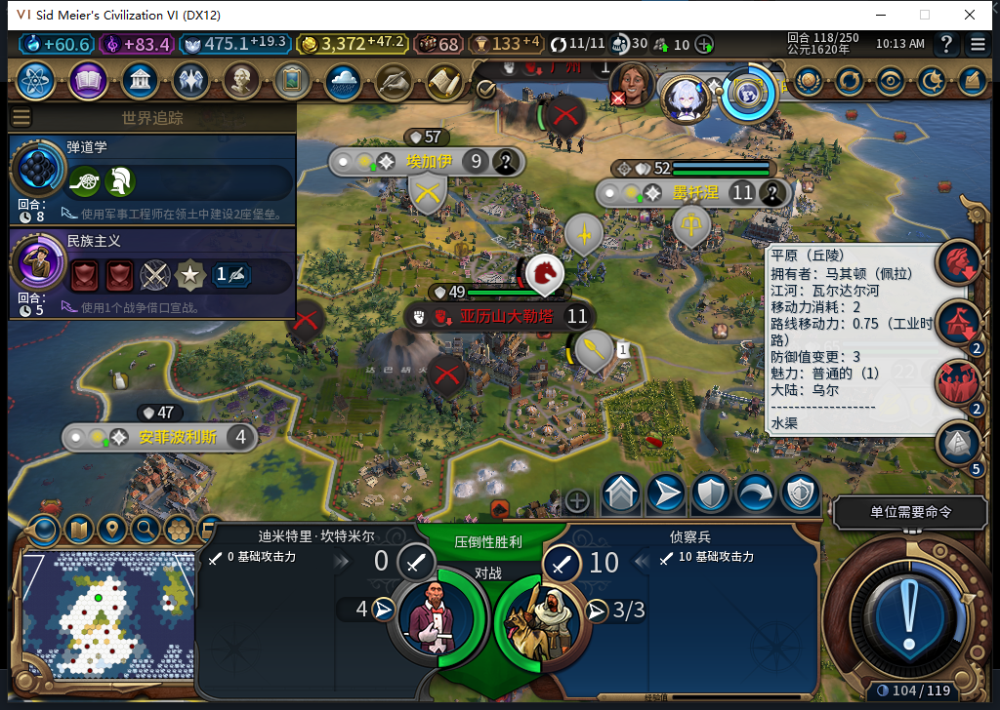

# 74版：埃特曼安吉征取与资产变化

2026-11-05，BF-202609141645，Steam离线、单人风云变幻。玩家确认1300金币后，既有敌城实际转给白绮，费用和行动各结算一次。埃特曼安吉神庙、4栋建筑、5件巨作及5个已完工区域即时保持；另一个未完工校园和87点施工进度在转移后不再保留。继续正常推进114→118后，这座城成为自由城市：花钱取得城市不保证能留住城市。TC-031整体保持部分、未闭。[首次取证与模型402／403审阅](../research/baiqi-p6-etemenanki74-evidence-2026-11-05.json)、[完工状态与物理右键／取消补证](../research/baiqi-p6-etemenanki74-completion-evidence-2026-11-05.json)、[四次正常换回合证据](../research/baiqi-p6-etemenanki74-normal-turn-evidence-2026-11-05.json)。

74版窗口原图，像素未改。这张图对应的付费分支由现有地图交互函数打开确认，随后实际物理点击“征取城市”；工具没有直接调用Capture或提交征城请求。后续另做物理右键打开与取消的独立样本，分开记账。

| 核对项 | 征取前 | 确认后 |
| --- | --- | --- |
| 城市 | 文明1，262147，37,12，人口11 | 白绮0，851979，同位置、人口11 |
| 金币 | 4524.2734375；报价1300 | 3224.2734375，恰扣1300 |
| 骑手2162700 | 37,13，行动4 | 原地，行动0，冷却114 |
| 请求／调用 | UI请求0、转城0、结束行动0 | 各1次，观察错误0；事务COMMITTED／DONE |
| 建筑 | 粮仓、圆形剧场、美术馆、埃特曼安吉神庙 | 4栋对应，损坏标志保持 |
| 巨作槽 | 圆形剧场作品1／5，美术馆10／9／8 | ID、类型与槽位逐项保持；双方16件作品各有唯一位置，新获5件不在旧主槽中 |
| 区域 | 5个已完工，1个校园未完工／87产能 | 5个已完工按类型／位置对应，新实例ID；34,13的未完工校园不在、该项进度0 |
| 驻防生命 | 最大200，QA伤害150 | 最大200，伤害100；原生转移带来的变化 |
| 占领／忠诚度 | 未占领，100，每回合+28 | 114即时：未占领，100，每回合−30.6875；后续见下表 |

校园所在地块606仍归白绮，并在新城市的购买地块中；UI和Core均读到DistrictType=−1，双方城市区域清单中都没有它。按旧完整ID向新主人查询会返回另一个完整ID的奇观对象，不能把“FindID非nil”当作校园仍在。最初快照缺少完工字段；随后回读事先保存的转前副本，UI和按完整ID／位置核验的Core校园对象都返回IsComplete=false、IsPillaged=false，UI施工进度87／成本129。原有5个已完工区域逐项对应保持。需求BR-023按引擎实测记录转换，不默认无损；本例明确记录未完工校园与进度撤去，不推成全部未完工区域的统一规则。

转前队列是校园，转后后台AI请求了纪念碑。日志中BACKGROUND请求0:114:1／城851979／BUILDING_MONUMENT，随后queue_observed与独立UI队列1项、hash−2025065568吻合。114时尚未建完，115进度16／30，116为28／30，117实际HasBuilding=true。测试玩家没有选生产或补产能；本例覆盖了新城接入托管、排队到建成的窄链路。

| 正常回合 | 城市归属 | 忠诚度／每回合变化 | 纪念碑 | 玩家金币 |
| --- | --- | --- | --- | --- |
| 114，已付费结果读档后 | 白绮0，851979 | 100／−30.6875 | 0／30 | 3224.2734375 |
| 115 | 白绮0，同城 | 72.3125／−27.6875 | 16／30 | 3260.984375 |
| 116 | 白绮0，同城 | 44.625／−27.6875 | 28／30 | 3297.6953125 |
| 117 | 白绮0，同城 | 17.9375／−26.6875 | 已建成 | 3334.40625 |
| 118 | 自由城市62，新ID131073 | 新主人100／−9 | 仍在 | 3372.1171875 |

每个结算点都在本地玩家回合、Core不忙且不处理消息时读取。原4建筑、5件巨作的ID／类型／槽位和5个已完工区域的类型／坐标逐点保持；118这些资产归自由城市。Players[62]:IsFreeCities()为true，不能把其100忠诚度当成白绮恢复了忠诚度。没有捕获叛离原因事件，因此因果范围限于连续负忠诚度后实际转成自由城市的这个分支；不能推成所有征城都会在四回合叛离。

118的Core账本仍只有一笔COMMITTED／DONE、cost1300，原balanceAfter=3224.2734375保持。四次金币增加分别等于前一回合原生收入减维护，没有观察到二次征取收费或叛离退款。白绮城市总数仍为12，但另有新城917515／25,15；总城数相同不能证明原目标仍归白绮，也不据此授完整自然生产移民链通过。

结束回合没有传reason，更没有UserForced。116、117期间，测试玩家依原版待办跳过可合法跳过的军队；几处军队同格时，测试玩家对无护送军队提交普通MOVE_TO分散到自有、可见、空地，随后再走普通结束。没有替文职下令、改队列、清未知回执或新增QA传送。117新将军与音乐家同格，玩家移动将军后，音乐家独立读回已不再等待命令；未人工处理音乐家，未据此推断具体后台动作。独立只读工具起初把缺失的SKIP_TURN枚举当参数，其false结果不算合法性证据；已改用实际数据行Hash745019656。执行军令的工具从一开始即使用该回退。

前端补证使用回读后的准备副本。在490,390这个点位，实际光标地块565／37,12；物理右键按下、松开、MoveUnitToPlot与Interact各1次，错误／丢弃0，实际弹出1300确认。只点击取消：UI请求0、金币4524.2734375、军队行动4、城市仍属1，Core账本为空。首个512,370未弹框样本保留；点位、重载及时间都不同，现有证据不能单独证明透明控件或OS输入根因。这个取消样本没有重做付费征城。

这是独立QA分支。奇观、建筑和作品原本就在敌城，没有人工创建；战争由场景API布置，骑手显式放置到邻格，放置后行动0，再单独恢复为4；城防伤害为人工准备。这些不是正常外交、自然战斗或后台军令的通过证据。目标原来没有驻军，本例不覆盖有驻军城市的处理。

已保存转前、转后和118叛离结果三份副本，原正常Farm114未覆盖。转后保存ACK为true，但工具的10秒文件等待先到期；随后只读找到同一文件并核验稳定字节，没有重发保存或征城。首次Core两项／UI一项观察绑定、后续四项输入／一项请求观察绑定均先核所有权再恢复。已完成转后114副本的独立恢复核验，再正常推进至118。118副本577982字节、SHA-256 `4e70270429fb9df59b01818c7bcc7af50c460d76392155640c2f6a30c570aad7`；之后官方载入正常Farm114，ACK为true，本证据切点尚待局内读回。实际现场见[交接](../handoff/2026-11-05.md)。

402／403均为完整HTTP候选；只接受局部调用链事实和补齐前态的取证方向，0代码采用。本次续验0新模型请求。缺少实际输入登记、静态定义表混同实例ID及错误上下文的建议未执行。软件套件未重跑，产品仍为原74；更长忠诚度场景、区域收益、其他奇观／特有资产与驻军矩阵继续验收。
