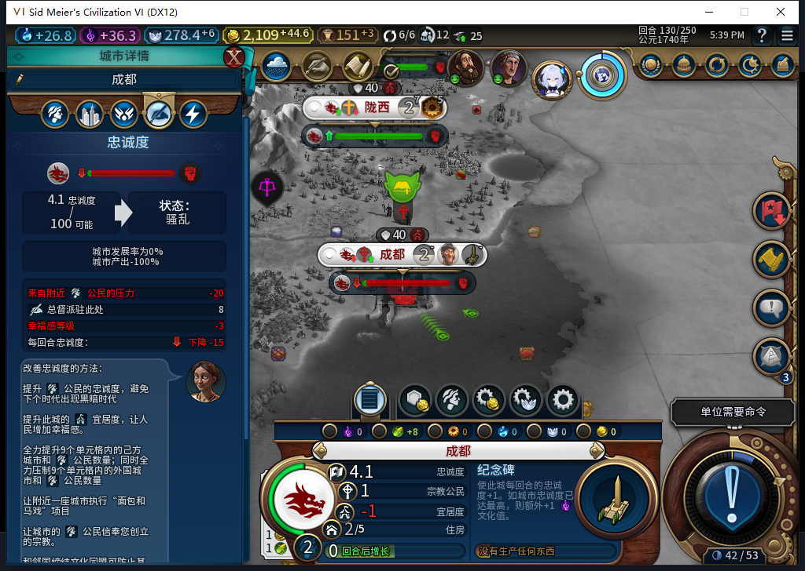

# 92长期保城仍失败：停止新增扩张后，成都130仍陷危机

从[128正式存读档窄通过](baiqi-expansion-stability-native-92.md)继续两个普通回合，**成都129忠诚19.0625／+1.09375，到130降为4.0625／−15，产能仍0**。本方始终7城，移民2686991仍在59,36、2移动力、原目标62,34保存且无原生排队目的地；没有建第8城。92暂停扩张并没有修复已有城市的长期保城失败。[精确证据](../research/baiqi-p6-expansion-stability92-long-term-fail130-evidence-2026-11-08.json)。

原图由测试玩家打开原版城市忠诚页，仅查看；没有裁剪、合成、遮罩或改数。原生明细和画面一致：附近人口压力−20、总督+8、幸福感−3，其余所读项目0；总督3仍派驻、未失能。不能再将新建第8城视为本次危机的必要条件，但两个分支也没有隔离时代、外国人口等变量，真正的压力变化原因仍未知。没有靠增益、授予人口／建筑或手动驻军制造恢复。

| 回合 | 城市数 | 成都忠诚 | 每回合变化 | 产能 | 移民 |
| --- | ---: | ---: | ---: | ---: | --- |
| 129 | 7 | 19.0625 | +1.09375 | 0 | 原地等待、目标保持 |
| 130 | 7 | 4.0625 | −15 | 0 | 原地等待、目标保持 |

[14行忠诚记录](expansion-stability92-129-130-vitals.csv)、[14行队列](expansion-stability92-129-130-queues.csv)覆盖全部己方城市。128之后测试玩家2次普通END／4次军队SKIP，实际推进2回合，0UserForced／手补内政。130检查保存读数后exit1，后续只读取、正式保存和查看，**没有END130或投票**。之前128撤下的观察器没有重新安装，不声称128→130原生订单计数为0。

失败档正式Save ACKtrue、连续读取稳定，1434179字节，SHA256为366921a883ce6c937dafdd568b69378cd9c2db4325d8589e3a77bb4786905170，尚未加载；125／128／原91失败130档均保留，私人存档不上库。当前source/install/runtime92未改，104文件／82Lua5.1，软件基线1321通过／1SDK环境跳过未重复跑，1321软件通过不能覆盖本次游戏FAIL。

541负责人独立只读警告读者用原34场景资格再读130：1758为UNKNOWN/target_unavailable，1976及2047为UNKNOWN/no_warning_entry。仍没有KNOWN_NEGATIVE实机正案，未接产品，没有新HTTP或原稿进游戏。旧91某可见样本−20不能填补当前目标缺值，也不能证明警告表的完备性或缓存有效期。

下一步继续核对己方时代及可见压力来源、选址警告的可靠输入；本失败分支不再推进。等待／目标保存保持窄通过，长期保城、产出恢复仍FAIL，旧ARMED／LEGACY恢复与完整40项继续开放。其他设备占用Steam，0模式切换／上线／登录／下载／上传器初始化／上传，公开Alpha2仍内部82／12图。
