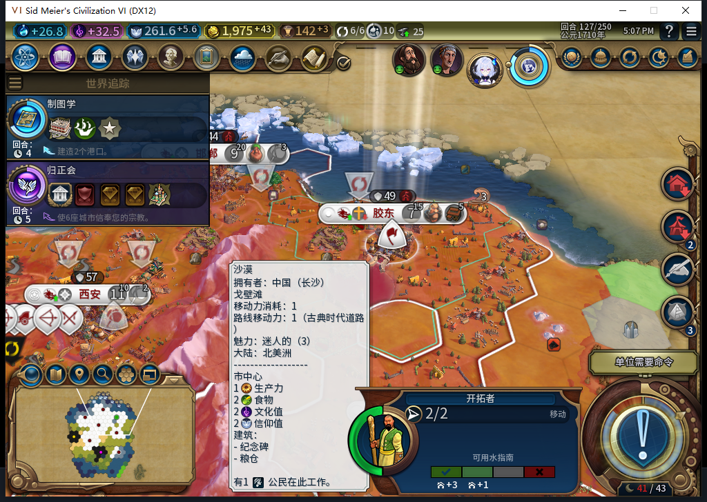
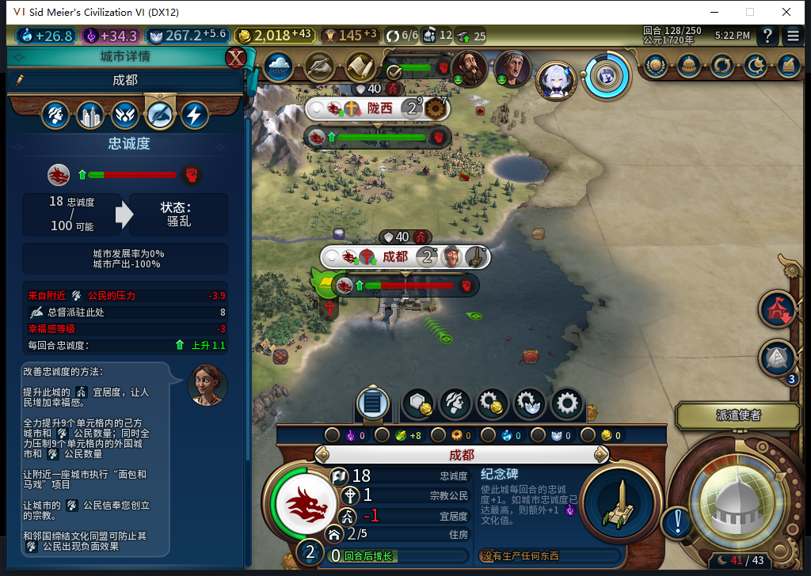
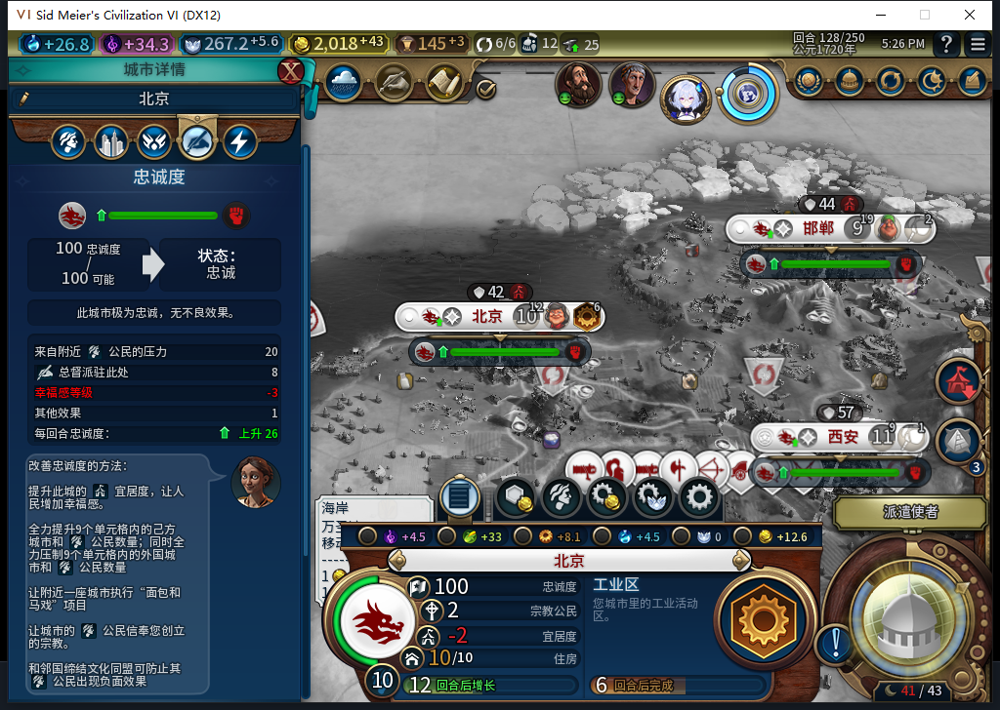

# 92实机：忠诚恢复前暂停扩张，其他城市继续生产

离线冷装92后，正式读取91保留的125回合备份，再走三个普通回合至128。同一名移民始终在59,36，原定城址62,34没有丢失，城市数保持7；北京工业区从16/86推进至39/86。这一窗口通过“低忠诚等待／保留目标／其他生产继续”的窄验收。**成都仍产出0，长期保城FAIL未关闭；没有实测忠诚恢复到50后重新出发。** [结构化证据](../research/baiqi-p6-expansion-stability92-native-and-model541-evidence-2026-11-08.json)。

安装来自已推送30e7d6f，104文件逐字节一致、82Lua5.1编译；既有软件1322运行、1321通过、1项SDK环境跳过，本次没有产品代码改动或重复全量测试。125冷读与91原采样逐字段相等：7城队列、18单位、20建筑、16区域、91个可见己方地块；这不是完整世界或存档等价证明。原91失败130另档完整保留，本轮是从125分支验证，不能改写那次失败。

| 回合 | 成都忠诚 | 每回合变化 | 成都产能 | 移民位置／移动力 | 原目标 |
| --- | ---: | ---: | ---: | --- | --- |
| 125 | 13.28125 | +1.796875 | 0 | 59,36／0 | 62,34 |
| 126 | 15.078125 | +1.796875 | 0 | 59,36／2 | 62,34 |
| 127 | 16.875 | +1.796875 | 0 | 59,36／2 | 62,34 |
| 128 | 17.96875 | +1.09375 | 0 | 59,36／2 | 62,34 |

四次直接读取原有BAIQI_SETTLER_GOALS_V1属性，unit2686991／plot2578不变，没有调用私有Inspect／Prepare／RunNow或写属性。原生排队目的地四次均nil；不能将本案推广到已有原生排队移动的演员，因为92不会取消旧队列。已有1移民恰好达到maxSettlers1，故本次“未新增训练”不能独立证明训练稳定性门，训练分支仍只有软件证据。

原版选择该移民仅为查看，选择自动触发定居透镜；右下2/2可见。地块提示遮挡部分地图，演员位置与保存目标来自关联只读记录，不从图像猜测。测试玩家没有移动或建城。

忠诚约18、每回合+1.1，总督+8仍在；城市产出−100%。纪念碑持续3/30，不能把忠诚回升写成城市恢复。[28行城市状态](expansion-stability92-125-128-vitals.csv)保留所有己方城市，采样时其余城市均非负压。

工业区界面预计6回合，精确39/86来自同回合原生队列读取；125为16/86。首都训练完蹲虎后接续建造者，128为52/63；胶东工业区完成后接续工作坊23/97；陇西完成纪念碑后开工业区0/90。[28行队列](expansion-stability92-125-128-queues.csv)。三张均为本机游戏原图，未裁剪、合成或改数字，只有文字解读新增。

观察器仅覆盖BaiqiExecutor绑定：510次recruit检查、4次城市RequestOperation、23次单位RequestOperation、0单位RequestCommand，537条、0错误／丢弃。移民126／127／128各一次SKIP_TURN，原生枚举确认为745019656；该绑定窗口0MOVE_TO／0FOUND_CITY，返回为正常void，不把返回值当位移证据。另有建造者15MOVE_TO／3个492889976操作、商人2个−2089494188操作；没有把这些未在本次核枚举的哈希另行命名。观察器已恢复全部绑定并撤下namespace，随后正式保存128，ACKtrue且文件连续读取稳定；私人存档不上库。

测试玩家共3次普通END、6次军队SKIP，实际换回合3次，无UserForced／Shift+Enter、无手补内政、无授予单位或揭图。127一次只读检查碰到忙碌，窗口停住后改名新读通过；原动作没有重放。最后一轮遇巴西原版军队称赞，仅测试玩家一次Bye关闭，没有后台外交或接受交易。

541是尚未完成的选址警告读取任务：canonical HTTP一份完整stop／DONE／合法外层JSON，原Lua能编译，但实际API夹具9个反例失败，整稿拒绝，0原稿进游戏。问题包括plot方法缺self、PlayersVisibility应为pid对象、误拒无主owner−1、缺新鲜规则复查和userdata支持。负责人独立只读版本34个Lua5.1场景通过，125实际三个目标均UNKNOWN（1758不可用、1976无条目、2047不可用），没有KNOWN_NEGATIVE正案。此前130原生接口曾给可见无主非城1758返回−20；缺条目不是0，更不能推断缓存、完备性或无风险。读者未接产品，源码仍92。

累计541逻辑任务／505完整外层JSON／33截断整弃／3最终传输失败／571HTTP含30额外尝试；Nov8首500维护成功1.19.5缓存复用，OpenCode原生生成0，未知缓存与人工成本null。原件留忽略目录，通用经验另同步共享仓库并给本证据精确反链。

其他设备仍占用Steam。启动前同实例取得独立后台只读离线证据；正式菜单导航与查询分开，导航不是0输入，查询没有激活、移动或截图。离线不代表账号远端空闲。本轮0上线／登录／下载／上传器初始化／上传／模式切换；GitHub／Steam公开Alpha2仍内部82／12图。原91退出留存自有无窗口／监听／CPU残余，等待超过180秒后只回收该残余，不称正常干净退出，也没有结束Steam或他人游戏。

128已正式重载一次，加载时一次LSQ超时没有发命令；原版Continue一次后重新资格查询得到126上下文，实际128可正常输入。WORLD、7城队列、18单位、完成建筑／区域、93可见己方地块逐字段相等，7城忠诚状态相等；目标62,34和原演员59,36／2移动力／queue=nil保持。这只通过保存等待提案的窄持久性，不关闭旧ARMED未决建城恢复FAIL。没有新增END或手补内政。

下一步继续选址质量与原91长期负压诊断。忠诚50恢复／新训练原生正反例、旧ARMED／LEGACY恢复、宗教采购正案、Base／RF兼容实机、性能／压力和完整40项继续开放。[91长期130失败](baiqi-expansion-stability-source-92.md)。
