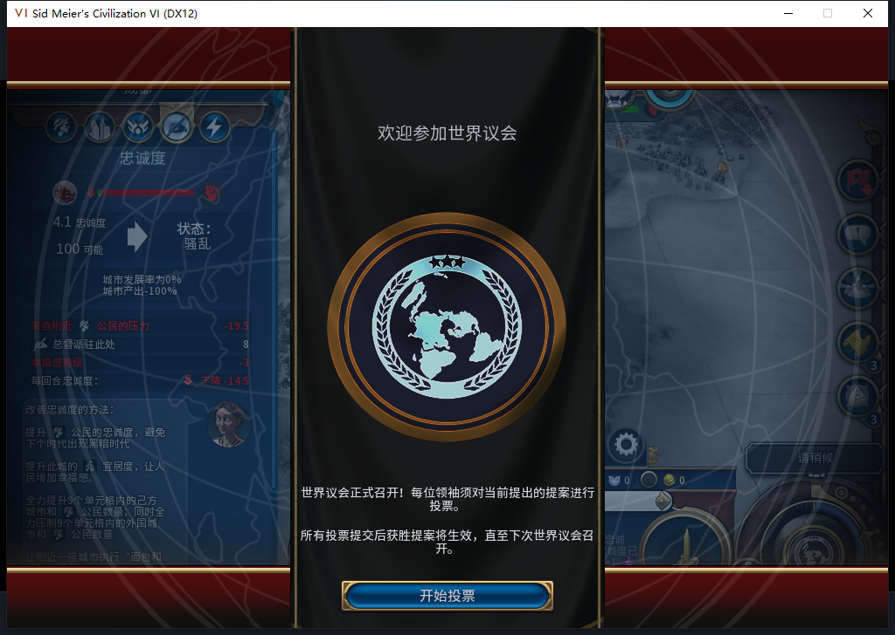

# 92扩张稳定性保护：软件通过；91长期保城仍FAIL

92增加一条内部规划约束：己方任一城市忠诚低于50或当前每回合下降，先等待恢复，再发新的移民训练、移动和建城请求；其他城市生产继续。**92尚未安装或实机，不能称保城成功。** 正在运行的91到130回合再次出现成都危机：忠诚4.0625、产能0，即使总督仍贡献+8也未能抵住附近人口压力。[精确证据](../research/baiqi-p6-expansion-stability92-and-source91-fail130-evidence-2026-11-08.json)。

92沿用已有BaiqiPolicy入口接入540修正候选，单一实现由Controller消费，没有新增控制开关。已知Standard不读取不支持的忠诚方法；Expansion1／2读取本方城市，未知规则、getter、ID、归属或数量不会默认安全。训练通过现有城址筛选在规划和最终发令前复核，移动在原生资格查询后再查，建城沿用最终原生边界。开始等待时先保留已记住的目标；不清ARMED、不取消原生排队移动，待命也会拒绝队列未知的单位。已有原生队列仍可能自行执行，不能把等待解释为单位必定原地不动。

15新增方法含29个Lua5.1纯场景及14个实际Controller消费者方法；55定向检查通过。最终完整**1322运行、1321通过、1项SDK程序集环境跳过**，没有初始化上传器。覆盖忠诚49→50恢复、仍正增长但低忠诚等待、负压力、未知方法、Base分支不读忠诚、首次建都、已有目标保持／恢复、训练和移动／建城最终资格后变化，以及其他生产继续。新增训练正案最初误读建筑参数键，实际已正确请求移民；改读PARAM_UNIT_TYPE后正案及拒绝对照通过。首次1320通过是早期切点，最终1322在保留目标的早期等待修正后重新跑完。

104文件包逐字节一致，82Lua5.1编译通过。最终v2 ZIP为8780051字节，SHA256为ccff4c15c270bb58d99e465c511f88a58988a1dae6972488695dc46578e12987。只为已知92更新私有比较工具版本白名单；原有锚点和未知版本拒绝保持。540候选整稿未采用：4个metatable反例和1个原include消费者导出不匹配，owner加固后嵌入现有Policy入口。本次接线没有新增HTTP；累计仍540逻辑／504完整外层JSON／33截断／3最终传输失败／570HTTPextra30，OpenCode原生生成0、未知成本null。

91的[125短期回升及三图](baiqi-governor-loyalty-native-91.md)保持历史窄样本。之后成都126为15.078125、127为16.875、128为17.96875、129为19.0625；130降至4.0625，初次采样压力−15，稍后同回合为−14.453125。后者明细：附近人口−19.453125、总督+8、幸福感−3，总督未失能。压力突变的具体原因尚未证实，不能直接归因时代、议会或新增己方城市。130同时已有第8城，91仍未收住进一步扩张。[123→130共57行城市采样](governor-loyalty91-123-130-vitals.csv)。

原图保留世界议会开场遮罩，左侧仍显示危机；没有裁剪或伪装成无遮挡城市页，没有投票。负责人发生一次编排错误：130城市检查返回FAIL后，同一exec仍无条件启动后续窗口，误发2次测试玩家军队SKIP及1次普通END。世界议会门槛挡住实际换回合，**仍130，未进131**；这不是编排保护成功。窗口已在就绪边界结束；只检查自己的Python任务树，没有结束游戏／Steam。后续有动作的exec改为检查exit_code后再依赖执行，当前不再END130，先保存现场。该错误保留原始回执并计入输入数。

从122到130实际推进8回合；工具完整返回共10次普通END及18次军队SKIP，无UserForced。129新增使者提醒由测试玩家原版查看／关闭，12使者全部保留，再经新鲜普通结束请求进入130。127忙碌断言在SKIP／标志前失败，129一次只读忙碌检查失败，均另名重读，不将这些检查错误变成模组失败或动作重放。

130失败档正式保存ACKtrue，1448849字节，SHA256为910e478db321fd703e2872e29380e6e3587002316b254f2a09a5c20c46b7c90a，连续读取稳定，未加载该新文件。第一次130保存前置仍要求精确−15，但同回合压力已变，执行在保存标志及Network.SaveGame之前停止；读回旧标志nil后，用新的v2名称和新鲜负压范围保存，没有重放保存请求。125、122备份均保留，私人存档不上库。

这条全局等待规则不能修复已选的恶劣城址，也不是原生忠诚预测；选址质量、长期保城和生产恢复FAIL仍开放。下一步离线冷验92的等待／目标保持，再继续验证选址风险入口。实际安装104文件仍91的固定pin，未热换运行中的文件。其他设备占用Steam禁令保持，本段0上线／登录／下载／上传初始化／上传或模式切换，公开GitHub／Steam Alpha2仍82／12图。旧ARMED／旧档恢复、宗教采购正案、兼容实机、性能和完整40项仍未完成。
