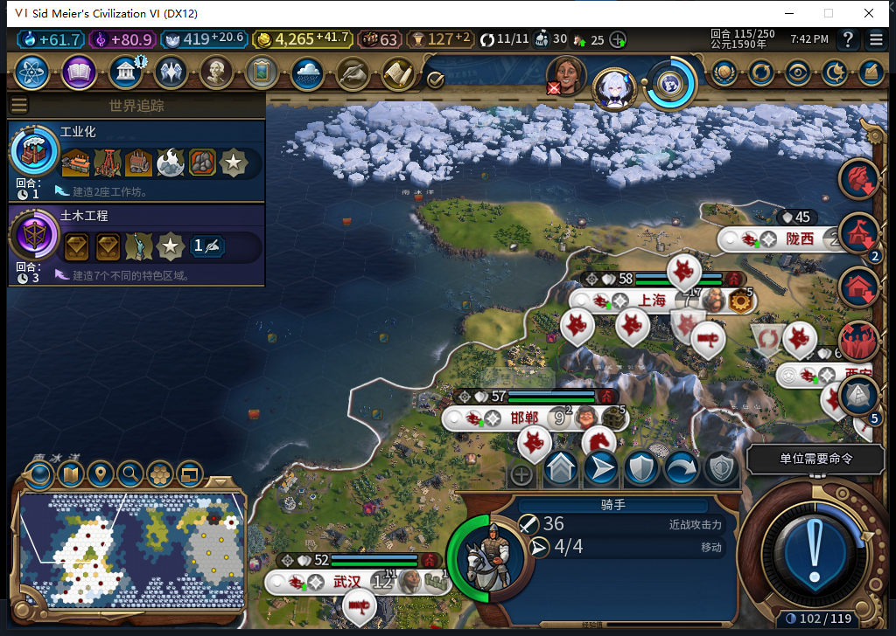

# 75版：过期FINISHING不扣新回合行动

2026-11-05，BF-202609141645，75源码／安装／运行，沿用完整1048项软件通过的源码1961f911。本轮只加诊断和证据。[实际状态、次数及指纹](../research/baiqi-p6-capture416-expired-finishing75-evidence-2026-11-05.json)。

独立QA驻军114存档中，测试玩家真实右键敌城并确认一次300金币，UI征取请求1、原生转城1。结束行动前精确故障阻止两次Finish尝试，留下真实UNKNOWN／FINISHING：转城、扣款肯定回执齐全，4524.2734375→4224.2734375，骑手4行动、冷却114。不是自然战斗。

测试玩家确认冻结提示后，通过9次合格军队SKIP和8次原版DoEndTurn处理提醒，再发出一次不带REASON／UserForced的正式ACTION_ENDTURN。随后独立读到当前115活动回合；仍有部分军队选择提醒，不宣称完整物理按钮矩阵或所有军队都跳过。没有测试玩家文职／生产命令。

| 读回 | 115撤故障后，两次Recover | 正式115存读档后，两次Recover |
| --- | --- | --- |
| 旧记录 | 唯一UNKNOWN／FINISHING，turn114 | 相同 |
| 军队 | 完整ID2162700、归属0、42,19，4行动、冷却114 | 相同 |
| 城市／冲突 | 0/851979、41,19、人口1，军队和城址冲突均true | 相同 |
| 新观察窗口 | 转城0、Finish0、观察错误0 | 相同 |
| 当前金币 | 4265.984375 | 相同 |

114扣款后的余额到115增加41.7109375；这不是直接扣款／退款调用计数，不凭该差值推断财政调用。真实旧扣款字段仍保持原数值。跨回合整个原生观察窗的累计为转城1、Finish0，含最初有偿征取；不能把累计1写成115再次转城。

截图证明选中骑手的4／4界面状态；完整ID、位置和旧记录由Core／UI另行读取。正式存档572660字节，同一进程重载；未授新冷进程重载或全部中断点通过。军队保留同ID的延迟销毁仍是未覆盖的实机窗口。

初次把Core读取器用于Executor时遇到该上下文没有Requisition辅助模块，已保留失败原件并改为独立UI读取；这是负责人诊断错误，不是模组失败或模型原稿实机结果。完成后全部故障／观察绑定清除，正常Farm114独立恢复：11城、4524.2734375金币、397.94140625信仰、原军队／建造者和空征取journal均匹配。
