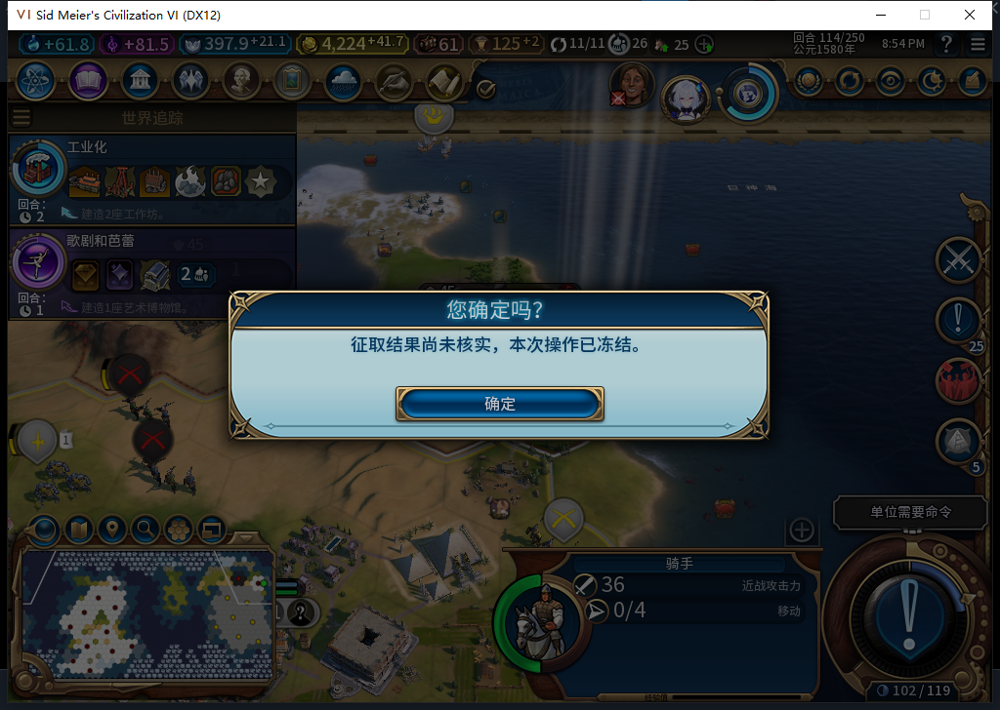
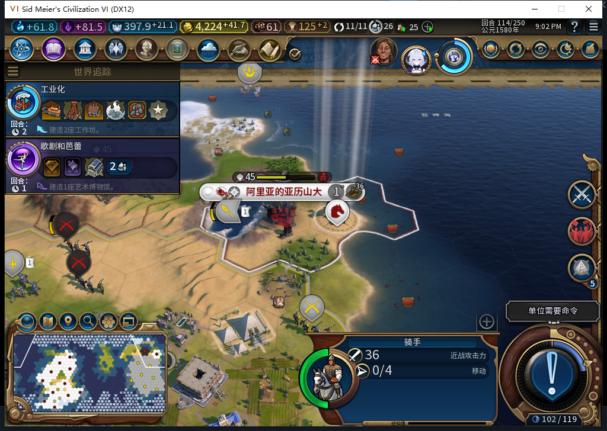

# 75版：结束行动已生效后异常，恢复不再结束一次

2026-11-05，BF-202609141645，75源码／安装／运行，自有进程15788，代码1961f911完整1048项软件检查仍为源码基线。本轮只加诊断与证据。[实际计数、阶段及保存点](../research/baiqi-p6-capture419-finish-applied75-evidence-2026-11-05.json)。

独立QA驻军114存档中，测试玩家真实右键敌城、确认一次300金币。模组确实转城、扣款并调用原生FinishMoves；该原生调用返回后，测试包装主动抛异常。骑手已实际0行动、冷却114，源账本尚未完成。另一个只针对这次实际动作结果的COMMIT故障，保持真实UNKNOWN／FINISHING供保存；没有改journal、余额、冷却或行动值。

第一段观察为原生转城1、Finish1、错误0；调用返回后异常1、COMMIT阻断1、透传3、匹配错误0。正式保存568901字节，SHA256为7db87b75ccad8b4259fa084ec772c6841dcea98e7ab767d3437d18d85abdfca3。保存时双故障和原生观察器仍临时占位，均未写入游戏属性。

| 阶段 | 实际账本 | 同一连续观察窗的转城／Finish |
| --- | --- | --- |
| 原生动作返回、故障保持 | UNKNOWN／FINISHING，骑手0行动 | 1／1 |
| 撤双故障后首次LiveRecover | COMMITTED／DONE，金币仍4224.2734375 | 仍1／1 |
| 再次LiveRecover | 同上 | 仍1／1 |

这段连续观察直接证明完成回执恢复时没有第二次调用Finish。旧扣款肯定回执before4524.2734375／after4224.2734375保持，冷却仍114。

随后清理原生观察器，从保存的UNKNOWN／FINISHING正式同进程重载，也恢复COMMITTED／DONE、0行动。加载阶段的原生调用总数未观测，保持未知；完成后另装新观察器，两次Recover为转城0／Finish0，不能拿这组0／0代替加载总数。

全部绑定清除并独立恢复原Farm114：11城、4524.2734375金币、397.94140625信仰、原军队／建造者和空征取journal匹配。该例不是自然战斗、新冷进程或完整中断矩阵。75未上传，417退出残留原因未定位；另发现旧“城邦62”标签需按历史原存档核对，本例不授城邦验收。
