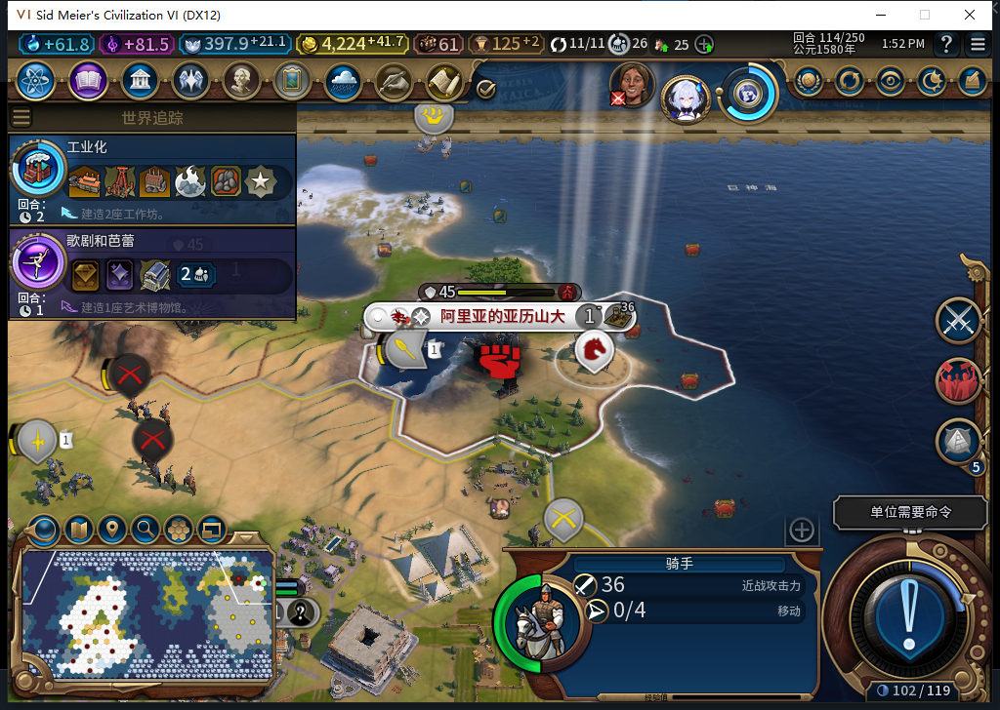

# 74版：扣费后、结束军队行动前的存读档恢复

2026-11-05，BF-202609141645，Steam离线，单人风云变幻／构建74。一个真实地图确认的300金币征城，在城市已转移、费用已记账、军队行动尚未结束时保存。正式加载后自动恢复完成，未再收费；完成后再调用两次Recover，也没有重转城或处理行动。这是TC-030的一个同进程、同回合窄样本，完整中断矩阵仍未闭。[结构化证据与模型405审阅](../research/baiqi-p6-finish405-recovery-evidence-2026-11-05.json)。

| 时点 | 城市与回执 | 金币 | 骑手2162700 | 观测 |
| --- | --- | --- | --- | --- |
| 独立准备副本114 | 原主1／城524295／41,19／人口1，账本nil | 4524.2734375 | 42,19，行动4 | 报价300，原有守军不改 |
| 一次物理右键、一次确认后 | 新主0／城851979，同位置人口；UNKNOWN／FINISHING | 4224.2734375 | 仍行动4，冷却114 | UI请求1、转城1、原生FinishMoves0；故障命中2 |
| 保存、清理绑定、正式加载并继续后 | 同一事务COMMITTED／DONE／recovered | 4224.2734375 | 行动0，同位置、冷却114 | 先独立读回，再做人工恢复探针；没有重投Request |
| 完成后显式Recover两次 | 仍只有同一笔完成事务 | 同值 | 仍0行动 | 新装计数器：转城0／FinishMoves0／错误0 |

断点不是CHARGED：Settle在调用FinishMoves之前已经持久化FINISHING，并先写了本回合冷却。实际transferObserved和chargeObserved均为true，balanceBefore=4524.2734375、balanceAfter=4224.2734375、cost300。故障只在精确军队／主人／回合匹配时、原生FinishMoves之前抛错；不改金币、城市、军队属性或账本。原处理器会立即再Recover一次，因此钩子持续阻断到保存，实际命中2次，不是玩家确认两次。

独立中断存档568824字节，SHA-256 `403f92346d0c28fed5d48c09ae24757104eca4e273ea3e8cfb6c70025592cce5`。保存ACK与两次稳定文件读取分开核验；故障、两项Core观察、一项UI请求和四项输入绑定都核所有权恢复后再加载。读档后的完成是产品自动恢复，随后才安装新计数器做两次Recover。启动恢复时没有保留诊断包装，不能声称实际计数到启动期间恰好几次原生调用；实际费用、行动及完成回执已在Core／UI独立吻合。

准备副本的战争、我方骑手邻接和150／200城防伤害是既有QA布景，不授自然外交或战斗通过。原守军1179657仍属敌方，40,19、0行动／37伤害／登船，未给守军命令。原正常Farm114文件哈希保持，当前保留已恢复的QA分支继续下一独立试验。

模型405完整stop／DONE／合法JSON，install及cleanup都能在Lua53编译，但cleanup会覆盖外来绑定；隔离的软件反例已证实，0原稿游戏执行。只参考断点与持续阻断方向，负责人改正静态调用、初态检查和绑定所有权，另做6项故障钩子安全检查。它们不是新增6项产品测试；本次产品74未改，完整软件套件未重跑。普通HTTP与OpenCode原生生成分账，后者新增0。

下一步仍需验证CHARGING等其他实际窗口、跨回合／跨进程和真实第三方战斗，不能由本例推完整TC-029／030通过。

405的[HTTP／OpenCode分账及通用经验](https://github.com/XenoAmess/local-model-operations/blob/c5c8b86f9c2608c7d3c172691ab70b927f6636ca/docs/evidence/2026-11-05-civ6-recovery405.json)已推送；该记录固定链接本项目941d098切点，不把后续406结果追授给405。

后续：[完整退出后的新进程加载](baiqi-cold-recovery-74.md)也自动完成，原同进程证据范围不改。
