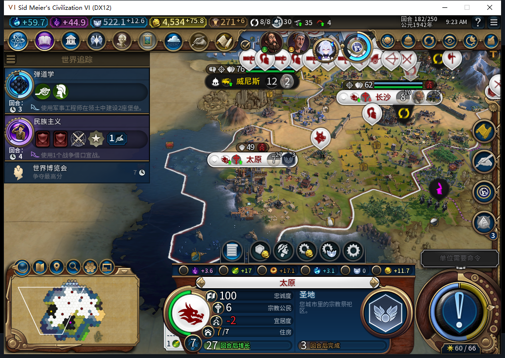
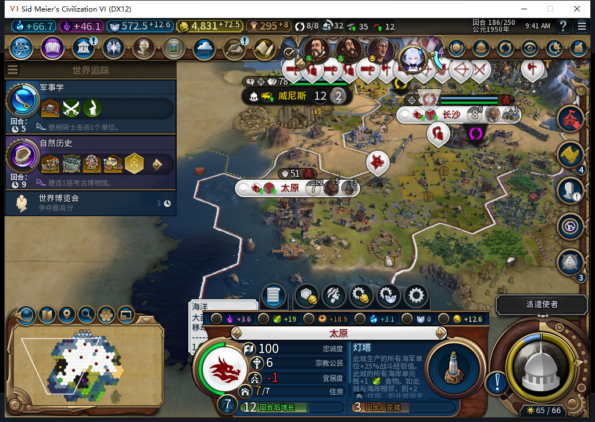

# 99实机：太原开始建圣地，完工后产生先知点

99版从179正式冷读，正常推进到186。太原先完成原商业中心，182自动排入首座圣地，185完工，接续灯塔；186先知点40→41、每回合0→1。随后正式保存／重载186，圣地、灯塔队列、先知点41／+1及九城食粮保持。**首座圣地建设与首次产点窄通过，仍没有招募先知或创教。**

太原7人口，圣地位于51,27。原生队列182为0/68，183为34/68，184为52/68；这三帧只是进度，185的区域完成标记才是完工证据。玩家没有手排圣地、清地或补产能。图中+17是粮食总产出，不是净粮食；人口和忠诚来自原版城市面板。

这张显示的是接续灯塔，圣地已在185完成。186太原保持7人口、忠诚100／+26，净粮食+5；先知点在独立只读中为41／每回合1，图里没有将信仰产出当成先知点。先知点尚未够普通招募，不能把有圣地写成已有宗教。

180首都曾继续训练军队。复核发现：圣地虽通过两种CanProduce，但允许用于建设的地块与原生圣地区位交集为0。太原、秀容、陇西各有完整地块筛选及原生APPEND资格样本，却都有既有队列；99保持这些生产。到太原队列自然空出时才开始圣地。这不构成取消生产或手动救场，也不把一次没有候选误判成优先级失效。

七个实际普通回合，共7次普通结束、45次测试玩家军队待命；185结束遇到西班牙初次介绍，由测试玩家选择一次不接受到访，之后才实际进入186。0UserForced、0手补内政、0赠送信仰或先知。军队待命和外交响应不算模组后台操作。

八份逐回合样本含九城72行食粮、72行忠诚：净粮食非负、无饥饿倒计时，忠诚100且变化为正。广州最终净粮食仍0，余量薄；新移民4980768仍在前往65,28，未授这名演员建城通过。首都16→17、秀容6→7、陇西1→3，不把北京因新移民而出现的帧变化另当人口成本完整验收。

179→185的透明观察共1846条：1781招募评估、14城市请求、50单位操作、1单位命令，0错0丢，185已全部撤除；51条单位调用为建造者39、移民9、商人1、大商人2。唯一单位命令来自大商人，不能写成军令。185→186没有这组观察器，因此不声称它覆盖全部七回合。观察到一座圣地，不冒称已数出恰好一次圣地发令。

冷读179与最后98自有采样的经济1、队列9、建筑59、区域33、可见自有地块140、单位30逐项一致。186正式重载前后，这些组分别1／9／66／34／145／36且全部相同，九城食粮与先知点亦保持。范围只是所采集自有状态，不是全世界相同或加载阶段0后台请求。

185一次食粮读取在处理状态守卫处停止，尚未采到食粮；新鲜就绪后独立读回9行正常，未重放结束。正式186重载的一次LSQ超时没有发送CMD；加载ACK、可见继续按钮和实际世界分别确认。两份完成态私有存档已校验，未入库。

99按107文件字节核验安装，新鲜后台Steam离线证明0.003459秒后启动；菜单头部导航另记为输入，证明本身无输入／激活／焦点变化／移动／截图。0模式切换／上线／登录／下载／上传初始化／上传，其他设备占用禁令保持。公开Alpha2下载包仍内部82，本页是99开发验收。

旧已发令ARMED存读恢复FAIL、98特殊未发令延期路径原生样本、自然创教与传教采购／传播、完整40项和兼容／性能继续开放。正常赞助的原生价格已只读核过，但自动赞助尚未实现。本页复用563实现及564报价研究，0新增HTTP、0新产品改动，不重跑原1457项软件切点。

[结构化证据](../research/baiqi-p6-source99-natural-holy186-evidence-2026-11-09.json)、[72行队列](source99-holy179-186-queues.csv)、[72行食粮](source99-holy179-186-food.csv)、[72行忠诚](source99-holy179-186-vitals.csv)、[实际先知点](source99-holy179-186-religion.csv)、[51条后台单位调用](source99-holy179-186-background-unit-calls.csv)、[待上传BBCode](../workshop/v0.1.0-alpha.2/pending-first-holy99-native186-2026-11-09.bbcode.txt)。

[两张原图与本页的固定提交公开访问核对](../research/baiqi-p6-source99-public-original-images-2026-11-09.json)：三份GET均HTTP200，字节／SHA与发布pin一致。这是仓库访问核对，未在Steam上传或复验外链显示。
