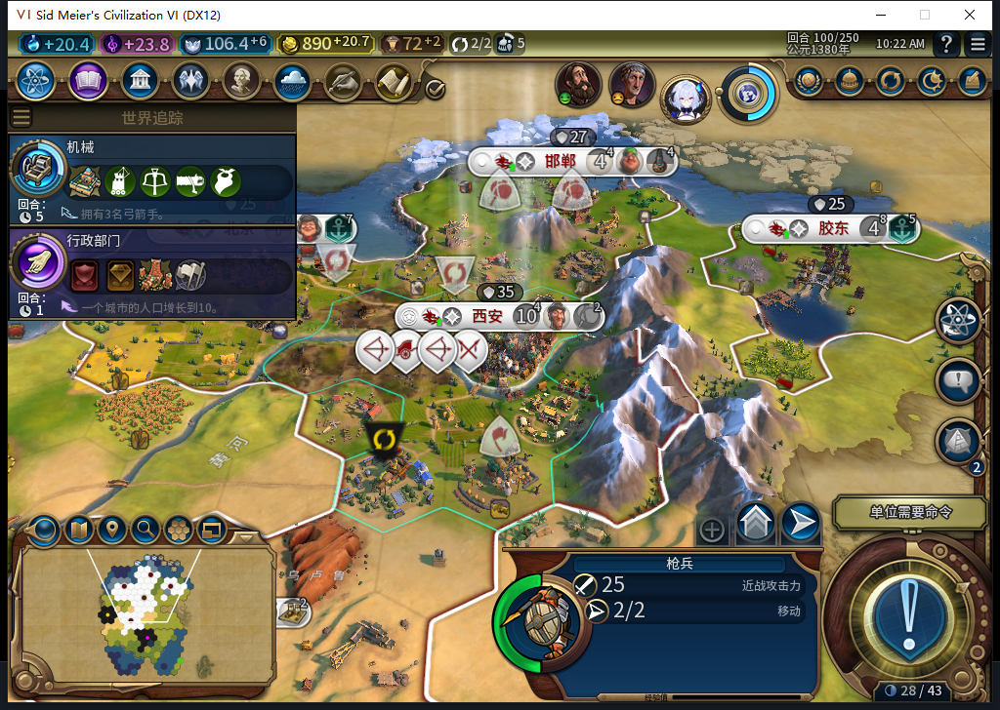
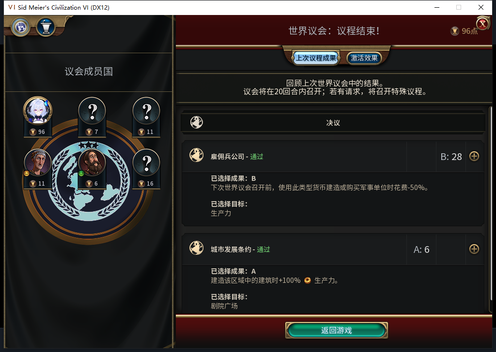
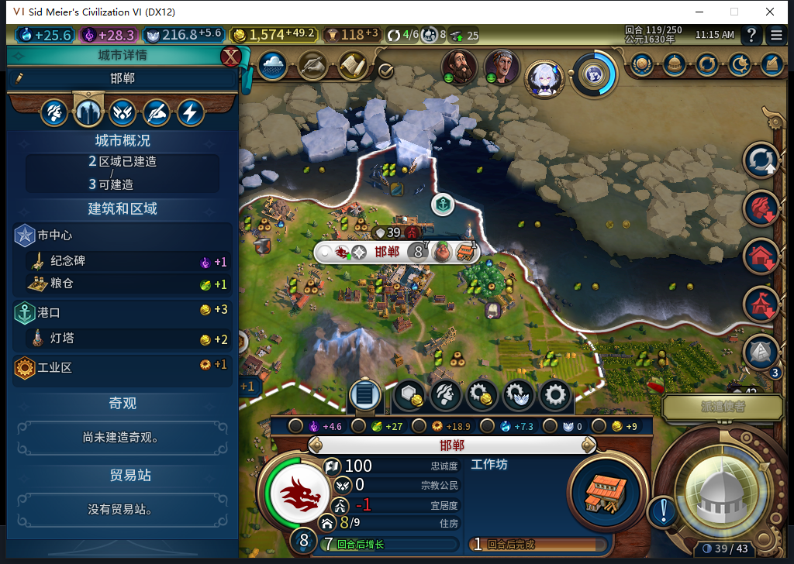
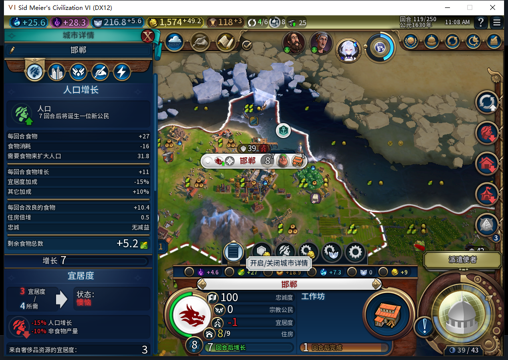
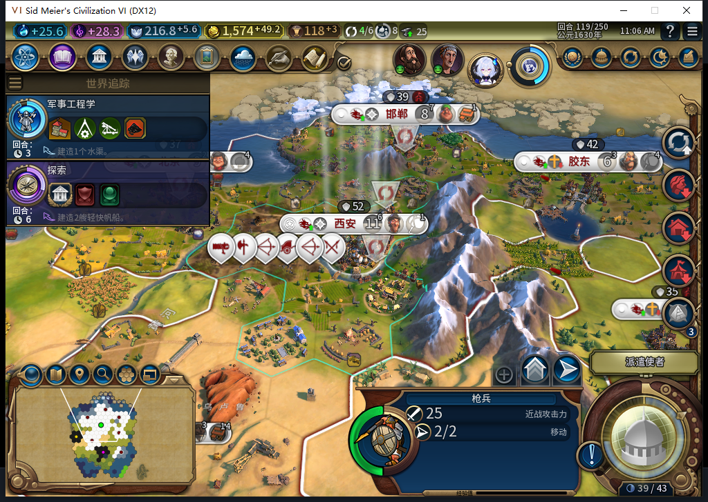

# 87五城补测通过：二十回合的资源与建设记录齐全

TC-037在本次风云变幻／无野蛮人夹具中通过。第99到119回合，玩家没有选择生产、区域或建造者任务；实际完成6栋建筑、4个特色区域、19处新增改良，并从5城自行扩至7城。七类战略资源每回合均已读取，共21份／147行。[逐项证据](../research/baiqi-p6-fivecity-resources119-model527-evidence-2026-11-08.json)、[122行逐城队列／成本／人口](results/source87-fivecity-resource99-119-queues.csv)、[147行资源原始数值](results/source87-fivecity-resource99-119-strategics.csv)。

这不是给[上一次漏采资源的窗口](baiqi-five-city-twenty-turns-87.md)补写历史。保留原119存档后，正式加载精确99存档、继续各一次，核对五城队列、九个UI可见单位的位置、金币、宗教及五条OBSERVED日志，再从99开始重新执行20个普通回合。本分支期末1574.37109375金，前分支1570.76953125金；请求和演员也有差异，不能说逐动作确定性重放。

输入账为22次普通END、20次侦察兵待命、8次海军统帅待命、16次外交／议会点击。100及117第一次结束后仍在本方回合，重新核对空闲状态和堆叠单位的原生待命资格后，各追加一次普通END。没有UserForced／Shift+Enter，没有人工文职内政。114最后一次只读等待已见115但游戏仍忙；后续只补读115，没有多发END。

议会由测试玩家处理，确认页选择金币B1与圣地A1、总费用0、提交一次。111实际通过军事生产费用减半与剧院广场建筑加成；后续队列成本保留实际读数。两次交易均拒绝，罗马议程对话正常关闭，使者提示仍保留。

| 回合 | 城市 | 单位 | 金币 | 铁库存 | 上限 | 原版积累读数 |
| --- | --- | --- | --- | --- | --- | --- |
| 99 | 5 | 9 | 865.46 | 0 | 25 | 0 |
| 100 | 5 | 10 | 890.17 | 0 | 25 | 0 |
| 101 | 5 | 10 | 910.87 | 0 | 25 | 0 |
| 102 | 5 | 9 | 931.57 | 0 | 25 | 0 |
| 103 | 5 | 9 | 952.28 | 2 | 25 | 2 |
| 104 | 5 | 8 | 974.98 | 4 | 25 | 2 |
| 105 | 5 | 8 | 1001.68 | 6 | 25 | 2 |
| 106 | 5 | 10 | 1030.39 | 8 | 25 | 2 |
| 107 | 6 | 9 | 1059.09 | 10 | 25 | 2 |
| 108 | 6 | 10 | 1094.09 | 12 | 25 | 2 |
| 109 | 6 | 10 | 1134.49 | 14 | 25 | 2 |
| 110 | 6 | 10 | 1180.70 | 16 | 25 | 2 |
| 111 | 6 | 12 | 1223.10 | 18 | 25 | 2 |
| 112 | 6 | 12 | 1264.65 | 20 | 25 | 2 |
| 113 | 6 | 11 | 1305.20 | 22 | 25 | 2 |
| 114 | 6 | 12 | 1345.75 | 24 | 25 | 2 |
| 115 | 6 | 14 | 1386.80 | 25 | 25 | 2 |
| 116 | 7 | 14 | 1431.46 | 25 | 25 | 2 |
| 117 | 7 | 15 | 1479.96 | 25 | 25 | 2 |
| 118 | 7 | 14 | 1527.17 | 25 | 25 | 2 |
| 119 | 7 | 14 | 1574.37 | 25 | 25 | 2 |

其余铝、煤、马、硝石、石油、铀的库存均为0；各自上限、预留、进口、加成、单位和电力需求也在CSV逐项保留。119第一次资源查询在前置断言处被拒绝，具体哪个瞬时条件未单独采到，不能确定归因；重新只读确认119空闲后取得同回合完整快照，没有补游戏命令。早先将其简称“临时忙”过于确定，以此记录为准。

建筑完成清单为北京／邯郸／胶东灯塔、长沙粮仓和纪念碑、成都粮仓；特色区域为北京／胶东港口、邯郸／长沙工业区。成都107、陇西116实际建城，新城市中心没有计入4个特色区。19处新增改良只统计99就已可见且自有的同一地块，缺少初始状态的新领土不算；这不是劫掠修复验收。

矿山替代的前后链在本分支再次成立：108邯郸请求前，地块2792（54,37）仍为矿山；119从Map与同城区域成员分别确认工业区已完工、未被劫掠。另一长沙工业区请求前是空地，农场子类型仍未直接实测。

建设有成果，也有代价。邯郸8人口、宜居度不足1，详情显示增长与非食物产出惩罚；本窗口不授予长期幸福、财政压力或扩张安全通过。3193条未来观察样本恰读一次，错误和丢样0，其中106次单位操作没有军队操作，唯一激活请求属于115的大商人。21份先知记录仍全是快照，尚无创教正案。范围只覆盖安装在Executor的观察器。

按区域→财务→先知撤除三个观察器，并在真正的WorldCongressPopup上下文清理滚动QA变量。原版保存119一次，ACKtrue、稳定1358854字节，SHA256为d09c790777f1354b589fe525319737a4cba35092ba261dbdcb6034842d2268dc；新文件尚未加载。119的UI／Core均读到7城14单位及七条OBSERVED日志；初99的Core额外列有一个坐标-9999的延迟死亡建造者，不能把两侧初始单位清单写成完全相同。

源码／安装／实机仍87，96文件再次核对一致，当前本机安装Build26407122。没有产品改动或重跑旧全套测试。模型527对宗教采购的分析原稿被拒：杜撰单位名称、建议普通购买先知、混淆指挥白名单与采购范围。负责人也给错了生产消费者段落（2570—2720不是实际2785—2869），下轮须补全真实调用链和原版MustPurchase／CanTrain定义，不能把责任全推给候选。自动宗教演员采购与完整宗教链继续处理，不用手工购买补演。

用户在补测期间通知其他设备开始使用Steam；此前空闲确认失效。自通知后没有Steam模式输入、登录、下载、初始化上传器或上传，持续使用已离线启动的自有实例。公开GitHub／Steam Alpha2仍为82／12图。ARMED与旧档恢复FAIL、围城／忠诚、宗教战斗单位实机权限、兼容、性能和完整40项仍开放。
