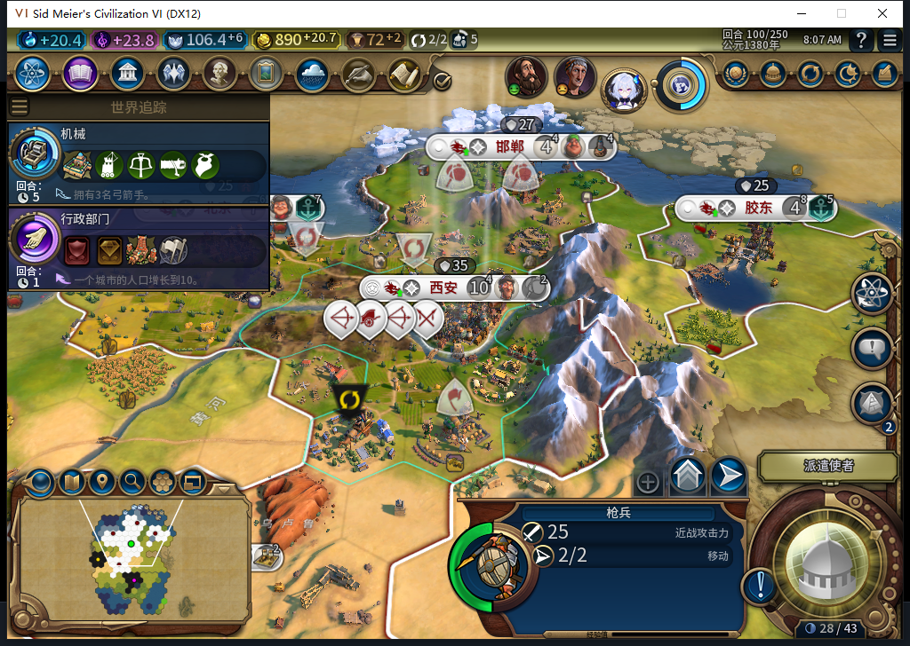
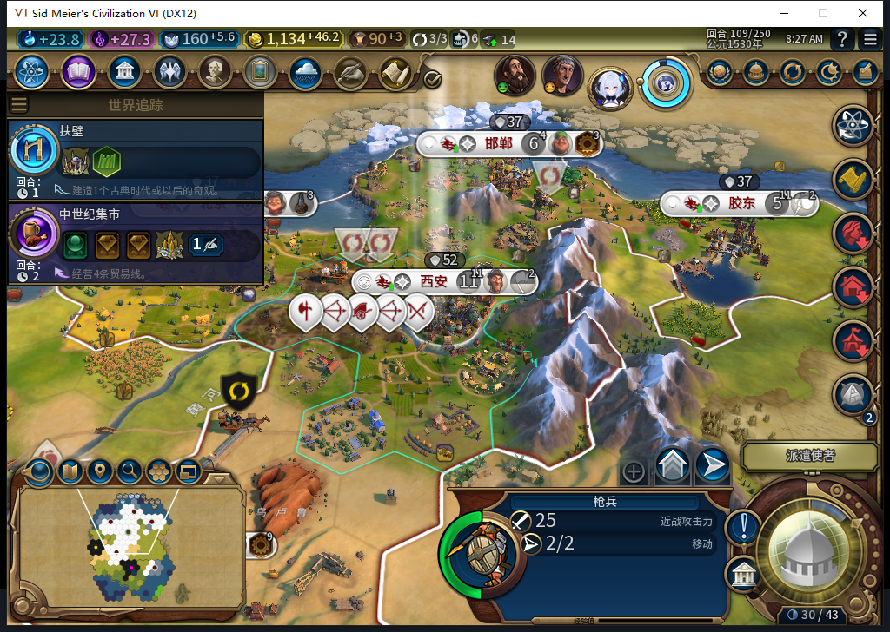
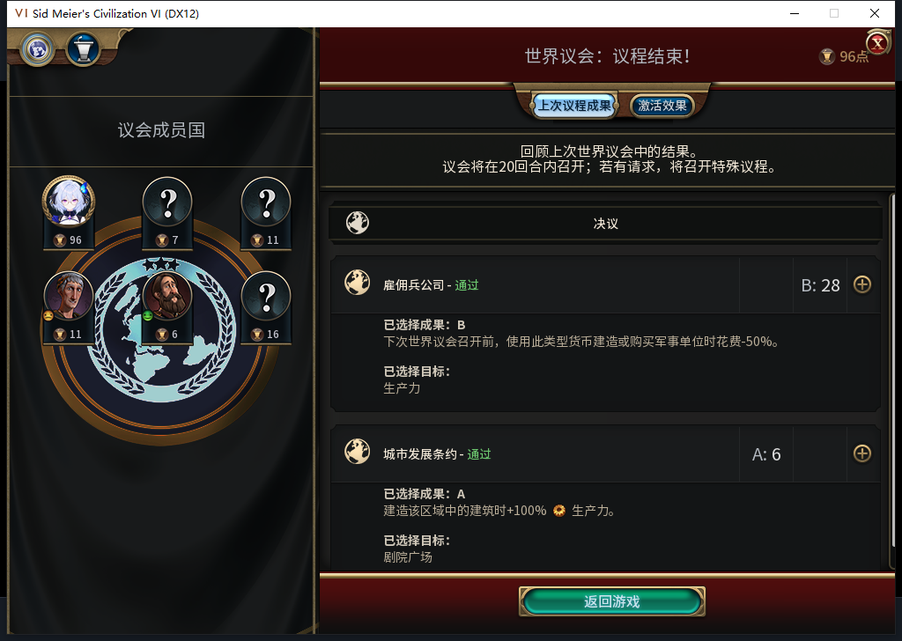
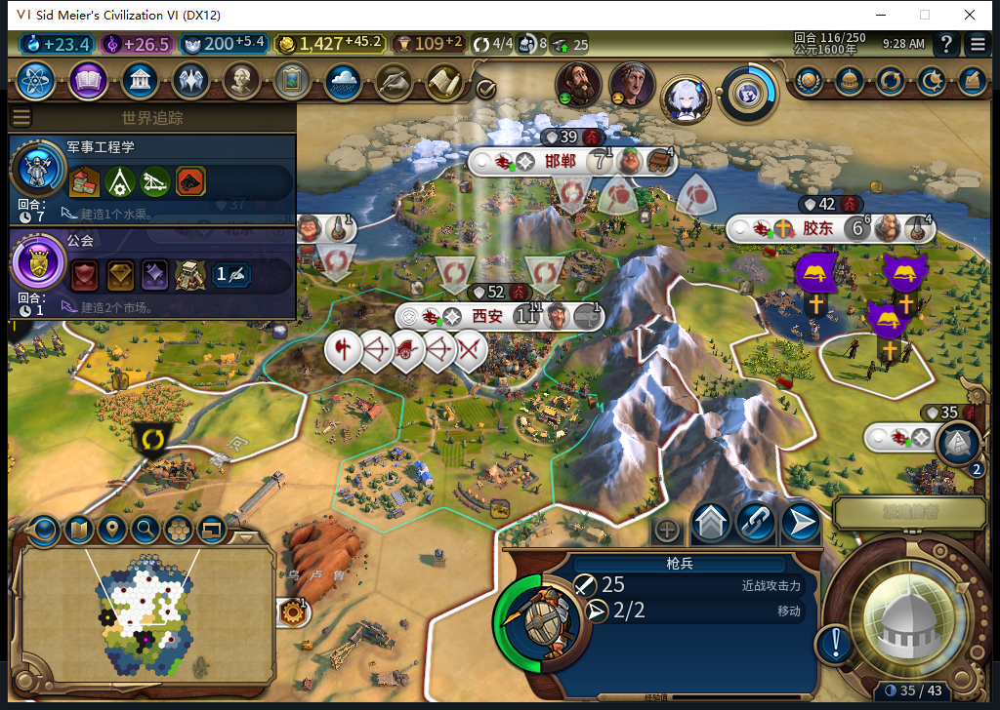
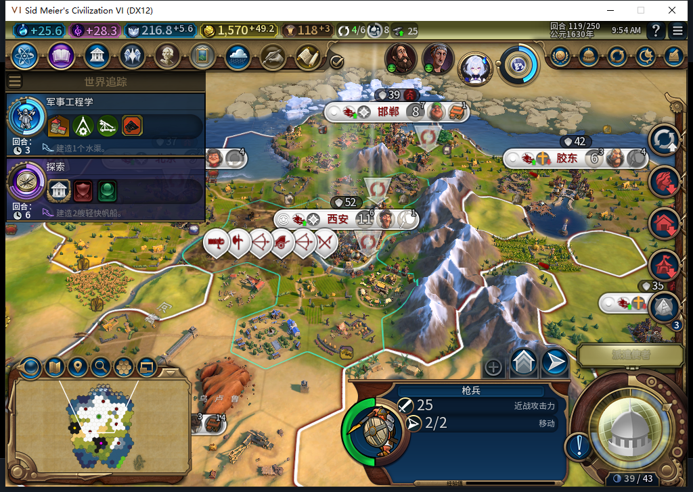

# 87五城二十回合：建设结果已验证，资源记录仍待补齐

第99到119回合，测试玩家没有选过生产、区域位置或建造者任务。模组完成6栋建筑、4个特色区域；在初始就已可见且自有的地块上，新建19处改良。成都107、陇西116自行建成，城市数从5增至7。这些是实际世界变化，不是把入队或请求返回当作完工。[逐项证据及范围](../research/baiqi-p6-fivecity119-model524-526-evidence-2026-11-08.json)、[每城每回合队列、成本和人口表](results/source87-fivecity99-119-queues.csv)。

TC-037暂不判整项通过：21份快照已有金币、信仰、人口、维护费及实际队列成本，规划样本也记录了资源是否足够，但缺少逐回合战略资源库存。119才新增的资源读回不能补写99—118。玩法结果与证据缺口分开保留。

初始五城都有正常生产：西安移民67/100、北京港口24/69、邯郸灯塔16/60、胶东港口21/69、长沙粮仓20/32。期末新增建筑是北京／邯郸／胶东灯塔、长沙粮仓和纪念碑、成都粮仓；新增完工特色区域是北京／胶东港口、邯郸／长沙工业区。新城市中心另计，没有拿它凑特色区域数量。

87修复的区域选址这次有了矿山正案。108回合邯郸发出工业区请求之前，透明观察器记录地块2792（54,37）仍是矿山、没有区域；109从Map和同一城市的区域成员表分别读到矿山已消失、工业区同坐标落地但未完工；119两边再次匹配，且已完工、未被劫掠。长沙的另一工业区请求前是空地，不能算改良替换。农场子类型仍未直接实测。

19处新增改良由前后同一地块确认：7农场、2矿山、4伐木场、渔船／种植园／采石场／牧场各1、2段长城。新领土或新可见地块缺初始状态的，一律不计新增；没有用这些结果授予“修复掠夺”通过。119较早快照只有18处，稍后的同回合结算快照增加了（60,35）伐木场，两个切点都保留，期间没有多结束一回合。

外交仍由测试玩家处理。107拒绝罗马交易，109拒绝巴西交易，99和115关闭罗马议程对话；110普通结束遇世界议会后先停。玩家投金币B1与圣地A1，确认提交一次；111实际通过的是军事单位生产费用减半和剧院广场建筑生产加成。它会影响后续成本，不能把自己的选票写成获胜结果。

二十个实际回合共发出22次普通END：100和117第一次请求后仍停在原回合，重新只读检查空闲状态及原生不可待命的堆叠单位，再各追加一次普通END。没有Shift+Enter／UserForced，也没有重放未知命令。28次待命分为20次侦察兵与8次海军统帅；16次外交／议会物理点击另计。使者提示是保留的外交提示，原版接口可正常结束；这不是全套物理按钮矩阵通过。

| 回合快照 | 城市 | 单位 | 金币 | 此回合END请求 | 待命请求 | 外交／议会点击 |
| --- | --- | --- | --- | --- | --- | --- |
| 99 | 5 | 9 | 865.46 | 1 | 1 | 1 |
| 100 | 5 | 10 | 890.17 | 2 | 1 | 0 |
| 101 | 5 | 10 | 910.87 | 1 | 1 | 0 |
| 102 | 5 | 9 | 931.57 | 1 | 1 | 0 |
| 103 | 5 | 9 | 952.28 | 1 | 1 | 0 |
| 104 | 5 | 8 | 974.98 | 1 | 1 | 0 |
| 105 | 5 | 8 | 1001.68 | 1 | 1 | 0 |
| 106 | 5 | 10 | 1030.39 | 1 | 1 | 0 |
| 107 | 6 | 9 | 1059.09 | 1 | 1 | 2 |
| 108 | 6 | 10 | 1094.09 | 1 | 1 | 0 |
| 109 | 6 | 10 | 1134.49 | 1 | 1 | 2 |
| 110 | 6 | 10 | 1180.70 | 1 | 1 | 10 |
| 111 | 6 | 12 | 1223.10 | 1 | 2 | 0 |
| 112 | 6 | 12 | 1264.65 | 1 | 2 | 0 |
| 113 | 6 | 11 | 1305.20 | 1 | 2 | 0 |
| 114 | 6 | 12 | 1345.75 | 1 | 2 | 0 |
| 115 | 6 | 14 | 1386.80 | 1 | 2 | 1 |
| 116 | 7 | 14 | 1427.86 | 1 | 2 | 0 |
| 117 | 7 | 15 | 1476.36 | 2 | 2 | 0 |
| 118 | 7 | 14 | 1523.57 | 1 | 2 | 0 |
| 119 | 7 | 14 | 1570.77 | 0 | 0 | 0 |

表中输入记在发出请求的回合，119为期末读回，无新的END。金币为实际余额，费用／进度详见逐城CSV；GetGoldYield与维护费原始读数分列，没有将前者误称为扣费后净收入。

未来请求观察器的3195条样本序号全部恰读一次：3062次招募评估、24次城市请求、108次单位操作、1次大商人激活请求，错误和丢样均0。单位操作为建造者80、移民22、大商人2、商人4；该Executor范围没有军队操作。21份先知记录全是快照，没有新先知出生／激活；119仍未创教，不能据此说所有伟人都无动作。观察器在119按嵌套顺序撤除；这不是全游戏上下文的请求总账。

原版保存99和119各一次，均ACKtrue且文件稳定。119保存1358158字节，SHA256为1010fd68348e61587e6fedcdfe0bba453e5b61aa7c81f4ccbc16dbaf853a2710；本轮未加载这个新119文件，不能沿用先前85重载结果。私人存档不上库。

环境新鲜读回为BF-202609141645、Xeon E5-2696 v3、32GiB内存、RTX3060 Laptop；当前游戏安装Build26407122，实际启用24项（白绮和23项官方内容）。Modding.GetActiveMods的Version字段实际为空；本模组87由96文件安装哈希及冷启动链确认。场景沿用无野蛮人、小型大陆、古典、王子、联机速度；后者只是速度名称，Steam持续沿用离线实例，未再次上传。该对照不能关闭围城文职损失或忠诚风险。

本轮产品源码仍为87。三个独立验收模块和测试已入库：队列元数据19项、区域前请求观察26项、资源快照20项，共65个逻辑边界／4个测试方法，Lua5.1全部通过；此前1222软件通过／1SDK环境跳过没有重跑。模型524返回文件路径，525错误限制Native对象且误用元数据查询，526含Lua5.1不支持的goto并漏getter的self，原稿全部拒绝、0入游戏。采用模块的范围与原版API依据见[诊断工具说明](baiqi-acceptance-diagnostics.md)。

还纠正了一个清理记录：85／99曾在Executor清议会滚动QA变量，但变量实际属于WorldCongressPopup。119在实际弹窗上下文读到三个遗留true，清掉四个已知QA标记并核验nil；原有观察器撤除不受影响。此前Executor内的nil断言不能证明弹窗变量已清。部分截图超过60秒时输入保护拒绝、没有点击；后续用新鲜截图逐像素核对已审阅的界面与整个目标区域，再交原输入保护执行一次。此类工具耗时不计作模组性能。

下一窗口从119开始逐回合采集战略资源；当前铁25/上限25、积累2，其余六类库存0，已取得真实只读基线。ARMED恢复FAIL、旧档等待、完整宗教链和宗教战斗单位权限、兼容与性能仍开放。公开GitHub／Steam Alpha2仍是82／12图，这轮没有发布新版本。

后续已从精确99存档[另开独立补测](baiqi-five-city-resource-complete-87.md)，执行新的20个普通回合并采齐21份资源。TC-037在该GS／NoBarb夹具通过；本页原窗口仍保留资源未齐状态，不追认历史。
