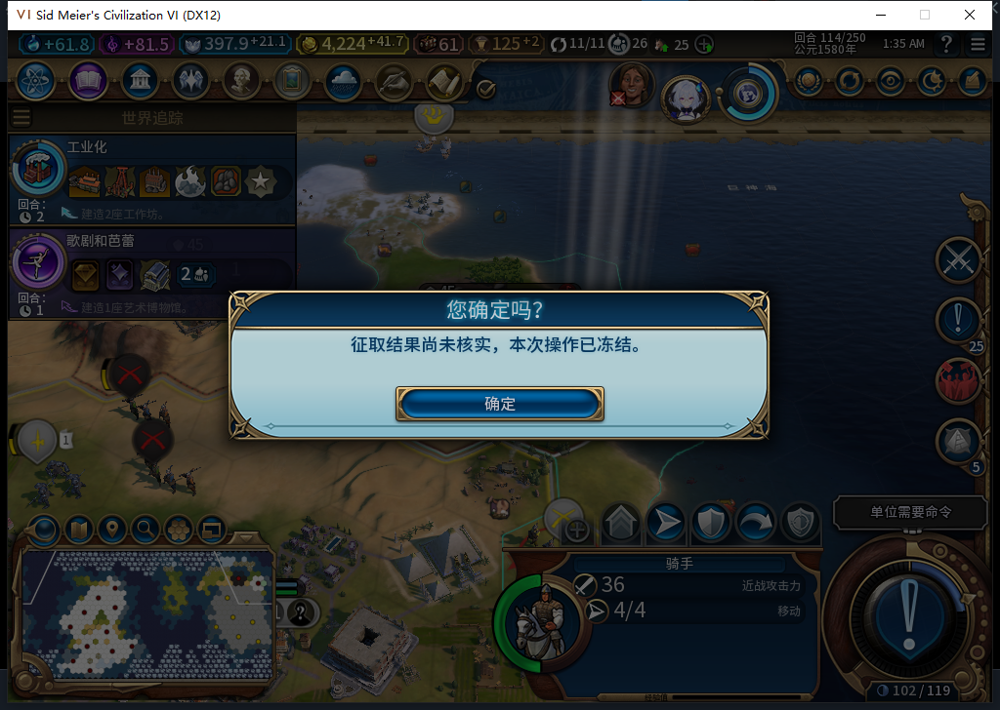
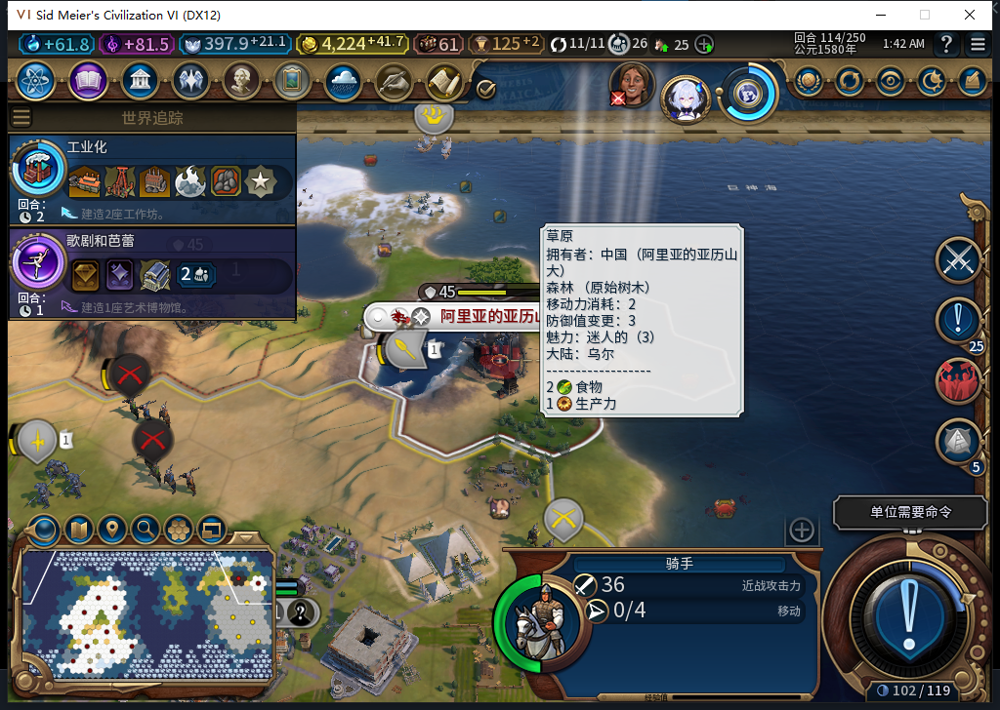

# 76实机：城旗征取的冻结提示与恢复

2026-11-06，在76开发版中，测试玩家右键敌城驻军旗帜并确认300金币。测试故意在最后“结束军队行动”前阻断调用，让征城处于尚未核实状态。城市已经移交、金币已经扣除，骑手仍有4行动；游戏确实弹出冻结提示。这验证了新增城旗上下文的结果提示能实际运行，而不只是存在一个Poll函数。

| 检查点 | 实际读回 |
| --- | --- |
| 故障仍在 | 一笔UNKNOWN／FINISHING，原价300；金币4524.2734375→4224.2734375；新城0／851979，41,19，人口1；骑手2162700仍4行动 |
| 移除故障后第一次恢复 | COMMITTED／DONE，骑手0行动；连续观察转城1次、结束行动1次；金币保持4224.2734375 |
| 再调用一次恢复 | 仍同一笔DONE，转城／结束行动连续计数仍1／1，没有新增征取请求 |
| 正式加载之前保存的UNKNOWN档 | Core与城旗上下文均读回COMMITTED／DONE、0行动、相同金币；加载后新观察窗口再恢复两次，新增转城／结束行动均0 |

冻结时正式保存Baiqi_P6_20261106_V76_FlagUnknown114.Civ6Save，568900字节，SHA256 `ff521654a0f314690d2cc0e70bdaf184b6f32d822081e744ca0f962f391d6fe4`。保存时故障仍生效，没有修改游戏属性或手填账本。之后清除故障和观察绑定，再正式加载这个保存点，验证保存的未知结果可恢复。加载期间的原生调用总数没有观察，保持未知；加载后0／0不能冒充加载期间也0／0。

弹窗由实际UnitFlagManager事件轮询触发，没有直接调用Poll，也没有第二次征取。关闭弹窗只是确认提示；本次另行使用诊断恢复入口，不增加玩家管理按钮或手动夺回内政入口。界面付费请求1次、账本一笔和余额差300分别核对；它们不是底层金币接口调用次数的全局计数。

这一局使用独立准备档，战争、军队位置、城防伤害和资金包含明确QA布景。故障只针对同一个健康骑手、同一回合、FINISHING阶段；不据此授予其他演员消失／升级、所有阶段、冷重启或完整40项通过。最后清除临时绑定，恢复原Farm114，原三上下文及真实城旗上下文核对原单位、城市、地块、经济和空征取账本。

源码、安装、运行均76，代码固定在96b1797682141d01e8e2916a5386b873c8ec5e0b；沿用完整1058项软件检查，之后仅诊断与文档。机器BF-202609141645、自有进程22124。全程Steam离线，已发布Alpha74没有更新。[结构化证据、原件摘要和模型审阅](../research/baiqi-p6-capture430-flag-unknown-evidence-2026-11-06.json)。[此前城旗取消／征取／继续进攻的四张实机图](baiqi-garrison-flag-native-76.md)。
