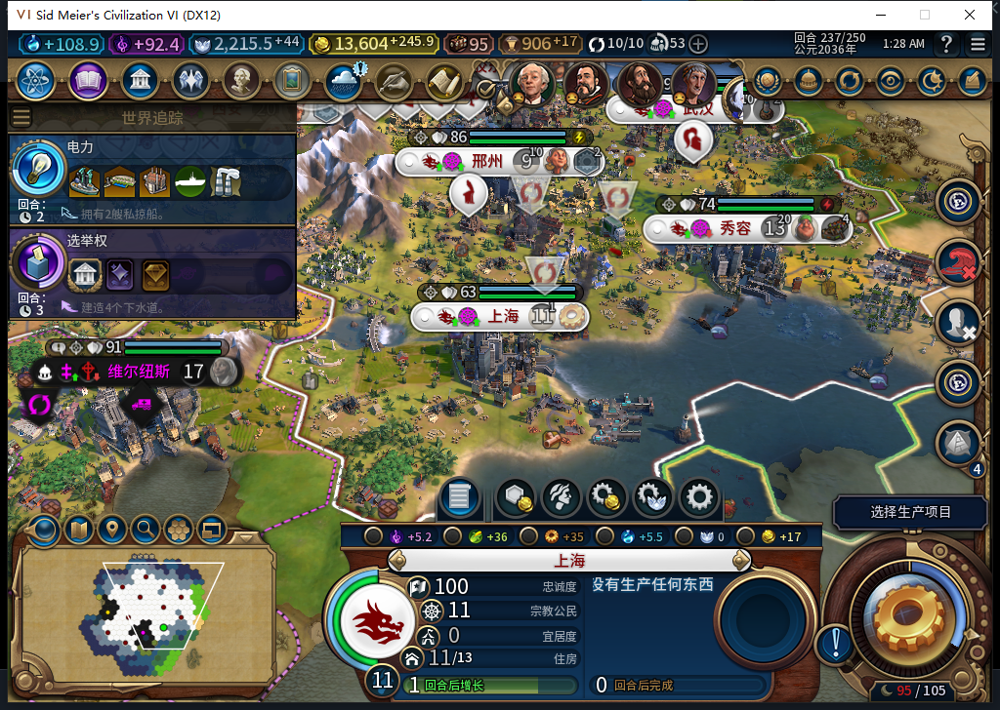

# 118：洪灾阻塞建筑队列的替代生产

116 连续推进到第 237 回合，上海工业区已受损，原版生产资格明确返回“洪灾区域，无法修复。”工厂仍在单项队列中、已有 73/165 进度，但当前生产 Hash 为 0。城市面板显示没有生产，原版要求选择生产；托管把非空队列当成正常施工，未安排替代工作。这是实际阻塞，已正式保存现场，未用测试玩家补内政。

118 只处理一条可确认的窄路径：单项未完建筑、当前 Hash 为 0、已建前置区域确实受损、该建筑原版资格明确拒绝、条目签名和进度可读。保留原条目，在前方 PREPEND 一项正常合法生产。正常施工、多项队列、完成态和未知读数保持原处理；不绕过洪灾区域的修复拒绝。候选、原版两种资格、最终操作资格和原受阻条目在写入前重检。回执须同时看到新任务在首位、原条目在第二位；未知结果保留待定，不重发。

新增 9 个测试方法覆盖原条目和进度保持、未知及正常队列拒绝、最终变化、原版拒绝、未知写入与错误位置回执。首轮夹具误用了 INSERT_MODE 参数索引，且误要求脚本已停止后仍打印待定日志，出现 2 个失败、1 个错误；负责人修正后重新检查。旧 117 在最终同组检查中仍失败。118 完整 **1715 项，1714 通过、1 项官方 SDK 环境跳过**；93 个 Lua 通过 Lua 5.1 编译，115 文件包逐字节一致。

629 本地模型候选完整 stop／DONE／合法 JSON。只部分采用前置区域受损及 PREPEND 方向；原 helper 未保护异常，未排除已拥有建筑，集成用“仍有任意受阻头”替代同一签名比较，均由负责人修正。237 只读预验确认真实工厂条目符合新门；**未替换运行控制器，也未发送生产请求**。

源码和包为 118，安装／实机仍待验证。116 已撤掉三项被动事件订阅并请求正常退出，准备冷加载原 237 存档。长沙食品市场已自然推进 0→150/190，人口 2→3，尚未建成。234 回合未建成时净粮已经升至 6，不能计作食品市场收益；237 原版 tooltip 为粮仓 1、开发地块 6。后续用实际建筑产粮接口核实建成贡献。

新商人 7209007 的上海至邢州活动路线已读回，但 234 容量 10/10、上海净粮为 12，不授 115 缺粮排序通过。627 的“负粮且原城无其他路线”判据与真实合同不符，候选拒用；628 的实际建筑收益接口方向部分采用，原片段缺身份／异常检查且 pillage 参数类型错误，负责人修正。旧 213、武汉 222 人口损失及全功能矩阵继续开放。Steam 未上线，工坊仍为 82。

[软件、模型、现场与存档指纹](../research/baiqi-p6-source118-blocked-production-software-2026-11-12.json)。
