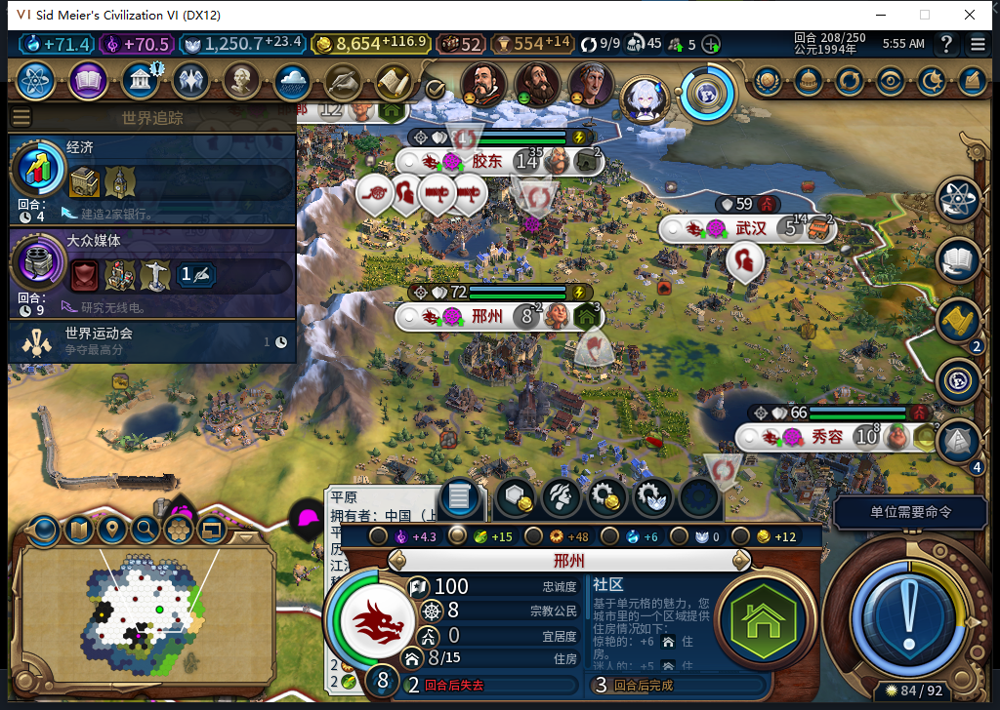

# 113：修正救粮桥的人类玩家判断

2026-11-11，BF-202609141645。112实机救粮未执行，不能由此前软件通过改记成功。原缺粮208已载入，邢州仍8人口、总粮15、净−1、库存1.74609375，面板提示两回合后掉人口；没有推进回合，也没有手动补粮或换地。

后台只读定位：Gameplay的PlayerConfigurations.IsHuman不存在，Player.IsHuman才可调用且实际true。112桥用了前者，Inspect返回UNAVAILABLE；故障钩子0次Prepare、0次截断，journal仍nil，2277仍属西安。因此这次没有到达计划中的持久许可故障点，更不是故障恢复通过。诊断函数已按原引用撤回，失败现场另正式保存1871326字节；未加载这份新存档。

113只修Core的资格读取：配置对象有IsHuman函数时以它为准，缺少时才用玩家对象。false、nil、非布尔、异常或两处均不可用均不能授权。UI持久协议和最终命令边界保持原设计，没有新增玩家入口。来自610的这个小片段经审阅后采用，测试由负责人实现。

新增5个测试方法把Core配置与UI配置真正分开；旧112先出现1个错误、其余4过，修后粮食持久化／Runner及静态对照相关42项全过，93Lua51编译、115文件包完成。首轮负责人误填两个不存在的测试模块名，32个产品方法已过但两个导入错误；改用实际模块后42全过，原日志保留，未宣称全量重跑。

609对故障方案仅复述已给方向，没有具体的精确恢复／世界范围保护，0代码采用；负责人私人钩子的7项软件检查已过，但因上述产品门失败，没有Native命中。610单HTTP完整stop/DONE/JSON，10835+584tokens，5274.9864ms；609同样单HTTP完整，11393+843tokens，7892.1658ms。二者复用当日1.19.5维护缓存，0OpenCode原生生成。累计610任务／570完整／37length／3transport／640HTTP／30extra；人工成本和净节时未知。

接下来在现有112实例中只替换经检查的113Core作明确标注的诊断预验，保存实际ARMED后，正式安装113冷读检查不重发，再用原缺粮空账本存档验证正常救粮。本页冻结时这些尚未通过。许可回复丢失也不能替代“城市命令已经发出但结果未知”的恢复验收。旧FOUND恢复FAIL、水坝施工、MOVE队列、性能、全40例与武汉冷读产出差异继续保留。Steam0上线／上传，工坊82保持。

[源指纹、模型采用、实际失败与软件检查](../research/baiqi-p6-food113-core-human-evidence-2026-11-11.json)。
