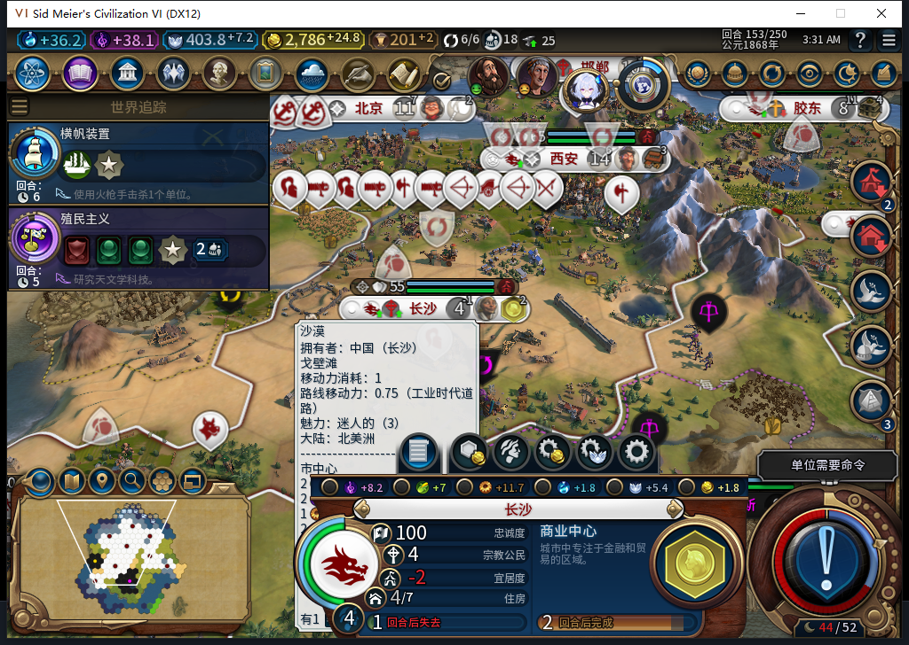
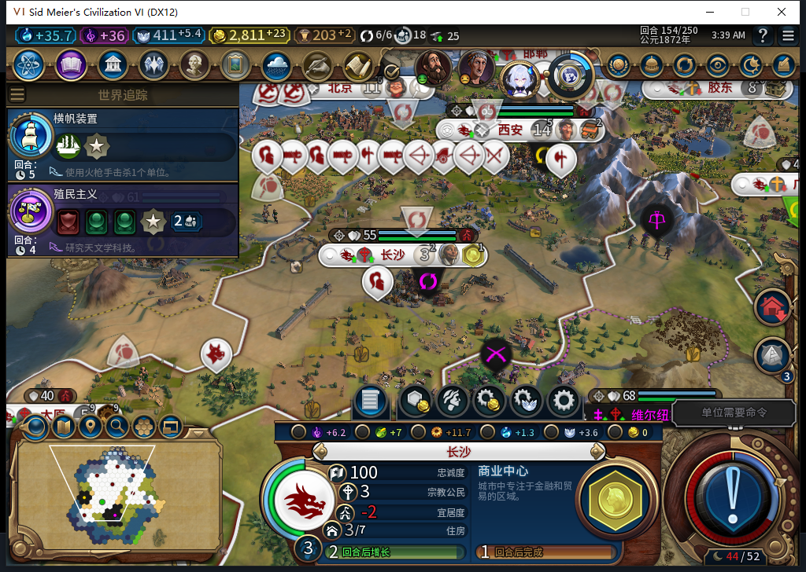

# 97 粮食侧重修复；96 实机确认增长后饥饿掉人口

后续已完成[97冷实机同153负例修复及154正式存读档](baiqi-food-focus-native-97.md)，附三张原图；自动净粮食+5、普通154人口4保持，八城粮食重载保持。下文尚未安装为软件切点，长期及旧FAIL仍开放。

2026-11-09，BF-202609141645。**96 同档复现长沙 153 饥饿倒计时 1，普通结束后 154 人口 4→3，记粮食管理 FAIL。97 软件修复已过，冷实机待验。** 没有手动补粮、分配市民、改产出侧重或排产。

[机器证据与模型审阅](../research/baiqi-p6-food-focus97-model553554-evidence-2026-11-09.json)、[逐回合粮食](food96-repro153-growth.csv)、[153 可见己方市民地块](food96-repro153-citizens.csv)。此前[96 救援与未明人口变化](baiqi-early-governor-native-96.md)的切点保留；本次补的是独立复现的饥饿链。

## 负例：增长后缺一粮，另有可工作的农场

先保留 96 正向 156 档，再用原版加载同一 95 的 152 档、继续各一次，开启单独诊断分支。这个分支用了新的输入凭证，没有重放原分支已执行的结束回合。

| 回合 | 长沙人口 | 粮食余额 | 阈值 | 净收支 | 增长倒计时 | 饥饿倒计时 |
| --- | ---: | ---: | ---: | ---: | ---: | ---: |
| 152 | 3 | 15.94921875 | 16 | +1 | 1 | −1 |
| 153 | 4 | 0.8984375 | 22 | **−1** | −1 | **1** |
| 154 | **3** | 15 | 16 | +1 | 2 | −1 |

长沙 `327684@53,30` 仍在造商业中心，不是在训练移民。153 的六种侧重与忽略标记均 false；13 个采集到的可见己方地块没有锁定市民。农场 `2124@52,28` 有 3 粮／1 产能却没有市民，实际使用的地块中有 0 粮地块。这里证明有可用粮食地块和实际饥饿，不宣称已找到所有饥饿场景的唯一原因。

原版 CityPanel 的粮食侧重参数为 `SET_FOCUS`、flags=0、yield=FOOD、data0=1；该 153 自有城市原生 `CanStartCommand` 实际返回 boolean true。诊断只查许可，**0 RequestCommand**，没有靠测试玩家补装产品内政。

饥饿前原版保存 ACK=true、重复读取稳定：私人 `Baiqi_P6_20261109_V96_ChangshaStarving153.Civ6Save`，1559392 B，SHA-256 `f08d4936c90c0f0d2cedddb78dced2bd427075d09b6b8a11a3d552458334b2f4`，未加载、不公开。随后只用一次普通 END153 确认损失，0 END154；独立分支共 2 END／8 军队待命／0 UserForced。96 自有实例已正常请求退出，153 与较早 156 两份保存均已核验。

## 97 的后台行为

负粮食城市进入现有强制内政托管：若忽略粮食，先明确设置“不忽略”；只有实际观察到解除忽略、且仍负收支，才明确设置“侧重粮食”。已经侧重不再发命令，收支恢复后不来回切换。这是后台合法市民侧重，不提供玩家接管、手动地块保留或加粮入口。

写入前核对原生许可，并重新读取同一己方城市、食物收支和侧重，再核玩家／领袖／回合／忙碌／单人及绑定归属。false、void、throw 的请求在同一上下文中保持未决，跨回合等真实侧重读回，不重复请求。未决内存不持久化，本包不声称冷读未决恢复通过；冷读可重新评估明确的非消耗性目标状态。

现有研究、总督等行政继续执行；缺 API 或未知城市数据只跳过该粮食处理。它不能创造粮食，没有可用食物地块、已侧重仍缺粮等分支仍需继续验收。粮食侧重也可能降低产能，本包不承诺两者同时增加。

## 软件与候选审阅

- 新增 16 方法，含 22 个纯规划子场景：旧 96 的实际 Admin 消费者有 **8 FAIL／0 ERROR**，97 全过。覆盖两阶段效果、未知请求不重放、许可后粮食／归属／领袖／忙碌变化、绑定被替换、缺接口及多城独立未决。
- 完整 **1376 run／1375 pass／1 skip**；skip 的真实条件是 `BAIQI_WORKSHOP_SDK_ASSEMBLY` 未指向官方 Steamworks.NET.dll，不等于 SDK 未安装。**85 Lua 5.1／107 文件**逐字节核包，8784014 B，SHA-256 `2706780956d75d2ac925ac81403fac556ec3a2cb8392876e521c6be1fbb68a3b`。
- 553／554 是真实独立规划模块与用例任务，实际 HTTP 峰值 2，重叠 4.631673 秒，不是 12—16 已达标。两者均完整 stop／DONE／合法外层 JSON，但 553 原 Lua 用六处 `!=`，Lua 5.1 编译失败，负责人改成 `~=` 后采用；554 原夹具把注入 M 和辅助函数声明为 chunk local，18 场景均无法按夹具协议执行。负责人修正作用域，保留 18 个场景正文并新增 4 例；实际消费者、连接与回归由负责人完成。原稿 0 Native。

553 为 2573+477=3050 tokens／4.633 秒，554 为 2651+846=3497／6.802 秒，各 1 HTTP、0 extra。累计 554 逻辑／516 完整 stop 合法外层 JSON／35 length／3 最终传输失败，584 HTTP／30 extra，0 新 OpenCode 原生生成。Nov9 每日成功缓存复用，installed/latest 1.19.5、updated=false；未知缓存 tokens、人工成本与净节时为 null。

本交付切点源码 97，安装／上一实机仍 96，**尚未授实际粮食侧重或人口保持通过**。后续冷启 97 读取保存的 153 负例，核真实粮食收支／市民选择，再普通推进核人口。旧忠诚／ARMED／旧档等待、自然宗教链、Base／RF、性能和完整 40 项继续开放。Steam 他机占用：0 模式切换／上线／登录／下载／上传器初始化／上传；公开 Alpha 2 仍 82／12 图。
