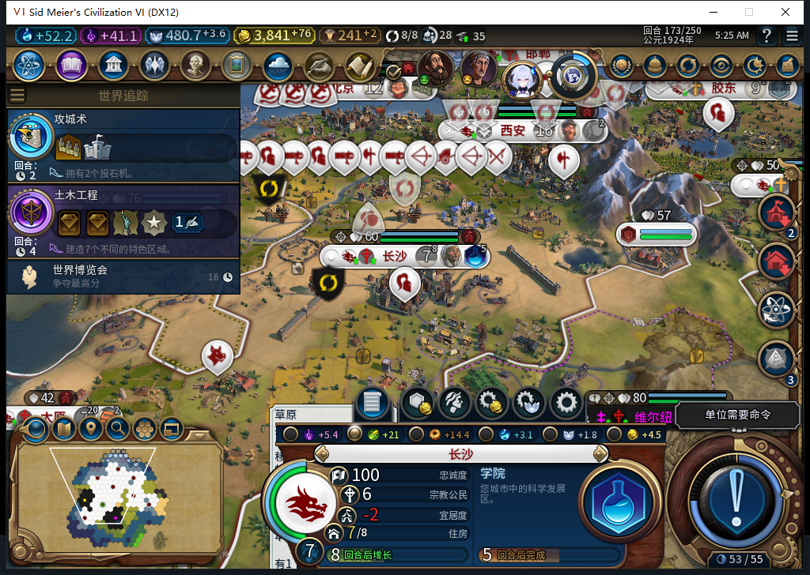
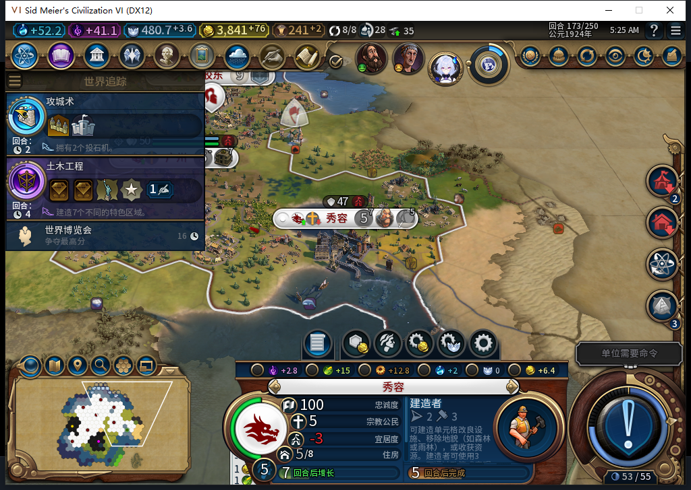
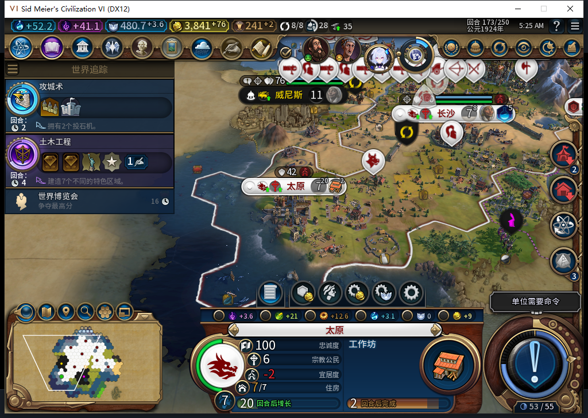

# 97：长沙保住人口后的 20 回合实机观察

2026-11-09，机器 `BF-202609141645`。源码、安装和实机均为 97，产品固定在 `4da78ccc3f3a4f0ed21bc657458dca765da748b4`，GS／无蛮族／白绮玩家 0。此前[同档对照](baiqi-food-focus-native-97.md)中，96 的长沙在第 154 回合由 4 人口饿回 3，97 自动转向粮食后保住了 4 人口。本轮继续沿该 97 分支推进到第 173 回合。

实际完成 153→173 的 20 次换回合，第 154 回合中途有一次已记录的正式保存／加载。本轮不是“同一 UI 上下文连续 20 回合”的观察器实验。153—173 有 21 份队列和城市状态快照，各 168 行；154—173 有 20 份全城食粮快照，共 160 行。所有这些食粮样本都没有饥饿倒计时，净粮食不小于 0；城市状态样本的忠诚度均为 100、每回合变化均大于 0。这是逐回合采样，不能覆盖每个引擎阶段或所有食粮来源。

| 城市 | 第 173 回合实际状态 | 可以据此确认的范围 |
| --- | --- | --- |
| 长沙 `327684@53,30` | 7 人口；粮食 `12.22265625/38`，净粮食 +7；粮食侧重 true；学院 `52/112` | 153 的饥饿风险没有在本窗口再次造成失人口；生产继续。粮食侧重的产能代价仍存在。 |
| 秀容 `524295@62,30` | 5 人口；忠诚 100／每回合 `+2.921875`；工业区已完工，建造者 `24/79` | 提前总督救援后的城市继续生长及生产；并不保证未来忠诚变化始终为正。 |
| 太原 `458758@49,27` | 7 人口；忠诚 100／每回合 +18；工业区已完成，工作坊 `76/97` | 旧版放置、97 继续建设的混合链得到完工事实；不是声称这些区域都在 97 开工。 |
| 广州 `393221@59,32` | 5 人口；粮食 `0.41796875/27`，净粮食 0，无饥饿倒计时 | 当前没有掉人口倒计时，但余粮很薄，不能写成所有城市都有充足粮食。 |

长沙图中底栏显示粮食总产出 +21，这不是净粮食；净值 +7 来自同回合原生读取。玩家只打开城市查看，没有替城市安排工人、改侧重或调整生产。修复刚生效时，产能由 `11.703125` 降至 `8.1015625`，这一取舍没有被删除或包装成免费收益。

秀容的总督 0 仍在任，忠诚正变化已经比早期救援时更薄；宜居度缺口仍可见。新城初次落点的负忠诚负例继续保留，不用后续救援替它追认安全选址。

相对第 153 回合的已完成资产，本窗口多出 17 栋已完成建筑、7 个已完成区域。共有地块的对照还看到 8 处从无改良变为改良：4 处渔船、3 处伐木场、1 处农场；另有 2 处农场被商业中心／水渠替代。学院等仍在建项目不计完工。金币余额由 `2786.32421875` 变为 `3841.171875`，原生总维护由 48 变为 52；这没有补齐本轮七种战略资源的逐回合记录，也不把所有经济变化归因于食粮侧重。

自然训练的移民 `4063259` 在 158 出生，邯郸人口 11→10 的成本已实际出现。其目标先后记录为 `2131@59,28`、`1902@52,25`、`2578@62,34`，173 时在 `61,34`、移动力 0，仍未建城。没有相应完整的发令前警告 trace，不能推断每次改道的具体原因，也不能授本窗口新增建城通过。

本轮测试玩家共发出 29 次无 Reason 的普通 END、92 次原版军队待命，实际换回合 20 次；0 次 `UserForced`、Shift+Enter 或人工文职内政。多出的 9 次 END 都在前次输入终止、读取当前回合与剩余单位后才提交。157／160／163／168／170 的原版使者界面分别保留 20／22／24／26／28 个使者，未分配。罗马、巴西来访及议会由测试玩家操作，不能计为 BACKGROUND 外交。

第 170 回合议会的 4 项免费首票分别为：军事顾问 A／远程、雇佣兵公司 B／金币、外交胜利 A／白绮、赞成世界博览会。确认页总费用为 0，提交和返回游戏各一次。

实际通过的是军事顾问 A／近战、雇佣兵公司 B／生产力，与我方目标不同。外交胜利最终目标本轮未读，保持未知。世界博览会的进行中公告在 173 实际出现；确认关闭后重拍城市图。最初 3 张被公告遮挡的图只留本地，不作为上面的城市成果图。议会导致的军事生产成本变化属于外部游戏效果，不能当成预算或食粮模块的效果。

被动观察器分两段共保存 4629 条：4453 次招募资格检查、35 次城市操作、139 次单位操作、2 次单位命令，错误和丢失均为 0。167 在旧段 3305 条时，单次 Lua 执行内先恢复原绑定、再安装新段，避开 4096 条上限；173 已恢复全部原绑定并撤除命名空间。141 条单位调用均为自有受托文职类型，未捕获军队命令。它只覆盖 Executor 中这些绑定，没有包装 `CityManager.RequestCommand`，粮食侧重命令次数仍未知。两个伟人命令的 void 返回也不单独证明激活效果。

新存档 `Baiqi_P6_20261109_V97_FoodStability173.Civ6Save`：正式 Save ACK true，重复读取大小／哈希稳定，`1666670` 字节，SHA-256 `eab32bcf74a09e52586248c4d37f1de0d2fe45a0582797c0ae6100940e9231c7`。私有存档未入库，本档尚未加载；154 的已完成态存读档验证仍见前文反链。没有 END173。

验收工具也保留了失败：161 等待遇到 size=0/tag=4 协议帧后停止，重新核实进程／端点与实际 162，未重放 END；166 的状态读取仍误限到 160，前置断言拒绝后才修正范围；168 的打开使者界面前置断言拒绝，随后读到尝试标记 nil、原界面隐藏，才走新的原版查看／关闭；当时究竟哪项瞬时条件变化未知。160 较早和稍后经济快照不同，两者都保留，主表采用稍后快照。后续采样等待 2 秒仅为 UI 更新留时间，不是引擎全部结算完成的证明；战略就绪也不保证没有可见公告。

第 168 回合另以既有只读接口核对圣地：8 城均无已完成或已放置圣地，4 城完整 `CanProduce` 为 true，另外 4 城原生原因明确为人口容量限制。市级资格、可见自有格上的 `CanHaveDistrict` 与模组最终放置／保护许可仍是不同检查；没有调用私有排产函数或人工排圣地。结合[162 的公开先知池](baiqi-religion-public-pool-97.md)，宗教链仍待自然正例，不能简单归因为池已耗尽或单一生产评分。

数据：[队列](food97-long153-173-queues.csv)、[世界经济](food97-long153-173-world.csv)、[城市状态](food97-long153-173-vitals.csv)、[食粮](food97-long154-173-growth.csv)、[移民路线](food97-long155-173-route.csv)、[共有地块变化](food97-long153-173-plot-changes.csv)、[后台单位调用](food97-long154-173-background-unit-calls.csv)、[160 两阶段采样](food97-long160-sampling-phase.csv)、[圣地资格](food97-holysite168-eligibility.csv)、[完整结构化记录](../research/baiqi-p6-food97-long173-evidence-2026-11-09.json)。

本包无新 HTTP 或软件方法，复用 97 的 1375 pass／1 SDK 环境 skip 基线，累计模型统计仍为 555。没有产品代码、安装包或公开二进制变更。UNIGNORE 的原生两阶段场景、已侧重仍饥饿、无合法粮食地块、动作未决时冷读、旧 ARMED／LEGACY 恢复、宗教、Base／RF、性能及完整 40 项继续开放。Steam 外机占用期间 0 模式切换、上线、登录、下载、上传器初始化或上传；公开 Alpha.2 仍为内部 82／12 张工坊图。
